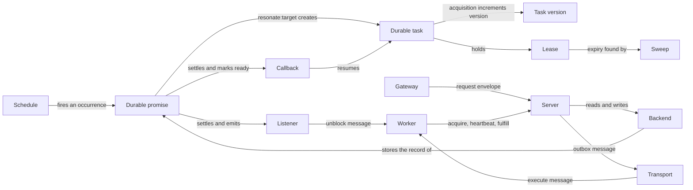
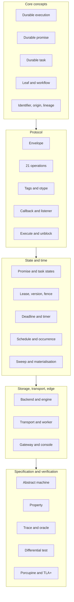
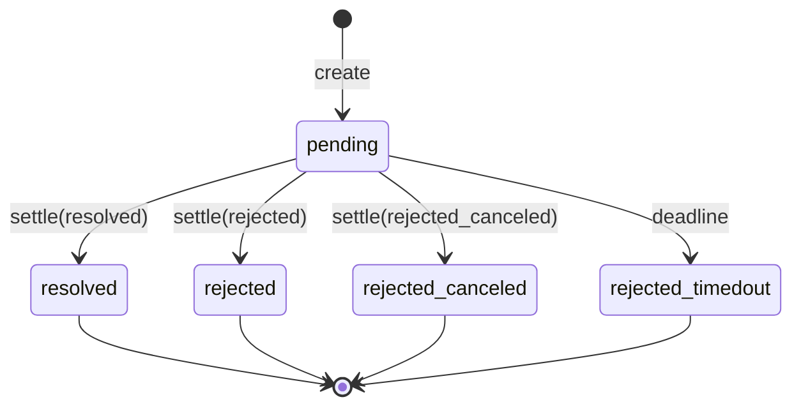
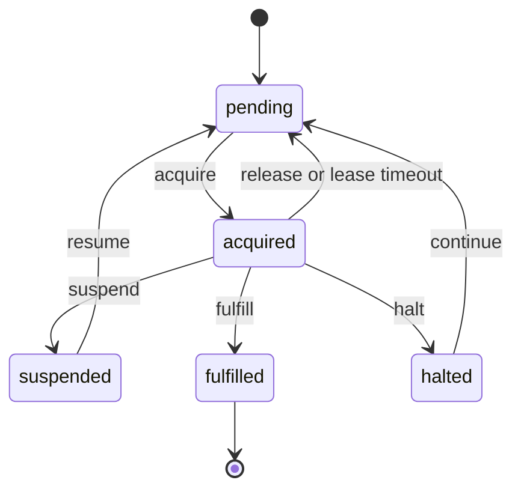

# Glossary: the vocabulary of Resonate

Resonate uses a small vocabulary with precise meanings. Resonate is a durable execution server and client library. Its protocol is the request and response contract between a client and the server. Its specification is an executable model of that contract. Many words are ordinary English words with a special sense. This glossary groups the terms by area. Each entry gives the meaning and, when the term is a code identifier, the source file that defines it. A file name is in the Resonate repository; a path is relative to its root.

The definitions follow ASD-STE100, the Simplified Technical English standard. Every abbreviation is spelled out at first use.

**Aha: the vocabulary is a state model in disguise.** The words that matter most name a position in a lifecycle. Task states are pending, acquired, suspended, halted, and fulfilled. Promise states are pending, resolved, rejected, rejected_canceled, and rejected_timedout. These words are not labels for components. They are the states that the specification proves properties about. A reader who learns them has learned the protocol.

Source: `spec/README.md`, `README.md`

## How the words relate

The arrows name what one term does to another, not a sequence. A lease does not become a sweep. A sweep finds an expired lease. A backend stores the record. The one-row shape applies to the relational backends.

Source: `spec/spec/02-abstract/state.lean`, `spec/spec/02-abstract/external.lean`, `impl/server/core/crates/resonate-core/src/types.rs`

## Terms grouped by area

The arrows show reading order, not a dependency.

Source: `README.md`, `spec/README.md`

## Core concepts

| Term | Meaning | Source |
|------|---------|--------|
| Durable execution | Execution that survives a crash, a network partition, and a restart without separate recovery code | `README.md` |
| Durable promise | A named record with a state, a value, tags, a deadline, and a settle time | `types.lean` |
| Durable function | A function registered with a Software Development Kit (SDK) and invoked under a durable identifier | `examples/async/README.md` |
| Durable task | The executable face of a durable promise. It exists only with a `resonate:target` tag. The tag creates it implicitly; `task.create` is the explicit protocol form | `validation.lean` |
| Leaf | A durable function with no durable operation. Resonate retries a leaf | `examples/async/README.md` |
| Workflow | A durable function with at least one durable operation. Resonate recovers a workflow by replay | `examples/async/README.md` |
| Durable operation | A Software Development Kit (SDK) call that creates a promise and may suspend the task | `async/context.ts` |
| Root | The first promise in a lineage. It has no parent | `ids.ts` |
| Child promise | A promise created below a root by `run`, `rpc`, `promise`, or a timer | `async/context.ts` |
| Latent promise | A promise that no task executes. An external actor settles it. The `resonate:external` tag marks this kind | `async/context.ts` |
| Runnable promise | A promise with a `resonate:target` tag, and therefore a task | `validation.lean` |
| Identifier (ID) | The name of a promise. The promise and its task share it | `types.lean` |
| Origin | Everything before the first `:` in an identifier. It selects the shard of state that holds the record | `ids.ts` |
| Lineage | The `.`-separated segments below an origin, such as `root:1.2`. The colon separates the origin from the lineage. The dot separates levels | `ids.ts` |
| Idempotency | The property that a repeated request gives the same result. A repeated identifier reuses the stored promise | `external.lean` |

Shard, partition, and origin document name the same idea in different backends.

## Protocol terms

The protocol has two envelopes and 21 operations. The protocol version is `2026-04-01`.

Source: `impl/server/core/crates/resonate-core/src/types.rs`

| Term | Meaning | Source |
|------|---------|--------|
| Request envelope | The `{kind, head, data}` object that a client sends. `kind` names the operation, `head` carries identifiers and correlation, and `data` carries the fields | `types.rs` |
| Response envelope | The `{kind, head, data}` object that the server returns. The fields have the same roles | `types.rs` |
| Correlation identifier (`corrId`) | The client value that ties a response to a request | `types.rs` |
| Protocol version | The wire version string. The current value is `2026-04-01` | `types.rs` |
| Promise operations | The six operations `get`, `create`, `settle`, `register_callback`, `register_listener`, and `search` | `external.lean` |
| Task operations | The eleven operations `get`, `create`, `acquire`, `fence`, `heartbeat`, `suspend`, `fulfill`, `release`, `halt`, `continue`, and `search` | `external.lean` |
| Schedule operations | The four operations `get`, `create`, `delete`, and `search` | `external.lean` |
| `promise.settle` | Resolve or reject a pending promise with one of three final states | `external.lean` |
| `task.acquire` | Acquire a pending task with a lease and a new version | `external.lean` |
| `task.fence` | Run a promise operation only if the caller still holds the current task version | `external.lean` |
| `task.heartbeat` | Renew the lease of one or more acquired tasks | `external.lean` |
| `task.suspend` | Register the awaited promises and suspend the task | `external.lean` |
| `task.fulfill` | Settle the promise from an acquired task. It sets the task to `fulfilled` and the promise to `resolved` | `external.lean` |
| `task.release` | Return an acquired task to `pending` voluntarily. A lease timeout is forced, not voluntary | `external.lean` |
| `task.halt` | Stop a task and keep it out of dispatch | `external.lean` |
| `task.continue` | Return a halted task to `pending` for dispatch | `external.lean` |
| Search status | The three search operations return 501 (Not Implemented) in the abstract machine. The real server may return results | `external.lean` |
| Callback | A record that a task waits on a promise. Settlement makes the task ready to resume | `state.lean` |
| Listener | An address that receives an `unblock` message when a promise settles. A listener is not tied to a task | `state.lean` |
| `execute` | The outbound message that offers a task to a worker | `validation.lean` |
| `unblock` | The outbound message that tells a listener a promise settled | `validation.lean` |
| Outbox | The pending `execute` and `unblock` messages. The object-store server stores them under keys; the relational backends send them directly | `sender.zig` |
| Tags | The string map on a promise. Tags carry target, scope, timer, origin, branch, and parent. Branch and parent record the call path | `types.lean` |
| `otype` | The object type derived from the tags: `internal`, `external`, or `runnable`. An external promise is awaitable; an internal one is not | `validation.lean` |
| `resonate:target` | The tag that makes a promise runnable and names its worker address | `validation.lean` |
| `resonate:scope` | The tag that with value `global` makes a promise one that a caller can await | `validation.lean` |
| `resonate:external` | The tag that makes a promise awaitable without a target | `validation.lean` |

## State terms

In the relational backends, a promise and a task are one record with two faces. The promise state and the task state are separate fields on that record. A latent promise has only the promise face.

The task state changes on these operations. Acquire moves `pending` to `acquired`. Suspend moves `acquired` to `suspended`. Resume moves `suspended` to `pending`. Fulfill moves `acquired` to `fulfilled`. Release or a lease timeout moves `acquired` to `pending`. Halt moves `acquired` to `halted`. Continue moves `halted` to `pending`.

Source: `state.lean`, `0001_initial.sql`

| Term | Meaning | Source |
|------|---------|--------|
| Promise state | One of `pending`, `resolved`, `rejected`, `rejected_canceled`, or `rejected_timedout`. A caller cancels a promise into `rejected_canceled` | `types.lean` |
| Task state | One of `pending`, `acquired`, `suspended`, `halted`, or `fulfilled` | `types.lean` |
| Task version | A counter on the task. Acquisition increments it, and every task mutation checks it | `types.lean` |
| Fence | A check that the task version matches before a mutation is allowed | `external.lean` |
| Task lease | The right to execute a task until a deadline | `external.lean` |
| Time to live (TTL) | The lease duration that the worker requests | `external.lean` |
| Settle | Move a pending promise to a final state | `external.lean` |
| Suspend | Register the awaited promises and give up the lease | `external.lean` |
| Resume | An internal check moves a suspended task back to `pending` so that it can replay | `internal.lean` |
| Replay | Re-execution of a workflow from the start. A settled promise returns its stored value instead of running again | `README.md` |
| Materialisation | Persisting the view that a read produced | `state.lean` |
| One-row model | The design that stores a promise and its task in one relational row. The S3 and Neo4j backends use other shapes | `state.lean` |

### Promise state diagram

Source: `types.lean`, `external.lean`

### Task state diagram

Source: `types.lean`, `external.lean`, `internal.lean`

## Time terms

Time is a parameter, not an ambient fact. Every machine handler receives `now`.

Source: `external.lean`, `system.lean`

| Term | Meaning | Source |
|------|---------|--------|
| Clock | The source of `now`. In debug mode the caller owns it | `resonate-base/src/lib.rs` |
| Deadline | A time at which a pending item becomes due. `timeoutAt` is the promise deadline | `types.lean` |
| Timer | A promise with `resonate:timer = true`. It is a durable sleep | `validation.lean` |
| Durable sleep | A wait that holds a stored record, not a process. No worker waits | `core.ts` |
| Schedule | A recurring source of promises with a cron expression | `types.lean` |
| Cron | A time syntax with five fields: minute, hour, day, month, and weekday | `types.lean` |
| Occurrence | One firing of a schedule at a computed time | `internal.lean` |
| `nextRunAt` | The next time a schedule will fire | `types.lean` |
| Sweep | The background pass that finds due deadlines and drives the timeout steps | `internal.lean`, `timerd.rs` |
| Lease timeout | The internal step, driven by the sweep, that returns an expired acquired task to `pending` | `internal.lean` |
| Retry timeout | The internal step that re-dispatches a pending task that nobody claimed | `internal.lean` |
## Storage terms

A backend implements the protocol over one durable medium. The core server is the Rust server library that loads plugins. It loads one server plugin. The one-file server is the compiled Rust binary. Its PostgreSQL mode needs version 16 or later.

Source: `impl/server/core/README.md`, `resonate-base/src/lib.rs`

| Term | Meaning | Source |
|------|---------|--------|
| Backend | The storage implementation that a server plugin wraps | `README.md` |
| Engine | The storage routines inside one backend implementation | `differential.rs` |
| SQLite | An embedded, single-file relational database. It is the default backend | `serve.rs` |
| PostgreSQL | A relational database server. The one-file server needs version 16 or later | `postgres/README.md` |
| Structured Query Language (SQL) | The language of the relational backends and the one-file server | `postgres/README.md` |
| MySQL | A relational database server. It shares the SQL backend shell | `README.md` |
| ScyllaDB | A wide-column store. It uses one partition per origin and lightweight transactions | `scylladb/src/lib.rs` |
| Lightweight transaction (LWT) | A conditional write that ScyllaDB must agree on | `scylladb/src/lib.rs` |
| Neo4j | A graph database. It stores one node per promise and edges for awaits and parentage | `neo4j/README.md` |
| Amazon Simple Storage Service (Amazon S3) | The object store that the Zig server targets. The Zig server has no Transport Layer Security (TLS) or authentication. Put it behind a proxy | `s3/README.md` |
| Blob | A backend over conditional-write object storage. It uses an Amazon S3-compatible store | `blob/README.md` |
| Zig server | The separate server implementation written in Zig that targets Amazon S3 | `s3/README.md` |
| Compare-and-swap (CAS) | A conditional write that succeeds only when the stored value matches an expected value | `blob/README.md` |
| Conditional write | A write with `If-Match` or `If-None-Match` that fails when the precondition is false | `s3/README.md` |
| Origin document | One object that holds every promise and task of one origin | `s3/README.md` |
| Garbage collection (GC) | Deleting settled records that are past the retention horizon | `postgres/resonate.sql` |

## Transport terms

A transport delivers messages between the server and a worker. It is a worker plugin.

Source: `impl/server/core/README.md`, `serve.rs`

| Term | Meaning | Source |
|------|---------|--------|
| Transport | A worker plugin that moves messages between the server and a worker | `README.md` |
| Worker | The code that acquires a task, runs it, and settles it | `README.md` |
| Hypertext Transfer Protocol (HTTP) push | The transport that posts an `execute` message to a worker address. The address schemes are `http` and `https` | `serve.rs` |
| HTTP poll | The transport that holds a connection and streams messages to a worker. The address scheme is `poll` | `serve.rs` |
| Server-Sent Events (SSE) | The one-way stream format that HTTP poll uses | `serve.rs` |
| Google Cloud Publish/Subscribe (Google Cloud Pub/Sub) | The managed message service that the `gcps` (Google Cloud Pub/Sub) transport uses | `serve.rs` |
| Bash worker | The worker that runs a shell command for a task | `serve.rs` |
| At-least-once | The delivery guarantee that a task may be offered more than once | `sender.zig` |

## Gateway and edge terms

A gateway is a plugin at the edge. It owns an HTTP server socket or contributes routes to one. It applies authentication before a request reaches the server.

Source: `impl/server/core/crates/resonate-core/src/gateway.rs`

| Term | Meaning | Source |
|------|---------|--------|
| Gateway | An edge plugin that accepts requests and forwards them to the server | `gateway.rs` |
| HTTP gateway | The gateway that owns the protocol listener on port 8001 by default | `gateway-http/src/lib.rs` |
| Web console | The embedded single-page application (SPA) at `/console` | `gateway-web/src/lib.rs` |
| Metrics gateway | The gateway that serves `/metrics` on port 9090 by default | `gateway-metrics/src/lib.rs` |
| Cross-Origin Resource Sharing (CORS) | The policy that controls which browser origins (scheme, host, and port) may call the gateway | `gateway-http/src/lib.rs` |
| JavaScript Object Notation (JSON) Web Token (JWT) | The signed bearer token that the gateway verifies | `auth/src/lib.rs` |
| WorkOS | The service that validates a client Application Programming Interface (API) key and returns its organization | `auth/src/workos.rs` |
| Readiness probe | `GET /ready`. It returns 200 (OK) or 503 (Service Unavailable) | `gateway-http/src/routes.rs` |
| Console | The read-only views in the web console that read console records | `gateway-web/src/lib.rs` |
| Read model | The three console query kinds `ui.executions.search`, `ui.execution.get`, and `ui.schedules.search` | `ui.rs` |
| `ui.*` namespace | The prefix for all console-only request kinds. The worker route refuses the whole namespace | `gateway-http/src/routes.rs` |
| Read-your-writes | The property that a client sees its own completed write on a later read. There is no session token, so a client cannot pin a read to the server that took the write. The property follows when the read path is linearizable, which the Porcupine check tests on recorded traces | `spec/valid/porc/README.md` |

## Specification and verification terms

The specification is an executable abstract machine. The tools ask whether a real server's behaviour is explained by that machine.

Source: `spec/README.md`

| Term | Meaning | Source |
|------|---------|--------|
| Abstract machine | The executable Lean 4 model with one transition per request | `README.md` |
| Internal step | One of six background steps: promise timeout, callback check, listener check, lease timeout, retry dispatch, and schedule | `internal.lean` |
| Property | A checkable statement about a state or a pair of consecutive states | `properties.lean` |
| Proved | True at every instant of every run, with no bound and no sample | `README.md` |
| Open | Stated with finite evidence and no general proof | `README.md` |
| Lean 4 | The proof assistant that hosts the abstract machine | `README.md` |
| Trace | A recorded sequence of external calls and responses | `valid/README.md` |
| Trace checker | The Lean 4 tool that asks whether any internal schedule explains a trace | `valid/README.md` |
| Newline-Delimited JSON (NDJSON) | The trace format: one JSON object per line | `valid/README.md` |
| Oracle | An executable reference model that produces the expected answer | `differential.rs` |
| Differential test | A test that sends the same requests to several backends and the oracle and compares the results | `differential.rs` |
| Port test | A differential test at the server and router network interfaces rather than the storage interface | `port.rs` |
| Linearizability | The property that a concurrent history is equivalent to some sequential execution | `validation-plan.md` |
| Porcupine | The linearizability checker written in the Go language. It is the second checker after the Lean 4 trace checker | `valid/porc/README.md` |
| Temporal Logic of Actions (TLA+) | The specification language used for the concurrent model | `tlap/README.md` |
| TLA+ model | The model that removes the atomic step and splits each event into phases | `tlap/README.md` |
| Fence in TLA+ | The main TLA+ model, called `Abstract`, deliberately has no fence, so it can show what goes wrong without one | `tlap/README.md` |

## SDK terms

An SDK is a client library for one language. The TypeScript SDK has two engines: a generator engine and an async/await engine.

Source: `impl/sdk/ts/README.md`, `examples/async/README.md`

| Term | Meaning | Source |
|------|---------|--------|
| Generator engine | The engine that uses `function*`, `yield*`, and the methods whose names start with `ctx.begin` | `README.md` |
| Async engine | The engine that uses `async`/`await` and eager operations | `README.md` |
| `Context` | The workflow view, also written `ctx`, that can perform durable operations | `async/context.ts` |
| `DurablePromise` | The SDK handle for a promise. It carries an identifier and a JavaScript Promise for the value | `async/context.ts` |
| `ctx.run` | Create a local child promise and execute the function in the same worker | `async/context.ts` |
| `ctx.rpc` | Create a remote child promise with a target and suspend until it settles | `async/context.ts` |
| `ctx.detached` | Create an independent root promise and return its handle without waiting | `async/context.ts` |
| `ctx.promise` | Create a latent promise that an external actor settles | `async/context.ts` |
| Eager operation | An operation that starts when it is called, before it is awaited | `async/README.md` |
| Retry policies | `Never`, `Constant`, `Linear`, and `Exponential` set the delay before the next retry of a leaf | `retries.ts` |
| Function registry | The map from `(name, version)` to a function implementation | `versioning.ts` |
| Version | The implementation number that the call options record on the promise | `versioning.ts` |

## Operations terms

The operations vocabulary covers the running process: configuration, logging, probing, metrics, and shutdown.

Source: `serve.rs`, `resonate-base/src/lib.rs`

| Term | Meaning | Source |
|------|---------|--------|
| `serve` | The subcommand that starts a server with a durable SQLite file by default | `serve.rs` |
| `--set KEY=VALUE` | The general override for any configuration key | `serve.rs` |
| Precedence | Defaults, then the configuration file, then the environment, then the flags. The later source wins | `serve.rs` |
| Log level | The `tracing` filter: `trace`, `debug`, `info`, `warn`, or `error` | `serve.rs` |
| Shutdown timeout | The milliseconds allowed for the drain. The drain is the wait for in-flight requests. The default is 10,000 | `serve.rs` |
| Prometheus | The metrics system whose text format the gateway serves | `gateway-metrics/src/lib.rs` |
| OpenTelemetry (OTel) | The vendor-neutral trace standard. The repository does not configure an exporter | `README.md` |
| Retention | The policy that decides when a settled record is deleted | `postgres/README.md` |
| `pg_cron` | The PostgreSQL extension that drives all timers in the one-file server | `postgres/README.md` |
| Plugin | A crate that provides a server, worker, gateway, or transport | `README.md` |
| Plugin registry | The set of plugins that a binary registers before it starts | `resonate-base/src/lib.rs` |

## Abbreviations

| Abbreviation | Expansion |
|--------------|-----------|
| API | Application Programming Interface |
| CAS | Compare-And-Swap |
| CLI | Command-Line Interface |
| CORS | Cross-Origin Resource Sharing |
| GC | Garbage Collection |
| HTTP | Hypertext Transfer Protocol |
| ID | Identifier |
| JSON | JavaScript Object Notation |
| JWT | JSON Web Token |
| LWT | Lightweight Transaction |
| NDJSON | Newline-Delimited JSON |
| OTel | OpenTelemetry |
| OTLP | OpenTelemetry Protocol |
| RPC | Remote Procedure Call |
| S3 | Amazon Simple Storage Service |
| SDK | Software Development Kit |
| SPA | Single-Page Application |
| SQL | Structured Query Language |
| SSE | Server-Sent Events |
| TLS | Transport Layer Security |
| TLA+ | Temporal Logic of Actions |
| TTL | Time to Live |
| UI | User Interface |

## Key insight: one record explains most of the vocabulary

The words look like a large system. Most of them describe two faces of one record. A durable promise is the value face. A durable task is the execution face. A lease bounds the execution right. A version fences it. A callback resumes it. A listener notifies an address. A timer is a promise with a timer tag and a deadline. A schedule creates promises. An origin names the partition that holds the record.

Source: `state.lean`, `validation.lean`

That is why the vocabulary is consistent across the layers. The words change with the layer, but the record does not. When a term is unclear, ask which face of the record it names.

## Related documents

- [00-overview.md](00-overview.md) — the thesis and the component map.
- [02-the-protocol.md](02-the-protocol.md) — the 21 operations and the envelopes.
- [03-durable-promises-and-tasks.md](03-durable-promises-and-tasks.md) — the state machines in detail.
- [04-the-formal-specification.md](04-the-formal-specification.md) — the machine, the properties, and the checkers.
- [06-storage-engines.md](06-storage-engines.md) — every backend and its vocabulary.
- [09-the-typescript-sdk.md](09-the-typescript-sdk.md) — the two engines and the context object.
- [14-patterns.md](14-patterns.md) — the patterns in code.
- [15-observability-and-operations.md](15-observability-and-operations.md) — the running process.
- [16-critical-assessment.md](16-critical-assessment.md) — the limits and the open questions.
