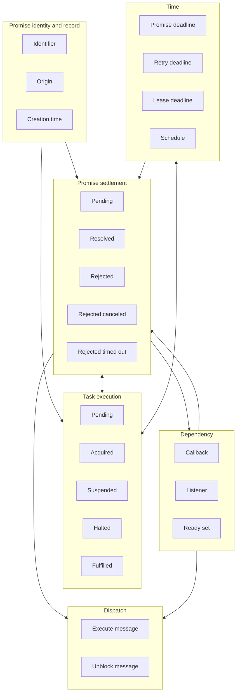
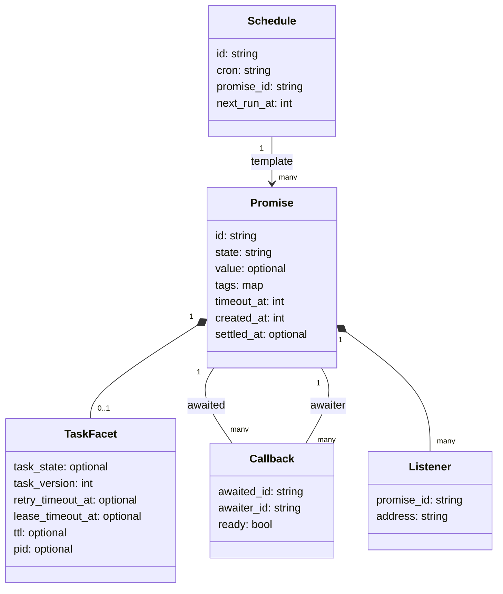
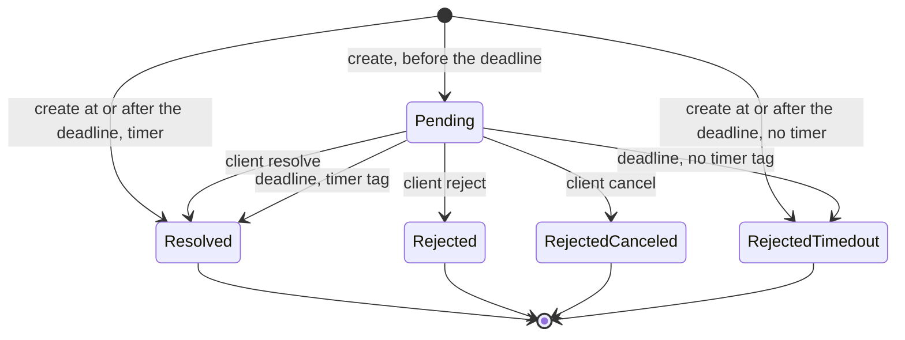
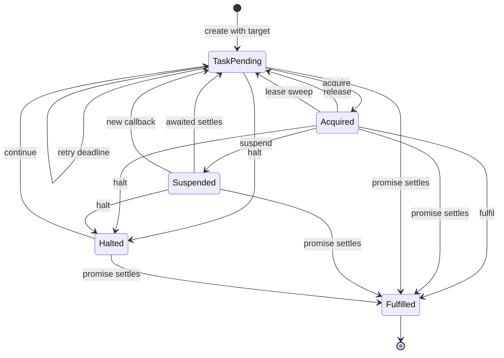
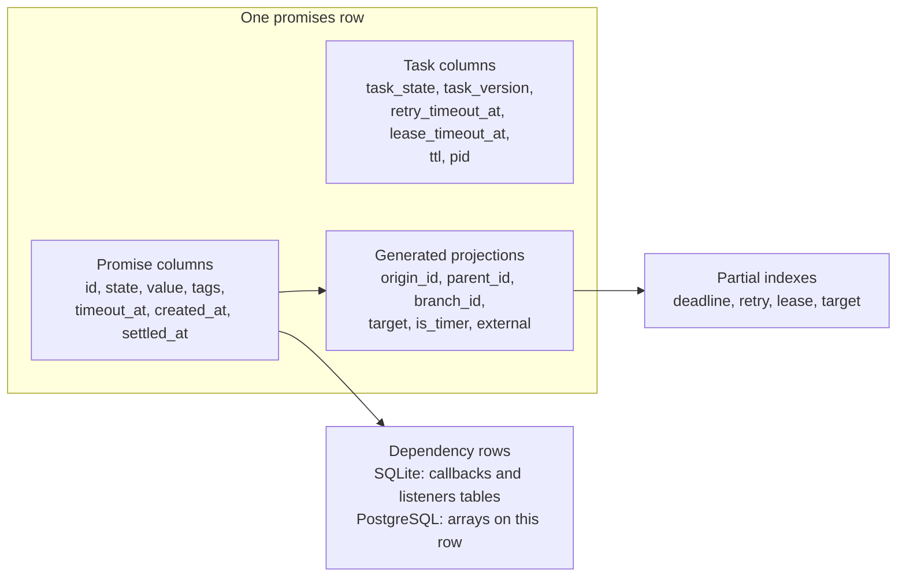
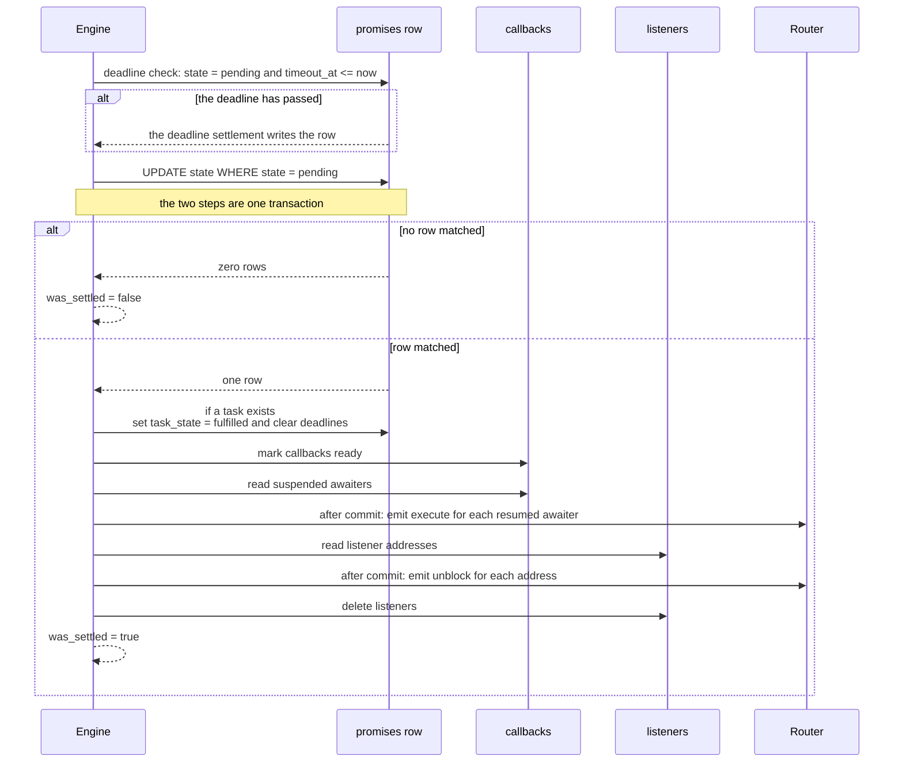
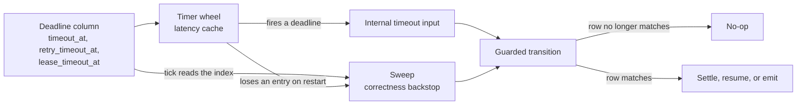

# Laws of durable promises

A durable promise is a future value with a permanent name. Any process that knows the name can read the value or settle it. To *settle* a promise means to end its pending state with a final outcome. The value survives a crash because a database row holds it, not a process.

An *identifier* names a promise. A *tag* is a key and value pair stored on the promise. The tag `resonate:target` names a worker address. A promise with that tag is a *task*: a unit of work that a worker can acquire. The Rust server keeps the promise and its task in one row.

This document states the laws that make that row correct. It shows the Structured Query Language (SQL) schemas for SQLite and PostgreSQL. It shows how each engine applies each transition. It gives a small Python model that runs the laws as tests.

## 1. The source

All paths in this document are relative to the Resonate repository root, `/Users/darkvoid/GitSources/src.resonatehq/resonate`. A path that starts with `impl/` names a file in that repository. The sibling specification repository is `/Users/darkvoid/GitSources/src.resonatehq/durable-promise-specification`.

The local specification repository is `durable-promise-specification`. Its `Readme.md` says the specification is now part of the Distributed Async Await Specification. The canonical text moved to another repository. The local repository is kept for history.

Source: `../durable-promise-specification/Readme.md:3-9`.

The historical `Readme.md` names three promise states: pending, resolved, and rejected. The current Rust server has five. It adds `rejected_canceled` and `rejected_timedout`. The extra states separate a user cancellation from a server deadline. This document uses the five-state model because it describes the server in this repository.

Source: `impl/server/core/crates/resonate-core/src/types.rs:11`.

The historical conformance harness tests the legacy Representational State Transfer (REST) interface. The current server uses a Remote Procedure Call (RPC) envelope. The harness therefore does not test the server in this repository. The current server is held to the model by a differential test against a second implementation called the oracle. Section 12 explains the oracle.

Source: `../durable-promise-specification/Readme.md:35-37`.

## 2. The method

This document uses the same four steps as the [Durable Streams laws document](../../src.electric/markdown/durable-streams/11-laws-entities-and-models.md).

1. **Bounded context.** Split the system into parts that own one meaning.
2. **Entity definition.** Name each thing, each field, and each error.
3. **Law.** Write one sentence that must stay true.
4. **Scenario.** Write the law as a Behavior-Driven Development (BDD) case.

For each verb, ask five questions.

| Question | Example for `settle` |
|----------|----------------------|
| What changes? | The promise state, the settlement time, and the value. |
| What must not change? | The identifier and the creation time. |
| What is the inverse? | No inverse exists. Settlement is final. |
| What happens twice? | The second settlement returns `false` and writes nothing. |
| What if the order changes? | A settle request first applies the deadline. If the deadline has passed, the deadline settlement wins. |

The order answer is the one that surprises most readers. A settle request first applies the deadline. The deadline settlement writes the row and ends the pending state. The client settlement then matches no pending row, so it writes nothing and reports no change. If a sweep already applied the deadline, the request reads an already settled row and also writes nothing.

For each entity, ask three questions.

| Question | Example for `Promise` |
|----------|-----------------------|
| What is conserved? | The identifier and the creation time. |
| What is bounded? | The state set and the deadline. |
| What is linked? | Callbacks, listeners, and the task on the same row. |

## 3. The bounded contexts



An arrow means that the source context supplies the subject or the trigger for the target context. Identity supplies the key to Settlement and to Task execution. Settlement and Task execution read and write the same row, so their arrow is bidirectional. Time supplies a deadline to both. Settlement and Dependency interact in both directions: suspension writes a callback, and settlement releases it. Settlement and Dependency both trigger Dispatch. The arrow does not mean ownership; the table below states ownership.

Six terms are used before Section 4 defines them in full. A *callback* links an awaited promise to the promise that waits on it. A *listener* is an address that asks to receive a settled promise. The *ready set* is the part of the callback set that settlement has released. The *origin* is the identifier text before the first colon. The *branch* is the tag named `resonate:branch`. The *parent* is the tag named `resonate:parent`. The branch and the parent are not parts of the identifier.

| Context | Owns | Does not own |
|---------|------|--------------|
| Identity and record | The identifier, the origin, the creation time | The deadline and the outcome |
| Settlement | The promise state, the value, the settlement time | The worker and the task lease |
| Task execution | The task state, the version, the lease fields | The promise value |
| Dependency | Callbacks, listeners, the ready set | The deadline |
| Time | The three deadlines and the schedule | The transition logic |
| Dispatch | Execute and unblock messages | Delivery, which is best effort |

## 4. The entities

The class diagram shows the fields. It does not show storage. A promise and its task are one row. The three deadlines are columns, not child rows. The callback and listener links are rows in two tables in SQLite and arrays on the same row in PostgreSQL.



The deadline fields are `timeout_at` on the promise, and `retry_timeout_at` and `lease_timeout_at` on the task facet. They are not rows.

| Entity | Meaning | Named outcomes and errors |
|--------|---------|---------------------------|
| `Promise` | A future value with a permanent identifier | `PromiseNotFound` (status 404). A second settlement is an outcome, not an error: it returns `false` and writes nothing. |
| `TaskFacet` | The worker side of the same row | `TaskNotFound` (status 404), `TaskConflict` (the task is not in the state the request requires), `TaskVersionMismatch` (the version does not match) |
| `Callback` | "Resume me when that promise settles" | `NotAwaitable` (the awaited promise is internal; status 422) |
| `Listener` | "Send me the settled promise" | `NotAwaitable` (the promise is not pending, or it is not external; status 422) |
| `Schedule` | A cron rule that creates promises | `ScheduleNotFound` (status 404) |
| `Deadline (fields)` | An armed deadline held in a column | None |

The abbreviations in this document are: BDD (Behavior-Driven Development), CTE (Common Table Expression), JSON (JavaScript Object Notation), JSONB (JavaScript Object Notation, binary form), RPC (Remote Procedure Call), REST (Representational State Transfer), SQL (Structured Query Language), TTL (Time To Live), and URI (Uniform Resource Identifier).

Five entity facts drive every later rule.

- **A promise and its task share one row.** The task is a facet of the promise, not a second entity with its own lifetime.
- **A tag carries the semantics.** `resonate:target` makes a promise runnable. `resonate:timer = "true"` makes the deadline resolve the promise. `resonate:scope = "global"` and `resonate:external = "true"` are alternate ways to make a promise awaitable. The value is a string, not a JSON boolean; the projections compare it with the text `'true'`.
- **A promise is external when one of four conditions holds.** Its scope tag is `global`, its external tag is `"true"`, it has a target, or it is a timer. Only an external promise can have callbacks or listeners. These obligations are the rows that wait on the promise.
- **A callback has two directions.** Every promise row has a `callbacks` array and a `resumes` array. On the row of promise A, `callbacks` holds the identifiers of the promises that are blocked on A. On the row of promise B, `resumes` holds the identifiers of the promises that settled and are ready for B to resume from. Settlement writes across rows: it clears A's own `callbacks`, and it appends A's identifier to the `resumes` array of every awaiter row. SQLite stores one row for each directed pair (awaited, awaiter) in a `callbacks` table with a `ready` flag, so a ready pair is the same row with `ready = true`. The word "me" always means the promise on the row that holds the array.
- **A deadline is data, not a queue row.** `timeout_at`, `retry_timeout_at`, and `lease_timeout_at` are columns. The timer wheel is a cache in front of them. Every create request supplies `timeoutAt`, so `timeout_at` is never absent. There is no timeout tag.

Two more terms are needed for the laws.

- **The wait set** of a task is the set of callbacks where the task is the awaiter. Suspension fills the set. Settlement of any awaited promise marks the matching callbacks ready.
- **A projection** is a generated column. The database computes it from the identifier or the tags. It is not written by the engine.

## 5. The laws

Each law has the prefix DP, for Durable Promise.

### 5.1 Identity and record

**DP-1.** One promise is one row, keyed by the promise identifier.

**DP-2.** A promise with a `resonate:target` tag is a task. A promise without the tag has no task. The row must agree with the tag.

**DP-3.** The origin is the identifier text before the first colon. The protocol does not limit the number of later colons: `parse` keeps them in the suffix. Only the core PostgreSQL deployment adds a constraint that allows at most one colon, and its migration calls that rule this deployment's convention, not a catalogue entry. The branch is a tag named `resonate:branch`, and the parent is a tag named `resonate:parent`. They are not parts of the identifier.

**DP-4.** A settled promise has a settlement time. A pending promise has no settlement time.

**DP-5.** A pending promise has no value.

**DP-6.** A promise created at or after its deadline is settled at creation. A timer resolves; any other promise rejects with `rejected_timedout`. The creation time and the settlement time both equal the deadline. A targeted promise gets a fulfilled task. The row is never pending.

**DP-7.** A pending promise is created before its deadline. Its deadline is therefore strict.

**DP-8.** The settlement time is not after the deadline. A settle request applies the deadline first, so a late request cannot write a late time.

**DP-9.** The settlement time is not before the creation time.

### 5.2 Promise settlement

**DP-10.** The promise states are `pending`, `resolved`, `rejected`, `rejected_canceled`, and `rejected_timedout`.

**DP-11.** A promise starts pending. A client can settle it to `resolved`, `rejected`, or `rejected_canceled`. The server alone produces `rejected_timedout`. No settled state returns to pending.

**DP-12.** Settlement is final. A second settlement does not change the state, the value, or the time. It returns `false`. It is not an error.

**DP-13.** A deadline settlement has a settlement time equal to the deadline.

**DP-14.** A deadline settlement has no value.

**DP-15.** A timer promise resolves at its deadline. An external non-timer promise rejects with `rejected_timedout` at its deadline. An internal promise has no armed deadline; it is applied lazily when a request names it.

**DP-16.** Only the server produces `rejected_timedout`. The settle-state type has three values: `resolved`, `rejected`, and `rejected_canceled`. A request that names `rejected_timedout` fails validation with status 400.

**DP-17.** A timer promise is not a task. It has no target.

**DP-18.** A settled promise that is also a task has a fulfilled task. The rule holds when the task was pending, acquired, suspended, or halted.

### 5.3 Task execution

**DP-19.** The task states are `pending`, `acquired`, `suspended`, `halted`, and `fulfilled`.

**DP-20.** A task exists if and only if the promise has a target.

**DP-21.** A fulfilled task's promise is settled.

**DP-22.** An acquired task has a process identifier, a lease deadline, and a TTL.

**DP-23.** A pending task has a retry deadline. The server arms it at creation with the creation time plus the task retry interval, and creation also emits one execute message for the task. The interval is one server setting named `task_retry_timeout`. The SQLite and PostgreSQL plugins both default to 30,000 milliseconds. A pending task has no lease deadline, TTL, or process identifier.

**DP-24.** A suspended task, a halted task, and a fulfilled task have no retry deadline, lease deadline, TTL, or process identifier.

**DP-25.** Acquire is a guarded transition. It requires the task to be pending and the version to match. It increments the version. The new version is positive.

**DP-26.** Release moves an acquired task to pending, arms a retry deadline at the request time plus the task retry interval, and emits an execute message. It does not restore the old lease deadline.

**DP-27.** Fulfil moves an acquired task to fulfilled and settles its promise.

**DP-28.** Suspend moves an acquired task to suspended only when every awaited promise exists, is external, and is pending. The request must name at least one awaited promise, and the names must be unique.

**DP-29.** A missing await, a non-awaitable await, or a settled await prevents suspension.

**DP-30.** A suspended task is on neither deadline queue and has no ready callback. Only a settled awaited promise or a new callback can resume it.

**DP-31.** Only an external promise can have obligations. An obligation is a callback or a listener.

**DP-32.** A promise is external when one of four conditions holds: its scope tag is `global`, its external tag is `"true"`, it has a target, or it is a timer.

**DP-33.** A callback is the pair (awaited promise, awaiter promise) plus a ready flag.

**DP-34.** A callback is written only when both promises are pending and the awaiter has a target. The test is on the promise state, not the task state. An acquired task still has a pending promise.

**DP-35.** A callback registered on a settled promise never blocks. If the awaiter is suspended, the server returns it to pending with a retry deadline and emits an execute message. If the awaiter is pending or acquired, the server writes one ready callback, and the next acquire consumes it. If the awaiter is halted or fulfilled, nothing changes. An *immediate resume* is this whole outcome: the server does not write a blocked callback, and a suspended awaiter does not stay suspended.

**DP-36.** Settlement marks every callback on the settled promise ready. It resumes each suspended awaiter and emits an execute message for it.

**DP-37.** Acquiring a task deletes its ready callbacks. A resumed task consumes the readiness once.

**DP-38.** Each listener receives one unblock message that carries the settled promise. The server then deletes the listeners.

**DP-39.** A listener is accepted only for a pending external promise. The caller refuses any other request with status 422 and writes nothing.

**DP-40.** A promise cannot await itself. A suspend request also rejects a duplicate awaited name. The request validator refuses both with status 400 before an engine sees the request. PostgreSQL adds the constraint `well_formed_promise_awaiter_is_not_self` as a second defence.

### 5.4 Time and dispatch

**DP-41.** The timer wheel is a latency cache. It holds the near future of one process. The deadline sweep is the correctness backstop.

**DP-42.** A timeout input applies only to a promise that is still pending and whose deadline has passed. A promise that settled early, or whose deadline has not passed, changes nothing.

**DP-43.** One process call applies its durable state change, its messages, and its armed timeouts together. Delivery happens after the commit and is best effort.

**DP-44.** An internal input is idempotent and narrow. It carries one timeout. It does not carry a new intent.

**DP-45.** The timeouts in an output are the deadlines the step just armed. The step does not report the deadlines it disarmed; the row no longer holds them.

**DP-46.** A schedule creates a promise at each due time and advances its next run time. The promise identifier is a template with `{{.id}}` and `{{.timestamp}}`.

**DP-47.** A pending promise whose deadline has passed reads as resolved for a timer, or `rejected_timedout` for a non-timer. The read uses the deadline as the settlement time, even before a sweep writes it down.

**DP-48.** Halt stops dispatch without settling the promise. It clears every task deadline. The promise deadline stays in place, so the promise can still time out. A halt request does nothing to a fulfilled or halted task.

**DP-49.** Continue returns a halted task to pending with a new retry deadline and emits an execute message. Halt is therefore not terminal.

**DP-50.** A listener address must have valid URI syntax. PostgreSQL rejects a malformed address with the constraint `consistent_listener_addresses_deliverable`. SQLite has no such constraint and does not validate the address. The law covers syntax only; no engine proves that the address is reachable.

**DP-51.** The lease sweep returns an acquired task to pending when its lease deadline has passed. It clears the lease, TTL, and process identifier, arms a retry deadline, and emits an execute message. It does not change the task version.

**DP-52.** A task version is a fence. A request that changes a task must present the current version. The lease sweep does not increment the version, so a worker that still holds the lease can fulfil a task whose lease deadline passed but whose sweep has not run. A worker whose task returned to pending fails the state check. A worker whose task another worker re-acquired fails the version check.

**DP-53.** An execute message repeats until a task leaves the pending state, because the retry deadline re-emits it. An unblock message does not repeat, because the transaction deletes the listeners that produced it. The two message kinds therefore have different recovery.

## 6. The promise state machine



The self-loop of a second settlement is not drawn. A second settlement is not a transition. It returns `false` and the row does not change. DP-12 states this.

A create at or after the deadline never enters the pending state. It enters the resolved state or the rejected-timed-out state directly (DP-6).

| From | Trigger | To | Value | Settlement time |
|------|---------|----|-------|-----------------|
| Pending | Client resolve, before the deadline | Resolved | As given; it may be empty | Request time |
| Pending | Client reject, before the deadline | Rejected | As given; it may be empty | Request time |
| Pending | Client cancel, before the deadline | RejectedCanceled | As given; it may be empty | Request time |
| Pending | Client settle, at or after the deadline | The deadline outcome | Absent | Deadline |
| Pending | Deadline, no timer tag | RejectedTimedout | Absent | Deadline |
| Pending | Deadline, timer tag | Resolved | Absent | Deadline |

**Why the deadline has two outcomes.** A timer is a promise that measures time. Its resolution means "the time arrived". A normal promise that reaches its deadline means "the work did not finish". The same clock event therefore has two meanings. The `is_timer` projection selects the meaning.

**Why a late client settlement cannot win.** The server applies the deadline before it applies the client request. The deadline settlement writes the row. The client settlement then matches no pending row and returns `false`. This is how DP-8 holds without a special case for late requests.

Source: `impl/server/core/crates/resonate-server-sqlite/src/lib.rs:429-467`, `:2598-2614`.

## 7. The task state machine



| Transition | Guard | Side effects |
|------------|-------|--------------|
| Pending to Acquired | Version matches | Clear retry, set lease, TTL, process identifier, increment version |
| Acquired to Pending | Release: version matches | Clear lease, arm retry, emit execute |
| Acquired to Pending | Lease sweep: the lease deadline has passed | Clear lease, TTL, and process identifier, arm retry, emit execute, keep the version |
| Acquired to Suspended | Version matches, at least one await, all awaits pending and external | Clear all task deadlines, write callbacks |
| Acquired to Fulfilled | Version matches | Clear all task deadlines, settle the promise |
| Pending, acquired, suspended, or halted to Fulfilled | The promise settles | Clear all task deadlines |
| Pending, acquired, or suspended to Halted | The task exists and is not fulfilled or halted | Clear all task deadlines |
| Halted to Pending | The task is halted | Arm retry, emit execute |
| Suspended to Pending | An awaited promise settles, or a callback is registered | Clear lease, arm retry, emit execute |

**How the version fence works.** The version advances only on acquire. The lease sweep returns an expired task to pending without a version change. The guard therefore has two parts: `task_state = 'acquired'` and the version. A worker whose lease expired but whose sweep has not run still matches both parts. That worker may finish the task. A worker whose task returned to pending fails the state check. A worker whose task another worker re-acquired fails the version check.

**Why halt is reversible.** Halt is an operator action, not an outcome. It stops dispatch and clears the deadlines. Continue puts the task back on the retry queue. The promise stays pending through both actions.

Source: `impl/server/core/crates/resonate-server-sqlite/src/lib.rs:2983-3029`, `:3154-3245`, `:3247-3295`, `:3297-3326`, `:3328-3375`.

## 8. The one-row anatomy



An arrow means "supplies data to". P and T supply the row. G derives from both. Q indexes G. D is keyed by promise identifiers and is not part of the row in SQLite. A dependency names the promise, not the task; a task is linkable only because it is also a promise.

The SQLite form stores callbacks and listeners in separate tables. The PostgreSQL form stores them in arrays on the same row. Both forms obey the same laws. The difference is the cost model, not the meaning.

| Data | SQLite | PostgreSQL |
|------|--------|------------|
| Promise fields | Columns | Columns |
| Task fields | Columns on the same row | Columns on the same row |
| Projections | Generated columns | Generated columns |
| Callbacks, blocked | `callbacks` table, `ready = false` | `callbacks` array |
| Callbacks, ready | `callbacks` table, `ready = true` | `resumes` array |
| Listeners | `listeners` table | `listeners` array |
| Schedules | `schedules` table | `schedules` table |
| Messages | Returned by the transition | Returned by the transition |

The PostgreSQL row also has `task_key`, a projection that equals the identifier for a task and is null otherwise. Section 11.1 explains why it exists.

## 9. Settlement in time



The durable state change and the message list come from one transaction. Every step from the first check to the listener DELETE is inside that transaction. The two Router arrows are after the commit. A message is not durable.

Delivery is best effort. A failed route is logged and the attempt is lost. The two message kinds have different recovery.

- **An execute message repeats.** The task stays pending with a retry deadline, and the retry sweep emits a new execute message.
- **An unblock message does not repeat.** The listeners are deleted in the same step. A lost unblock is lost. The old design made the same choice: its pump read one outbox row, deleted the row, and then delivered the message. A crash after the delete lost that message. The current design removes the table and keeps the trade.

Source: `impl/server/core/crates/resonate-sql/src/server.rs:171-246`.

## 10. The SQLite implementation

SQLite is a single file. The engine holds one connection behind a mutual exclusion lock (mutex). Every transition is a short sequence of statements on that connection.

The SQLite schema declares no CHECK constraint. The engine's guarded statements hold the laws. The PostgreSQL schema states many of the same laws as CHECK constraints. The two schemas therefore enforce the laws in different places. Section 12 explains the differential test that compares them.

### 10.1 The tables

```sql
CREATE TABLE promises (
  id TEXT PRIMARY KEY,
  state TEXT NOT NULL DEFAULT 'pending',
  param_headers TEXT, param_data TEXT,
  value_headers TEXT, value_data TEXT,
  tags TEXT NOT NULL DEFAULT '{}',
  target TEXT GENERATED ALWAYS AS (json_extract(tags, '$.resonate:target')) STORED,
  origin_id TEXT GENERATED ALWAYS AS (
    CASE WHEN instr(id, ':') > 0 THEN substr(id, 1, instr(id, ':') - 1) ELSE id END) STORED,
  parent_id TEXT GENERATED ALWAYS AS (json_extract(tags, '$.resonate:parent')) STORED,
  branch_id TEXT GENERATED ALWAYS AS (json_extract(tags, '$.resonate:branch')) STORED,
  is_timer BOOLEAN NOT NULL GENERATED ALWAYS AS (
    COALESCE(json_extract(tags, '$.resonate:timer'), '') = 'true') STORED,
  external BOOLEAN NOT NULL GENERATED ALWAYS AS (
    COALESCE(json_extract(tags, '$.resonate:scope'), '') = 'global'
    OR COALESCE(json_extract(tags, '$.resonate:external'), '') = 'true'
    OR json_extract(tags, '$.resonate:target') IS NOT NULL
    OR COALESCE(json_extract(tags, '$.resonate:timer'), '') = 'true') STORED,
  timeout_at BIGINT NOT NULL,
  created_at BIGINT NOT NULL,
  settled_at BIGINT,
  task_state TEXT,
  task_version INT NOT NULL DEFAULT 0,
  retry_timeout_at BIGINT,
  lease_timeout_at BIGINT,
  ttl BIGINT,
  pid TEXT
);
```

Source: `impl/server/core/crates/resonate-server-sqlite/migrations/0001_initial.sql:14-58`.

The three dependency and schedule tables are:

```sql
CREATE TABLE callbacks (
  awaited_id TEXT NOT NULL REFERENCES promises(id) ON DELETE CASCADE,
  awaiter_id TEXT NOT NULL REFERENCES promises(id) ON DELETE CASCADE,
  ready BOOLEAN NOT NULL DEFAULT false,
  PRIMARY KEY (awaited_id, awaiter_id)
);

CREATE TABLE listeners (
  promise_id TEXT NOT NULL REFERENCES promises(id) ON DELETE CASCADE,
  address TEXT NOT NULL,
  PRIMARY KEY (promise_id, address)
);

CREATE TABLE schedules (
  id TEXT PRIMARY KEY,
  cron TEXT NOT NULL,
  promise_id TEXT NOT NULL,
  promise_timeout BIGINT NOT NULL,
  promise_param_headers TEXT,
  promise_param_data TEXT,
  promise_tags TEXT NOT NULL DEFAULT '{}',
  created_at BIGINT NOT NULL,
  next_run_at BIGINT NOT NULL,
  last_run_at BIGINT
);
```

Source: `impl/server/core/crates/resonate-server-sqlite/migrations/0001_initial.sql:70-100`.

There is no outbox. An outbox is a table that holds messages until a delivery process reads them. The old design had one and a pump that drained it. The current design returns the messages from the transition instead. There is no `promise_timeouts` table. A pending external promise past `timeout_at` is the queue, and a partial index covers it.

### 10.2 The indexes

| Index | Predicate | Job |
|-------|-----------|-----|
| `idx_promises_timeout_at` | `state = 'pending' AND external` | The eager deadline sweep |
| `idx_promises_target` | `target IS NOT NULL` | Find tasks |
| `idx_promises_branch_id` | `branch_id IS NOT NULL` | Branch queries |
| `idx_promises_retry_timeout_at` | `retry_timeout_at IS NOT NULL` | The retry sweep |
| `idx_promises_lease_timeout_at` | `lease_timeout_at IS NOT NULL` | The lease sweep |
| `idx_promises_pid` | `pid IS NOT NULL` | Find tasks by worker |
| `idx_callbacks_awaiter_id` | None | Find what one task waits on |
| `idx_callbacks_ready` | `ready = true`, indexed on `awaiter_id` | Find ready work |

Source: `impl/server/core/crates/resonate-server-sqlite/migrations/0001_initial.sql:59-68`, `:76-77`.

### 10.3 The three sweeps

The engine has three sweeps. Each one reads a partial index and applies a guarded update.

| Sweep | Query predicate | Action |
|-------|-----------------|--------|
| Promise deadline | `state = 'pending' AND external AND timeout_at <= now` | Settle the promise. A timer resolves; a non-timer rejects timed out. |
| Retry | `task_state = 'pending' AND retry_timeout_at <= now` | Move the retry deadline forward and emit execute. |
| Lease | `task_state = 'acquired' AND lease_timeout_at <= now` | Return the task to pending with a retry deadline and emit execute. |

The promise sweep selects only external promises. An internal promise is not in the index. It expires lazily on the two paths that can observe it. A settle request applies the deadline before the request (DP-8). A read projects the expired state (DP-47). The projection is `PromiseRecord::project(now)`, and every operation that returns a record calls it. A task request cannot name an internal promise, because a task requires a target and a target makes the promise external.

Source: `impl/server/core/crates/resonate-server-sqlite/src/lib.rs:3868-3975`.

### 10.4 How each transition runs

| Transition | Statement shape | Edge case it handles |
|------------|-----------------|----------------------|
| Create | `INSERT OR IGNORE`, then one task update; a settled state when the deadline has passed | A create at or after the deadline inserts a settled row, creates a fulfilled task, and arms no deadline (DP-6). A live create arms the retry deadline and emits one execute message (DP-23). |
| Settle | The deadline check, then `UPDATE ... WHERE id = ? AND state = 'pending'` | A second settle matches zero rows and returns `false` |
| Register callback | Conditional insert; direct resume when the awaited is settled | A late callback does not block forever |
| Register listener | Insert only when the promise is pending and external | The caller refuses any other request with status 422 and writes nothing |
| Acquire | `UPDATE ... WHERE id = ? AND task_version = ? AND task_state = 'pending'` | A stale worker cannot acquire |
| Suspend | Count missing, non-awaitable, and settled awaits first | A suspend with a settled external await is an immediate resume: the task stays acquired and no message is sent. A settled internal await is not awaitable and fails the check. |
| Fulfil | Guarded update, then settle | A stale fulfil matches zero rows |
| Release | `UPDATE ... WHERE id = ? AND task_version = ? AND task_state = 'acquired'` | A stale release cannot return the task |
| Halt | `UPDATE ... WHERE task_state NOT IN ('fulfilled', 'halted')` | A fulfilled task is not halted |
| Continue | `UPDATE ... WHERE task_state = 'halted'` | A task that is not halted is not continued |
| Deadline check | `SELECT ... WHERE id IN (...) AND state = 'pending' AND timeout_at <= ?` | An early or stale timeout matches zero rows |

Source: `impl/server/core/crates/resonate-server-sqlite/src/lib.rs:2672-2734`, `:2736-2757`, `:2761-2841`, `:2983-3029`, `:3154-3326`, `:3328-3375`, `:2598-2658`.

The SQLite engine does not re-check the callback arrays after a transition. A "second callback check" is the extra statement that PostgreSQL runs after a transition to look for a callback another transaction committed during the statement. One SQLite connection behind a mutex means no other transaction can commit between the read and the write, so the check is unnecessary. PostgreSQL and MySQL must run it because their transactions can see different snapshots.

Source: `impl/server/core/crates/resonate-server-sqlite/src/lib.rs:2586-2596`.

## 11. The PostgreSQL implementation

PostgreSQL serves many clients at once. The engine therefore uses two techniques: one transaction for each transition, built from common table expressions (CTEs), and a row lock for settlement.

### 11.1 The table

The PostgreSQL `promises` table has the same promise and task columns. It adds three array columns and four unused message columns.

| Column group | Columns | Why it differs from SQLite |
|--------------|---------|----------------------------|
| Promise | `id`, `state`, `param_headers`, `param_data`, `value_headers`, `value_data`, `tags`, `timeout_at`, `created_at`, `settled_at` | Headers and tags are JSONB, a binary JSON type |
| Projection | `origin_id`, `parent_id`, `branch_id`, `target`, `is_timer`, `external`, `task_key` | Same meaning, JSONB operators |
| Task | `task_state`, `task_version`, `retry_timeout_at`, `lease_timeout_at`, `ttl`, `pid` | Same |
| Dependencies | `callbacks TEXT[]`, `resumes TEXT[]`, `listeners TEXT[]` | Arrays replace two tables |
| Unconsumed | `pmessage`, `tmessage`, `func`, `args` | Declared, not read |

Source: `impl/server/core/crates/resonate-server-postgres/migrations/0001_initial.sql:56-127`.

`task_key` is a generated column. It equals `id` when the row has a `resonate:target` tag, and it is null otherwise. The old outbox table needed a foreign key to "the promises that are tasks", which is a partial set. A foreign key must name a unique key. A unique index over a nullable column allows any number of null rows, so `task_key` gives one key for a task and no key for a non-task. The outbox is gone. The unique constraint `promises_task_key_unique` on `task_key` remains as the one place that uses the column.

### 11.2 The constraints are the laws

The PostgreSQL schema states many laws as constraints. A violation reports the constraint name, and that name is the same string the specification uses.

| Constraint | Law | Meaning |
|------------|-----|---------|
| `consistent_task_iff_targeted_promise` | DP-2, DP-20 | A task exists exactly when a target exists |
| `consistent_settled_promise_has_fulfilled_task` | DP-18 | A settled promise with a task has a fulfilled task |
| `consistent_settled_task_promise_settled` | DP-21 | A fulfilled task's promise is settled |
| `well_formed_promise_created_at_lte_timeout_at` | DP-6, DP-7 | The stored creation time is not after the deadline |
| `well_formed_promise_pending_created_before_deadline` | DP-7 | A pending promise is created before the deadline |
| `well_formed_promise_settled_at_lte_timeout_at` | DP-8 | Settlement is not after the deadline |
| `well_formed_promise_created_at_lte_settled_at` | DP-9 | Settlement is not before creation |
| `well_formed_promise_settled_at_iff_not_pending` | DP-4 | A settled promise has a settlement time |
| `well_formed_promise_pending_has_no_value` | DP-5 | A pending promise has no value |
| `well_formed_promise_deadline_verdict_matches_timer_tag` | DP-15 | The deadline outcome matches the timer tag |
| `well_formed_promise_deadline_settlement_has_no_value` | DP-14 | A deadline settlement has no value |
| `well_formed_promise_timedout_is_server_owned` | DP-13 | A `rejected_timedout` promise uses the deadline as its settlement time |
| `well_formed_promise_timer_not_targeted` | DP-17 | A timer has no target |
| `well_formed_promise_obligations_require_external` | DP-31 | Only an external promise has obligations |
| `well_formed_promise_awaiter_is_not_self` | DP-40 | A promise is not in its own callback list |
| `well_formed_task_acquired_iff_has_pid` | DP-22 | An acquired task has a process identifier |
| `well_formed_task_acquired_iff_has_ttl` | DP-22 | An acquired task has a TTL |
| `well_formed_task_acquired_iff_has_lease_timeout_at` | DP-22 | An acquired task has a lease deadline |
| `well_formed_task_pending_iff_has_retry_timeout_at` | DP-23 | A pending task has a retry deadline |
| `well_formed_task_fulfilled_is_cleared` | DP-24 | A fulfilled task has no deadlines |
| `well_formed_task_suspended_is_cleared` | DP-24 | A suspended task has no deadlines |
| `well_formed_task_halted_is_cleared` | DP-24 | A halted task has no deadlines |
| `well_formed_task_suspended_has_no_resumes` | DP-30 | A suspended task has no ready set |
| `well_formed_task_acquired_version_positive` | DP-25 | An acquired task has a positive version |
| `consistent_listener_addresses_deliverable` | DP-50 | Every listener address is a valid URI |
| `well_formed_promise_id_at_most_one_separator` | DP-3 | The core PostgreSQL deployment allows at most one colon; the migration calls this a deployment convention, not a protocol rule |

Source: `impl/server/core/crates/resonate-server-postgres/migrations/0001_initial.sql:228-416`.

The table is a subset of the laws, not the whole set. Rules that need a comparison with `now`, a cross-row check, or a message side effect stay in the engine. The PostgreSQL constraints catch a wrong row that an engine bug would write. They do not replace the guards.

### 11.3 How each transition runs

PostgreSQL uses one transaction per transition. A transition can run more than one statement inside that transaction.

| Transition | Shape |
|------------|-------|
| Create | One CTE: insert with `ON CONFLICT (id) DO NOTHING`, then branches for the new row and the existing row, then a union that returns the row and the emitted execute message |
| Settle | A lock preamble `SELECT id ... FOR UPDATE`, then CTEs that update the row, cascade the task, resume awaiters, and unblock listeners |
| Acquire | One guarded `UPDATE ... WHERE task_version = ? AND task_state = 'pending'` |
| Suspend | A read of all awaited promises, then one update with the callback array changes |
| Fulfil | A guarded task update, then the settlement CTE |
| Release | A guarded update that returns the task to pending and arms a retry deadline at the request time plus the task retry interval |

Source: `impl/server/core/crates/resonate-server-postgres/src/lib.rs:2952-3013`, `:3015-3082`, `:3357-3409`, `:3617-3708`, `:3710-3797`, `:3799-3842`.

Two edge cases need special handling in PostgreSQL.

1. **A concurrent create.** `ON CONFLICT DO NOTHING` makes the second insert a no-op. The statement then returns the existing row. The result matches the SQLite `INSERT OR IGNORE` behaviour.
2. **A snapshot race.** A CTE can read a snapshot that does not include a callback committed after the statement began. The engine runs the second callback check: after the write, it re-reads the promise row and its callback arrays, so it sees work another transaction committed. If the re-read finds a callback that the transition did not handle, it returns `StorageError::Serialization`. The caller retries the whole transition. A retry is safe because every state change is guarded.

Source: `impl/server/core/crates/resonate-server-postgres/src/lib.rs:244-260`, `:2952-3041`.

The MySQL engine is the third SQL engine. It applies the same laws in its own dialect. This document does not show its schema.

## 12. Why there are three engines and one oracle

Resonate has three independent SQL engines: SQLite, PostgreSQL, and MySQL. Each one is a separate plugin crate, and each applies the transitions in its own SQL dialect. The `resonate-sql` crate holds only what they share: the engine contract, the storage error, the parameter and record structures, and the migration runner. There is no shared engine over a storage trait.

The reason is performance. A shared trait forces the slowest common shape on every database. PostgreSQL loses its single-round-trip CTE. Each engine can use the feature that its database does best.

Correctness comes from a differential test against a model called the oracle. The oracle uses ordered maps and ordered sets, so its output order is deterministic. Every engine receives the same input sequence and the same logical time value `now`, and must produce the same output. The test supplies `now`; it does not synchronize wall-clock time. A difference is a bug in one of them.

Source: `impl/server/core/crates/resonate-sql/src/lib.rs:1-11`.

The engine interface has four methods and three contract properties.

```rust
#[async_trait]
pub trait Engine: Send + Sync {
    async fn process(&self, input: Input<'_>, now: i64) -> Output;
    async fn tick(&self, now: i64) -> StorageResult<(usize, Vec<Outgoing>, Vec<Scheduled>)>;
    async fn upcoming(&self, limit: usize) -> StorageResult<Vec<Scheduled>>;
    fn returns_messages(&self) -> bool {
        false
    }
}
```

Source: `impl/server/core/crates/resonate-sql/src/engine.rs:190-230`.

The types in that signature are:

- `Input<'a>` is either `External(&RequestEnvelope)`, a request from outside, or `Internal(Timeout)`, the system asking something of itself (`engine.rs:141-147`).
- `Output` has three fields: `response: Option<ResponseEnvelope>`, `messages: Vec<Outgoing>`, and `timeouts: Vec<Scheduled>` (`engine.rs:163-172`).
- `StorageError` has three values: `Backend(String)` for a driver failure, `Serialization` for a retryable conflict, and `InvalidInput(String)` for a value that violates a storage constraint (`resonate-sql/src/lib.rs:95-105`).
- `StorageResult<T>` is `Result<T, StorageError>` (`resonate-sql/src/lib.rs:92`).
- `Outgoing` is either `Execute { address, task_id, version }` or `Unblock { address, promise }` (`engine.rs:36-45`).
- `Timeout` is one of `PromiseTimeout`, `TaskRetryTimeout`, `TaskLeaseTimeout`, or `ScheduleDue` (`engine.rs:80-89`).
- `Scheduled` is one deadline and the time it comes due: `{ at: i64, timeout: Timeout }` (`engine.rs:135-138`).
- The `usize` in the `tick` result is the count of deadlines that fired.

`process` has no `StorageResult` in its signature, so it reports an error in the `Output`. An external request gets an error `ResponseEnvelope` with a status code inside `output.response`. An internal input has `response: None`, and a storage failure there is a bug that the engine must not hide. `tick` and `upcoming` return `StorageResult` because they have no response envelope to carry the error.

The four methods are:

- `process` applies one input and returns the new messages and the deadlines to arm.
- `tick` fires every deadline that is now due. It returns the number of fired deadlines, the messages, and the deadlines it armed.
- `upcoming` returns the nearest deadlines in durable state. The timer calls it after a restart to fill itself.
- `returns_messages` says whether the engine returns the messages it emitted. The SQL engines all return `true`. The default is `false` for an engine that queues its messages instead. The differential test reads the method to know which output shape to compare.

The three contract properties are:

1. **`process` is atomic over durable state.** The state change, the messages, and the armed timeouts belong to one transaction.
2. **`Input::Internal` is idempotent and narrow.** It carries one timeout. It does not carry a new intent.
3. **`timeouts` reports arming.** It does not report disarming. A fired timeout that no longer applies does nothing.

Source: `impl/server/core/crates/resonate-sql/src/engine.rs:1-12`, `:195-218`.

## 13. The timer wheel and the sweeps



The timer wheel answers "what is due soon?" It is a cache. It can lose entries on a restart. It can fire a timeout early. Neither event breaks correctness.

The sweep answers "what is due now?" It reads the partial index over the deadline columns. It is the backstop. There are three sweeps, one for each deadline column. Section 10.3 gives their queries.

The guarded update makes both paths safe. If the wheel fires a timeout for a promise that settled one millisecond earlier, the deadline check finds no pending row. The engine does nothing. If the wheel fires early, the same check rejects the timeout input, because the deadline is still in the future; the promise does not change.

Source: `impl/server/core/crates/resonate-sql/src/deadlines.rs:1-118`, `impl/server/core/crates/resonate-server-sqlite/src/lib.rs:2598-2658`.

## 14. The working model

The model below runs with Python 3 and no third-party package. It is a teaching model. It keeps one record per promise in a dictionary. The real server keeps one row in SQL.

The model implements the laws for identity, settlement, tasks, dependencies, halt, and dispatch. It does not model the timer wheel (DP-41), the transaction boundary (DP-43), the arming report (DP-45), schedules (DP-46), or message recovery (DP-53). Section 15 lists the scenario coverage in the same way.

The model takes two shortcuts. It uses a retry interval of 1,000 milliseconds; both SQL servers default to 30,000 milliseconds. It keeps the deadlines that each operation armed in one growing `armed` list, not in a per-operation return value. The list is a log for the reader; law DP-45 describes the per-step output that the real engine returns.

```python
"""A small executable model of the durable promise laws.

This model teaches the rules. It is not the Rust server.
The Rust server keeps one promise and its task in one SQL row.
This model keeps one record in a dictionary.
"""

from __future__ import annotations

from dataclasses import dataclass, field
from typing import Any, Optional


PENDING = "pending"
RESOLVED = "resolved"
REJECTED = "rejected"
CANCELED = "rejected_canceled"
TIMEDOUT = "rejected_timedout"

TASK_PENDING = "pending"
TASK_ACQUIRED = "acquired"
TASK_SUSPENDED = "suspended"
TASK_HALTED = "halted"
TASK_FULFILLED = "fulfilled"

PROMISE_STATES = {PENDING, RESOLVED, REJECTED, CANCELED, TIMEDOUT}
TASK_STATES = {TASK_PENDING, TASK_ACQUIRED, TASK_SUSPENDED, TASK_HALTED, TASK_FULFILLED}
CLIENT_SETTLE_STATES = {RESOLVED, REJECTED, CANCELED}


class PromiseError(Exception):
    code = "PROMISE_ERROR"

    def __init__(self, message: str, **details: Any) -> None:
        super().__init__(message)
        self.details = details


class PromiseNotFound(PromiseError):
    code = "PROMISE_NOT_FOUND"


class TaskNotFound(PromiseError):
    code = "TASK_NOT_FOUND"


class TaskConflict(PromiseError):
    code = "TASK_CONFLICT"


class NotAwaitable(PromiseError):
    code = "NOT_AWAITABLE"


class TimerCannotBeTargeted(PromiseError):
    code = "TIMER_CANNOT_BE_TARGETED"


@dataclass
class Promise:
    id: str
    timeout_at: int
    created_at: int
    state: str = PENDING
    settled_at: Optional[int] = None
    value: Optional[str] = None
    tags: dict[str, str] = field(default_factory=dict)
    target: Optional[str] = None
    task_state: Optional[str] = None
    task_version: int = 0
    retry_timeout_at: Optional[int] = None
    lease_timeout_at: Optional[int] = None
    ttl: Optional[int] = None
    pid: Optional[str] = None
    is_timer: bool = False

    @property
    def external(self) -> bool:
        return (
            self.tags.get("resonate:scope") == "global"
            or self.tags.get("resonate:external") == "true"
            or self.target is not None
            or self.is_timer
        )

    @property
    def origin(self) -> str:
        return self.id.split(":", 1)[0]


class Store:
    """One row per promise, with its task on the same row."""

    def __init__(self, retry_ms: int = 1_000) -> None:
        self.rows: dict[str, Promise] = {}
        self.callbacks: set[tuple[str, str]] = set()   # (awaited, awaiter)
        self.ready: set[tuple[str, str]] = set()       # (awaited, awaiter)
        self.listeners: dict[str, set[str]] = {}       # promise -> addresses
        self.messages: list[tuple[Any, ...]] = []
        self.armed: list[tuple[str, str, int]] = []    # a log of armed deadlines
        self.retry_ms = retry_ms

    # -- create -------------------------------------------------------------

    def create(
        self,
        promise_id: str,
        timeout_at: int,
        *,
        target: Optional[str] = None,
        tags: Optional[dict[str, str]] = None,
        is_timer: bool = False,
        now: int = 0,
    ) -> Promise:
        existing = self.rows.get(promise_id)
        if existing is not None:
            return existing

        # The tags are authoritative (DP-2, DP-17). A keyword argument is
        # shorthand: it writes the tag, and the tag then decides the meaning.
        row_tags = dict(tags or {})
        if target is not None:
            row_tags.setdefault("resonate:target", target)
        if is_timer:
            row_tags.setdefault("resonate:timer", "true")
        target = row_tags.get("resonate:target")
        is_timer = row_tags.get("resonate:timer") == "true"
        if is_timer and target is not None:
            raise TimerCannotBeTargeted(promise_id)

        # Law DP-6: a promise created at or after its deadline is settled at once.
        if now >= timeout_at:
            state = RESOLVED if is_timer else TIMEDOUT
            row = Promise(
                id=promise_id,
                timeout_at=timeout_at,
                created_at=timeout_at,
                state=state,
                settled_at=timeout_at,
                target=target,
                tags=row_tags,
                is_timer=is_timer,
                task_state=TASK_FULFILLED if target is not None else None,
            )
            self.rows[promise_id] = row
            return row

        row = Promise(
            id=promise_id,
            timeout_at=timeout_at,
            created_at=now,
            target=target,
            tags=row_tags,
            is_timer=is_timer,
            task_state=TASK_PENDING if target is not None else None,
        )

        # Law DP-23: a pending task starts with a retry deadline.
        if row.task_state == TASK_PENDING and row.target is not None:
            row.retry_timeout_at = now + self.retry_ms

        self.rows[promise_id] = row

        if row.external and row.state == PENDING:
            self.armed.append(("promise", promise_id, timeout_at))
        if row.task_state == TASK_PENDING and row.target is not None:
            self.armed.append(("retry", promise_id, row.retry_timeout_at))
            self.messages.append(("execute", row.target, promise_id, row.task_version))
        return row

    # -- promise settlement -------------------------------------------------

    def settle(
        self,
        promise_id: str,
        state: str,
        *,
        value: Optional[str] = None,
        now: int,
    ) -> bool:
        # Law DP-11: a client settles only to resolved, rejected, or canceled.
        if state not in CLIENT_SETTLE_STATES:
            raise PromiseError(f"a client cannot settle to {state}")
        row = self._require_promise(promise_id)

        # Law DP-8: the deadline is applied before the client request.
        if row.state == PENDING and row.timeout_at <= now:
            self._deadline(row)
            return False

        if row.state != PENDING:
            return False

        row.state = state
        row.settled_at = now
        row.value = value
        self._settle_effects(row, now)
        return True

    def _settle_effects(self, row: Promise, now: int) -> None:
        # Law DP-18: a settled promise that is also a task has a fulfilled task.
        if row.task_state is not None and row.task_state != TASK_FULFILLED:
            row.task_state = TASK_FULFILLED
            self._clear_task_deadlines(row)
            self._drop_callbacks_as_awaiter(row.id)

        # Law DP-36: callbacks on this promise become ready.
        for awaited, awaiter in list(self.callbacks):
            if awaited != row.id:
                continue
            self.ready.add((awaited, awaiter))
            other = self.rows.get(awaiter)
            if other is not None and other.task_state == TASK_SUSPENDED:
                other.task_state = TASK_PENDING
                other.retry_timeout_at = now + self.retry_ms
                other.lease_timeout_at = None
                other.ttl = None
                other.pid = None
                self.armed.append(("retry", other.id, other.retry_timeout_at))
                self.messages.append(("execute", other.target, other.id, other.task_version))

        # Law DP-38: each listener receives one unblock.
        for address in self.listeners.pop(row.id, set()):
            self.messages.append(("unblock", address, row.id))

    # -- dependency ---------------------------------------------------------

    def register_callback(self, awaited_id: str, awaiter_id: str, *, now: int) -> None:
        awaited = self.rows.get(awaited_id)
        awaiter = self.rows.get(awaiter_id)
        if awaited is None:
            return
        if not awaited.external:
            raise NotAwaitable(awaited_id)
        if awaiter_id == awaited_id:
            raise PromiseError("an awaiter is not itself")

        # Law DP-34: both promises pending, and the awaiter has a target.
        if (
            awaited.state == PENDING
            and awaiter is not None
            and awaiter.state == PENDING
            and awaiter.target is not None
        ):
            self.callbacks.add((awaited_id, awaiter_id))

        # Law DP-35: a settled awaited resumes the awaiter immediately.
        if awaited.state != PENDING and awaiter is not None:
            if awaiter.task_state == TASK_SUSPENDED:
                awaiter.task_state = TASK_PENDING
                awaiter.retry_timeout_at = now + self.retry_ms
                awaiter.lease_timeout_at = None
                awaiter.ttl = None
                awaiter.pid = None
                self.armed.append(("retry", awaiter.id, awaiter.retry_timeout_at))
                self.messages.append(("execute", awaiter.target, awaiter.id, awaiter.task_version))
            if awaiter.task_state in (TASK_PENDING, TASK_ACQUIRED):
                self.ready.add((awaited_id, awaiter_id))

    def register_listener(self, promise_id: str, address: str) -> None:
        row = self.rows.get(promise_id)
        if row is None or row.state != PENDING or not row.external:
            raise NotAwaitable(promise_id)
        self.listeners.setdefault(promise_id, set()).add(address)

    # -- task ---------------------------------------------------------------

    def acquire(
        self,
        task_id: str,
        version: int,
        pid: str,
        ttl: int,
        *,
        now: int,
    ) -> bool:
        row = self._require_task(task_id)
        if row.task_state != TASK_PENDING or row.task_version != version:
            return False
        row.task_state = TASK_ACQUIRED
        row.task_version += 1
        row.retry_timeout_at = None
        row.lease_timeout_at = now + ttl
        row.ttl = ttl
        row.pid = pid
        self._delete_ready(task_id)
        self.armed.append(("lease", task_id, row.lease_timeout_at))
        return True

    def suspend(self, task_id: str, version: int, awaited_ids: list[str]) -> str:
        # Law DP-28: the request must name at least one await.
        if not awaited_ids:
            raise PromiseError("a suspend must name at least one awaited promise")
        if len(set(awaited_ids)) != len(awaited_ids):
            raise PromiseError("awaited names must be unique")
        if task_id in awaited_ids:
            raise PromiseError("a task cannot await itself")

        row = self.rows.get(task_id)
        if row is None or row.task_state != TASK_ACQUIRED or row.task_version != version:
            return "no_match"

        missing = 0
        not_awaitable = 0
        settled = False
        for awaited_id in awaited_ids:
            other = self.rows.get(awaited_id)
            if other is None:
                missing += 1
                continue
            if not other.external:
                not_awaitable += 1
            if other.state != PENDING:
                settled = True

        if missing == 0 and not_awaitable == 0 and not settled:
            self._delete_ready(task_id)
            for awaited_id in awaited_ids:
                self.callbacks.add((awaited_id, task_id))
            row.task_state = TASK_SUSPENDED
            self._clear_task_deadlines(row)
            return "suspended"

        if missing == 0 and not_awaitable == 0:
            self._delete_ready(task_id)
            return "immediate_resume"

        return f"missing={missing},not_awaitable={not_awaitable}"

    def fulfill(
        self,
        task_id: str,
        version: int,
        state: str,
        *,
        value: Optional[str] = None,
        now: int,
    ) -> bool:
        # Law DP-16: validate the state before any row changes.
        if state not in CLIENT_SETTLE_STATES:
            raise PromiseError(f"a client cannot settle to {state}")
        row = self.rows.get(task_id)
        if row is None or row.task_state != TASK_ACQUIRED or row.task_version != version:
            return False
        row.task_state = TASK_FULFILLED
        self._clear_task_deadlines(row)
        # Law DP-8: a settlement after the deadline is discarded, but the task
        # is fulfilled because the promise is settled either way.
        self.settle(task_id, state, value=value, now=now)
        self._drop_callbacks_as_awaiter(task_id)
        return True

    def release(self, task_id: str, version: int, *, now: int) -> bool:
        row = self.rows.get(task_id)
        if row is None or row.task_state != TASK_ACQUIRED or row.task_version != version:
            return False
        row.task_state = TASK_PENDING
        row.retry_timeout_at = now + self.retry_ms
        row.lease_timeout_at = None
        row.ttl = None
        row.pid = None
        self.armed.append(("retry", task_id, row.retry_timeout_at))
        self.messages.append(("execute", row.target, task_id, row.task_version))
        return True

    # -- control ------------------------------------------------------------

    def halt(self, task_id: str) -> bool:
        # Law DP-48: halt stops dispatch but does not settle the promise.
        row = self.rows.get(task_id)
        if row is None or row.task_state not in (
            TASK_PENDING,
            TASK_ACQUIRED,
            TASK_SUSPENDED,
        ):
            return False
        row.task_state = TASK_HALTED
        self._clear_task_deadlines(row)
        return True

    def continue_task(self, task_id: str, *, now: int) -> bool:
        # Law DP-49: continue returns a halted task to the retry queue.
        row = self.rows.get(task_id)
        if row is None or row.task_state != TASK_HALTED:
            return False
        row.task_state = TASK_PENDING
        row.retry_timeout_at = now + self.retry_ms
        self.armed.append(("retry", task_id, row.retry_timeout_at))
        self.messages.append(("execute", row.target, task_id, row.task_version))
        return True

    # -- time ---------------------------------------------------------------

    def tick(self, now: int) -> None:
        for row in list(self.rows.values()):
            if row.state == PENDING and row.external and row.timeout_at <= now:
                self._deadline(row)
        for row in list(self.rows.values()):
            if row.task_state == TASK_PENDING and row.retry_timeout_at is not None:
                if row.retry_timeout_at <= now:
                    row.retry_timeout_at = now + self.retry_ms
                    self.armed.append(("retry", row.id, row.retry_timeout_at))
                    self.messages.append(("execute", row.target, row.id, row.task_version))
            if row.task_state == TASK_ACQUIRED and row.lease_timeout_at is not None:
                if row.lease_timeout_at <= now:
                    row.task_state = TASK_PENDING
                    row.retry_timeout_at = now + self.retry_ms
                    row.lease_timeout_at = None
                    row.ttl = None
                    row.pid = None
                    self.armed.append(("retry", row.id, row.retry_timeout_at))
                    self.messages.append(("execute", row.target, row.id, row.task_version))

    def _deadline(self, row: Promise) -> None:
        state = RESOLVED if row.is_timer else TIMEDOUT
        row.state = state
        row.settled_at = row.timeout_at
        row.value = None
        self._settle_effects(row, row.timeout_at)

    # -- helpers ------------------------------------------------------------

    def _require_promise(self, promise_id: str) -> Promise:
        row = self.rows.get(promise_id)
        if row is None:
            raise PromiseNotFound(promise_id)
        return row

    def _require_task(self, task_id: str) -> Promise:
        row = self.rows.get(task_id)
        if row is None or row.task_state is None:
            raise TaskNotFound(task_id)
        return row

    def _delete_ready(self, awaiter_id: str) -> None:
        self.ready = {pair for pair in self.ready if pair[1] != awaiter_id}

    def _drop_callbacks_as_awaiter(self, awaiter_id: str) -> None:
        self.callbacks = {pair for pair in self.callbacks if pair[1] != awaiter_id}
        self._delete_ready(awaiter_id)

    @staticmethod
    def _clear_task_deadlines(row: Promise) -> None:
        row.retry_timeout_at = None
        row.lease_timeout_at = None
        row.ttl = None
        row.pid = None
```

One difference from the real server is deliberate. The model raises `NotAwaitable` from `register_callback` and `register_listener`. The real server returns that refusal as status 422 to the caller. The law is the same.

## 15. The BDD specification

The runner is a decorator and a loop. The decorator `scenario` adds a name and a function to a list. The loop `run` gives each function a fresh store and records an assertion failure.

```python
SCENARIOS: list[tuple[str, Any]] = []


def scenario(name: str) -> Any:
    def register(fn: Any) -> Any:
        SCENARIOS.append((name, fn))
        return fn

    return register


def run() -> None:
    failures = 0
    for name, fn in SCENARIOS:
        store = Store()
        try:
            fn(store)
            print(f"PASS  {name}")
        except AssertionError as error:
            failures += 1
            print(f"FAIL  {name}: {error}")
    print(f"\n{len(SCENARIOS) - failures} passed, {failures} failed")
```

These are the scenarios. The suite covers identity, the deadline, every task transition, callbacks, listeners, and halt. It does not test DP-3 (origin), DP-9 (settlement time before creation), DP-17 (a timer has no target), DP-30 (a suspended task has no ready callback), DP-37 (acquire deletes ready callbacks), DP-39 (a listener on a settled promise is refused), DP-44 (internal input), DP-45 (arming report), DP-46 (schedules), DP-50 (uniform resource identifier syntax), DP-51 (lease sweep), DP-52 (the re-acquire fence), or DP-53 (message recovery). Sections 10 to 13 state those laws against the SQL engines.

```python
@scenario("Create twice returns the same row")
def _create_idempotent(store: Store) -> None:
    first = store.create("p1", timeout_at=100)
    second = store.create("p1", timeout_at=999)
    assert first is second
    assert second.timeout_at == 100


@scenario("A second settlement is a no-op")
def _settle_twice(store: Store) -> None:
    store.create("p1", timeout_at=100)
    assert store.settle("p1", RESOLVED, value="one", now=10) is True
    assert store.settle("p1", REJECTED, value="two", now=20) is False
    assert store.rows["p1"].value == "one"
    assert store.rows["p1"].settled_at == 10


@scenario("Settling a task promise fulfils the task")
def _settle_task(store: Store) -> None:
    row = store.create("p1", timeout_at=100, target="worker")
    store.settle("p1", RESOLVED, value="done", now=10)
    assert row.task_state == TASK_FULFILLED
    assert row.pid is None and row.ttl is None


@scenario("A timer promise resolves at its deadline")
def _timer_deadline(store: Store) -> None:
    row = store.create("t1", timeout_at=50, is_timer=True)
    store.tick(50)
    assert row.state == RESOLVED
    assert row.settled_at == 50
    assert row.value is None


@scenario("A non-timer promise rejects timed out at its deadline")
def _deadline_reject(store: Store) -> None:
    row = store.create("p1", timeout_at=50, tags={"resonate:scope": "global"})
    store.tick(50)
    assert row.state == TIMEDOUT
    assert row.settled_at == 50


@scenario("A settle request after the deadline does not change the outcome")
def _late_settle(store: Store) -> None:
    row = store.create("p1", timeout_at=50, tags={"resonate:scope": "global"})
    assert store.settle("p1", RESOLVED, value="late", now=60) is False
    assert row.state == TIMEDOUT
    assert row.settled_at == 50
    assert row.value is None


@scenario("Acquire increments the version and clears the retry deadline")
def _acquire(store: Store) -> None:
    row = store.create("p1", timeout_at=100, target="worker")
    assert store.acquire("p1", version=0, pid="w1", ttl=30, now=10) is True
    assert row.task_state == TASK_ACQUIRED
    assert row.task_version == 1
    assert row.retry_timeout_at is None
    assert row.lease_timeout_at == 40
    assert (row.pid, row.ttl) == ("w1", 30)


@scenario("Acquire with a stale version fails")
def _acquire_stale(store: Store) -> None:
    store.create("p1", timeout_at=100, target="worker")
    store.acquire("p1", version=0, pid="w1", ttl=30, now=10)
    assert store.acquire("p1", version=0, pid="w2", ttl=30, now=11) is False


@scenario("Release returns the task to pending with a retry deadline")
def _release(store: Store) -> None:
    row = store.create("p1", timeout_at=1000, target="worker")
    store.acquire("p1", version=0, pid="w1", ttl=30, now=10)
    assert store.release("p1", version=1, now=20) is True
    assert row.task_state == TASK_PENDING
    assert row.retry_timeout_at == 20 + store.retry_ms
    assert ("execute", "worker", "p1", 1) in store.messages


@scenario("Fulfil settles the promise and rejects a second fulfil")
def _fulfill(store: Store) -> None:
    row = store.create("p1", timeout_at=1000, target="worker")
    store.acquire("p1", version=0, pid="w1", ttl=30, now=10)
    assert store.fulfill("p1", 1, RESOLVED, value="ok", now=20) is True
    assert row.state == RESOLVED
    assert row.value == "ok"
    assert store.fulfill("p1", 1, RESOLVED, value="again", now=30) is False


@scenario("Suspend with a settled await does not suspend")
def _suspend_settled(store: Store) -> None:
    store.create("a1", timeout_at=100, tags={"resonate:scope": "global"})
    store.settle("a1", RESOLVED, value="x", now=5)
    store.create("p1", timeout_at=100, target="worker")
    store.acquire("p1", version=0, pid="w1", ttl=30, now=10)
    result = store.suspend("p1", 1, ["a1"])
    assert result == "immediate_resume"
    assert store.rows["p1"].task_state == TASK_ACQUIRED


@scenario("Suspend with a non-external await fails")
def _suspend_not_awaitable(store: Store) -> None:
    store.create("a1", timeout_at=100)
    store.create("p1", timeout_at=100, target="worker")
    store.acquire("p1", version=0, pid="w1", ttl=30, now=10)
    result = store.suspend("p1", 1, ["a1"])
    assert result == "missing=0,not_awaitable=1"
    assert store.rows["p1"].task_state == TASK_ACQUIRED


@scenario("A suspend must name at least one await")
def _suspend_empty(store: Store) -> None:
    store.create("p1", timeout_at=100, target="worker")
    store.acquire("p1", version=0, pid="w1", ttl=30, now=10)
    try:
        store.suspend("p1", 1, [])
    except PromiseError:
        pass
    else:
        raise AssertionError("expected PromiseError")


@scenario("A suspend cannot await itself")
def _suspend_self(store: Store) -> None:
    store.create("p1", timeout_at=100, target="worker")
    store.acquire("p1", version=0, pid="w1", ttl=30, now=10)
    try:
        store.suspend("p1", 1, ["p1"])
    except PromiseError:
        pass
    else:
        raise AssertionError("expected PromiseError")
    assert store.rows["p1"].task_state == TASK_ACQUIRED


@scenario("A client cannot settle to rejected_timedout")
def _client_cannot_timeout(store: Store) -> None:
    store.create("p1", timeout_at=100, tags={"resonate:scope": "global"})
    try:
        store.settle("p1", TIMEDOUT, now=10)
    except PromiseError:
        pass
    else:
        raise AssertionError("expected PromiseError")
    assert store.rows["p1"].state == PENDING


@scenario("A promise created at its deadline is settled")
def _create_at_deadline(store: Store) -> None:
    row = store.create("p1", timeout_at=50, tags={"resonate:scope": "global"}, now=60)
    assert row.state == TIMEDOUT
    assert row.created_at == 50
    assert row.settled_at == 50
    assert ("promise", "p1", 50) not in store.armed
    task = store.create("p2", timeout_at=50, target="worker", now=60)
    assert task.state == TIMEDOUT
    assert task.task_state == TASK_FULFILLED
    assert not any(message[0] == "execute" for message in store.messages)


@scenario("Settling resumes a suspended awaiter")
def _resume(store: Store) -> None:
    store.create("a1", timeout_at=100, tags={"resonate:scope": "global"})
    store.create("p1", timeout_at=100, target="worker")
    store.acquire("p1", version=0, pid="w1", ttl=30, now=10)
    assert store.suspend("p1", 1, ["a1"]) == "suspended"
    store.messages.clear()
    store.settle("a1", RESOLVED, value="x", now=20)
    row = store.rows["p1"]
    assert row.task_state == TASK_PENDING
    assert ("execute", "worker", "p1", 1) in store.messages


@scenario("A listener receives one unblock and is cleared")
def _listener(store: Store) -> None:
    store.create("p1", timeout_at=100, tags={"resonate:scope": "global"})
    store.register_listener("p1", "address-1")
    store.settle("p1", RESOLVED, value="x", now=10)
    assert store.messages.count(("unblock", "address-1", "p1")) == 1
    assert "p1" not in store.listeners


@scenario("A callback on a settled promise resumes a suspended awaiter")
def _late_callback(store: Store) -> None:
    store.create("a1", timeout_at=100, tags={"resonate:scope": "global"})
    store.create("a2", timeout_at=100, tags={"resonate:scope": "global"})
    store.create("p1", timeout_at=100, target="worker")
    store.acquire("p1", version=0, pid="w1", ttl=30, now=10)
    store.suspend("p1", 1, ["a1"])
    store.settle("a2", RESOLVED, value="x", now=15)
    store.register_callback("a2", "p1", now=20)
    assert store.rows["p1"].task_state == TASK_PENDING
    assert ("a2", "p1") in store.ready


@scenario("A promise with no target has no task")
def _no_task(store: Store) -> None:
    row = store.create("p1", timeout_at=100, tags={"resonate:scope": "global"})
    assert row.task_state is None
    assert row.external is True


@scenario("Halt clears dispatch and continue restores it")
def _halt_continue(store: Store) -> None:
    row = store.create("p1", timeout_at=1000, target="worker")
    store.acquire("p1", version=0, pid="w1", ttl=30, now=10)
    assert store.halt("p1") is True
    assert row.task_state == TASK_HALTED
    assert row.lease_timeout_at is None
    store.messages.clear()
    assert store.continue_task("p1", now=30) is True
    assert row.task_state == TASK_PENDING
    assert row.retry_timeout_at == 1030
    assert ("execute", "worker", "p1", 1) in store.messages


@scenario("Settling a halted task fulfils it")
def _settle_halted(store: Store) -> None:
    row = store.create("p1", timeout_at=1000, target="worker")
    store.acquire("p1", version=0, pid="w1", ttl=30, now=10)
    store.halt("p1")
    store.settle("p1", RESOLVED, value="done", now=20)
    assert row.task_state == TASK_FULFILLED
    assert row.state == RESOLVED
```

The output is:

```text
PASS  Create twice returns the same row
PASS  A second settlement is a no-op
PASS  Settling a task promise fulfils the task
PASS  A timer promise resolves at its deadline
PASS  A non-timer promise rejects timed out at its deadline
PASS  A settle request after the deadline does not change the outcome
PASS  Acquire increments the version and clears the retry deadline
PASS  Acquire with a stale version fails
PASS  Release returns the task to pending with a retry deadline
PASS  Fulfil settles the promise and rejects a second fulfil
PASS  Suspend with a settled await does not suspend
PASS  Suspend with a non-external await fails
PASS  A suspend must name at least one await
PASS  A suspend cannot await itself
PASS  A client cannot settle to rejected_timedout
PASS  A promise created at its deadline is settled
PASS  Settling resumes a suspended awaiter
PASS  A listener receives one unblock and is cleared
PASS  A callback on a settled promise resumes a suspended awaiter
PASS  A promise with no target has no task
PASS  Halt clears dispatch and continue restores it
PASS  Settling a halted task fulfils it

22 passed, 0 failed
```

## 16. Edge cases and the answer

| Edge case | Law | What the SQL server does (SQLite and PostgreSQL) |
|-----------|-----|----------------------|
| Two callers create the same identifier | DP-1 | The second insert is ignored. Both callers get the first record. |
| A caller settles a settled promise | DP-12 | The guarded update matches no row. The result is `false`. |
| A caller settles after the deadline | DP-8 | The deadline settlement writes the row. The client settlement writes nothing, and its value and request time are discarded. |
| A caller settles with `rejected_timedout` | DP-16 | Validation fails with status 400. The settle-state type has three values. |
| A pending external promise passes its deadline | DP-15, DP-47 | The sweep settles it. A timer resolves. A normal promise rejects timed out. |
| A pending internal promise passes its deadline | DP-15, DP-47 | No sweep selects it. A settle request that names it applies the deadline. A read projects the expired state without writing. |
| The timer wheel fires early | DP-41, DP-42 | The deadline check rejects the timeout input because the deadline is in the future. The promise does not change. |
| The timer wheel fires late or loses an entry | DP-41 | The sweep reads the deadline index and settles every due row. |
| A worker acquires with an old version | DP-25 | The guarded update matches no row. The request returns status 409 with `Version mismatch`. |
| A worker loses its lease | DP-51, DP-52 | The lease sweep returns the task to pending and emits execute. It does not change the version. |
| A slow worker fulfils before the lease sweep | DP-27, DP-52 | The version still matches and the task is acquired. The fulfil succeeds. |
| A worker releases a task | DP-26 | The task returns to pending with a retry deadline and an execute message. |
| A worker fulfils a task | DP-27 | The task becomes fulfilled and the promise settles. |
| A task is created | DP-23 | The task starts pending with a retry deadline, and the server emits one execute message. |
| A suspend names a missing promise | DP-29 | The suspend reports the missing count and does not suspend. |
| A suspend names an internal promise | DP-29 | The suspend reports the non-awaitable count and does not suspend. |
| A suspend names a settled external promise | DP-29 | The task stays acquired. This is an immediate resume; the task never enters the suspended state. |
| A suspend names a settled internal promise | DP-29 | The await is not external, so the suspend does not happen. |
| A suspend names no promise | DP-28 | Validation fails. A task cannot suspend with an empty wait set. |
| A suspend names the same promise twice | DP-40 | Validation fails with status 400. The name list must be unique. |
| A task awaits itself | DP-40 | The request validator rejects it with status 400. PostgreSQL also rejects the row by the constraint `well_formed_promise_awaiter_is_not_self`. |
| A callback names a settled promise | DP-35 | The awaiter does not block. A suspended awaiter returns to pending; a pending or acquired awaiter gets one ready callback. |
| A listener registers on a settled promise | DP-39 | The caller refuses the request with status 422. Nothing is written. |
| A promise names itself as an awaiter | DP-40 | The request validator rejects it with status 400. PostgreSQL also rejects the row by constraint. |
| A promise has a task but no target | DP-2, DP-20 | The PostgreSQL constraint rejects the row. SQLite has no constraint; its engine writes a task only through the target path, so a row written by hand could break the law. |
| A settled promise keeps an acquired task | DP-18 | PostgreSQL accepts the settlement because one update sets the promise state and the task state together; the constraint rejects any intermediate state. SQLite has no constraint, so its guarded statement sets both fields together. |
| A task is halted and its promise settles | DP-18 | The task becomes fulfilled. Halt does not prevent settlement. |
| A fetched pending promise is past its deadline | DP-47 | The read projects it to the expired state before the sweep runs. |
| A schedule becomes due | DP-46 | The engine fills the template, creates the promise, and advances the next run time. |
| An execute message is lost during delivery | DP-43, DP-53 | The retry sweep emits it again at the retry deadline. |
| An unblock message is lost during delivery | DP-43, DP-53 | It is not repeated. The transaction deleted the listener rows. |

## 17. Aha

**Aha:** the one-row design is not a storage trick. It is the laws made physical. A promise and its task cannot disagree, because they are the same row. In PostgreSQL, a named constraint enforces many of the laws on every write. The rest need a comparison with the current time, a cross-row check, or a message side effect, so the engine keeps those guards. SQLite has no check constraints, so a guarded statement must carry the same law. Either way, a settled promise cannot keep an active task, and a task cannot exist without a target.

The second insight is about time. The system never depends on a timer firing. The deadline is a column. The timer wheel only makes the common case fast. The sweep and the guarded update make every case correct. A restart, an early fire, or a late fire cannot break a promise.

The third insight is about what the transaction does not cover. Durable state and messages are one step, but delivery is after the commit and best effort. The design accepts one lost unblock and no lost execute, because only the execute message has a retry deadline. The old outbox made the same trade.

## Related documents

- [03-durable-promises-and-tasks.md](03-durable-promises-and-tasks.md) for the promise and task model.
- [04-the-formal-specification.md](04-the-formal-specification.md) for the property catalogue.
- [05-the-server-core.md](05-the-server-core.md) for the engine interface.
- [06-storage-engines.md](06-storage-engines.md) for the SQLite, PostgreSQL, MySQL, and oracle engines.
- [11-schedules-timers-and-time.md](11-schedules-timers-and-time.md) for time in operation.
- [../../src.electric/markdown/durable-streams/11-laws-entities-and-models.md](../../src.electric/markdown/durable-streams/11-laws-entities-and-models.md) for the Durable Streams laws.
