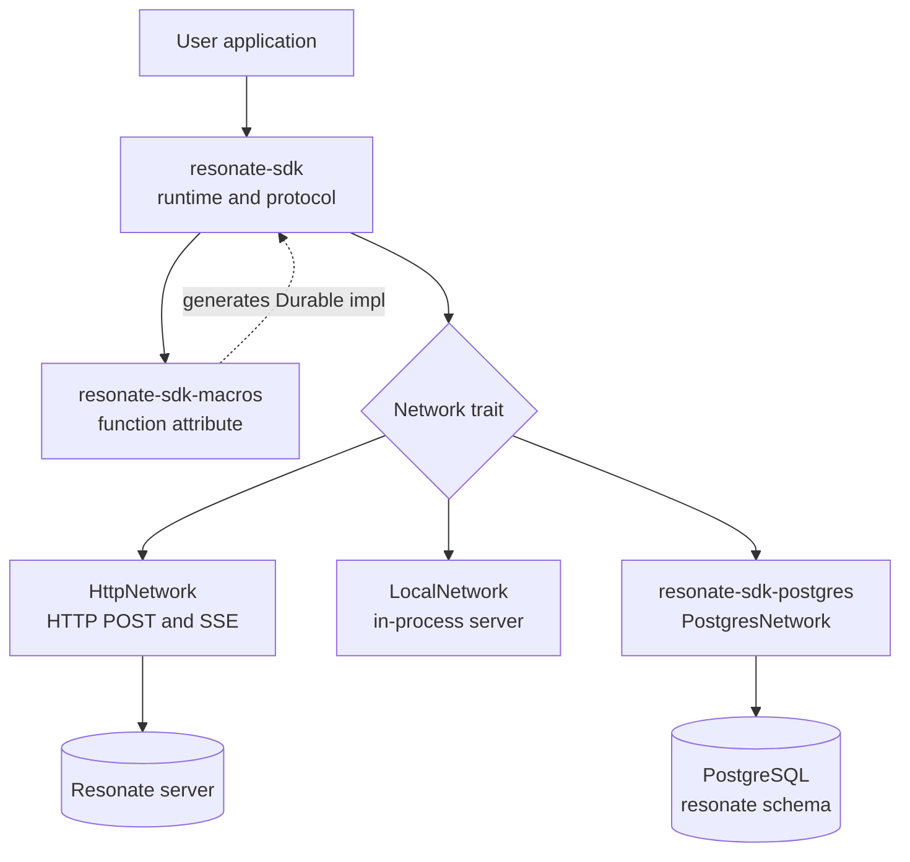
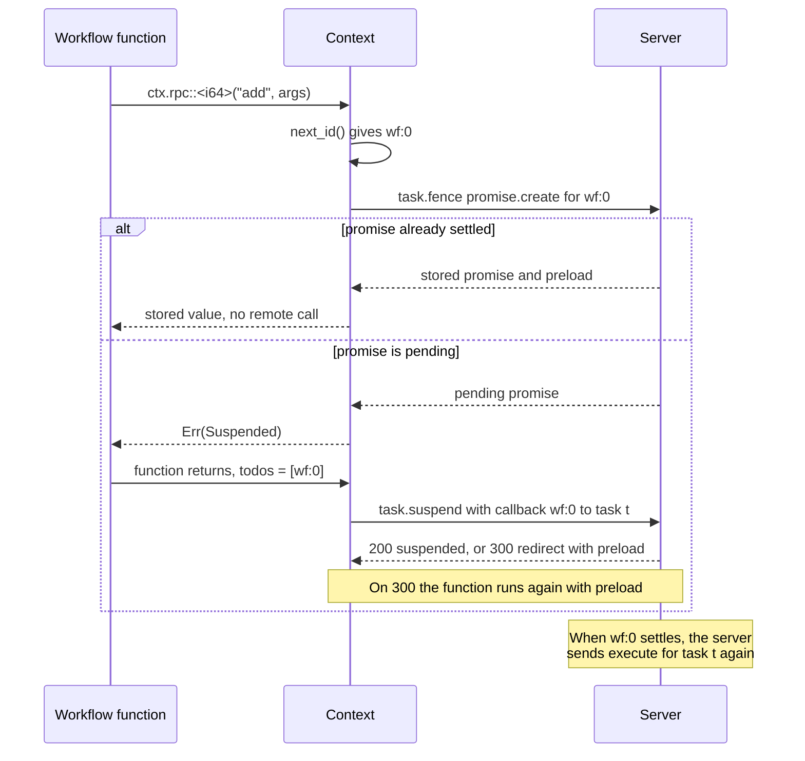

# The Rust SDK

Resonate is a durable execution system. A server stores *durable promises*. A promise is a named record with a state, a parameter, a value, tags, and a deadline. A *durable task* lets a worker execute a promise. The worker acquires the task with a lease, runs user code, and settles the promise. A Software Development Kit (SDK) is the library that speaks the Resonate protocol for one language.

This document studies the Rust SDK in its own repository, `resonate-sdk-rs`, at commit `6545265`. The main Resonate repository contains a copy at `impl/sdk/rs`. The copy is a mirror, not a second implementation.

Citations use paths relative to the separate repository root. `resonate/src/context.rs` means `resonate-sdk-rs/resonate/src/context.rs`. A path that starts with `impl/sdk/rs/` belongs to the main repository at commit `9c72d818`.

Source: `README.md:5-10`, `Cargo.toml:1-13`

## Terms

A *task* is the record that lets a worker execute a promise; its states are `pending`, `acquired`, `suspended`, `halted`, and `fulfilled`. Its `version` is a *fencing token*, which the server increments on each acquisition, and `task.fence` rejects an old value. A *lease* is the time-bounded right to execute, renewed by a heartbeat. An *execute message* tells a worker that a task is available. *Replay* runs a workflow again from its first line; a settled child returns its stored value and does not run.

A *workflow* takes `&Context` and can create children. A *leaf* takes no `&Context`; a *pure leaf* also takes no `&Info`, while a leaf with `&Info` gets read-only metadata. The *target* is the address in `resonate:target`, which routes an execute message to a named set of workers called a *group*. The *process identifier* names one worker instance. A *unicast* address names one process; an *anycast* address names any process in a group.

The *origin* is the text before the first `:` in a promise identifier; the *lineage* is the text after it. A *todo* is an unresolved dependency identifier. A *preload* is a promise record returned with a fenced response to short-circuit replay. A *latent promise* has no function and needs an external settle. A *timer promise* has `resonate:timer = true`, and its deadline resolves it. The *codec* converts a value to JSON (JavaScript Object Notation), encrypts it, then encodes base64. The *registry* maps a function name to its implementation.

Source: `resonate/src/types.rs:85-167`, `resonate/src/ids.rs:1-24`, `resonate/src/durable.rs:49-67`, `resonate/src/codec.rs:28-31`, `resonate/src/network.rs:9-22`

## Three crates, one workspace

The repository is one Cargo workspace with three members. The workspace version is `0.6.0`.

| Crate | Package name | What it provides | Key source |
|---|---|---|---|
| `resonate` | `resonate-sdk` | The runtime: `Resonate`, `Context`, the registry, the codec, the task engine, and the `HttpNetwork` and `LocalNetwork` implementations | `resonate/Cargo.toml:1-28` |
| `resonate-macros` | `resonate-sdk-macros` | The `function` attribute macro, which generates the `Durable` implementation | `resonate-macros/Cargo.toml:1-18` |
| `resonate-postgres` | `resonate-sdk-postgres` | The third network, `PostgresNetwork`, which uses the Resonate stored procedures in PostgreSQL | `resonate-postgres/Cargo.toml:1-27` |

The three networks share one `Network` trait: process identifier, group, unicast and anycast addresses, start, stop, send, receive, and target resolution. `HttpNetwork` uses `poll://uni@group/process` and receives messages with Server-Sent Events (SSE). `LocalNetwork` uses `local://uni@group/process` and runs an in-process server. `PostgresNetwork` uses `poll://uni@group/process` and receives messages with `LISTEN` and `NOTIFY`, plus a fallback tick.

Source: `Cargo.toml:1-13`, `resonate/src/lib.rs:88-114`, `resonate/src/network.rs:9-22`, `resonate/src/http_network.rs:11-59`, `resonate-postgres/src/lib.rs:60-72`



`LocalNetwork` is not a mock. It is an in-memory protocol implementation with its own state machine and a one-second timer tick. `Resonate::local()` fixes the process identifier and group to `default`, sets the lease time to live (TTL) to the maximum `u64` value, and replaces any configured network. A local instance never opens a socket.

Source: `resonate/src/network.rs:1378-1504`, `resonate/src/resonate.rs:101-126`

## The worker model

`Resonate::new` subscribes a transport callback, starts the network in a Tokio task, and refreshes subscriptions every 60 seconds. An `execute` message carries a task identifier and a fencing token; the runtime spawns `Core::on_message`, which sends `task.acquire`, decodes the parameter, and calls `execute_until_blocked`. An `unblock` message carries a settled promise and wakes local subscribers. The server increments the task version on each acquisition, so an old execute message cannot acquire the task. Each execute message becomes one Tokio task with no fixed concurrency limit, so a process can run a root workflow and a child function at the same time.

Source: `resonate/src/resonate.rs:201-253`, `resonate/src/resonate.rs:580-640`, `resonate/src/core.rs:77-105`, `resonate/src/transport.rs:16-70`

Source: `resonate/src/types.rs:121-132`, `resonate/src/core.rs:99-175`

## Registration: the function name is a dispatch key

The crate has one attribute macro, `function`, and no derive macro. A user writes:

```rust
#[resonate_sdk::function]
async fn add(x: i64, y: i64) -> Result<i64> {
    Ok(x + y)
}
```

The macro reads the first parameter to select one of three kinds. `&Context` makes a workflow. `&Info` makes a leaf with read-only metadata. Any other first parameter, or no parameter, makes a pure leaf. The kind is the `DurableKind` value in the generated implementation.

Source: `resonate-macros/src/lib.rs:22-49`, `resonate-macros/src/lib.rs:94-102`, `resonate-macros/src/lib.rs:225-243`

The macro consumes the function and emits a hidden `__Durable_<PascalCase>` struct, a lower-case constant with the original name, and a `Durable` implementation with `NAME` and `KIND`. The body is inlined into `execute`, with the environment bound to `ctx` or `info`.

The registered name is the function identifier, unless the attribute supplies `name = "..."`. The parser accepts only that key; any other key is a compile error. The name is stored in `Durable::NAME`, and `Registry::register` inserts the function under that string. Registration is explicit, does not contact the server, and rejects an empty name with `Error::Application { message: "name is required" }` and a duplicate name with `Error::AlreadyRegistered`.

Source: `resonate-macros/src/lib.rs:65-220`, `resonate/src/registry.rs:41-74`, `resonate/src/resonate.rs:274-284`

A function name is not a promise identifier. This distinction is the central fact of the SDK.

An identifier has an origin and an optional lineage. The origin is the caller-supplied root identifier. A root promise uses the origin alone and has no colon. The first child appends `:<sequence>`; a deeper child appends `.<sequence>`. The sequence counter starts at 0, so the first child is `:0`. A root identifier may contain dots, but not a colon, an empty string, or a null byte.

| Layer | Example | Who sets it | Stable because |
|---|---|---|---|
| Registered name | `add` | The macro, or `name = "..."` | It is stored in the promise parameter |
| Root promise identifier | `sum-1` | The caller of `run`, `rpc`, or `schedule` | It is the deduplication key |
| First child identifier | `sum-1:0` | `Context::next_id` | It follows call order on a deterministic replay |
| Grandchild identifier | `sum-1:0.0` | The child context | The same counter rule applies one level down |
| Detached identifier | `sum-1:d4f2a9c0b1e8d7f6` | `Context::detached` | A seahash of the next child identifier, in 16 hexadecimal digits |

Source: `resonate/src/ids.rs:36-108`, `resonate/src/context.rs:134-140`, `resonate/src/context.rs:428-468`, `resonate/src/context.rs:1167-1174`

The sequence counter follows *call order on the current run*, not source order. A conditional can skip a call, and a loop can repeat one. Replay produces the same identifiers only if the workflow is deterministic, so the programmer must branch only on durable values, not on wall-clock time or random numbers.

The server stores the function name inside the promise parameter. The runtime builds that parameter as `{"func": <registered name>, "args": <arguments>}` and encodes it. A worker decodes the parameter, reads `func`, and looks up that string in the registry. If the lookup fails, the task ends with `Error::FunctionNotFound`, the runtime releases the task, and the server can offer it again.

Source: `resonate/src/resonate.rs:380-407`, `resonate/src/types.rs:245-261`, `resonate/src/core.rs:215-226`

This lookup is why the registered name must stay stable across restarts and builds. A promise created by one build may still be pending when another build starts, and the new process must find the same name. A rename makes the promise undeliverable until the deadline passes. The `name = "..."` attribute safely renames the Rust function while keeping the wire name.

The root promise identifier must also stay stable. `run` and `rpc` are idempotent by identifier: a second call with the same identifier returns a handle to the existing promise, and a changed identifier runs the work twice. If the identifier exists with a different function or arguments, the server does not compare the parameters; it returns the existing promise.

Source: `resonate/src/resonate.rs:410-488`

> **Aha:** the macro does not turn a Rust function into a promise. It turns the function into a *named dispatch entry*. Promise identity is a separate lineage identifier that the caller supplies or the context mints. This separation lets several promises run the same function, lets one lineage survive a process restart, and lets a renamed Rust symbol keep its old wire name.

## How a call becomes a promise

`Resonate::run` executes a function in the calling process. `Resonate::rpc` asks a remote worker group to execute a function by name.

`run` first checks the registry for the function name, builds a promise-create request, and sends `task.create`. A status of 409 means the promise exists. If the task is acquired, the SDK starts the task engine in a background Tokio task.

`rpc` does not check the local registry. It creates a promise with no task. The target tag routes the execute message to a worker group. The server creates the task when the promise is runnable. The execute message tells a worker in that group to acquire the existing task and run it; the worker does not create the task.

Source: `resonate/src/resonate.rs:410-488`, `resonate/src/send.rs:237-256`, `resonate/src/send.rs:571-596`

Every root call writes five tags: `resonate:origin`, `resonate:branch`, and `resonate:parent` all equal the root identifier, `resonate:scope` is `global`, and `resonate:target` is the resolved target.

A bare target name goes through the network resolver. `HttpNetwork` and `PostgresNetwork` produce `poll://any@<name>`; `LocalNetwork` produces `local://any@<name>`. A target that contains `://` passes through unchanged. The default target is the network group.

A child call writes the parent's branch and identifier, its own identifier as the origin, and the parent's target. A detached child keeps the parent's origin, declares the origin as its parent, and uses its own identifier as the branch. A detached child thus adds one segment, and its descendants stay under the original origin.

Source: `resonate/src/resonate.rs:366-372`, `resonate/src/resonate.rs:768-796`, `resonate/src/context.rs:453-468`

Inside a workflow, every call creates a child promise. The builder is lazy; nothing reaches the server until the workflow calls `.await` or `.spawn()`. Each call claims the next sequence number when the builder is created, so the identifier follows call order, not completion order.

| Context call | Scope | Identifier | Behavior on a pending promise |
|---|---|---|---|
| `ctx.run(func, args).await` | `local` | `<parent>:<n>` | Creates the promise, runs the leaf inline, and settles it |
| `ctx.run(func, args).spawn()` | `local` | `<parent>:<n>` | Runs the leaf on a background task; returns `DurableFuture` |
| `ctx.rpc::<T>("name", args).await` | `global` | `<parent>:<n>` | Creates the promise and returns `Error::Suspended` |
| `ctx.rpc::<T>("name", args).spawn()` | `global` | `<parent>:<n>` | Creates it in the background; returns `RemoteFuture` |
| `ctx.sleep(duration).await` | `global` | `<parent>:<n>` | Creates a timer promise with `resonate:timer = true` |
| `ctx.promise::<T>().await` | `global` | `<parent>:<n>` | Creates a latent promise for an external settle |
| `ctx.detached("func", args).spawn()` | `global` | `<origin>:d<hash>` | Creates a fire-and-forget promise; only `id()` is observable |

`DurableFuture` and `RemoteFuture` are local handles with `id()` and `await`. `ResonateHandle<T>` is the root handle from `.spawn()` and has `id()`, `result()`, and `await`. A spawned local child is flushed before the workflow ends. A spawned remote future adds its identifier to the todo list if it is still pending, so the workflow suspends rather than orphan the work. A latent promise's `.create()` starts it in the background, and `.data()` attaches a payload for the external resolver.

Child deadlines are capped by the parent: `min(now + requested, parent_deadline)`. If the caller gives no timeout, the child gets 24 hours, still capped. A sleep uses the same rule, so it cannot outlive its workflow.

Source: `resonate/src/context.rs:56-65`, `resonate/src/context.rs:142-153`, `resonate/src/context.rs:212-468`, `resonate/src/context.rs:946-1060`, `resonate/src/context.rs:1180-1243`, `resonate/src/handle.rs:1-89`

The codec encodes Rust value to JSON, then optionally encrypts, then base64; decoding reverses it. A null value becomes an empty string, and an error becomes `{"__type": "error", "message": ...}`. The default encryptor does nothing.

Two mechanisms keep replay consistent. The creation sequencer gives each terminal operation (`run`, `rpc`, `sleep`, `promise`, and `detached`) a slot in call order. A slot waits for its predecessor, creates its promise, and reports success or failure. If one creation fails, later slots abort without touching the server, so the server sees an exact prefix of the creation calls.

The second mechanism is lease fencing. Every child create and settle passes through `task.fence` with the active task identifier and fencing token. A worker whose lease expired receives status 409 instead of writing stale state. The fenced response also carries preloaded promises, which the runtime caches for the rest of the execution.

Source: `resonate/src/codec.rs:28-144`, `resonate/src/sequencing.rs:1-149`, `resonate/src/effects.rs:9-121`



A schedule is a stored record, not a running job. `Resonate::schedule(schedule_id, cron, func_name, args)` builds the template `{{.id}}-{{.timestamp}}`, validates the schedule identifier, resolves the target, and calls `schedule.create`. Each firing creates a root promise with a new timestamp. The target comes from the default group unless the builder calls `.target(...)`; the server rejects a schedule without a target. `.version(...)` is stored but ignored on dispatch.

Source: `resonate/src/resonate.rs:499-532`, `resonate/src/resonate.rs:1006-1061`, `resonate/src/promises.rs:125-160`

## One call, end to end

1. `r.run("sum-1", total, ())` checks the registry and sends `task.create`.
2. The server creates the root promise and an `acquired` task at version 1, with parameter `{"func":"total","args":[]}`.
3. The engine runs `total`. `ctx.run(add, (2, 3)).await` creates `sum-1:0` and executes `add` inline.
4. `ctx.rpc::<i64>("add", (a, 4)).await` creates `sum-1:1` and returns `Error::Suspended`. The engine sends `task.suspend` with one callback.
5. The server marks the task `suspended` and records the callback. A worker in the target group receives an execute message for the new task, acquires it, runs `add`, and settles `sum-1:1`.
6. The callback makes the root task available. The server sends an execute message for `sum-1` with a higher fencing token.
7. The engine acquires the root task and replays `total`. Both children are resolved, so both calls return stored values without running. `total` returns `Ok(9)`, and the engine settles the root promise.

Source: `resonate/src/core.rs:77-377`, `resonate/src/context.rs:707-780`, `resonate/src/context.rs:996-1017`

## Retries, waiting, and resumption

The Rust SDK has no user-level retry policy: no attempt counter, delay formula, or maximum. The task lifecycle supplies the retry.

A normal return settles the promise and fulfills the task. An `Err` return also settles the promise, with state `rejected`, and fulfills the task; the caller receives that error from `.await`. Only a *panic* is an engine failure: the engine catches it, converts it to `Error::Application`, and releases the task without settling the promise. The engine logs a special message when the panic came from `.unwrap()` on `Error::Suspended`, because suspension is control flow and must propagate with `?`.

Source: `resonate/src/core.rs:321-419`

The lease keeps a long function alive. The default lease TTL is 60,000 milliseconds, and the asynchronous heartbeat sends `task.heartbeat` every half TTL, or 30,000 milliseconds. It starts before function execution and stops after it. Local mode uses a no-op heartbeat.

Waiting has two layers. A local child either completes inline or suspends; if it suspends, its remote todos move up to the parent. A remote child, a sleep, or a latent promise records its identifier in the remote-todo list and returns `Error::Suspended`. At the end of the function, the engine collects every todo and calls `task.suspend` with one callback per dependency.

The suspend response has two cases. Status 200 means the task is suspended. Status 300 means at least one dependency settled during the call. The response then carries preloaded promises, and the engine runs the function again without re-acquiring the task. This redirect avoids a lost wake-up between registration and suspension.

Source: `resonate/src/resonate.rs:31-47`, `resonate/src/resonate.rs:132-188`, `resonate/src/heartbeat.rs:34-143`, `resonate/src/context.rs:489-551`, `resonate/src/core.rs:350-469`, `resonate/src/send.rs:171-202`

Replay is short-circuiting, not checkpoint restoration. The workflow text runs from its first line every time. A settled child returns its stored value and does not execute. A pending child is created and either executed or added to the suspend list. The creation sequencer keeps `promise.create` order equal to call order, so a deterministic workflow produces the same identifiers.

| Mechanism | Trigger | Effect | Who decides |
|---|---|---|---|
| User error | Function returns `Err`, not `Suspended` | Promise settles as `rejected`; task is fulfilled | SDK |
| Panic | The engine catches a panic | Task is released; the promise stays pending | SDK releases; server re-offers |
| Lease expiry | The worker stops sending heartbeats | The server treats the task as free | Server |
| Suspension | The function leaves remote todos | Callbacks are registered; the task is suspended | SDK requests; server records |
| Redirect | A dependency settles during `task.suspend` | The function runs again with preload | Server returns status 300 |
| Promise deadline | The deadline passes | A normal promise becomes `rejected_timedout`; a timer promise becomes `resolved` | Server state machine |
| Network loss | An SSE stream ends | The client reconnects with exponential backoff from 1 second to 60 seconds | SDK |

A caller can bound the retry period with `.timeout(Duration)`. The default is 24 hours. The timeout becomes the promise deadline; it does not set a retry count. A function that panics is offered again until that deadline passes. If the promise then times out, the handle returns `Error::Timeout`.

Source: `resonate/src/context.rs:707-780`, `resonate/src/context.rs:996-1017`, `resonate/src/core.rs:228-258`, `resonate/src/options.rs:17-25`, `resonate/src/handle.rs:81-85`

## The public surface

| Method | Input | Result |
|---|---|---|
| `Resonate::new(config)` | `ResonateConfig` | An infallible client. Reads `RESONATE_URL`, or `RESONATE_HOST`, `RESONATE_SCHEME`, and `RESONATE_PORT`, when the config has no URL. `token` or `RESONATE_TOKEN` becomes a Bearer token |
| `Resonate::local()` | none | An in-process client with group `default` and maximum lease TTL |
| `register(func)` | A generated durable function | `Result<()>`; rejects an empty or duplicate name |
| `run(id, func, args)` | Root identifier, function value, arguments | A builder: `.await` gives `Result<T>`, `.spawn()` gives `ResonateHandle<T>` |
| `rpc(id, name, args)` | Root identifier, function name, arguments | A builder with the same terminal operations |
| `get::<T>(id)` | Any existing promise identifier | A `ResonateHandle<T>`, without root validation |
| `schedule(schedule_id, cron, func_name, args)` | Schedule identifier, cron text, function name, arguments | A builder; `.await` gives `ResonateSchedule`, which has `delete()` |
| `stop()` | none | `Result<()>`; stops the network, heartbeat, and subscription refresh |
| `promises` | Sub-client | `get`, `create`, `resolve`, `reject`, `cancel`, `register_listener`, and `search` |
| `schedules` | Sub-client | `create`, `get`, `delete`, and `search` |
| `with_dependency(value)` | Any `Send + Sync + 'static` value | The client, with a dependency available through `Context` and `Info` |

Dependencies are keyed by type; a second value replaces the first. `get_dependency::<T>()` panics when absent.

`ResonateConfig` has fields for `url`, `group`, `pid`, `ttl`, `token`, `encryptor`, and `network`. A custom `network` overrides the URL; `PostgresNetwork` is selected that way, not by the URL. The URL takes precedence over environment variables, and `token` over `RESONATE_TOKEN`.

Source: `resonate/src/resonate.rs:96-359`, `resonate/src/resonate.rs:490-542`, `resonate/src/promises.rs:25-181`, `resonate/src/lib.rs:30-75`

`Context` exposes `run(func, args)`, `rpc::<T>(name, args)`, `sleep(duration)`, `promise::<T>()`, and `detached("func", args)`, which return lazy builder types. It also exposes `id`, `parent_id`, `origin_id`, `timeout_at`, and `func_name`; an `info()` snapshot; and `get_dependency::<T>()`. `Info` has the same identifier fields plus `branch_id` and `tags`, but no child-creation methods.

Source: `resonate/src/context.rs:130-185`, `resonate/src/context.rs:254-468`, `resonate/src/info.rs:7-16`

A complete example:

```rust
#[resonate_sdk::function]
async fn total(ctx: &Context) -> Result<i64> {
    let a: i64 = ctx.run(add, (2_i64, 3_i64)).await?;
    let b: i64 = ctx.rpc::<i64>("add", (a, 4_i64)).await?;
    Ok(b)
}

#[tokio::main]
async fn main() -> Result<()> {
    let r = Resonate::new(ResonateConfig {
        url: Some("http://localhost:8001".into()),
        ..Default::default()
    });
    r.register(add)?;
    r.register(total)?;
    let value: i64 = r.run("sum-1", total, ()).await?;
    println!("{value}");
    r.stop().await
}
```

`ctx.run` runs in the same process. `ctx.rpc("add", ...)` needs an `add` function registered on a worker in the target group. If no other worker exists, `ctx.rpc` suspends the root task indefinitely; the example needs a second worker or a second `Resonate` instance.

The error type is one enum. The variants a user sees most often are `FunctionNotFound`, `AlreadyRegistered`, `InvalidId`, `ServerError`, `EncodingError`, `DecodingError`, `Suspended`, and `Timeout`. `Suspended` is control flow: a workflow must propagate it with `?`. `Application` is a general application error: the registry returns it for an empty function name, and the handle and core paths also return it. It is not limited to panic handling.

Source: `resonate/src/context.rs:273-416`, `resonate/src/resonate.rs:303-324`, `resonate/src/error.rs:4-63`

## The mirror in the main repository

The main repository has the same workspace at `impl/sdk/rs`. At the two revisions, the files are identical except for the license link in `README.md` and the missing top-level `LICENSE`. The copy keeps `impl/sdk/rs/Cargo.toml` as its own workspace root, so the server workspace does not build it.

Both sides have the same three members, crate names, and version `0.6.0`. The separate repository is the publish source. Its continuous integration runs formatting, linting, unit tests, and two end-to-end tests: one against a Resonate server and one against PostgreSQL.

Source: `Cargo.toml:1-13`, `README.md:3`, `impl/sdk/rs/Cargo.toml:1-13`, `impl/sdk/rs/README.md:3`, `.github/workflows/ci.yml:1-115`

## Limits and open questions

1. **Function versioning is not implemented.** Builders accept `.version(u32)`, but the create request omits it. A schedule writes a `version` key into the parameter, but `TaskData` has only `func` and `args`, so dispatch ignores it.

2. **The README is stale in at least three places.** The installation example pins version `0.1`, while the workspace is `0.6.0`. The environment table lists `RESONATE_PREFIX`, but the code reads only `RESONATE_URL`, `RESONATE_HOST`, `RESONATE_SCHEME`, `RESONATE_PORT`, and `RESONATE_TOKEN`. The README also says execution "resumes from the last checkpoint."

3. **Replay is from the start.** The implementation runs from the first line and short-circuits settled child promises. A side effect not behind a durable call repeats on every replay.

4. **There is no retry policy.** The SDK cannot set a delay, a factor, a maximum attempt count, or a retry condition. The only bound is the promise deadline.

5. **There is no workflow-level cancellation.** A running local function is not interrupted. A caller can cancel a promise through `promises.cancel`. `stop()` stops the network and heartbeat, not a function future.

6. **Registration is manual.** Every worker must register every function it may execute. A missing registration becomes `FunctionNotFound`, a release, and another delivery.

7. **The macro has a narrow input grammar.** It accepts top-level `async fn` items with simple identifier parameters and a `Result<T>` return; an associated function, a closure, or a destructuring parameter is not accepted.

8. **`Resonate::new` cannot report a connection failure at construction.** It starts the network in a spawned task. The first request reports a connection failure as `Error::HttpError`, because `request.send().await?` maps the `reqwest::Error`. `Error::ServerError` requires an HTTP response with status 400 or more.

9. **The PostgreSQL network needs a prepared database.** The user must apply the schema from the `resonate-postgres` package before the first call. `pg_cron` is optional because the network pump runs `process_timeouts()` on each wake; the fallback tick is 250 milliseconds.

Source: `resonate/src/options.rs:4-26`, `resonate/src/resonate.rs:380-394`, `resonate/src/resonate.rs:1006-1024`, `resonate/src/types.rs:245-251`, `README.md:8-33`, `README.md:159-170`, `resonate/src/resonate.rs:146-158`, `resonate/src/resonate.rs:244-255`, `resonate-postgres/src/lib.rs:1-25`

Several questions remain open from the source alone.

- Which repository is edited first? The history shows the same change in both places, but the source does not state a synchronization process.
- Is function versioning planned, or a leftover? The builder and the schedule both carry version data, and neither uses it.
- Does the local network pass the same conformance tests as the HTTP server? The tests exercise the same scenarios, but the source does not compare it to the Lean specification.
- Can a workflow be re-entered after a redirect while it holds a local variable? The engine runs it again in the same process, so a captured value can differ from the first run.

Source: `resonate/src/options.rs:4-26`, `resonate/src/network.rs:1378-1504`, `resonate/src/core.rs:350-374`

## Related documents

- [02-the-protocol.md](02-the-protocol.md) — the request and response envelopes that the SDK sends.
- [03-durable-promises-and-tasks.md](03-durable-promises-and-tasks.md) — the promise, task, lease, and suspension model.
- [09-the-typescript-sdk.md](09-the-typescript-sdk.md) — the other SDK with two execution engines.
- [10-the-other-sdks.md](10-the-other-sdks.md) — the Python, Go, Java, and in-repository Rust SDKs.
- [12-the-postgres-server-in-one-file.md](12-the-postgres-server-in-one-file.md) — the SQL schema that `resonate-postgres` calls.
