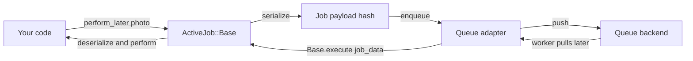
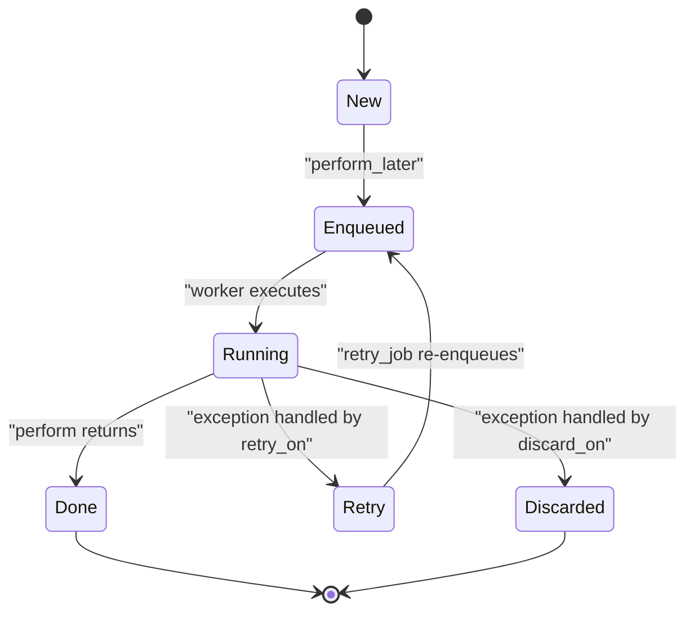

# 00 -- ActiveJob: one job interface, many queue backends

ActiveJob is the Ruby on Rails job framework. It gives you one interface for background work and hides the queue backend behind it. You write a job once. You can run it on Sidekiq today and on a database-backed queue tomorrow without changing the job.

The gem in this exploration is `activejob-8.1.4`, installed at `/Users/darkvoid/.gems/gems/activejob-8.1.4`. All paths below are under its `lib/` directory unless stated otherwise.

The loaded version is available as `ActiveJob.version`, `ActiveJob.gem_version`, and `ActiveJob::VERSION` (8.1.4). `ActiveJob.deprecator` (`:nodoc:`) is the framework's deprecation reporter.

## The problem it solves

Web requests must finish fast. Slow work, such as sending mail, resizing photos, or rebuilding search indexes, must move out of the request. Every queue backend solves this differently. Sidekiq uses Redis. Delayed Job stores rows in a database. Resque uses Redis with separate workers. Each backend has its own job format, its own retry rules, and its own scheduling syntax.

Without ActiveJob, moving from one backend to another means rewriting every job. ActiveJob removes that lock-in. The class-level interface is the same everywhere.

```ruby
# Source: lib/active_job/base.rb, lines 31-40 (documentation example)
class ProcessPhotoJob < ActiveJob::Base
  def perform(photo)
    photo.watermark!('Rails')
    photo.rotate!(90.degrees)
    photo.resize_to_fit!(300, 300)
    photo.upload!
  end
end
```

Enqueue it with one call:

```ruby
ProcessPhotoJob.perform_later(photo)
```

The queue backend is a configuration choice, not a code choice:

```ruby
ActiveJob::Base.queue_adapter = :inline
```

Source: `/Users/darkvoid/.gems/gems/activejob-8.1.4/lib/active_job/base.rb`, lines 20-24.

## The core idea

A job is a small Ruby object. It has one method you write, `perform`. When you enqueue it, ActiveJob turns the object into a plain hash and gives that hash to an adapter. Later, a worker reads the hash, builds a new object from it, and calls `perform`.



The important point: the queue does not store your Ruby object. It stores the hash. The Ruby object is rebuilt on the worker side. This is why jobs survive across processes and across restarts.

The whole job lifecycle has four states:



## Why this is pleasant in Ruby

Ruby lets a framework be a set of small, readable modules. ActiveJob exploits three Ruby features.

First, a class-level Domain-Specific Language (DSL). You declare queue, priority, retry, discard, and callbacks on the class. The instance just does the work.

```ruby
# Composite of the real DSL. Sources: lib/active_job/queue_name.rb line 39,
# lib/active_job/queue_priority.rb line 39, lib/active_job/exceptions.rb lines 64 and 109.
class ProcessPhotoJob < ApplicationJob
  queue_as :images
  queue_with_priority 10

  retry_on IOError, wait: 5.seconds, attempts: 3
  discard_on ActiveJob::DeserializationError

  before_perform { |job| track(job.arguments.first) }

  def perform(photo)
    photo.process!
  end
end
```

Second, you pass plain Ruby objects as arguments. Strings, integers, times, ranges, hashes, and even Active Record models all work. The model case is the deep one: a model argument is not copied into the queue. It is stored as a Global ID (a `gid://` Uniform Resource Identifier, URI) and reloaded from the database on the worker. See [04-arguments-and-serializers.md](./04-arguments-and-serializers.md).

Third, concerns and inheritance. `ActiveJob::Base` is itself composed from small modules, each in its own file. You build `ApplicationJob` from it and share behavior through inheritance and `ActiveSupport::Concern` mixins.

## The shape of the framework

`ActiveJob::Base` is an empty class that includes eleven modules:

```ruby
# Source: lib/active_job/base.rb, lines 63-76
class Base
  include Core
  include QueueAdapter
  include QueueName
  include QueuePriority
  include Enqueuing
  include Execution
  include Callbacks
  include Exceptions
  include Instrumentation
  include Logging
  include ExecutionState
end
```

Each module owns one concern. `Core` holds the job attributes and serialization. `Enqueuing` owns `perform_later`. `Execution` owns `perform_now`. `Callbacks` owns the hooks. `Exceptions` owns `retry_on` and `discard_on`. `Instrumentation` and `Logging` own observability. `ExecutionState` restores locale and timezone. The modules are described across the next documents.

The top-level file requires everything and adds one bulk method, `perform_all_later`:

```ruby
# Source: lib/active_job.rb, lines 66-90 (abridged)
def self.perform_all_later(*jobs)
  jobs.flatten!
  jobs.group_by(&:queue_adapter).each do |queue_adapter, adapter_jobs|
    instrument_enqueue_all(queue_adapter, adapter_jobs) do
      if queue_adapter.respond_to?(:enqueue_all)
        queue_adapter.enqueue_all(adapter_jobs)
      else
        adapter_jobs.each { |job| job.scheduled_at ? queue_adapter.enqueue_at(job, job.scheduled_at.to_f) : queue_adapter.enqueue(job) }
      end
    end
  end
end
```

## The map of this exploration

- [01-the-job.md](./01-the-job.md) — the job object, its attributes, and its serialized hash form.
- [02-enqueue-lifecycle.md](./02-enqueue-lifecycle.md) — what happens from `perform_later` to the adapter.
- [03-execution.md](./03-execution.md) — `perform_now`, `execute`, and the nested run.
- [04-arguments-and-serializers.md](./04-arguments-and-serializers.md) — `ActiveJob::Arguments`, serializers, and Global ID.
- [05-queue-adapters.md](./05-queue-adapters.md) — the adapter contract and the built-in adapters.
- [06-callbacks.md](./06-callbacks.md) — before, after, and around hooks.
- [07-exceptions-retry-discard.md](./07-exceptions-retry-discard.md) — retry, discard, and backoff.
- [08-continuable.md](./08-continuable.md) — steps, cursors, checkpoints, and resume.
- [09-instrumentation-and-timezone.md](./09-instrumentation-and-timezone.md) — notifications, logging, locale, and timezone.
- [10-rails-integration-and-testing.md](./10-rails-integration-and-testing.md) — Railtie, generators, and the test adapter.

## The Aha Moment

**Aha:** ActiveJob is not a queue. It is a serialization contract plus a tiny adapter interface. The framework's real product is the hash produced by `serialize` and the guarantee that `deserialize` reverses it. Everything else — retries, callbacks, instrumentation, continuations — is logic layered around that hash. A job is a pure value (a hash) that happens to also know its own class name, and the queue backend is just the place where hashes wait.

Continue to [01-the-job.md](./01-the-job.md).
