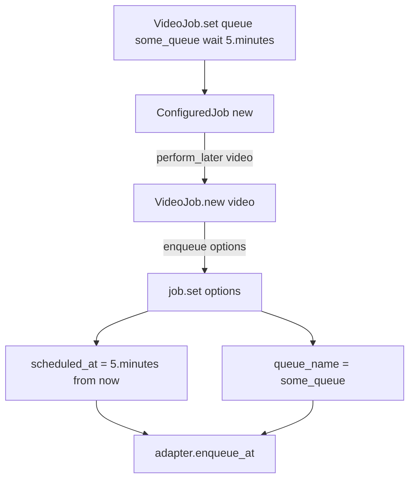
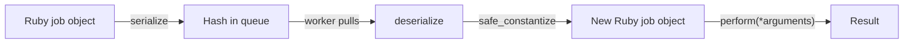

# 01 -- The Job: one object, two lives

A job lives twice. First, it lives in your process as a Ruby object. Then it lives in the queue as a hash. The same class produces both. This document describes the object and the hash.

Source files: `/Users/darkvoid/.gems/gems/activejob-8.1.4/lib/active_job/core.rb`, `/Users/darkvoid/.gems/gems/activejob-8.1.4/lib/active_job/base.rb`, `/Users/darkvoid/.gems/gems/activejob-8.1.4/lib/active_job/queue_name.rb`, and `/Users/darkvoid/.gems/gems/activejob-8.1.4/lib/active_job/queue_priority.rb`.

## `ActiveJob::Base` and `ApplicationJob`

`ActiveJob::Base` is the root class. It includes eleven modules, one per concern:

```ruby
# Source: lib/active_job/base.rb, lines 63-77
class Base
  include Core
  include QueueAdapter
  include QueueName
  include QueuePriority
  include Enqueuing
  include Execution
  include Callbacks
  include Exceptions
  include Instrumentation
  include Logging
  include ExecutionState

  ActiveSupport.run_load_hooks(:active_job, self)
end
```

The only method you must implement is `perform`:

```ruby
# Source: lib/active_job/base.rb, lines 27-29 (documentation)
# The only necessary method to implement is the "perform" method.
```

In a Rails application you do not inherit from `ActiveJob::Base` directly. The generator creates an intermediate class, `ApplicationJob`, so all jobs share one place for configuration:

```ruby
# Rendered output of lib/rails/generators/job/templates/application_job.rb.tt, lines 1-8
class ApplicationJob < ActiveJob::Base
  # Automatically retry jobs that encountered a deadlock
  # retry_on ActiveRecord::Deadlocked

  # Most jobs are safe to ignore if the underlying records are no longer available
  # discard_on ActiveJob::DeserializationError
end
```

Then each job inherits from `ApplicationJob`:

```ruby
# Rendered output of lib/rails/generators/job/templates/job.rb.tt, lines 1-7
class CheckoutJob < ApplicationJob
  queue_as :default

  def perform(*args)
    # Do something later
  end
end
```

The generator itself is `lib/rails/generators/job/job_generator.rb`, which writes the job into `app/jobs/`.

## The instance attributes

`Core` declares the state a job carries. These are plain Ruby attribute accessors:

```ruby
# Source: lib/active_job/core.rb, lines 18-63 (abridged)
attr_accessor :arguments        # Job arguments
attr_accessor :scheduled_at     # Time when the job should be performed
attr_accessor :job_id           # Job identifier
attr_accessor :provider_job_id  # ID optionally provided by the adapter
attr_accessor :executions       # Number of times this job has been executed
attr_accessor :exception_executions # Per-retry_on execution counters
attr_accessor :locale           # I18n.locale to be used during the job
attr_accessor :timezone         # Timezone to be used during the job
attr_accessor :enqueued_at      # Track when a job was enqueued
```

`job_id` is generated with `SecureRandom.uuid`. `provider_job_id` is set later by the adapter. `queue_name` and `priority` have writer-only accessors because their readers are computed (see below).

The constructor sets defaults:

```ruby
# Source: lib/active_job/core.rb, lines 103-112
def initialize(*arguments)
  @arguments  = arguments
  @job_id     = SecureRandom.uuid
  @queue_name = self.class.queue_name
  @scheduled_at = nil
  @priority   = self.class.priority
  @executions = 0
  @exception_executions = {}
  @timezone   = Time.zone&.name
end
```

Note `@timezone = Time.zone&.name`. The job remembers the timezone at creation time so the worker can restore it later.

## The class-level DSL

Two modules give the class its declarations.

`QueueName` gives `queue_as`. The queue name may be a symbol, a string, or a block evaluated in the job's context for dynamic names:

```ruby
# Source: lib/active_job/queue_name.rb, lines 39-52
def queue_as(part_name = nil, &block)
  if block_given?
    self.queue_name = block
  else
    self.queue_name = queue_name_from_part(part_name)
  end
end

def queue_name_from_part(part_name)
  queue_name = part_name || default_queue_name
  name_parts = [queue_name_prefix.presence, queue_name]
  -name_parts.compact.join(queue_name_delimiter)
end
```

The default queue is `"default"` and the delimiter is `"_"`, so a prefix `"production"` plus queue `:images` gives `"production_images"`. The instance reader resolves a block by `instance_exec`:

```ruby
# Source: lib/active_job/queue_name.rb, lines 61-66
def queue_name
  if @queue_name.is_a?(Proc)
    @queue_name = self.class.queue_name_from_part(instance_exec(&@queue_name))
  end
  @queue_name
end
```

`QueuePriority` gives `queue_with_priority`. Lower is more important:

```ruby
# Source: lib/active_job/queue_priority.rb, lines 39-57 (abridged)
def queue_with_priority(priority = nil, &block)
  if block_given?
    self.priority = block
  else
    self.priority = priority
  end
end

def priority
  if @priority.is_a?(Proc)
    @priority = instance_exec(&@priority)
  end
  @priority
end
```

## `set` and per-instance options

`Core::ClassMethods#set` returns a `ConfiguredJob` holding the options. The options are applied when you later call `perform_later` or `perform_now` on it:

```ruby
# Source: lib/active_job/core.rb, lines 96-98
def set(options = {})
  ConfiguredJob.new(self, options)
end
```

`ConfiguredJob` is thin:

```ruby
# Source: lib/active_job/configured_job.rb, lines 5-22
class ConfiguredJob
  def initialize(job_class, options = {})
    @options = options
    @job_class = job_class
  end

  def perform_now(...)
    @job_class.new(...).set(@options).perform_now
  end

  def perform_later(...)
    job = @job_class.new(...)
    enqueue_result = job.enqueue(@options)
    yield job if block_given?
    enqueue_result
  end
end
```

The instance-level `set` translates the options into attributes:

```ruby
# Source: lib/active_job/core.rb, lines 175-182
def set(options = {})
  self.scheduled_at = options[:wait].seconds.from_now if options[:wait]
  self.scheduled_at = options[:wait_until] if options[:wait_until]
  self.queue_name   = self.class.queue_name_from_part(options[:queue]) if options[:queue]
  self.priority     = options[:priority].to_i if options[:priority]

  self
end
```

So `set(wait: 5.minutes)` stores an absolute timestamp in `scheduled_at`, computed now. `set(wait_until: ...)` stores the timestamp directly.



## The serialized hash

This is the real contract of the framework. `serialize` turns the object into a hash that is safe to hand to any queue backend:

```ruby
# Source: lib/active_job/core.rb, lines 117-132
def serialize
  {
    "job_class"  => self.class.name,
    "job_id"     => job_id,
    "provider_job_id" => provider_job_id,
    "queue_name" => queue_name,
    "priority"   => priority,
    "arguments"  => serialize_arguments_if_needed(arguments),
    "executions" => executions,
    "exception_executions" => exception_executions,
    "locale"     => locale || I18n.locale.to_s,
    "timezone"   => timezone,
    "enqueued_at" => Time.now.utc.iso8601(9),
    "scheduled_at" => scheduled_at ? scheduled_at.utc.iso8601(9) : nil,
  }
end
```

For a job `ProcessPhotoJob.perform_later(Photo.find(5))`, the hash looks roughly like:

```json
{
  "job_class": "ProcessPhotoJob",
  "job_id": "6f4f6b8e-7b1c-4c0a-9b2a-1f0e3d5c7a9b",
  "provider_job_id": null,
  "queue_name": "default",
  "priority": null,
  "arguments": [{ "_aj_globalid": "gid://demo/Photo/5" }],
  "executions": 0,
  "exception_executions": {},
  "locale": "en",
  "timezone": "UTC",
  "enqueued_at": "2026-10-25T12:00:00.000000000Z",
  "scheduled_at": null
}
```

The `arguments` value is `[{ "_aj_globalid": "gid://demo/Photo/5" }]`. The model is not embedded; only its Global ID is. See [04-arguments-and-serializers.md](./04-arguments-and-serializers.md).

`deserialize` is the mirror. It rebuilds the object from the hash:

```ruby
# Source: lib/active_job/core.rb, lines 160-172
def deserialize(job_data)
  self.job_id               = job_data["job_id"]
  self.provider_job_id      = job_data["provider_job_id"]
  self.queue_name           = job_data["queue_name"]
  self.priority             = job_data["priority"]
  self.serialized_arguments = job_data["arguments"]
  self.executions           = job_data["executions"]
  self.exception_executions = job_data["exception_executions"]
  self.locale               = job_data["locale"] || I18n.locale.to_s
  self.timezone             = job_data["timezone"] || Time.zone&.name
  self.enqueued_at          = deserialize_time(job_data["enqueued_at"]) if job_data["enqueued_at"]
  self.scheduled_at         = deserialize_time(job_data["scheduled_at"]) if job_data["scheduled_at"]
end
```

Notice a detail: `deserialize` sets `serialized_arguments`, not `arguments`. The arguments are decoded lazily, right before `perform`, so the adapter can move the job between machines before any database lookup happens.

The class-level entry point first resolves the class by name:

```ruby
# Source: lib/active_job/core.rb, lines 69-76
def deserialize(job_data)
  job_class = job_data["job_class"].safe_constantize
  raise UnknownJobClassError, job_data["job_class"] unless job_class

  job = job_class.new
  job.deserialize(job_data)
  job
end
```

`UnknownJobClassError` is raised when the hash names a class that is not loaded, for example after you rename a job class and an old job is still in the queue:

```ruby
# Source: lib/active_job/core.rb, lines 5-9
class UnknownJobClassError < NameError
  def initialize(job_class_name)
    super("Failed to instantiate job, class `#{job_class_name}` doesn't exist", job_class_name)
  end
end
```

The round trip is symmetric and lossless by design:



## The Aha Moment

**Aha:** A job is two representations of the same data with one class name in common. The Ruby object is only a convenient view. The hash is the durable truth. Every feature in ActiveJob — callbacks, retries, continuations — either reads from or writes into that hash. This is why a job can sit in Redis for an hour and then run in a different process: the hash, not the object, crossed the boundary.

Continue to [02-enqueue-lifecycle.md](./02-enqueue-lifecycle.md).
