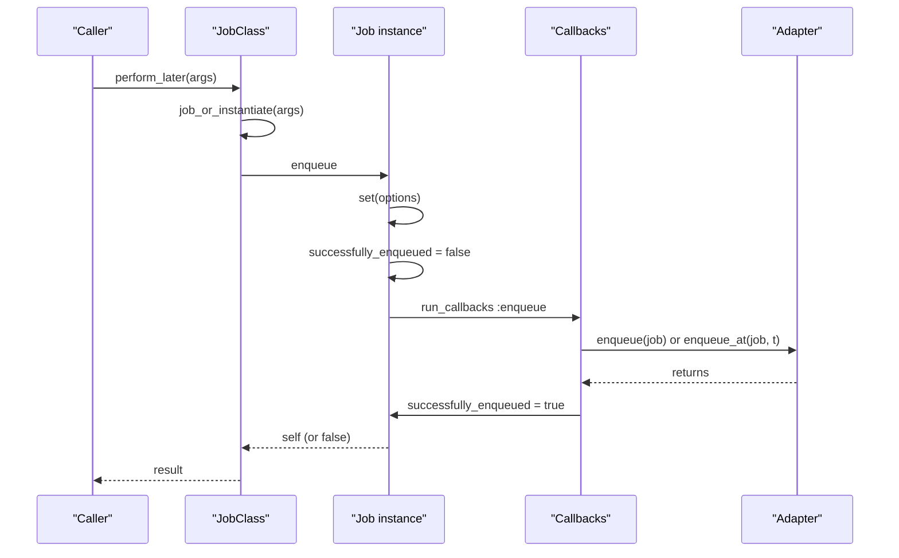
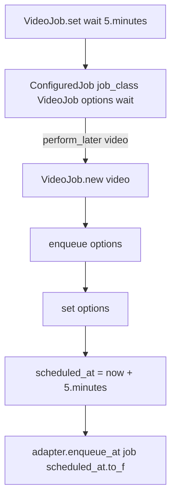

# 02 -- The Enqueue Lifecycle: from `perform_later` to the adapter

Enqueueing is the short half of the job's life. This document traces the call chain from `perform_later` down to the adapter, and back up with a return value.

Source files: `/Users/darkvoid/.gems/gems/activejob-8.1.4/lib/active_job/enqueuing.rb`, `/Users/darkvoid/.gems/gems/activejob-8.1.4/lib/active_job/core.rb`, `/Users/darkvoid/.gems/gems/activejob-8.1.4/lib/active_job/enqueue_after_transaction_commit.rb`, and `/Users/darkvoid/.gems/gems/activejob-8.1.4/lib/active_job.rb`.

## The entry point

`perform_later` is a class method. It builds the instance, enqueues it, and yields the instance to an optional block:

```ruby
# Source: lib/active_job/enqueuing.rb, lines 51-63
def perform_later(...)
  job = job_or_instantiate(...)
  enqueue_result = job.enqueue

  yield job if block_given?

  enqueue_result
end

def job_or_instantiate(*args, &)
  args.first.is_a?(self) ? args.first : new(*args)
end
```

Two details matter. First, `job_or_instantiate` reuses an instance if you pass one (e.g. `MyJob.perform_later(existing_job)`); the retry path re-enqueues via `retry_job`, covered in [07-exceptions-retry-discard.md](./07-exceptions-retry-discard.md). Second, `perform_later` returns the enqueue result, not the job — a design choice explained at the end.

## The instance `enqueue`

`enqueue` applies options, resets the success flags, and runs the enqueue callbacks around the actual push:

```ruby
# Source: lib/active_job/enqueuing.rb, lines 82-94
def enqueue(options = {})
  set(options)
  self.successfully_enqueued = false
  self.enqueue_error = nil

  raw_enqueue

  if successfully_enqueued?
    self
  else
    false
  end
end
```

`set(options)` was covered in [01-the-job.md](./01-the-job.md). It writes `scheduled_at`, `queue_name`, and `priority` from `:wait`, `:wait_until`, `:queue`, and `:priority`.

The private chain is three short methods:

```ruby
# Source: lib/active_job/enqueuing.rb, lines 97-113
def raw_enqueue
  run_callbacks :enqueue do
    _raw_enqueue
  end
end

def _raw_enqueue
  if scheduled_at
    queue_adapter.enqueue_at self, scheduled_at.to_f
  else
    queue_adapter.enqueue self
  end

  self.successfully_enqueued = true
rescue EnqueueError => e
  self.enqueue_error = e
end
```

`run_callbacks :enqueue` runs the `before_enqueue`, `around_enqueue`, and `after_enqueue` hooks. `_raw_enqueue` picks `enqueue_at` when a schedule time exists, otherwise `enqueue`. It flips `successfully_enqueued` to `true` only after the adapter returns without raising.

The adapter may raise `EnqueueError` to signal a failed push:

```ruby
# Source: lib/active_job/enqueuing.rb, lines 8-8
class EnqueueError < StandardError; end
```

The result is captured in `enqueue_error`, not re-raised, so callers can inspect the job after a failure.



`perform_later` calls `job.enqueue` with no arguments; options arrive only through `ConfiguredJob#perform_later`, which calls `job.enqueue(@options)`.

## The job id versus the provider job id

Two identifiers exist.

- `job_id` is a Universally Unique Identifier (UUID) generated by ActiveJob in `initialize` (`SecureRandom.uuid`, `lib/active_job/core.rb` line 105). It is stable across retries and re-enqueues because it is serialized and deserialized with the job.
- `provider_job_id` is assigned by the adapter. The async adapter uses its own UUID. Sidekiq uses its Job ID (`jid`). Delayed Job uses its row id. It is `nil` until the adapter sets it.

The split lets you correlate one ActiveJob job with many backend records, or one backend record with one ActiveJob job, regardless of which backend you use.

## The `set` / `configured_job` options

`set` accepts four options. They map to attributes:

| Option | Attribute | Where applied |
| --- | --- | --- |
| `:wait` | `scheduled_at = wait.seconds.from_now` | `core.rb` line 176 |
| `:wait_until` | `scheduled_at = wait_until` | `core.rb` line 177 |
| `:queue` | `queue_name` | `core.rb` line 178 |
| `:priority` | `priority` (as integer) | `core.rb` line 179 |

The object that carries them is `ConfiguredJob`, in `lib/active_job/configured_job.rb`. Its `perform_later` simply calls `job.enqueue(@options)`, which funnels through the same `set`:

```ruby
# Source: lib/active_job/configured_job.rb, lines 14-21
def perform_later(...)
  job = @job_class.new(...)
  enqueue_result = job.enqueue(@options)

  yield job if block_given?

  enqueue_result
end
```



## Enqueue after transaction commit

A job enqueued inside an Active Record transaction is unsafe: the worker may run it before the transaction commits, and the record it needs may not exist yet. ActiveJob can defer the enqueue until after commit.

The behavior is controlled per job by `enqueue_after_transaction_commit`:

```ruby
# Source: lib/active_job/enqueuing.rb, lines 13-24
class_attribute :enqueue_after_transaction_commit, instance_accessor: false, instance_predicate: false, default: false
```

The module `EnqueueAfterTransactionCommit` overrides `raw_enqueue` when the flag is on. It marks the job as successfully enqueued, snapshots the schedule time, queue, and priority, and registers an `ActiveRecord.after_all_transactions_commit` hook:

```ruby
# Source: lib/active_job/enqueue_after_transaction_commit.rb, lines 24-47 (abridged)
def raw_enqueue
  if self.class.enqueue_after_transaction_commit
    self.successfully_enqueued = true
    deferred_scheduled_at = scheduled_at
    deferred_queue_name = queue_name
    deferred_priority = priority
    ActiveRecord.after_all_transactions_commit do
      previous_scheduled_at, previous_queue_name, previous_priority = scheduled_at, queue_name, priority
      self.scheduled_at = deferred_scheduled_at
      self.queue_name = deferred_queue_name
      self.priority = deferred_priority
      self.successfully_enqueued = false
      super
    ensure
      self.scheduled_at = previous_scheduled_at
      self.queue_name = previous_queue_name
      self.priority = previous_priority
    end
    self
  else
    super
  end
end
```

The snapshot and restore pattern exists because the hook runs later, after the current `enqueue` call has returned, and the job object may have been reused meanwhile. The Railtie includes this module into `ActiveJob::Base` only when Active Record is loaded (`lib/active_job/railtie.rb` lines 29-35).

The same module also patches `perform_all_later` to partition jobs into immediate and deferred groups:

```ruby
# Source: lib/active_job/enqueue_after_transaction_commit.rb, lines 11-21
def perform_all_later(*jobs)
  jobs.flatten!
  deferred_jobs, immediate_jobs = jobs.partition { |job| job.class.enqueue_after_transaction_commit }
  super(immediate_jobs) if immediate_jobs.any?
  ActiveRecord.after_all_transactions_commit { super(deferred_jobs) } if deferred_jobs.any?
  nil
end
```

## Bulk enqueue

`ActiveJob.perform_all_later` pushes many jobs at once, skipping enqueue callbacks. It groups jobs by adapter and, when the adapter supports it, uses `enqueue_all` for one bulk push:

```ruby
# Source: lib/active_job.rb, lines 63-90
def self.perform_all_later(*jobs)
  jobs.flatten!
  jobs.group_by(&:queue_adapter).each do |queue_adapter, adapter_jobs|
    instrument_enqueue_all(queue_adapter, adapter_jobs) do
      if queue_adapter.respond_to?(:enqueue_all)
        queue_adapter.enqueue_all(adapter_jobs)
      else
        adapter_jobs.each do |job|
          job.successfully_enqueued = false
          job.enqueue_error = nil
          if job.scheduled_at
            queue_adapter.enqueue_at(job, job.scheduled_at.to_f)
          else
            queue_adapter.enqueue(job)
          end
          job.successfully_enqueued = true
        rescue EnqueueError => e
          job.enqueue_error = e
        end
        adapter_jobs.count(&:successfully_enqueued?)
      end
    end
  end
  nil
end
```

## The return value

`perform_later` returns the enqueue result, not the job instance. That result is:

- the job instance, when the adapter accepted it (`successfully_enqueued?` is true), or
- `false`, when the adapter raised `EnqueueError` or a callback halted the enqueue.

The job itself is still reachable through the block form, `perform_later(args) { |job| ... }`, which is how callers inspect `provider_job_id` or `enqueue_error` after the push.

## The Aha Moment

**Aha:** The enqueue path is deliberately boring. Everything interesting — options, callbacks, transaction deferral — resolves to exactly two adapter calls: `enqueue(job)` or `enqueue_at(job, timestamp)`. The framework's job is to reduce a rich, opinionated interface down to that tiny, boring surface. That smallness is what makes each new queue backend a ten-line file instead of a rewrite. See [05-queue-adapters.md](./05-queue-adapters.md).

Continue to [03-execution.md](./03-execution.md).
