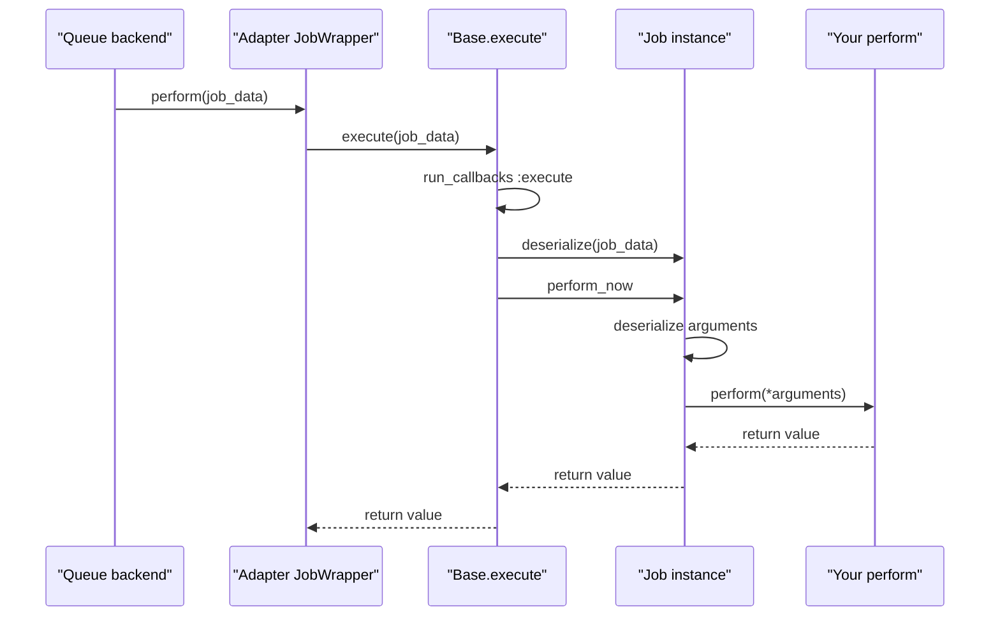
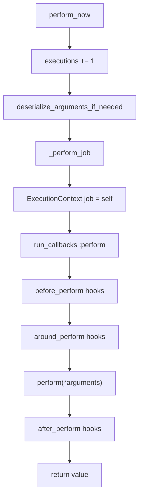

# 03 -- Execution: `perform_now`, `execute`, and the nested run

Execution is the long half of the job's life. This document traces how a serialized hash becomes a Ruby object and runs your `perform` method.

Source files: `/Users/darkvoid/.gems/gems/activejob-8.1.4/lib/active_job/execution.rb`, `/Users/darkvoid/.gems/gems/activejob-8.1.4/lib/active_job/core.rb`, and `/Users/darkvoid/.gems/gems/activejob-8.1.4/lib/active_job/instrumentation.rb`.

## Two entry points

There are two ways a job runs, and they must be kept apart.

`perform_now` runs the job immediately in the current process. The queue adapter is not involved:

```ruby
# Source: lib/active_job/execution.rb, lines 22-24
def perform_now(...)
  job_or_instantiate(...).perform_now
end
```

`execute` is the worker-side entry point. It is a class method that takes the serialized hash, rebuilds the job, and runs it:

```ruby
# Source: lib/active_job/execution.rb, lines 26-31
def execute(job_data)
  ActiveJob::Callbacks.run_callbacks(:execute) do
    job = deserialize(job_data)
    job.perform_now
  end
end
```

`execute` is what every adapter's wrapper calls. The async adapter's `JobWrapper#perform` calls `Base.execute @job_data` (`lib/active_job/queue_adapters/async_adapter.rb` line 70). Sidekiq's wrapper calls `Base.execute job_data.merge("provider_job_id" => jid)` (`lib/active_job/queue_adapters/sidekiq_adapter.rb` line 89). The `:execute` callback is shared across all jobs, and the Railtie uses it to wrap execution in the code reloader (`lib/active_job/railtie.rb` lines 82-90).



## Inside `perform_now`

The instance method is short but packs several responsibilities:

```ruby
# Source: lib/active_job/execution.rb, lines 45-58
def perform_now
  # Guard against jobs that were persisted before we started counting executions by zeroing out nil counters
  self.executions = (executions || 0) + 1

  deserialize_arguments_if_needed

  _perform_job
rescue Exception => exception
  handled = rescue_with_handler(exception)
  return handled if handled

  run_after_discard_procs(exception)
  raise
end
```

Step by step:

1. `executions` increments. This counter is serialized, so a retried job carries its count forward.
2. `deserialize_arguments_if_needed` decodes the stored arguments into real Ruby objects. This is the lazy decode promised in [01-the-job.md](./01-the-job.md).
3. `_perform_job` runs the callbacks and your `perform`.
4. If anything raises, `rescue_with_handler` consults the `rescue_from`, `retry_on`, and `discard_on` handlers. If one handles the exception, its return value is returned. Otherwise `run_after_discard_procs` runs and the exception re-raises.

`perform` itself is an unimplemented placeholder. Every subclass replaces it:

```ruby
# Source: lib/active_job/execution.rb, lines 60-62
def perform(*)
  fail NotImplementedError
end
```

The argument decoding:

```ruby
# Source: lib/active_job/core.rb, lines 193-210
def deserialize_arguments_if_needed
  if arguments_serialized?
    @arguments = deserialize_arguments(@serialized_arguments)
    @serialized_arguments = nil
  end
end

def serialize_arguments(arguments)
  Arguments.serialize(arguments)
end

def deserialize_arguments(serialized_args)
  Arguments.deserialize(serialized_args)
end

def arguments_serialized?
  @serialized_arguments
end
```

After this runs, `@serialized_arguments` is set to `nil` and `@arguments` holds live objects. The nil-out means a job that is later re-serialized (for example, by a retry) serializes its live arguments again rather than reusing stale serialized ones.

## The nested run

`_perform_job` sets the job into the execution context and runs the `:perform` callback chain around your method:

```ruby
# Source: lib/active_job/execution.rb, lines 65-70
def _perform_job
  ActiveSupport::ExecutionContext[:job] = self
  run_callbacks :perform do
    perform(*arguments)
  end
end
```

`ActiveSupport::ExecutionContext[:job]` publishes the current job to anything running inside the job. Active Record query logs use it to tag queries with the job class (`lib/active_job/railtie.rb` lines 92-106). The continuable test helper uses it to read the current continuation state.

`run_callbacks :perform` is the ActiveSupport callback runner. It composes `before_perform`, `around_perform`, and `after_perform` into a stack, and the innermost frame calls `perform(*arguments)`.



## `around_perform` and perform-inside-perform

The `around` hook receives the job and a block. Calling the block runs the rest of the chain, including `perform`:

```ruby
# Source: lib/active_job/callbacks.rb, lines 73-104 (documentation, abridged)
around_perform do |job, block|
  UserMailer.notify_video_started_processing(job.arguments.first)
  block.call
  UserMailer.notify_video_processed(job.arguments.first)
end
```

Because `perform` is just the innermost block, a job can run another job inside itself. `perform_now` is blocking and returns the value of `perform`:

```ruby
# Source: lib/active_job/execution.rb, lines 34-44 (documentation)
# +perform_now+ returns the value of your job's +perform+ method.
class MyJob < ActiveJob::Base
  def perform
    "Hello World!"
  end
end

puts MyJob.new(*args).perform_now # => "Hello World!"
```

A parent job can therefore call a child job's `perform_now` inline, sharing the same process, transaction, and callback stack. The nesting is plain Ruby: one `perform` inside another `perform`, each with its own callback chain.

## The instrumentation wrappers

Two other modules wrap `perform_now` to emit notifications. `Instrumentation` instruments the whole run:

```ruby
# Source: lib/active_job/instrumentation.rb, lines 25-39 and 42-45
def perform_now
  instrument(:perform) { super }
end

def instrument(operation, payload = {}, &block)
  payload[:job] = self
  payload[:adapter] = queue_adapter

  ActiveSupport::Notifications.instrument("#{operation}.active_job", payload) do |payload|
    value = block.call(payload) if block
    payload[:aborted] = @_halted_callback_hook_called if defined?(@_halted_callback_hook_called)
    @_halted_callback_hook_called = nil
    value
  end
end

def _perform_job
  instrument(:perform_start)
  super
end
```

`Logging` adds log tags, and `ExecutionState` restores locale and timezone. These are covered in [09-instrumentation-and-timezone.md](./09-instrumentation-and-timezone.md). The important structural fact here: `perform_now` is wrapped in layers. The outermost layer is locale and timezone, then log tagging, then the `perform` notification, and only then the actual counter increment and your method.

## The Aha Moment

**Aha:** There is no magic "run the job" call. `execute` is just `deserialize` followed by `perform_now`, and `perform_now` is just a guarded call to your `perform` through a callback stack. The whole worker side of the framework is ordinary method composition. Because `perform` is a plain method and `perform_now` is blocking, a job is simultaneously a queue entry, a unit of testable code, and something another job can call directly — three uses, one method.

Continue to [04-arguments-and-serializers.md](./04-arguments-and-serializers.md).
