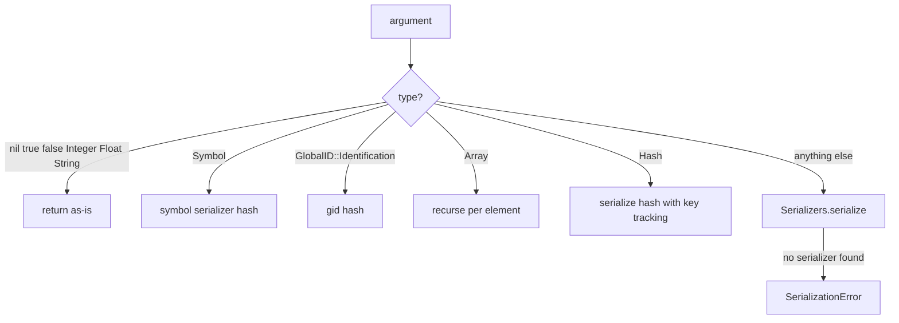
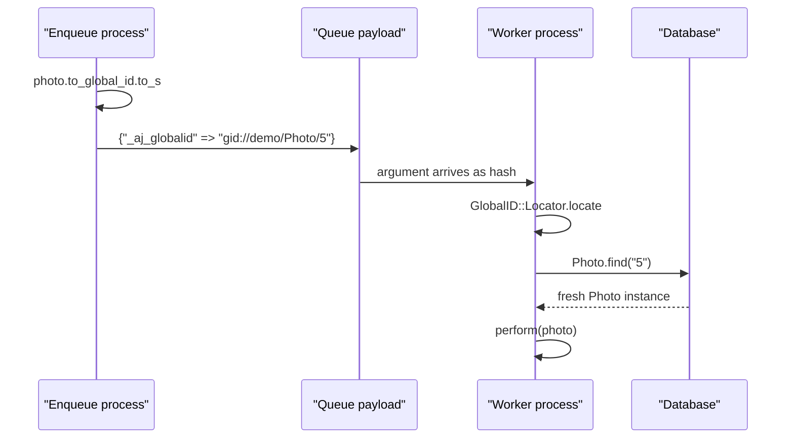

# 04 -- Arguments and Serializers: how a model becomes a Global ID

Arguments are the payload of a job. ActiveJob must turn any Ruby object you pass into a hash that a queue backend can store, then turn it back on the worker. Two pieces do this: `ActiveJob::Arguments` and the `Serializers` registry.

Source files: `/Users/darkvoid/.gems/gems/activejob-8.1.4/lib/active_job/arguments.rb`, `/Users/darkvoid/.gems/gems/activejob-8.1.4/lib/active_job/serializers.rb`, and everything under `/Users/darkvoid/.gems/gems/activejob-8.1.4/lib/active_job/serializers/`. The Global ID (GlobalID) gem is at `/Users/darkvoid/.gems/gems/globalid-1.4.0/lib/global_id/`.

## The problem

Queue backends store simple data: strings, numbers, booleans, null, arrays, and objects. A Ruby `Date`, a `Symbol`, an `ActiveSupport::Duration`, and an Active Record model are none of those. They must be converted to JavaScript Object Notation (JSON) primitives and back.

The conversion must also be lossless enough for a worker in a different process and, possibly, a different version of your code. This is a harder constraint than JSON alone.

## `ActiveJob::Arguments`

`Arguments` is a module with two public methods:

```ruby
# Source: lib/active_job/arguments.rb, lines 34-36 and 82-86
def serialize(arguments)
  arguments.map { |argument| serialize_argument(argument) }
end

def deserialize(arguments)
  arguments.map { |argument| deserialize_argument(argument) }
rescue
  raise DeserializationError
end
```

`serialize_argument` is a `case` that classifies each argument:

```ruby
# Source: lib/active_job/arguments.rb, lines 38-76
def serialize_argument(argument)
  case argument
  when nil, true, false, Integer, Float # Types that can hardly be subclassed
    argument
  when String
    if argument.class == String
      argument
    else
      begin
        Serializers.serialize(argument)
      rescue SerializationError
        argument
      end
    end
  when Symbol
    { Serializers::OBJECT_SERIALIZER_KEY => "ActiveJob::Serializers::SymbolSerializer", "value" => argument.name }
  when GlobalID::Identification
    convert_to_global_id_hash(argument)
  when Array
    argument.map { |arg| serialize_argument(arg) }
  when ActiveSupport::HashWithIndifferentAccess
    serialize_indifferent_hash(argument)
  when Hash
    symbol_keys = argument.keys
    symbol_keys.select! { |k| k.is_a?(Symbol) }
    symbol_keys.map!(&:name)
    aj_hash_key = if Hash.ruby2_keywords_hash?(argument)
      RUBY2_KEYWORDS_KEY
    else
      SYMBOL_KEYS_KEY
    end
    result = serialize_hash(argument)
    result[aj_hash_key] = symbol_keys
    result
  else
    Serializers.serialize(argument)
  end
end
```



The design rule: primitives pass through untouched, containers recurse, and everything else goes through the serializer registry. A model hits the `GlobalID::Identification` branch before the generic `Serializers` branch.

## The Global ID branch

When an argument responds to `GlobalID::Identification` — every Active Record model does, through `include GlobalID::Identification` in the GlobalID Railtie (`/Users/darkvoid/.gems/gems/globalid-1.4.0/lib/global_id/railtie.rb` lines 33-36) — ActiveJob stores a one-key hash:

```ruby
# Source: lib/active_job/arguments.rb, lines 191-196
def convert_to_global_id_hash(argument)
  { GLOBALID_KEY => argument.to_global_id.to_s }
rescue URI::GID::MissingModelIdError
  raise SerializationError, "Unable to serialize #{argument.class} " \
    "without an id. (Maybe you forgot to call save?)"
end
```

`GLOBALID_KEY` is `"_aj_globalid"` (`lib/active_job/arguments.rb` line 90). The stored string looks like `gid://demo/Photo/5`.

The `gid://` URI is produced by `GlobalID::Identification#to_global_id` and `URI::GID`:

```ruby
# Source: /Users/darkvoid/.gems/gems/globalid-1.4.0/lib/global_id/identification.rb, lines 38-40
def to_global_id(options = {})
  GlobalID.create(self, options)
end
```

```ruby
# Source: /Users/darkvoid/.gems/gems/globalid-1.4.0/lib/global_id/uri/gid.rb, lines 76-78 (abridged)
def create(app, model, params = nil)
  build app: app, model_name: model.class.name, model_id: model.id, params: params
end
```

So `Photo.find(5).to_global_id.to_s` is `"gid://demo/Photo/5"`: the app name (`demo`), the class name (`Photo`), and the primary key (`5`).

On the worker, `deserialize_argument` recognizes the one-key hash and loads the record from the database:

```ruby
# Source: lib/active_job/arguments.rb, lines 109-134 (abridged)
def deserialize_argument(argument)
  case argument
  when nil, true, false, String, Integer, Float
    argument
  when Array
    argument.map { |arg| deserialize_argument(arg) }
  when Hash
    if serialized_global_id?(argument)
      deserialize_global_id argument
    elsif custom_serialized?(argument)
      Serializers.deserialize(argument)
    else
      deserialize_hash(argument)
    end
  else
    raise ArgumentError, "Can only deserialize primitive arguments: #{argument.inspect}"
  end
end

def serialized_global_id?(hash)
  hash.size == 1 && hash.include?(GLOBALID_KEY)
end

def deserialize_global_id(hash)
  GlobalID::Locator.locate hash[GLOBALID_KEY]
end
```

`GlobalID::Locator.locate` turns the URI back into a model instance by calling the model's `find` with the id:

```ruby
# Source: /Users/darkvoid/.gems/gems/globalid-1.4.0/lib/global_id/locator.rb, lines 211-217
def locate(gid, options = {})
  return unless model_id_is_valid?(gid)
  model_class = gid.model_class
  model_class = model_class.includes(options[:includes]) if options[:includes]

  model_class.find gid.model_id
end
```



The model is never embedded. The worker issues a fresh query and gets the current state of the record, not the state at enqueue time. If the record was deleted, `find` raises, and the common remedy is `discard_on ActiveJob::DeserializationError` (see the generated `ApplicationJob` template and [07-exceptions-retry-discard.md](./07-exceptions-retry-discard.md)).

Two failure modes are surfaced as specific errors. An unsaved model raises `SerializationError`:

```ruby
# Source: lib/active_job/arguments.rb, lines 17-26 (abridged)
class SerializationError < ArgumentError; end
```

Any deserialization failure is wrapped in `DeserializationError`, with the original as the cause:

```ruby
# Source: lib/active_job/arguments.rb, lines 10-15
class DeserializationError < StandardError
  def initialize
    super("Error while trying to deserialize arguments: #{$!.message}")
    set_backtrace $!.backtrace
  end
end
```

## Hashes and their keys

Ruby hashes can have symbol keys, but JSON objects cannot. ActiveJob serializes symbol keys to strings and remembers which ones to restore:

```ruby
# Source: lib/active_job/arguments.rb, lines 140-157 (abridged)
def serialize_hash(argument)
  argument.each_with_object({}) do |(key, value), hash|
    hash[serialize_hash_key(key)] = serialize_argument(value)
  end
end

def deserialize_hash(serialized_hash)
  result = serialized_hash.transform_values { |v| deserialize_argument(v) }
  if result.delete(WITH_INDIFFERENT_ACCESS_KEY)
    result = result.with_indifferent_access
  elsif symbol_keys = result.delete(SYMBOL_KEYS_KEY)
    result = transform_symbol_keys(result, symbol_keys)
  elsif symbol_keys = result.delete(RUBY2_KEYWORDS_KEY)
    result = transform_symbol_keys(result, symbol_keys)
    result = Hash.ruby2_keywords_hash(result)
  end
  result
end
```

Five reserved keys mark metadata: `_aj_symbol_keys` for symbol-keyed hashes, `_aj_ruby2_keywords` for hashes that were Ruby 2 keyword arguments, `_aj_hash_with_indifferent_access` for `HashWithIndifferentAccess`, `_aj_globalid` for Global ID references, and `_aj_serialized` for custom serializers. These keys are reserved, and using them yourself raises:

```ruby
# Source: lib/active_job/arguments.rb, lines 90-107 and 159-170
GLOBALID_KEY = "_aj_globalid"
SYMBOL_KEYS_KEY = "_aj_symbol_keys"
RUBY2_KEYWORDS_KEY = "_aj_ruby2_keywords"
WITH_INDIFFERENT_ACCESS_KEY = "_aj_hash_with_indifferent_access"

def serialize_hash_key(key)
  case key
  when RESERVED_KEYS
    raise SerializationError.new("Can't serialize a Hash with reserved key #{key.inspect}")
  when String
    key
  when Symbol
    key.name
  else
    raise SerializationError.new("Only string and symbol hash keys may be serialized as job arguments, but #{key.inspect} is a #{key.class}")
  end
end
```

## The serializer registry

`Serializers` keeps a set of known serializers. `serialize` finds the first one that matches the argument's class; `deserialize` looks up the serializer by the name stored in the hash:

```ruby
# Source: lib/active_job/serializers.rb, lines 31-48
def serialize(argument)
  serializer = @serializers_index[argument.class] || serializers.find { |s| s.serialize?(argument) }
  raise SerializationError.new("Unsupported argument type: #{argument.class.name}") unless serializer
  serializer.serialize(argument)
end

def deserialize(argument)
  serializer_name = argument[OBJECT_SERIALIZER_KEY]
  raise ArgumentError, "Serializer name is not present in the argument: #{argument.inspect}" unless serializer_name

  serializer = serializer_name.safe_constantize
  raise ArgumentError, "Serializer #{serializer_name} is not known" unless serializer

  serializer.deserialize(argument)
end
```

Every custom serializer stores its own class name under `OBJECT_SERIALIZER_KEY` (`"_aj_serialized"`, line 104), so the worker knows which class can reverse it. The registry is also readable and writable: `ActiveJob::Serializers.serializers` returns the known serializers, and `serializers=` replaces the list (`serializers.rb` lines 51-57).

The base class is `ObjectSerializer`, a singleton:

```ruby
# Source: lib/active_job/serializers/object_serializer.rb, lines 24-49 (abridged)
class ObjectSerializer
  include Singleton

  def initialize
    super
    @template = { Serializers::OBJECT_SERIALIZER_KEY => self.class.name }.freeze
  end

  def serialize?(argument)
    argument.is_a?(klass)
  end

  def serialize(hash)
    @template.merge(hash)
  end

  def deserialize(hash)
    raise NotImplementedError, "#{self.class.name} should implement a public #deserialize(hash) method"
  end
end
```

The registry ships with serializers for `Symbol`, `Duration`, `DateTime`, `Date`, `TimeWithZone`, `Time`, `Module`, `Range`, and `BigDecimal` (`lib/active_job/serializers.rb` lines 106-114). Each is a tiny subclass. `DateSerializer` is representative:

```ruby
# Source: lib/active_job/serializers/date_serializer.rb, lines 5-18
class DateSerializer < ObjectSerializer
  def serialize(date)
    super("value" => date.iso8601)
  end

  def deserialize(hash)
    Date.iso8601(hash["value"])
  end

  def klass
    Date
  end
end
```

`TimeSerializer` inherits from `TimeObjectSerializer` (itself an `ObjectSerializer` subclass that adds nanosecond `iso8601` serialization).

`TimeWithZoneSerializer` is worth studying because it stores the zone, not just the instant:

```ruby
# Source: lib/active_job/serializers/time_with_zone_serializer.rb, lines 5-23
class TimeWithZoneSerializer < ObjectSerializer
  NANO_PRECISION = 9

  def serialize(time_with_zone)
    super(
      "value" => time_with_zone.iso8601(NANO_PRECISION),
      "time_zone" => time_with_zone.time_zone.tzinfo.name
    )
  end

  def deserialize(hash)
    Time.iso8601(hash["value"]).in_time_zone(hash["time_zone"] || Time.zone)
  end

  def klass
    ActiveSupport::TimeWithZone
  end
end
```

## Writing a custom serializer

A custom serializer subclasses `ObjectSerializer` and implements `serialize`, `deserialize`, and `klass`:

```ruby
# Source: lib/active_job/serializers/object_serializer.rb, lines 6-24 (documentation)
class MoneySerializer < ActiveJob::Serializers::ObjectSerializer
  def serialize(money)
    super("amount" => money.amount, "currency" => money.currency)
  end

  def deserialize(hash)
    Money.new(hash["amount"], hash["currency"])
  end

  def klass
    Money
  end
end
```

In Rails, register it through `config.active_job.custom_serializers = [MoneySerializer]`, which the Railtie feeds into `Serializers.add_serializers` (`lib/active_job/railtie.rb` lines 22-27). Out of Rails, call `ActiveJob::Serializers.add_serializers MoneySerializer` directly.

## The Aha Moment

**Aha:** The model argument is a foreign key, not a copy. Passing a model to a job stores a `gid://` reference, and the worker reloads the record with a fresh `find`. This is why jobs see current data, why a deleted record breaks a job with a clear `DeserializationError`, and why you never accidentally ship stale database rows through the queue. The serializer registry is the escape hatch: any value type that is not a model, a primitive, or a container can teach ActiveJob how to freeze and thaw it.

Continue to [05-queue-adapters.md](./05-queue-adapters.md).
