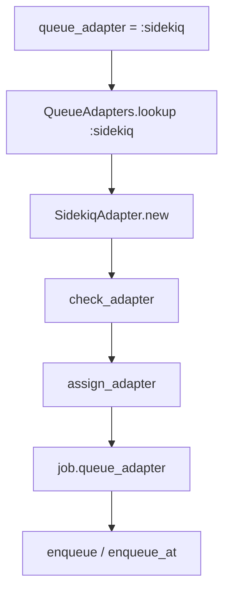
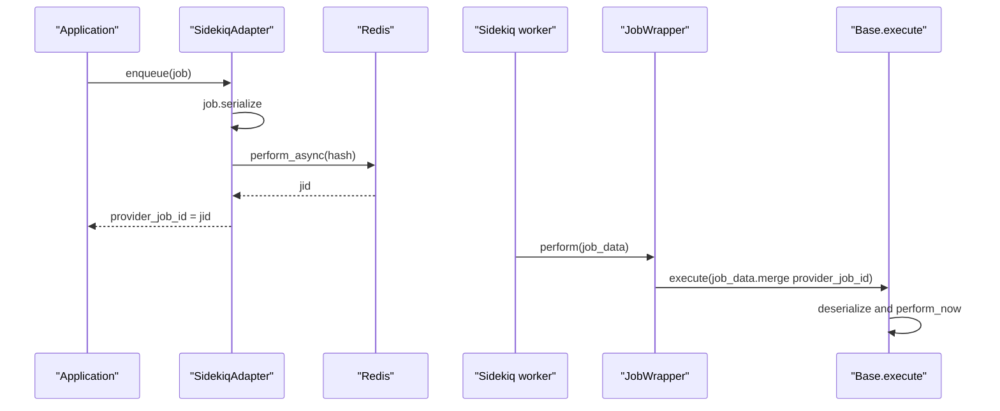

# 05 -- Queue Adapters: the tiny interface behind everything

An adapter is the only part of ActiveJob that talks to a real queue backend. Everything else in the framework is backend-agnostic because it funnels through this interface.

Source files: `/Users/darkvoid/.gems/gems/activejob-8.1.4/lib/active_job/queue_adapter.rb`, `/Users/darkvoid/.gems/gems/activejob-8.1.4/lib/active_job/queue_adapters.rb`, and everything under `/Users/darkvoid/.gems/gems/activejob-8.1.4/lib/active_job/queue_adapters/`.

## The contract

The abstract adapter declares two methods that every adapter must implement, plus one helper:

```ruby
# Source: lib/active_job/queue_adapters/abstract_adapter.rb, lines 9-24
class AbstractAdapter
  attr_accessor :stopping

  def enqueue(job)
    raise NotImplementedError
  end

  def enqueue_at(job, timestamp)
    raise NotImplementedError
  end

  def stopping?
    !!@stopping
  end
end
```

That is almost the whole contract. `enqueue(job)` pushes a job for immediate execution. `enqueue_at(job, timestamp)` pushes a job for execution after an absolute Unix timestamp. `stopping?` supports graceful shutdown for the Continuable machinery ([08-continuable.md](./08-continuable.md)). Adapters may optionally add `enqueue_all(jobs)` for bulk pushes and `check_adapter` for load-time warnings.

The interface is validated by duck typing. `QueueAdapter.queue_adapter=` accepts either a symbol (looked up in the registry) or an object that responds to `enqueue` and `enqueue_at`:

```ruby
# Source: lib/active_job/queue_adapter.rb, lines 49-75 (abridged)
def queue_adapter=(name_or_adapter)
  case name_or_adapter
  when Symbol, String
    queue_adapter = ActiveJob::QueueAdapters.lookup(name_or_adapter).new
    queue_adapter.try(:check_adapter)
    assign_adapter(name_or_adapter.to_s, queue_adapter)
  else
    if queue_adapter?(name_or_adapter)
      adapter_name = ActiveJob.adapter_name(name_or_adapter).underscore
      assign_adapter(adapter_name, name_or_adapter)
    else
      raise ArgumentError
    end
  end
end

QUEUE_ADAPTER_METHODS = [:enqueue, :enqueue_at].freeze

def queue_adapter?(object)
  QUEUE_ADAPTER_METHODS.all? { |meth| object.respond_to?(meth) }
end
```

`ActiveJob.adapter_name(adapter)` derives the adapter name from an object (used by `queue_adapter=`), and `ActiveJob::Base.queue_adapter_name` returns the configured adapter name string (`queue_adapter.rb` lines 7-12 and 39-44).

The default adapter is `:async`. The registry maps a symbol to a class by name:

```ruby
# Source: lib/active_job/queue_adapters.rb, lines 129-137
def lookup(name)
  const_get(name.to_s.camelize << ADAPTER)
end
```

So `:sidekiq` resolves to `ActiveJob::QueueAdapters::SidekiqAdapter`.



## The built-in development adapters

Three adapters ship for local use.

The async adapter runs jobs on an in-process thread pool via Concurrent Ruby. It is the default. It serializes the job immediately for parity with real backends, then executes it on a thread:

```ruby
# Source: lib/active_job/queue_adapters/async_adapter.rb, lines 39-72 (abridged)
def enqueue(job)
  @scheduler.enqueue JobWrapper.new(job), queue_name: job.queue_name
end

def enqueue_at(job, timestamp)
  @scheduler.enqueue_at JobWrapper.new(job), timestamp, queue_name: job.queue_name
end

class JobWrapper
  def initialize(job)
    job.provider_job_id = SecureRandom.uuid
    @job_data = job.serialize
  end

  def perform
    Base.execute @job_data
  end
end
```

Note the comment in the source: serializing even though the job stays in-process catches serialization bugs early. The scheduler defaults to up to `RAILS_MAX_THREADS` threads (`lib/active_job/queue_adapters/async_adapter.rb` lines 74-117). Pending jobs are lost on restart, which is why this adapter is for development and testing only. The adapter also exposes `shutdown(wait: true)` to gracefully stop the pool and `immediate=` (a test-suite hook) to run scheduled jobs immediately (`lib/active_job/queue_adapters/async_adapter.rb` lines 47-57).

The inline adapter runs the job synchronously inside `enqueue`:

```ruby
# Source: lib/active_job/queue_adapters/inline_adapter.rb, lines 13-22
class InlineAdapter < AbstractAdapter
  def enqueue(job)
    Base.execute(job.serialize)
  end

  def enqueue_at(*)
    raise NotImplementedError, "Use a queueing backend to enqueue jobs in the future..."
  end
end
```

The test adapter records jobs instead of running them, and can optionally perform them. It is covered in [10-rails-integration-and-testing.md](./10-rails-integration-and-testing.md).

## A real backend: Sidekiq

The Sidekiq adapter shows the full pattern. Enqueue pushes a serialized hash through a `JobWrapper`:

```ruby
# Source: lib/active_job/queue_adapters/sidekiq_adapter.rb, lines 40-52
def enqueue(job)
  job.provider_job_id = JobWrapper.set(
    wrapped: job.class,
    queue: job.queue_name
  ).perform_async(job.serialize)
end

def enqueue_at(job, timestamp)
  job.provider_job_id = JobWrapper.set(
    wrapped: job.class,
    queue: job.queue_name,
  ).perform_at(timestamp, job.serialize)
end
```

`provider_job_id` becomes Sidekiq's `jid`. The wrapper runs on the Sidekiq worker and hands the hash back to the framework:

```ruby
# Source: lib/active_job/queue_adapters/sidekiq_adapter.rb, lines 85-92
class JobWrapper
  include Sidekiq::Worker

  def perform(job_data)
    Base.execute job_data.merge("provider_job_id" => jid)
  end
end
```

The worker side of every adapter is this same one-liner: decode the backend's message into a hash and call `Base.execute`. Backburner, Resque, Delayed Job, Sneakers, and queue_classic all end in `Base.execute job_data`:

```ruby
# Source: lib/active_job/queue_adapters/resque_adapter.rb, lines 44-51
class JobWrapper
  class << self
    def perform(job_data)
      Base.execute job_data
    end
  end
end
```

Sidekiq also implements `enqueue_all`, which uses `Sidekiq::Client.push_bulk` to push many jobs in one Redis round trip (`lib/active_job/queue_adapters/sidekiq_adapter.rb` lines 54-83).



## A database-backed backend

ActiveJob itself no longer ships a database adapter, but the same contract governs ones such as Solid Queue or Delayed Job. Delayed Job stores each job as a row in a database table:

```ruby
# Source: lib/active_job/queue_adapters/delayed_job_adapter.rb, lines 19-29
def enqueue(job)
  delayed_job = Delayed::Job.enqueue(JobWrapper.new(job.serialize), queue: job.queue_name, priority: job.priority)
  job.provider_job_id = delayed_job.id
  delayed_job
end

def enqueue_at(job, timestamp)
  delayed_job = Delayed::Job.enqueue(JobWrapper.new(job.serialize), queue: job.queue_name, priority: job.priority, run_at: Time.at(timestamp))
  job.provider_job_id = delayed_job.id
  delayed_job
end
```

Here `provider_job_id` is the database row id. The pattern is identical to Sidekiq: the adapter translates `enqueue` into the backend's native call and stores the backend's own identifier back on the job.

## Retry and discard from the adapter's side

ActiveJob's own `retry_on` and `discard_on` do not need adapter support. They re-run the job through the ordinary `enqueue` path (see [07-exceptions-retry-discard.md](./07-exceptions-retry-discard.md)). When ActiveJob exhausts its own retries, the exception bubbles up to the backend, and the backend's own retry machinery takes over if it has one. This is why the `retry_on` documentation says the exception is "allowed to bubble up to the underlying queuing system":

```ruby
# Source: lib/active_job/exceptions.rb, lines 16-19 (documentation)
# If the exception keeps getting raised beyond the specified number of attempts, the exception is allowed to
# bubble up to the underlying queuing system, which may have its own retry mechanism or place it in a
# holding queue for inspection.
```

The adapter therefore has two retry layers available: ActiveJob's in-job retries (cross-backend) and the backend's own dead-letter handling (backend-specific).

## The Aha Moment

**Aha:** An adapter is ten lines of glue. The entire surface is `enqueue` and `enqueue_at` on the way in, and `Base.execute(job_data)` on the way out. Everything complicated — serialization, argument handling, callbacks, retries, instrumentation, timezones — lives in the framework, not the adapter. That is the whole economic argument for ActiveJob: backend authors only have to move a hash into their store and hand it back; all the hard, shared logic is written once.

Continue to [06-callbacks.md](./06-callbacks.md).
