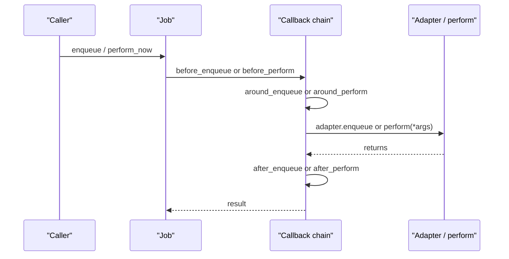
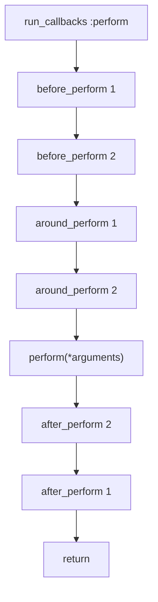

# 06 -- Callbacks: hooks around enqueue and perform

Callbacks let you run code at specific points in a job's life without putting that code inside `perform`. There are six, in two groups of three.

Source files: `/Users/darkvoid/.gems/gems/activejob-8.1.4/lib/active_job/callbacks.rb`, and the underlying runner in ActiveSupport's `ActiveSupport::Callbacks`.

## The six hooks

The `Callbacks` module declares two callback chains, one for enqueue and one for perform, plus a shared `execute` chain:

```ruby
# Source: lib/active_job/callbacks.rb, lines 22-30
class << self
  include ActiveSupport::Callbacks
  define_callbacks :execute
end

included do
  define_callbacks :perform, skip_after_callbacks_if_terminated: true
  define_callbacks :enqueue, skip_after_callbacks_if_terminated: true
end
```

The six hooks:

- `before_enqueue`, `around_enqueue`, `after_enqueue` run in the enqueuing process.
- `before_perform`, `around_perform`, `after_perform` run in the worker process.

Each has a class method that delegates to `set_callback`:

```ruby
# Source: lib/active_job/callbacks.rb, lines 50-52 and 69-71 and 121-123
def before_perform(*filters, &blk)
  set_callback(:perform, :before, *filters, &blk)
end

def after_perform(*filters, &blk)
  set_callback(:perform, :after, *filters, &blk)
end

def before_enqueue(*filters, &blk)
  set_callback(:enqueue, :before, *filters, &blk)
end
```

`around_perform`, `after_enqueue`, and `around_enqueue` follow the same shape (`lib/active_job/callbacks.rb` lines 102-104, 141-143, 162-164).



## How the chain runs

The actual call sites were shown in [02-enqueue-lifecycle.md](./02-enqueue-lifecycle.md) and [03-execution.md](./03-execution.md). Enqueue wraps the adapter push in `run_callbacks :enqueue`:

```ruby
# Source: lib/active_job/enqueuing.rb, lines 97-101
def raw_enqueue
  run_callbacks :enqueue do
    _raw_enqueue
  end
end
```

Perform wraps your method in `run_callbacks :perform`:

```ruby
# Source: lib/active_job/execution.rb, lines 65-70
def _perform_job
  ActiveSupport::ExecutionContext[:job] = self
  run_callbacks :perform do
    perform(*arguments)
  end
end
```

The `around` hook is the key structural one. It receives the job and a block, and must call the block to continue:

```ruby
# Source: lib/active_job/callbacks.rb, lines 73-87 (documentation)
around_perform do |job, block|
  UserMailer.notify_video_started_processing(job.arguments.first)
  block.call
  UserMailer.notify_video_processed(job.arguments.first)
end
```

The block is the rest of the chain — all remaining `around` hooks, then the innermost action (`perform` or the adapter push). So `around` callbacks nest like Russian dolls, and you can capture the return value:

```ruby
# Source: lib/active_job/callbacks.rb, lines 89-100 (documentation)
around_perform do |job, block|
  value = block.call
  puts value # => "Hello World!"
end

def perform
  "Hello World!"
end
```



## Halting

A `before` callback can stop the chain by throwing `:abort`. Because both chains are defined with `skip_after_callbacks_if_terminated: true`, halting skips the remaining `after` callbacks. The block never runs.

Halting is how you prevent a job from being enqueued or performed:

```ruby
before_enqueue do |job|
  throw :abort if job.arguments.first.nil?
end
```

The enqueue path reports a halted enqueue through the instrumentation payload. `Instrumentation` tracks the halt with `halted_callback_hook`:

```ruby
# Source: lib/active_job/instrumentation.rb, lines 47-50
def halted_callback_hook(*)
  super
  @_halted_callback_hook_called = true
end
```

The `LogSubscriber` then logs a specific message:

```ruby
# Source: lib/active_job/log_subscriber.rb, lines 17-20 (enqueue case)
elsif event.payload[:aborted]
  info do
    "Failed enqueuing #{job.class.name} to #{queue_name(event)}, a before_enqueue callback halted the enqueuing execution."
  end
end
```

## Ordering and inheritance

Callbacks are inherited. A subclass inherits its parent's callbacks, and its own callbacks append after them. `prepend: true` pushes a callback to the front of the chain instead. `Logging` uses this to make its tag wrapper run first:

```ruby
# Source: lib/active_job/logging.rb, lines 28-28
around_enqueue(prepend: true) { |_, block| tag_logger(&block) }
```

You can also pass `if:` / `unless:` conditions, symbol method names, and multiple filters in one call, because `set_callback` is the standard ActiveSupport callback API.

## The Aha Moment

**Aha:** A callback does not know or care whether it is in the enqueuing process or the worker. The two chains are identical in shape; only the wrapped action differs (adapter push versus `perform`). This symmetry is why the API is so small: you learn six method names once, and they behave the same on both sides of the process boundary. The difference that matters is the object — the enqueue hooks run on the instance in your request, the perform hooks run on a fresh instance rebuilt in the worker.

Continue to [07-exceptions-retry-discard.md](./07-exceptions-retry-discard.md).
