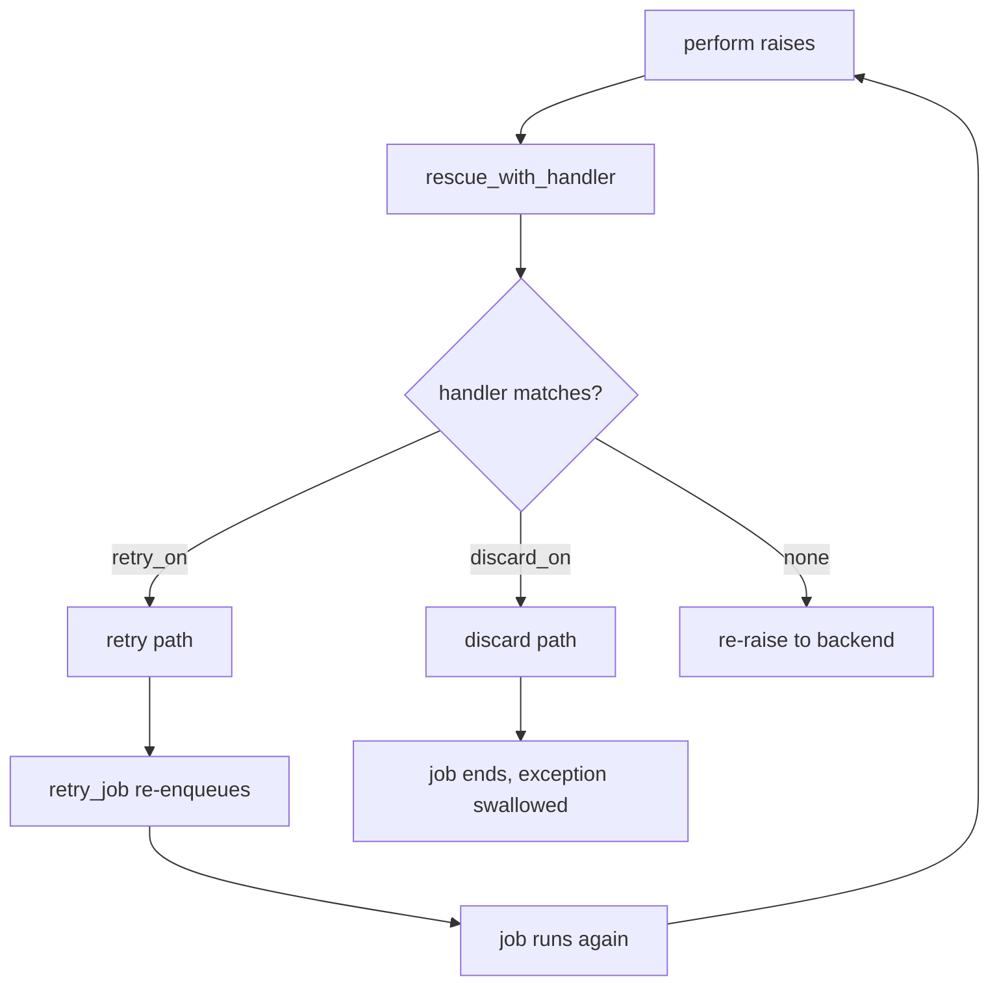
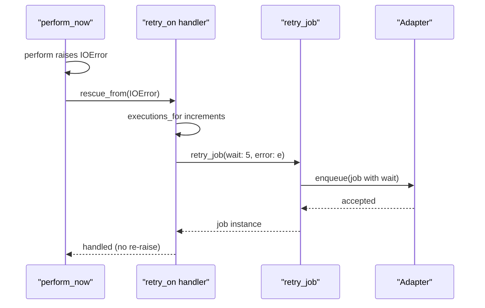

# 07 -- Exceptions, Retry, and Discard

Jobs fail. ActiveJob gives you declarative control over what happens when they do: retry with backoff, discard silently, or run custom code. This document explains the machinery.

Source files: `/Users/darkvoid/.gems/gems/activejob-8.1.4/lib/active_job/exceptions.rb` and `/Users/darkvoid/.gems/gems/activejob-8.1.4/lib/active_job/execution.rb`.

## The rescue chain

`retry_on` and `discard_on` are built on top of `ActiveSupport::Rescuable#rescue_from`. `Execution` includes `Rescuable`, and `perform_now` is the rescue point:

```ruby
# Source: lib/active_job/execution.rb, lines 12-14 and 45-58
module Execution
  extend ActiveSupport::Concern
  include ActiveSupport::Rescuable

  def perform_now
    self.executions = (executions || 0) + 1
    deserialize_arguments_if_needed
    _perform_job
  rescue Exception => exception
    handled = rescue_with_handler(exception)
    return handled if handled

    run_after_discard_procs(exception)
    raise
  end
end
```

When `perform` raises, `rescue_with_handler` searches the registered handlers bottom to top, then up the class hierarchy, and runs the first one whose class matches:

```ruby
# Source: lib/active_job/exceptions.rb, lines 24-25 (documentation)
# +retry_on+ and +discard_on+ handlers are searched from bottom to top, and up the class hierarchy.
# The handler of the first class for which <tt>exception.is_a?(klass)</tt> holds true is the one invoked, if any.
```

If a handler returns a value, that value becomes the return value of `perform_now`, and the exception is swallowed. If nothing handles it, the exception re-raises and reaches the queue backend.



## `retry_on`

`retry_on` registers a `rescue_from` handler that either re-enqueues or gives up:

```ruby
# Source: lib/active_job/exceptions.rb, lines 64-83
def retry_on(*exceptions, wait: 3.seconds, attempts: 5, queue: nil, priority: nil, jitter: JITTER_DEFAULT, report: false)
  rescue_from(*exceptions) do |error|
    executions = executions_for(exceptions)
    if attempts == :unlimited || executions < attempts
      ActiveSupport.error_reporter.report(error, source: "application.active_job") if report
      retry_job wait: determine_delay(seconds_or_duration_or_algorithm: wait, executions: executions, jitter: jitter), queue: queue, priority: priority, error: error
    else
      if block_given?
        instrument :retry_stopped, error: error do
          yield self, error
        end
        run_after_discard_procs(error)
      else
        instrument :retry_stopped, error: error
        run_after_discard_procs(error)
        raise error
      end
    end
  end
end
```

The defaults are `wait: 3.seconds` and `attempts: 5`, where attempts includes the original execution. `attempts: :unlimited` retries forever. `report: true` reports through the error reporter before retrying.

The per-declaration counter is tracked in `exception_executions`, keyed by the string representation of the exception list:

```ruby
# Source: lib/active_job/exceptions.rb, lines 197-204
def executions_for(exceptions)
  if exception_executions
    exception_executions[exceptions.to_s] = (exception_executions[exceptions.to_s] || 0) + 1
  else
    executions
  end
end
```

`executions` itself is the total run count, incremented in `perform_now` (see [03-execution.md](./03-execution.md)). `exception_executions` is serialized with the job (`core.rb` line 127), so both counters survive the round trip through the queue.

## Backoff and jitter

`determine_delay` computes the wait:

```ruby
# Source: lib/active_job/exceptions.rb, lines 171-195
def determine_delay(seconds_or_duration_or_algorithm:, executions:, jitter: JITTER_DEFAULT)
  jitter = jitter == JITTER_DEFAULT ? self.class.retry_jitter : (jitter || 0.0)

  case seconds_or_duration_or_algorithm
  when  :polynomially_longer
    # This delay uses a polynomial backoff strategy, which was previously misnamed as exponential
    delay = executions**4
    delay_jitter = determine_jitter_for_delay(delay, jitter)
    delay + delay_jitter + 2
  when ActiveSupport::Duration, Integer
    delay = seconds_or_duration_or_algorithm.to_i
    delay_jitter = determine_jitter_for_delay(delay, jitter)
    delay + delay_jitter
  when Proc
    algorithm = seconds_or_duration_or_algorithm
    algorithm.call(executions)
  else
    raise "Couldn't determine a delay based on #{seconds_or_duration_or_algorithm.inspect}"
  end
end

def determine_jitter_for_delay(delay, jitter)
  return 0.0 if jitter.zero?
  Kernel.rand * delay * jitter
end
```

The `:wait` option accepts three forms:

- a fixed `Duration` or `Integer` in seconds,
- a `Proc` that receives the execution count and returns a delay,
- the symbol `:polynomially_longer`, whose delay is `executions**4 + 2` (plus jitter), giving roughly 3s, then 18s, then 83s, and so on. The source comment notes this was previously misnamed "exponential".

Jitter is a random fraction added to the delay so retrying jobs do not thundering-herd a backend. The effective default is `0.0`, set by the `retry_jitter` class attribute:

```ruby
# Source: lib/active_job/exceptions.rb, line 11
class_attribute :retry_jitter, instance_accessor: false, instance_predicate: false, default: 0.0
```

(The doc comment at line 36 still says 15%; the code default is 0.0. Pass `jitter: 0.15` for a 15% upper bound, or set `self.retry_jitter` on the job.)

## How a retried job re-enqueues

`retry_job` is an instance method that re-runs the normal enqueue path with overrides, then restores the original attributes:

```ruby
# Source: lib/active_job/exceptions.rb, lines 158-165
def retry_job(options = {})
  instrument :enqueue_retry, options.slice(:error, :wait) do
    scheduled_at, queue_name, priority = self.scheduled_at, self.queue_name, self.priority
    enqueue options
  ensure
    self.scheduled_at, self.queue_name, self.priority = scheduled_at, queue_name, priority
  end
end
```

Because `enqueue` applies `set(options)`, the `:wait`, `:queue`, and `:priority` options become the re-enqueue parameters. The `ensure` restores the job's own schedule, queue, and priority after the push, so a later retry uses the original values again.

The retried job keeps its `job_id` and its incremented `executions`, because those are serialized. In effect a retry is just `perform_later` of the same job again.



## `discard_on`

`discard_on` swallows the exception entirely:

```ruby
# Source: lib/active_job/exceptions.rb, lines 109-117
def discard_on(*exceptions, report: false)
  rescue_from(*exceptions) do |error|
    instrument :discard, error: error do
      ActiveSupport.error_reporter.report(error, source: "application.active_job") if report
      yield self, error if block_given?
      run_after_discard_procs(error)
    end
  end
end
```

The canonical use is a record that no longer exists when the worker loads it:

```ruby
# Source: lib/rails/generators/job/templates/application_job.rb.tt, lines 5-7
# Most jobs are safe to ignore if the underlying records are no longer available
# discard_on ActiveJob::DeserializationError
```

`after_discard` registers a block run whenever a job is discarded for any reason:

```ruby
# Source: lib/active_job/exceptions.rb, lines 119-133 and 206-214
def after_discard(&blk)
  self.after_discard_procs += [blk]
end

def run_after_discard_procs(exception)
  exceptions = []
  after_discard_procs.each do |blk|
    instance_exec(self, exception, &blk)
  rescue StandardError => e
    exceptions << e
  end
  raise exceptions.last unless exceptions.empty?
end
```

## A note on older names

The task that prompted this exploration mentions `RetryJob` / `DiscardJob` exceptions and `rescue_with` handling. In 8.1.4 those no longer exist. The `RetryJob` and `DiscardJob` exception classes, and the `discard_job` instance method, were removed from Rails in version 5.0. What remains in 8.1.4 is:

- `retry_job` — an instance method (shown above), the primitive behind `retry_on` and the Continuable resume machinery ([08-continuable.md](./08-continuable.md)).
- `rescue_from` — the `ActiveSupport::Rescuable` API that `retry_on` and `discard_on` build on, invoked through `rescue_with_handler` in `perform_now`.

There is no `discard_job` method; discarding is only via `discard_on` or by handling the exception and not re-raising. The modern recommendation is the declarative pair `retry_on` / `discard_on`.

## The Aha Moment

**Aha:** Retry is just re-enqueue. There is no special retry channel. `retry_job` calls the exact same `enqueue` you call from `perform_later`, carrying the same `job_id`, the same serialized arguments, and an incremented `executions` counter. The backoff is only a `wait` value computed from that counter. This means retries inherit every enqueue feature for free — queues, priorities, schedules, callbacks, instrumentation — because they are ordinary enqueues.

Continue to [08-continuable.md](./08-continuable.md).
