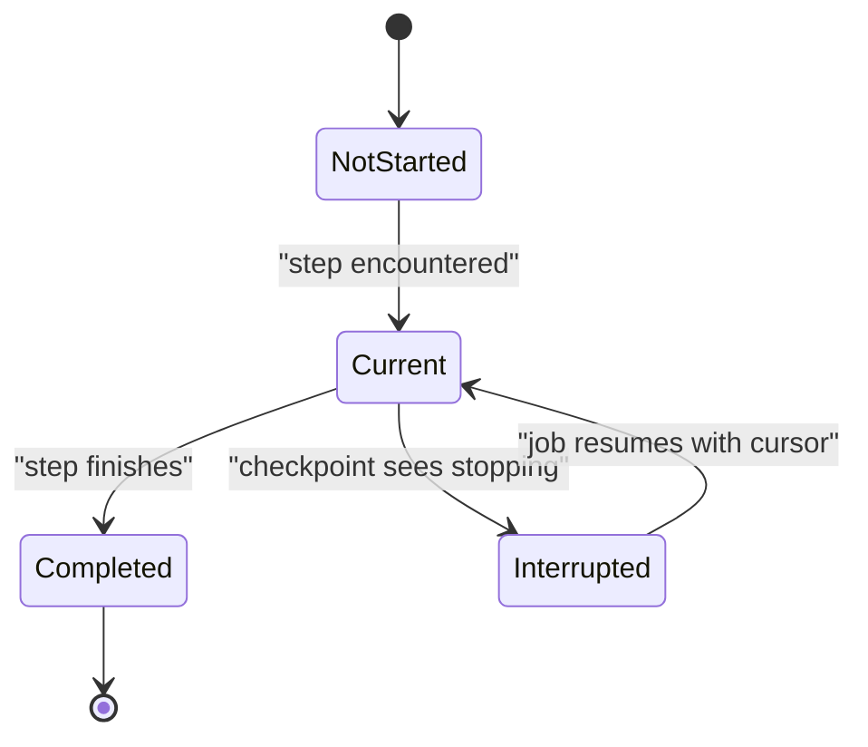
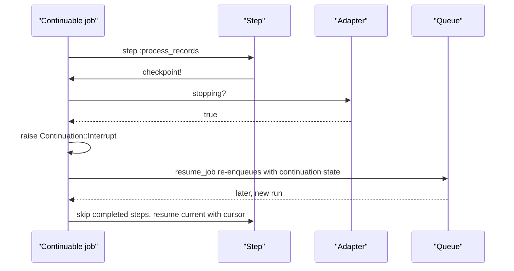

# 08 -- Continuable: steps, cursors, checkpoints, and resume

Long jobs can outlive a single process. A deploy, a shutdown, or a crash can interrupt a job mid-way. The Continuable machinery lets a job record its progress and resume from where it left off.

Source files: `/Users/darkvoid/.gems/gems/activejob-8.1.4/lib/active_job/continuable.rb`, `/Users/darkvoid/.gems/gems/activejob-8.1.4/lib/active_job/continuation.rb`, `/Users/darkvoid/.gems/gems/activejob-8.1.4/lib/active_job/continuation/step.rb`, and `/Users/darkvoid/.gems/gems/activejob-8.1.4/lib/active_job/continuation/validation.rb`.

This machinery is the foundation that ActiveJob Continuations and, above it, Async Job DSL Continuations (ajdc) build on. For the layer above, see the sibling exploration at `../../ajdc/`.

## The idea

A continuable job divides its work into named steps. Each step runs when encountered. Steps may keep a cursor, a value that marks progress inside the step. When the job is interrupted at a checkpoint, its progress is serialized with the job. On the next run, completed steps are skipped and the interrupted step resumes with its last cursor.

The core loop is the `step` method:

```ruby
# Source: lib/active_job/continuable.rb, lines 35-50
def step(step_name, start: nil, isolated: false, &block)
  unless block_given?
    step_method = method(step_name)
    raise ArgumentError, "Step method '#{step_name}' must accept 0 or 1 arguments" if step_method.arity > 1
    if step_method.parameters.any? { |type, name| type == :key || type == :keyreq }
      raise ArgumentError, "Step method '#{step_name}' must not accept keyword arguments"
    end
    block = step_method.arity == 0 ? -> (_) { step_method.call } : step_method
  end
  checkpoint! if continuation.advanced?
  continuation.step(step_name, start: start, isolated: isolated, &block)
end
```



## A minimal example

The documentation example shows the full shape:

```ruby
# Source: lib/active_job/continuation.rb, lines 28-60 (documentation, abridged)
class ProcessImportJob < ApplicationJob
  include ActiveJob::Continuable

  def perform(import_id)
    @import = Import.find(import_id)

    step :validate do
      @import.validate!
    end

    step(:process_records) do |step|
      @import.records.find_each(start: step.cursor) do |record|
        record.process
        step.advance! from: record.id
      end
    end

    step :reprocess_records
    step :finalize
  end
end
```

Code outside a step runs on every job run. That is where you reload state, such as the `Import` above. Steps that completed are skipped on resume.

## The `Continuation` object

Each continuable job owns a `Continuation`, created in the modified initializer:

```ruby
# Source: lib/active_job/continuable.rb, lines 16-28
included do
  class_attribute :max_resumptions, instance_writer: false
  class_attribute :resume_options, instance_writer: false, default: { wait: 5.seconds }
  class_attribute :resume_errors_after_advancing, instance_writer: false, default: true

  around_perform :continue

  def initialize(...)
    super(...)
    self.resumptions = 0
    self.continuation = Continuation.new(self, {})
  end
end
```

The `Continuation` holds the completed step names and the current step with its cursor. Its serialized form is a compact hash:

```ruby
# Source: lib/active_job/continuation.rb, lines 235-240
def to_h
  {
    "completed" => completed.map(&:to_s),
    "current" => current&.to_a,
  }.compact
end
```

The job's `serialize` and `deserialize` merge this state into the job payload:

```ruby
# Source: lib/active_job/continuable.rb, lines 52-60
def serialize
  super.merge("continuation" => continuation.to_h, "resumptions" => resumptions)
end

def deserialize(job_data)
  super
  self.continuation = Continuation.new(self, job_data.fetch("continuation", {}))
  self.resumptions = job_data.fetch("resumptions", 0)
end
```

So the continuation progress rides along in the same hash that the queue stores, exactly like arguments and executions.

## The `Step` and the cursor

`Step` is the cursor's home:

```ruby
# Source: lib/active_job/continuation/step.rb, lines 25-73 (abridged)
def initialize(name, cursor, job:, resumed:)
  @name = name.to_sym
  @initial_cursor = cursor
  @cursor = cursor
  @resumed = resumed
  @job = job
end

def checkpoint!
  job.checkpoint!
end

def set!(cursor)
  @cursor = cursor
  checkpoint!
end

def advance!(from: nil)
  from = cursor if from.nil?
  begin
    to = from.succ
  rescue NoMethodError
    raise UnadvanceableCursorError, "Cursor class '#{from.class}' does not implement 'succ'"
  end
  set! to
end
```

`advance!` calls `succ` on the cursor, so an integer cursor counts up, a date cursor moves forward, and so on. `advance!(from: record.id)` advances the cursor past an arbitrary id when records are not contiguous. `set!` assigns an absolute value. Both call `checkpoint!`, the interruption point. `Step#resumed?` reports whether the step was resumed from a previous execution, and `Step#advanced?` whether the cursor moved during this run (`step.rb` lines 62-69).

A cursor may be any value serializable as a job argument, and it defaults to `nil`. A nested iteration can use an array cursor, as the documentation shows with `start: [ 0, 0 ]` (`lib/active_job/continuation.rb` lines 110-118).

## Checkpoints and interruption

A checkpoint is where a job may stop safely:

```ruby
# Source: lib/active_job/continuable.rb, lines 62-69
def checkpoint!
  interrupt!(reason: :stopping) if queue_adapter.stopping?
end

def interrupt!(reason:)
  instrument :interrupt, reason: reason, **continuation.instrumentation
  raise Continuation::Interrupt, "Interrupted #{continuation.description} (#{reason})"
end
```

`queue_adapter.stopping?` asks the adapter whether the process is shutting down. The async adapter exposes `stopping` for tests; the Sidekiq adapter sets it from Sidekiq's quiet event (`lib/active_job/queue_adapters/sidekiq_adapter.rb` lines 21-31). If stopping, the job raises `Continuation::Interrupt`, a subclass of `Exception` (not `StandardError`) so ordinary rescue handlers do not swallow it:

```ruby
# Source: lib/active_job/continuation.rb, lines 191-194
class Interrupt < Exception; end
```

The other continuation errors live under `Continuation::Error`: `InvalidStepError` for an invalid step, and `CheckpointError` for a checkpoint failure such as an open transaction (`continuation.rb` lines 197-210).

Checkpoints occur before each step (except the first in a run) and inside a step whenever the cursor is set, advanced, or checkpointed explicitly. Jobs are not interrupted between checkpoints, so you should checkpoint more often than your shutdown timeout.



## Resume

The `around_perform :continue` wrapper handles interruption and errors:

```ruby
# Source: lib/active_job/continuable.rb, lines 72-98
def continue(&block)
  if continuation.started?
    self.resumptions += 1
    instrument :resume, **continuation.instrumentation
  end

  block.call
rescue Continuation::Interrupt => e
  resume_job(e)
rescue Continuation::Error
  raise
rescue StandardError => e
  if resume_errors_after_advancing? && continuation.advanced?
    resume_job(e)
  else
    raise
  end
end

def resume_job(exception)
  executions_for(exception)
  if max_resumptions.nil? || resumptions < max_resumptions
    retry_job(**self.resume_options)
  else
    raise Continuation::ResumeLimitError, "Job was resumed a maximum of #{max_resumptions} times"
  end
end
```

On resume, `resumptions` increments. On interrupt, the job re-enqueues through the same `retry_job` primitive described in [07-exceptions-retry-discard.md](./07-exceptions-retry-discard.md), with `resume_options` (default `wait: 5.seconds`). If a step already made progress and then hit a plain `StandardError`, the job also resumes by default, preserving the work done. `max_resumptions` caps the number of resumes; `nil` means unlimited.

The serialized progress is validated on the way back in, to catch a job whose step definitions changed between versions. `Validation` checks that steps are symbols, not nested, not repeated, and appear in the expected order:

```ruby
# Source: lib/active_job/continuation/validation.rb, lines 7-43 (abridged)
def validate_step!(name)
  validate_step_symbol!(name)
  validate_step_not_encountered!(name)
  validate_step_not_nested!(name)
  validate_step_resume_expected!(name)
  validate_step_expected_order!(name)
end
```

## Isolated steps

A step with `isolated: true` always runs in its own execution. When a previous step has already made progress and the job reaches an isolated step, it interrupts itself first, so the isolated step starts fresh on the next run:

```ruby
# Source: lib/active_job/continuation.rb, lines 289-297
def run_step(name, start:, isolated:, &block)
  @isolating ||= isolated
  if isolating? && advanced?
    job.interrupt!(reason: :isolating)
  else
    run_step_inline(name, start: start, &block)
  end
end
```

This is for long steps that cannot checkpoint inside their own body: the progress is serialized before the step begins.

## Testing

The continuation test helper can interrupt a job mid-step or after a step by making the test adapter report `stopping?`:

```ruby
# Source: lib/active_job/continuation/test_helper.rb, lines 36-39 and 65-68
def interrupt_job_during_step(job, step, cursor: nil, &block)
  require_active_job_test_adapter!("interrupt_job_during_step")
  queue_adapter.with(stopping: ->() { during_step?(job, step, cursor: cursor) }, &block)
end

def interrupt_job_after_step(job, step, &block)
  require_active_job_test_adapter!("interrupt_job_after_step")
  queue_adapter.with(stopping: ->() { after_step?(job, step) }, &block)
end
```

## The Aha Moment

**Aha:** A continuable job is a state machine serialized into the same job hash as everything else. The "magic" is just three fields — a list of completed step names, the current step name plus cursor, and a resume counter — merged into `serialize` and read back in `deserialize`. Because the state is data, not code, the job can resume in a different process, on a different machine, or after a restart, as long as the queue still has the hash.

Continue to [09-instrumentation-and-timezone.md](./09-instrumentation-and-timezone.md).
