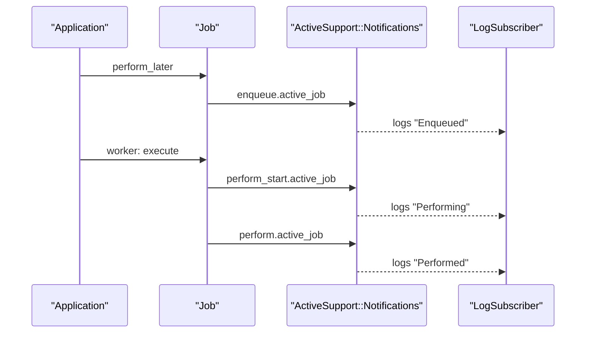
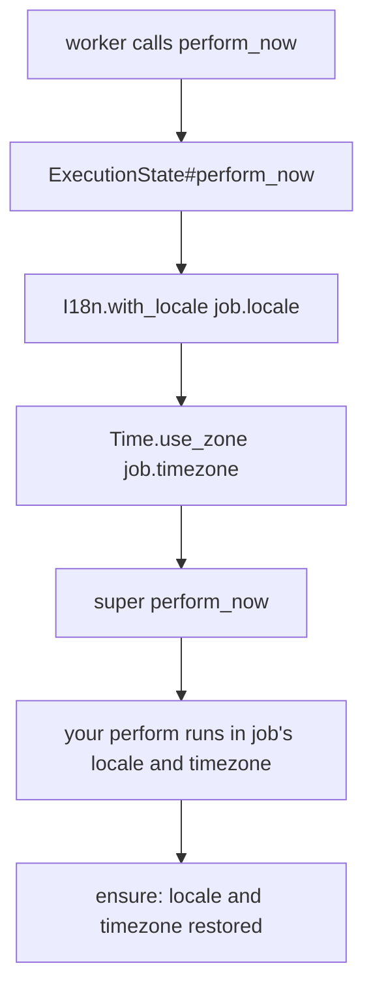

# 09 -- Instrumentation, Logging, Locale, and Timezone

Observability and correct time and language handling are cross-cutting concerns. ActiveJob emits notifications, logs them, and restores locale and timezone around every job.

Source files: `/Users/darkvoid/.gems/gems/activejob-8.1.4/lib/active_job/instrumentation.rb`, `/Users/darkvoid/.gems/gems/activejob-8.1.4/lib/active_job/logging.rb`, `/Users/darkvoid/.gems/gems/activejob-8.1.4/lib/active_job/execution_state.rb`, `/Users/darkvoid/.gems/gems/activejob-8.1.4/lib/active_job/log_subscriber.rb`, and `/Users/darkvoid/.gems/gems/activejob-8.1.4/lib/active_job/structured_event_subscriber.rb`.

## Instrumentation

`Instrumentation` wraps two lifecycle points. Enqueue is instrumented via an `around_enqueue` callback that picks the event name from whether a schedule exists:

```ruby
# Source: lib/active_job/instrumentation.rb, lines 19-23
included do
  around_enqueue do |_, block|
    scheduled_at ? instrument(:enqueue_at, &block) : instrument(:enqueue, &block)
  end
end
```

Perform is instrumented in two layers. `perform_now` instruments the whole run, and `_perform_job` instruments the start:

```ruby
# Source: lib/active_job/instrumentation.rb, lines 25-45
def perform_now
  instrument(:perform) { super }
end

def _perform_job
  instrument(:perform_start)
  super
end
```

`instrument` puts the job and adapter into the payload and emits a `ActiveSupport::Notifications` event named `"<operation>.active_job"`:

```ruby
# Source: lib/active_job/instrumentation.rb, lines 29-39
def instrument(operation, payload = {}, &block)
  payload[:job] = self
  payload[:adapter] = queue_adapter

  ActiveSupport::Notifications.instrument("#{operation}.active_job", payload) do |payload|
    value = block.call(payload) if block
    payload[:aborted] = @_halted_callback_hook_called if defined?(@_halted_callback_hook_called)
    @_halted_callback_hook_called = nil
    value
  end
end
```

The `:aborted` flag records whether a callback halted the chain (see [06-callbacks.md](./06-callbacks.md)). The full set of events is: `enqueue`, `enqueue_at`, `enqueue_all`, `perform_start`, `perform`, `enqueue_retry`, `retry_stopped`, `discard`, `interrupt`, `resume`, `step_started`, `step`, and `step_skipped`. The retry, discard, interrupt, resume, and step events are emitted by `Exceptions` and `Continuation`, all through the same `instrument` helper.



## Logging

`Logging` tags the logger with the job name and id. Enqueue and perform each wrap themselves in a tag:

```ruby
# Source: lib/active_job/logging.rb, lines 15-47 (abridged)
cattr_accessor :logger, default: ActiveSupport::TaggedLogging.new(ActiveSupport::Logger.new(STDOUT))

class_attribute :log_arguments, instance_accessor: false, default: true

around_enqueue(prepend: true) { |_, block| tag_logger(&block) }

def perform_now
  tag_logger(self.class.name, self.job_id) { super }
end

def tag_logger(*tags, &block)
  if logger.respond_to?(:tagged)
    tags.unshift "ActiveJob" unless logger_tagged_by_active_job?
    logger.tagged(*tags, &block)
  else
    yield
  end
end
```

`log_arguments` can be set to `false` on a job to hide sensitive arguments from logs and from the structured event subscriber.

`LogSubscriber` translates the notifications into human-readable log lines. For example, enqueue success and failure:

```ruby
# Source: lib/active_job/log_subscriber.rb, lines 9-27 (abridged)
def enqueue(event)
  job = event.payload[:job]
  ex = event.payload[:exception_object] || job.enqueue_error
  if ex
    error { "Failed enqueuing #{job.class.name} to #{queue_name(event)}: #{ex.class} (#{ex.message})" }
  elsif event.payload[:aborted]
    info { "Failed enqueuing #{job.class.name} to #{queue_name(event)}, a before_enqueue callback halted the enqueuing execution." }
  else
    info { "Enqueued #{job.class.name} (Job ID: #{job.job_id}) to #{queue_name(event)}" + args_info(job) }
  end
end
```

It attaches itself to the `:active_job` namespace at the bottom of the file:

```ruby
# Source: lib/active_job/log_subscriber.rb, line 271
ActiveJob::LogSubscriber.attach_to :active_job
```

`StructuredEventSubscriber` emits machine-readable events such as `active_job.enqueued`, `active_job.started`, `active_job.completed`, `active_job.retry_scheduled`, and `active_job.discarded`, each with a typed payload (job class, id, queue, adapter, duration, exception). It also attaches to `:active_job` (`lib/active_job/structured_event_subscriber.rb` line 220).

`ActiveJob.verbose_enqueue_logs` is a global flag. When true, the log subscriber appends the source location of the enqueue call to each enqueue log line:

```ruby
# Source: lib/active_job.rb, lines 55-61 and lib/active_job/log_subscriber.rb, lines 234-260
singleton_class.attr_accessor :verbose_enqueue_logs
self.verbose_enqueue_logs = false

def info(progname = nil, &block)
  return unless super
  if ActiveJob.verbose_enqueue_logs
    log_enqueue_source
  end
end
```

## Locale and timezone

A job runs in a worker process whose default locale and timezone may differ from the enqueuing request's. ActiveJob captures both at enqueue time and restores them at perform time.

The values are captured in the constructor and in `serialize`:

```ruby
# Source: lib/active_job/core.rb, line 111 and lines 127-128
@timezone   = Time.zone&.name

"locale"     => locale || I18n.locale.to_s,
"timezone"   => timezone,
```

`locale` has an accessor on the job (`core.rb` line 47) and defaults to the current `I18n.locale`. `timezone` defaults to `Time.zone&.name`, the ActiveSupport timezone name such as `"UTC"` or `"America/New_York"`.

Restoration is a small module, `ExecutionState`, which wraps `perform_now`:

```ruby
# Source: lib/active_job/execution_state.rb, lines 3-10
module ExecutionState
  def perform_now
    I18n.with_locale(locale) do
      Time.use_zone(timezone) { super }
    end
  end
end
```

`I18n.with_locale` and `Time.use_zone` set the values for the duration of the block and restore them afterwards, even if the job raises. There is no separate `timezones.rb` file in 8.1.4; the timezone logic lives in `core.rb` and `execution_state.rb`.



## The Aha Moment

**Aha:** A background job is a small island of context. The request that enqueued it is long gone, so anything the job needs from that context — locale, timezone — must be captured at enqueue time, serialized, and re-established at perform time. Instrumentation and logging follow the same pattern: they wrap the two lifecycle seams (enqueue and perform) so the same notification fires whether the job runs in a worker, inline, or in a test, and the consumer never knows the difference.

Continue to [10-rails-integration-and-testing.md](./10-rails-integration-and-testing.md).
