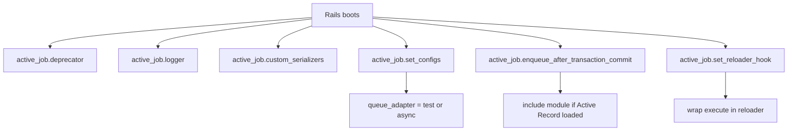
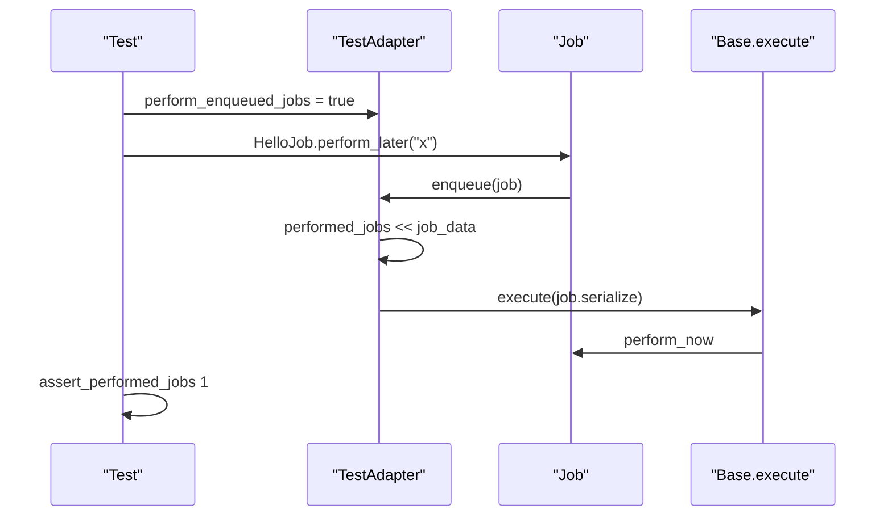

# 10 -- Rails Integration and Testing

ActiveJob works standalone, but its richest behavior appears inside a Rails application. The Railtie wires it into the boot process, generators create jobs, and the test adapter plus helpers make job tests deterministic.

Source files: `/Users/darkvoid/.gems/gems/activejob-8.1.4/lib/active_job/railtie.rb`, `/Users/darkvoid/.gems/gems/activejob-8.1.4/lib/rails/generators/job/`, `/Users/darkvoid/.gems/gems/activejob-8.1.4/lib/active_job/test_helper.rb`, `/Users/darkvoid/.gems/gems/activejob-8.1.4/lib/active_job/test_case.rb`, and `/Users/darkvoid/.gems/gems/activejob-8.1.4/lib/active_job/queue_adapters/test_adapter.rb`.

## The Railtie

The Railtie (`lib/active_job/railtie.rb`) runs a series of initializers. The key ones:

Configuration and defaults. `config.active_job` is an options object, and the queue adapter defaults to `:test` in test environments and `:async` everywhere else:

```ruby
# Source: lib/active_job/railtie.rb, lines 45-56 (abridged)
initializer "active_job.set_configs" do |app|
  options = app.config.active_job
  options.queue_adapter ||= (Rails.env.test? ? :test : :async)

  config.after_initialize do
    options.each do |k, v|
      k = "#{k}="
      ActiveJob.send(k, v) if ActiveJob.respond_to?(k)
    end
  end
end
```

The logger is set from Rails:

```ruby
# Source: lib/active_job/railtie.rb, lines 18-20
initializer "active_job.logger" do
  ActiveSupport.on_load(:active_job) { self.logger = ::Rails.logger }
end
```

Custom serializers and the Action Controller parameters serializer are registered when their dependencies load:

```ruby
# Source: lib/active_job/railtie.rb, lines 22-43 (abridged)
initializer "active_job.custom_serializers" do |app|
  ActiveSupport.on_load(:active_job_arguments) do
    custom_serializers = app.config.active_job.custom_serializers
    ActiveJob::Serializers.add_serializers custom_serializers
  end
end

initializer "active_job.action_controller_parameters" do |app|
  ActiveSupport.on_load(:active_job) do
    ActiveSupport.on_load(:action_controller) do
      ActiveJob::Serializers.add_serializers ActiveJob::Serializers::ActionControllerParametersSerializer
    end
  end
end
```

The transaction-deferral module is included only when Active Record is present:

```ruby
# Source: lib/active_job/railtie.rb, lines 29-35
initializer "active_job.enqueue_after_transaction_commit" do |app|
  ActiveSupport.on_load(:active_job) do
    ActiveSupport.on_load(:active_record) do
      ActiveJob::Base.include EnqueueAfterTransactionCommit
    end
  end
end
```

The code reloader wraps every `execute` in development, so job classes are reloaded between runs:

```ruby
# Source: lib/active_job/railtie.rb, lines 82-90
initializer "active_job.set_reloader_hook" do |app|
  ActiveSupport.on_load(:active_job) do
    ActiveJob::Callbacks.singleton_class.set_callback(:execute, :around, prepend: true) do |_, inner|
      app.reloader.wrap do
        inner.call
      end
    end
  end
end
```

Active Record query log tags are extended with the job class when query log tags are enabled:

```ruby
# Source: lib/active_job/railtie.rb, lines 92-106
initializer "active_job.query_log_tags" do |app|
  query_logs_tags_enabled = app.config.respond_to?(:active_record) &&
    app.config.active_record.query_log_tags_enabled &&
    app.config.active_job.log_query_tags_around_perform
  if query_logs_tags_enabled
    app.config.active_record.query_log_tags |= [:job]
    ActiveSupport.on_load(:active_record) do
      ActiveRecord::QueryLogs.taggings = ActiveRecord::QueryLogs.taggings.merge(
        job: ->(context) { context[:job].class.name if context[:job] }
      )
    end
  end
end
```

The `active_job.backtrace_cleaner` initializer sets `LogSubscriber.backtrace_cleaner = ::Rails.backtrace_cleaner` (`railtie.rb` lines 108-112).



## Generators

`bin/rails generate job checkout` runs the job generator. It writes `app/jobs/checkout_job.rb` and creates `app/jobs/application_job.rb` if it does not exist:

```ruby
# Source: lib/rails/generators/job/job_generator.rb, lines 20-28
def create_job_file
  template "job.rb", File.join("app/jobs", class_path, "#{file_name}_job.rb")
  in_root do
    if behavior == :invoke && !File.exist?(application_job_file_name)
      template "application_job.rb", application_job_file_name
    end
  end
end
```

The templates produce the `ApplicationJob` base class and the concrete job (see [01-the-job.md](./01-the-job.md)). The `--queue` and `--parent` options control the queue and parent class, and the generator hooks the test framework to create a matching test file.

## The test adapter

The test adapter records jobs instead of running them. It is one of the three built-in adapters described in [05-queue-adapters.md](./05-queue-adapters.md). It keeps two lists, `enqueued_jobs` and `performed_jobs`:

```ruby
# Source: lib/active_job/queue_adapters/test_adapter.rb, lines 28-59 (abridged)
def enqueue(job)
  job_data = job_to_hash(job)
  perform_or_enqueue(perform_enqueued_jobs && !filtered?(job), job, job_data)
end

def enqueue_at(job, timestamp)
  job_data = job_to_hash(job, at: timestamp)
  perform_or_enqueue(perform_enqueued_at_jobs && !filtered?(job), job, job_data)
end

def perform_or_enqueue(perform, job, job_data)
  if perform
    performed_jobs << job_data
    Base.execute(job.serialize)
  else
    enqueued_jobs << job_data
  end
end
```

When `perform_enqueued_jobs` is true, enqueue runs the job immediately and records it in `performed_jobs`. When false, the job is only recorded in `enqueued_jobs`. The adapter also supports `filter`, `reject`, `queue`, and `at` for selective execution, and `stopping` for the Continuable test helpers.

## The test helpers

`ActiveJob::TestHelper` is included by `ActiveJob::TestCase` (`lib/active_job/test_case.rb`), and the Railtie includes it into Action Dispatch integration tests (`railtie.rb` lines 77-79).

`queue_adapter_for_test` returns the adapter the helpers use (a `TestAdapter` by default; override it to substitute another adapter), and `queue_adapter` returns `ActiveJob::Base.queue_adapter` (`test_helper.rb` lines 62-67 and 661-663).

`perform_enqueued_jobs` flips the test adapter into performing mode for a block, or flushes the queue when called without a block:

```ruby
# Source: lib/active_job/test_helper.rb, lines 620-654 (abridged)
def perform_enqueued_jobs(only: nil, except: nil, queue: nil, at: nil, &block)
  unless block_given?
    require_active_job_test_adapter!("perform_enqueued_jobs (without a block)")
    return flush_enqueued_jobs(only: only, except: except, queue: queue, at: at)
  end

  return _assert_nothing_raised_or_warn("perform_enqueued_jobs", &block) unless using_test_adapter?

  old_perform_enqueued_jobs = queue_adapter.perform_enqueued_jobs
  old_perform_enqueued_at_jobs = queue_adapter.perform_enqueued_at_jobs
  old_filter = queue_adapter.filter
  old_reject = queue_adapter.reject
  old_queue = queue_adapter.queue
  old_at = queue_adapter.at

  begin
    queue_adapter.perform_enqueued_jobs = true
    queue_adapter.perform_enqueued_at_jobs = true
    queue_adapter.filter = only
    queue_adapter.reject = except
    queue_adapter.queue = queue
    queue_adapter.at = at
    _assert_nothing_raised_or_warn("perform_enqueued_jobs", &block)
  ensure
    queue_adapter.perform_enqueued_jobs = old_perform_enqueued_jobs
    queue_adapter.perform_enqueued_at_jobs = old_perform_enqueued_at_jobs
    queue_adapter.filter = old_filter
    queue_adapter.reject = old_reject
    queue_adapter.queue = old_queue
    queue_adapter.at = old_at
  end
end
```

The block form saves and restores every adapter flag, so nested calls compose.

`assert_enqueued_jobs` counts matches. It supports `:only`, `:except`, and `:queue` filters:

```ruby
# Source: lib/active_job/test_helper.rb, lines 122-138
def assert_enqueued_jobs(number, only: nil, except: nil, queue: nil, &block)
  require_active_job_test_adapter!("assert_enqueued_jobs")
  if block_given?
    original_jobs = enqueued_jobs_with(only: only, except: except, queue: queue)
    _assert_nothing_raised_or_warn("assert_enqueued_jobs", &block)
    new_jobs = enqueued_jobs_with(only: only, except: except, queue: queue)
    actual_count = (new_jobs - original_jobs).count
  else
    actual_count = enqueued_jobs_with(only: only, except: except, queue: queue).count
  end
  assert_equal number, actual_count, "#{number} jobs expected, but #{actual_count} were enqueued"
end
```

`assert_enqueued_with` checks the details of an enqueued job and returns the instantiated job:

```ruby
# Source: lib/active_job/test_helper.rb, lines 406-452 (abridged)
def assert_enqueued_with(job: nil, args: nil, at: nil, queue: nil, priority: nil, &block)
  require_active_job_test_adapter!("assert_enqueued_with")
  expected = { job: job, args: args, at: at, queue: queue, priority: priority }.compact
  expected_args = prepare_args_for_assertion(expected)
  potential_matches = []
  if block_given?
    original_enqueued_jobs = enqueued_jobs.dup
    _assert_nothing_raised_or_warn("assert_enqueued_with", &block)
    jobs = enqueued_jobs - original_enqueued_jobs
  else
    jobs = enqueued_jobs
  end
  matching_job = jobs.find do |enqueued_job|
    deserialized_job = deserialize_args_for_assertion(enqueued_job)
    potential_matches << deserialized_job
    expected_args.all? do |key, value|
      if value.respond_to?(:call)
        value.call(deserialized_job[key])
      else
        value == deserialized_job[key]
      end
    end
  end
  assert matching_job, message
  instantiate_job(matching_job)
end
```

`args` may include matcher procs, and `at` accepts a time or a range-covering proc. `assert_performed_with` is the mirror over `performed_jobs` (`test_helper.rb` lines 510-557). `assert_performed_jobs`, `assert_no_enqueued_jobs`, and `assert_no_performed_jobs` complete the surface.



## The Aha Moment

**Aha:** The test adapter is not a mock; it is a real adapter whose storage is two arrays in memory. Every helper is just a query over those arrays. `perform_enqueued_jobs` works by flipping a flag so the same `enqueue` call branches into `Base.execute`. Because tests go through the identical enqueue and execute paths as production, a job that passes its test will serialize, enqueue, deserialize, and perform correctly in any backend — the test only changes where the hash waits.

Continue to [README.md](./README.md).
