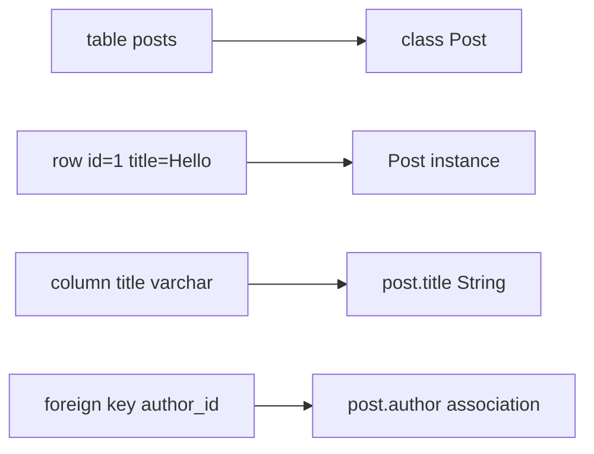
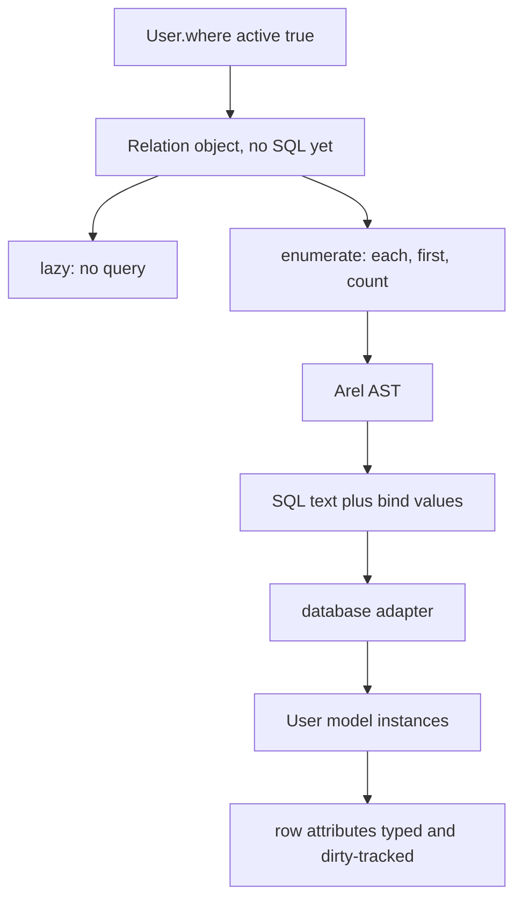

# 00 -- ActiveRecord: an object-relational mapper in two halves

ActiveRecord is the object-relational mapper (ORM) that ships with Ruby on Rails. This exploration reads ActiveRecord version 8.1.4 from the installed gem and explains how the library works from the inside. The goal is to understand the machinery, not to memorize an application programming interface (API) list. When the prose says "ORM", it means software that maps a relational database (a system of tables, rows, and Structured Query Language, or SQL) onto ordinary programming-language objects.

The gem lives at `/Users/darkvoid/.gems/gems/activerecord-8.1.4/`. The entry file is `lib/active_record.rb`. Everything else lives under `lib/active_record/` and `lib/arel/`.

## The problem an ORM solves

A relational database stores rows in tables. A Ruby program stores objects in memory. These two worlds have different shapes, and an application has to cross the boundary between them constantly.

- A table maps to a Ruby class.
- A row maps to one instance of that class.
- A column maps to an attribute on the instance.
- A foreign key maps to an association between two instances.
- A row identity (the primary key) maps to the instance identity (`id`).



Without a mapper, the developer writes SQL by hand, converts result rows into objects by hand, and converts objects back into INSERT or UPDATE statements by hand. That is repetitive, error-prone, and mixes two languages in every file. An ORM removes the hand-written conversion and replaces it with a generated one.

ActiveRecord is not the only ORM. Ruby has Sequel; Python has SQLAlchemy; Java has Hibernate. What is specific to ActiveRecord is the way it splits itself into two cooperating halves.

## The two halves

Read the class definition of `ActiveRecord::Base` in `/Users/darkvoid/.gems/gems/activerecord-8.1.4/lib/active_record/base.rb`, near line 282. The class pulls in dozens of modules. Those modules fall into two groups that answer two different questions.

1. The model half answers "what is a record?" It gives a class its table name, its attribute types, its getters and setters, its lifecycle callbacks, and its validation rules. A model object is a single row, held in memory.
2. The query half answers "which records?" It builds a lazy, immutable `Relation` object that accumulates WHERE clauses, ORDER clauses, and limits without touching the database. The relation turns into SQL only when the caller enumerates it.



The two halves meet at one point: when a relation executes, it returns instances of the model class. The model knows how to build itself from a raw result row; the relation knows how to ask for the rows.

This split matters because it explains almost every design decision that follows. The model half is stateful and mutable. The query half is stateless and immutable until enumeration. Mixing them is the classic source of confusion, for example mutating a `Relation` you thought was a fresh copy.

## Why Ruby makes this pleasant

ActiveRecord leans on four Ruby features that other languages have only partially.

Metaprogramming. The attribute getters and setters (`post.title`, `post.title=`) are not typed by hand. They are generated with `define_method` and cached in a generated module. The source is in `/Users/darkvoid/.gems/gems/activerecord-8.1.4/lib/active_record/attribute_methods/read.rb` near line 11 and in `attribute_methods/write.rb` near line 15. A missing method name that matches a column falls back through `method_missing`, which triggers the definition lazily, in `/Users/darkvoid/.gems/gems/activerecord-8.1.4/lib/active_record/attribute_methods.rb` near line 475.

Dynamic typing. A column's database type becomes a Ruby type at runtime. The schema is read from the database, and each column is wrapped in a `ActiveRecord::Type::*` object that knows how to cast a raw value. This is what makes `post.published_on` a `Date` without any code in `Post`.

Blocks and lambdas. Scopes are declared with a block. The `scope` macro in `/Users/darkvoid/.gems/gems/activerecord-8.1.4/lib/active_record/scoping/named.rb` near line 154 stores that block and runs it later against the relation. A lambda that returns a `Relation` composes naturally with other relation methods.

A flexible hash-based syntax. `User.where(active: true)` is one call with a Ruby hash, not a string. The hash is expanded into equality predicates by `PredicateBuilder`, in `/Users/darkvoid/.gems/gems/activerecord-8.1.4/lib/active_record/relation/predicate_builder.rb` near line 23. The developer almost never writes SQL, but SQL is always available when needed through `where("...")`.

These features let the public API be small and the generated API be large. The developer writes a few lines and gets hundreds of generated methods.

## The entry file and its wiring

`lib/active_record.rb` is a require map and a configuration surface. The `ActiveRecord` module extends `ActiveSupport::Autoload`, so files are loaded only when their constants are first referenced.

One line in that file is the hinge between ActiveRecord and Arel:

```ruby
ActiveSupport.on_load(:active_record) { Arel::Table.engine = self }
```

From `/Users/darkvoid/.gems/gems/activerecord-8.1.4/lib/active_record.rb`, near line 625. Arel is the SQL-building library bundled with ActiveRecord. Arel's `Table` class holds a reference to its "engine" (ActiveRecord), so an Arel table can delegate type-casting and quoting back to the model that owns it.

A nearby configuration flag controls how query values travel to the database:

```ruby
singleton_class.attr_accessor :disable_prepared_statements
self.disable_prepared_statements = false
```

From `/Users/darkvoid/.gems/gems/activerecord-8.1.4/lib/active_record.rb`, near line 184. Prepared statements send the SQL shape and the values separately, so the database can reuse the parsed plan. ActiveRecord 8.1 keeps them enabled by default.

The `Base` class at the top of the model hierarchy is built by composition. This is the actual source:

```ruby
class Base
  include ActiveModel::API

  extend ActiveSupport::Benchmarkable
  extend ActiveSupport::DescendantsTracker

  extend ConnectionHandling
  extend QueryCache::ClassMethods
  extend Querying
  extend Translation
  extend DynamicMatchers
  extend DelegatedType
  extend Explain
  extend Enum
  extend Delegation::DelegateCache
  extend Aggregations::ClassMethods

  include Core
  include Persistence
  include ReadonlyAttributes
  include ModelSchema
  include Inheritance
  include Scoping
  include Sanitization
  include AttributeAssignment
  include Integration
  include Validations
  include CounterCache
  include Attributes
  include Locking::Optimistic
  include Locking::Pessimistic
  include Encryption::EncryptableRecord
  include AttributeMethods
  include Callbacks
  include Timestamp
  include Associations
  include SecurePassword
  include AutosaveAssociation
  include NestedAttributes
  include Transactions
  include TouchLater
  include NoTouching
  include Reflection
  include Serialization
  include Store
  include SecureToken
  include TokenFor
  include SignedId
  include Suppressor
  include Marshalling::Methods

  self.param_delimiter = "_"
end
```

From `/Users/darkvoid/.gems/gems/activerecord-8.1.4/lib/active_record/base.rb`, near line 282 through 334. The `extend` calls add class-level behavior (for example, `Querying` delegates `where` and friends to the default relation). The `include` calls add instance behavior (for example, `Persistence` adds `save`, `Persistence#delete`, and `Persistence#destroy`).

## How a single request flows

Follow one simple line of code from start to finish:

```ruby
posts = Post.where(published: true).order(created_at: :desc).limit(10)
posts.to_a
```

1. `Post.where` delegates to `Post.all.where` through the `Querying` module, in `/Users/darkvoid/.gems/gems/activerecord-8.1.4/lib/active_record/querying.rb` at line 24.
2. `Post.all` returns the current scope, or a fresh default relation, in `/Users/darkvoid/.gems/gems/activerecord-8.1.4/lib/active_record/scoping/named.rb` near line 22.
3. `where`, `order`, and `limit` each call `spawn`, which copies the relation and mutates the copy. The original is never changed. See `/Users/darkvoid/.gems/gems/activerecord-8.1.4/lib/active_record/relation/spawn_methods.rb`, lines 9 through 11.
4. `to_a` calls `records`, which calls `load`, which calls `exec_queries`. That is where the relation stops being a description and starts being a query. See `/Users/darkvoid/.gems/gems/activerecord-8.1.4/lib/active_record/relation.rb` near line 1431.
5. `exec_queries` builds the Arel abstract syntax tree (AST), asks the connection to compile it into SQL text and bind values, executes it, and instantiates one model per row.

The word "lazy" describes steps 1 through 3. The word "eager" describes step 4. Everything in this exploration either explains one of those steps or the model machinery that step 5 uses.

## What the six chapters cover

This is the first half of the exploration. Each chapter drills into one layer.

- [01-connection-and-adapters.md](./01-connection-and-adapters.md) — how a database configuration becomes a pool of connections, and how an adapter turns a request into bytes on a socket.
- [02-sql-generation-arel.md](./02-sql-generation-arel.md) — the Arel AST and the visitor that compiles it into dialect-specific SQL.
- [03-the-model.md](./03-the-model.md) — how a class learns its schema, types, attribute methods, and dirty tracking.
- [04-query-interface.md](./04-query-interface.md) — the lazy immutable `Relation` and the query methods that build on it.
- [05-persistence.md](./05-persistence.md) — save, create, update, delete, bulk inserts, locking, and transactions.
- [06-associations.md](./06-associations.md) — how foreign keys become associations, proxies, preloading, and the N+1 problem.

The second half (chapters 07 through 13, plus the README) is written by another author and continues with callbacks, migrations, attribute types in depth, scoping and eager loading, the query cache and pool, the Ruby experience, and framework integration.

## The Aha Moment

**Aha:** ActiveRecord is not one big object. It is two small ideas layered on each other. A `Relation` is a frozen recipe for a query, built by chaining methods that each return a copy. The `Base` model is a row-shaped object that learned its own shape from the database schema. The recipe and the shape only touch at the single moment when a query executes and hands raw rows to the model to instantiate. Once you see that seam, the rest of the library is just the two halves doing their jobs on either side of it.

The seam is visible in one method. `Relation#exec_queries` in `/Users/darkvoid/.gems/gems/activerecord-8.1.4/lib/active_record/relation.rb` near line 1431 calls `exec_main_query` to get raw rows, then `instantiate_records` to turn rows into models, then `preload_associations` to fill in associations. Query on one side, model on the other.

Continue to [01-connection-and-adapters.md](./01-connection-and-adapters.md).
