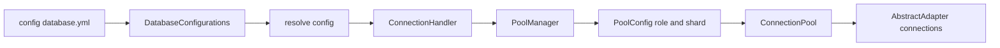
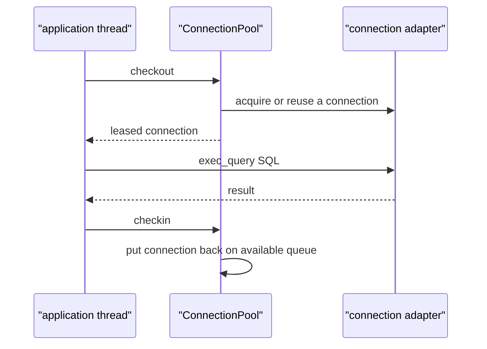

# 01 -- Connection and adapters: from database.yml to bytes on a socket

Every ActiveRecord query, create, update, and delete ends at the same place: a piece of SQL text handed to a database driver, plus a set of bind values. This chapter follows that path backwards. It starts at the configuration file, moves through the pool of connections, and ends at the adapter-specific method that actually talks to the database.

The chapter uses PostgreSQL (PostgreSQL is a relational database system) as the concrete adapter, but the abstract machinery is the same for MySQL, SQLite, and every other adapter. The entry point is `establish_connection` in `/Users/darkvoid/.gems/gems/activerecord-8.1.4/lib/active_record/connection_handling.rb`.

## From one config to one pool

Rails applications put their database settings in `config/database.yml`. At boot, that YAML (YAML is a human-readable data serialization format) is parsed into a hash and handed to ActiveRecord as `ActiveRecord::Base.configurations`. A typical file looks like this:

```yaml
development:
  primary:
    adapter: postgresql
    database: myapp_development
    pool: 5
    checkout_timeout: 5
```

The word `pool: 5` sets `max_connections` to 5. The word `checkout_timeout: 5` sets `checkout_timeout` to 5 seconds. Both become options on the `ConnectionPool` object described below.

Calling `establish_connection` is a three-line method:

```ruby
def establish_connection(config_or_env = nil)
  config_or_env ||= DEFAULT_ENV.call.to_sym
  db_config = resolve_config_for_connection(config_or_env)
  connection_handler.establish_connection(db_config, owner_name: self, role: current_role, shard: current_shard)
end
```

From `/Users/darkvoid/.gems/gems/activerecord-8.1.4/lib/active_record/connection_handling.rb`, lines 50 through 54. If no argument is given, the current environment name (for example `:development`) is used. The environment name is resolved to a database configuration object, then passed to the connection handler together with two selector keys: a role and a shard.

- A role is usually `:writing` or `:reading`. The `:writing` role is the primary database; the `:reading` role is a read replica.
- A shard is usually `:default`. Shards are for horizontal partitioning: the same schema split across many databases by a key.

The default role and shard are `:writing` and `:default`. The connection handler uses the pair `(role, shard)` as the address of a specific pool.



## The configuration resolver

`ActiveRecord::Base.configurations` holds a `DatabaseConfigurations` object. Its `resolve` method turns whatever was passed (a symbol, a hash, or a connection URL, which is a uniform resource locator) into one of two normalized objects: a `HashConfig` or a `UrlConfig`.

```ruby
def resolve(config) # :nodoc:
  return config if DatabaseConfigurations::DatabaseConfig === config

  case config
  when Symbol
    resolve_symbol_connection(config)
  when Hash, String
    build_db_config_from_raw_config(default_env, "primary", config)
  else
    raise TypeError, "Invalid type for configuration. Expected Symbol, String, or Hash. Got #{config.inspect}"
  end
end
```

From `/Users/darkvoid/.gems/gems/activerecord-8.1.4/lib/active_record/database_configurations.rb`, lines 176 through 187. A symbol is looked up in the already-built list of configurations. A hash or a string is treated as a raw config for the current environment under the name `"primary"`.

The whole YAML tree is flattened by `build_configs` and `walk_configs`, in the same file near lines 202 through 225. `build_configs` iterates each environment, and `walk_configs` iterates each named config within one environment. After flattening, environment variables such as `DATABASE_URL` are merged in near lines 305 through 307, so a process environment can override the file.

The normalized config keeps the `adapter` key separate from connection options. The adapter name (for example `"postgresql"`) is the single most important field, because it selects which adapter class will be instantiated.

## The connection handler and the pool manager

`ConnectionHandler#establish_connection` is in `/Users/darkvoid/.gems/gems/activerecord-8.1.4/lib/active_record/connection_adapters/abstract/connection_handler.rb`, lines 115 through 153. Its job is to turn a config and a `(role, shard)` pair into a `PoolConfig`, and to remember that `PoolConfig` in the right slot.

```ruby
def establish_connection(config, owner_name: Base, role: Base.current_role, shard: Base.current_shard, clobber: false)
  owner_name = determine_owner_name(owner_name, config)

  pool_config = resolve_pool_config(config, owner_name, role, shard)
  db_config = pool_config.db_config

  pool_manager = set_pool_manager(pool_config.connection_descriptor)

  existing_pool_config = pool_manager.get_pool_config(role, shard)

  if !clobber && existing_pool_config && existing_pool_config.db_config == db_config
    if owner_name.primary_class? && (existing_pool_config.connection_descriptor != owner_name)
      existing_pool_config.connection_descriptor = owner_name
    end
    existing_pool_config.pool
  else
    disconnect_pool_from_pool_manager(pool_manager, role, shard)
    pool_manager.set_pool_config(role, shard, pool_config)
    payload = { connection_name: ..., role: role, shard: shard, config: db_config.configuration_hash }
    ActiveSupport::Notifications.instrumenter.instrument("!connection.active_record", payload) do
      pool_config.pool
    end
  end
end
```

From `/Users/darkvoid/.gems/gems/activerecord-8.1.4/lib/active_record/connection_adapters/abstract/connection_handler.rb`, lines 115 through 153, shortened. If a pool with the same config already exists at that `(role, shard)` address, it is reused. Otherwise the old pool is disconnected and a new `PoolConfig` is installed. The `!connection.active_record` notification is how Rails' logging reports "connected to database".

The handler delegates to a `PoolManager`, which maps a connection name to a grid of pools keyed by role and shard. The `ConnectionHandler` is the public face; the `PoolManager` is the storage. `retrieve_connection_pool`, near line 212 of the same file, is the hot path every query uses to find its pool. With `strict: true` and no pool found, it raises `ConnectionNotDefined` and includes the role and shard in the error message.

`PoolConfig` is a thin wrapper. Its `pool` method builds the real pool lazily:

```ruby
def pool
  @pool || synchronize { @pool ||= ConnectionAdapters::ConnectionPool.new(self) }
end
```

From `/Users/darkvoid/.gems/gems/activerecord-8.1.4/lib/active_record/connection_adapters/pool_config.rb`, lines 65 through 67. One line at the bottom of that file matters for every forking web server:

```ruby
ActiveSupport::ForkTracker.after_fork { ActiveRecord::ConnectionAdapters::PoolConfig.discard_pools! }
```

From `/Users/darkvoid/.gems/gems/activerecord-8.1.4/lib/active_record/connection_adapters/pool_config.rb`, line 83. When a process forks, the child must not share a database socket with its parent. After a fork, all cached pools are discarded and rebuilt lazily on first use.

## The connection pool

A `ConnectionPool` is the object that limits how many database connections exist and guarantees that no two threads use the same connection at the same time. The class documentation in `/Users/darkvoid/.gems/gems/activerecord-8.1.4/lib/active_record/connection_adapters/abstract/connection_pool.rb`, lines 54 through 128, states the contract directly: each thread checks out a connection, uses it, and checks it back in.

The important options are documented in that same block:

- `checkout_timeout` — seconds to wait for a free connection before raising a timeout error. Default 5 seconds.
- `max_connections` — the pool capacity. Default 5. A nil or -1 value means unlimited.
- `min_connections` — connections kept open at all times. Default 0.
- `idle_timeout` — seconds a connection may sit unused before being closed. Default 300.

The pool is thread-safe. It uses Ruby's `MonitorMixin` (a re-entrant mutex, where a mutex is a mutual exclusion lock) to guard its internal state. Checkout and checkin are symmetric:

```ruby
def checkout(checkout_timeout = @checkout_timeout)
  return checkout_and_verify(acquire_connection(checkout_timeout)) unless @pinned_connection

  @pinned_connection.lock.synchronize do
    synchronize do
      if @pinned_connection
        @pinned_connection.verify!
        unless @connections.include?(@pinned_connection)
          @connections << @pinned_connection
        end
        @pinned_connection
      else
        checkout_and_verify(acquire_connection(checkout_timeout))
      end
    end
  end
end

def checkin(conn)
  return if @pinned_connection.equal?(conn)

  conn.lock.synchronize do
    synchronize do
      connection_lease.clear(conn)
      conn.expire
      @available.add conn
    end
  end
end
```

From `/Users/darkvoid/.gems/gems/activerecord-8.1.4/lib/active_record/connection_adapters/abstract/connection_pool.rb`, lines 639 through 660 and 667 through 677. Checkout takes a connection from an `@available` queue; if the queue is empty and the pool is under capacity, `acquire_connection` opens a new one; if the pool is full, the thread waits until `checkout_timeout` expires. Checkin clears the lease registry entry and puts the connection back on `@available`.

The lease registry is keyed by execution context, not by thread. Inside a concurrent framework like a web server, one unit of work may hop between threads. `IsolatedExecutionState.context` tracks the current logical unit of work, so a connection stays attached to the request even if the thread changes.



The public methods on the pool mirror this. `lease_connection` checks a connection out for the whole request; `with_connection` checks one out, yields it, and checks it back in when the block finishes; `release_connection` returns a leased connection early. The model-level wrappers `lease_connection`, `connection`, `with_connection`, and `release_connection` are in `/Users/darkvoid/.gems/gems/activerecord-8.1.4/lib/active_record/connection_handling.rb` near lines 267 through 314.

## The adapter layer

The pool holds adapter objects, not raw sockets. The common superclass is `AbstractAdapter` in `/Users/darkvoid/.gems/gems/activerecord-8.1.4/lib/active_record/connection_adapters/abstract_adapter.rb`, line 31. Its initializer, near lines 132 through 185, sets up three things this chapter cares about:

1. A visitor. `@visitor = arel_visitor` builds an `Arel::Visitors::ToSql` that knows how to compile Arel nodes into this adapter's SQL dialect.
2. A statement pool. `@statements = build_statement_pool` holds prepared statements.
3. A prepared-statements flag. `@prepared_statements` defaults to true unless `ActiveRecord.disable_prepared_statements` is set or the config overrides it.

The visitor and the collector are defined together:

```ruby
def collector
  if prepared_statements
    Arel::Collectors::Composite.new(
      Arel::Collectors::SQLString.new,
      Arel::Collectors::Bind.new,
    )
  else
    Arel::Collectors::SubstituteBinds.new(
      self,
      Arel::Collectors::SQLString.new,
    )
  end
end

def arel_visitor
  Arel::Visitors::ToSql.new(self)
end
```

From `/Users/darkvoid/.gems/gems/activerecord-8.1.4/lib/active_record/connection_adapters/abstract_adapter.rb`, lines 1261 through 1277. When prepared statements are on, the collector builds SQL text in one buffer and bind values in a separate list, so the two stay apart. When they are off, a `SubstituteBinds` collector inlines quoted values directly into the SQL text. The choice is visible in the SQL log: prepared statements show `?` placeholders, substituted statements show literal values.

A concrete adapter subclasses `AbstractAdapter` and fills in the parts that differ per database. The PostgreSQL adapter is in `/Users/darkvoid/.gems/gems/activerecord-8.1.4/lib/active_record/connection_adapters/postgresql_adapter.rb`:

```ruby
class PostgreSQLAdapter < AbstractAdapter
  ADAPTER_NAME = "PostgreSQL"

  class << self
    def new_client(conn_params)
      PG.connect(**conn_params)
    rescue ::PG::Error => error
      # ... translate driver errors into ActiveRecord exceptions ...
    end
  end
end
```

From `/Users/darkvoid/.gems/gems/activerecord-8.1.4/lib/active_record/connection_adapters/postgresql_adapter.rb`, lines 53 through 71, shortened. `new_client` wraps the `pg` gem's `PG.connect`. The `rescue` block is the adapter's exception translation layer: a raw driver error about a missing database becomes `ActiveRecord::NoDatabaseError`, a bad username becomes `ActiveRecord::DatabaseConnectionError`, and so on. This is why application code can rescue `ActiveRecord::` exceptions instead of driver exceptions.

Each adapter also declares a `type_map`: a mapping from database type names to `ActiveRecord::Type::*` cast objects. The PostgreSQL adapter defines `NATIVE_DATABASE_TYPES` near line 134, which lists the SQL type each abstract type maps to when creating a column (for example, `string` maps to `character varying`). The type map used for reading results is built from the PostgreSQL Object Identifier (OID) registry at connect time, which is how the driver knows which Ruby class to build for each column.

## The execution path

A query reaches the adapter through the abstract `DatabaseStatements` module. The first stop is `to_sql_and_binds`, which turns an Arel tree (or a raw string) into SQL text plus a bind list:

```ruby
def to_sql_and_binds(arel_or_sql_string, binds = [], preparable = nil, allow_retry = false) # :nodoc:
  if arel_or_sql_string.respond_to?(:ast)
    arel_or_sql_string = arel_or_sql_string.ast
  end

  if Arel.arel_node?(arel_or_sql_string) && !(String === arel_or_sql_string)
    unless binds.empty?
      raise "Passing bind parameters with an arel AST is forbidden. " \
        "The values must be stored on the AST directly"
    end

    collector = collector()
    collector.retryable = true

    if prepared_statements
      collector.preparable = true
      sql, binds = visitor.compile(arel_or_sql_string, collector)
      # ...
    else
      sql = visitor.compile(arel_or_sql_string, collector)
    end
    allow_retry = collector.retryable
    [sql.freeze, binds, preparable, allow_retry]
  else
    arel_or_sql_string = arel_or_sql_string.dup.freeze unless arel_or_sql_string.frozen?
    [arel_or_sql_string, binds, preparable, allow_retry]
  end
end
```

From `/Users/darkvoid/.gems/gems/activerecord-8.1.4/lib/active_record/connection_adapters/abstract/database_statements.rb`, lines 17 through 51. The interesting constraint is the raise on line 25: you cannot pass bind values alongside an Arel tree. Arel nodes carry their own values as bind parameters on the tree itself. The visitor walks the tree and pushes each value into the collector's bind list as it goes.

The public execution methods are thin wrappers over this. `exec_query` for reads:

```ruby
def exec_query(sql, name = "SQL", binds = [], prepare: false)
  internal_exec_query(sql, name, binds, prepare: prepare)
end
```

And `exec_insert` for writes, both in the same file:

```ruby
def exec_insert(sql, name = nil, binds = [], pk = nil, sequence_name = nil, returning: nil)
  sql, binds = sql_for_insert(sql, pk, binds, returning)
  internal_exec_query(sql, name, binds)
end
```

From `/Users/darkvoid/.gems/gems/activerecord-8.1.4/lib/active_record/connection_adapters/abstract/database_statements.rb`, lines 150 through 152 and 160 through 163. `exec_delete` and `exec_update` follow the same pattern near lines 168 through 177.

Everything below those methods funnels into `raw_execute`:

```ruby
def raw_execute(sql, name = nil, binds = [], prepare: false, async: false, allow_retry: false, materialize_transactions: true, batch: false)
  type_casted_binds = type_casted_binds(binds)
  log(sql, name, binds, type_casted_binds, async: async, allow_retry: allow_retry) do |notification_payload|
    with_raw_connection(allow_retry: allow_retry, materialize_transactions: materialize_transactions) do |conn|
      begin
        result = perform_query(conn, sql, binds, type_casted_binds, prepare: prepare, notification_payload: notification_payload, batch: batch)
        query_completed = true
      ensure
        begin
          handle_warnings(result, sql)
        rescue
          raise if query_completed
        end
      end
      result
    end
  end
end
```

From `/Users/darkvoid/.gems/gems/activerecord-8.1.4/lib/active_record/connection_adapters/abstract/database_statements.rb`, lines 567 through 588. This is the lowest shared level. It type-casts the binds, logs the query, borrows the raw driver connection, and calls `perform_query`. The abstract `perform_query` raises `NotImplementedError` at line 591; each adapter must supply its own.

The PostgreSQL version is in `/Users/darkvoid/.gems/gems/activerecord-8.1.4/lib/active_record/connection_adapters/postgresql/database_statements.rb`, lines 127 through 162:

```ruby
def perform_query(raw_connection, sql, binds, type_casted_binds, prepare:, notification_payload:, batch: false)
  update_typemap_for_default_timezone
  result = if prepare
    begin
      stmt_key = prepare_statement(sql, binds, raw_connection)
      notification_payload[:statement_name] = stmt_key
      raw_connection.exec_prepared(stmt_key, type_casted_binds)
    rescue PG::FeatureNotSupported => error
      # ... retry after flushing the cached plan ...
    end
  elsif binds.nil? || binds.empty?
    raw_connection.async_exec(sql)
  else
    raw_connection.exec_params(sql, type_casted_binds)
  end

  verified!
  notification_payload[:affected_rows] = result.cmd_tuples
  notification_payload[:row_count] = result.ntuples
  result
end
```

From `/Users/darkvoid/.gems/gems/activerecord-8.1.4/lib/active_record/connection_adapters/postgresql/database_statements.rb`, lines 127 through 162, shortened. Three branches. Prepared statements use `exec_prepared` with a statement key. Queries with binds but no prepare use `exec_params`, which sends SQL and values together. Queries with no binds at all use `async_exec`. In every branch the raw `pg` result is returned to `raw_execute`, which then passes it to `cast_result` so the adapter can build an `ActiveRecord::Result` with typed columns.

## The Aha Moment

**Aha:** A database connection is never used directly. It is always wrapped twice: first by an `AbstractAdapter` that knows the SQL dialect, quoting rules, and type map, then by a `ConnectionPool` that owns the adapter and enforces the checkout/checkin contract. Application code asks the pool for a connection, asks the adapter to run a query, and gives the connection back. The `(role, shard)` pair is the address of the pool, and everything else is just bookkeeping around those two objects.

The double wrapping is what makes the rest of the stack simple. The model and the relation never talk to a socket. They talk to a connection object that already knows how to compile Arel to SQL and how to cast driver results into Ruby values. Chapter [02-sql-generation-arel.md](./02-sql-generation-arel.md) shows the compilation half; chapter [11-query-cache-and-pool.md](./11-query-cache-and-pool.md) in the second half shows the pool and query cache in more depth.

Continue to [02-sql-generation-arel.md](./02-sql-generation-arel.md).
