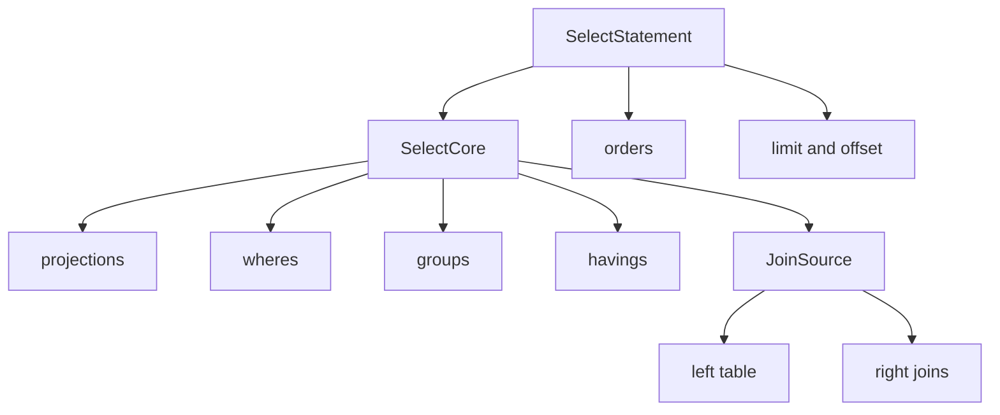
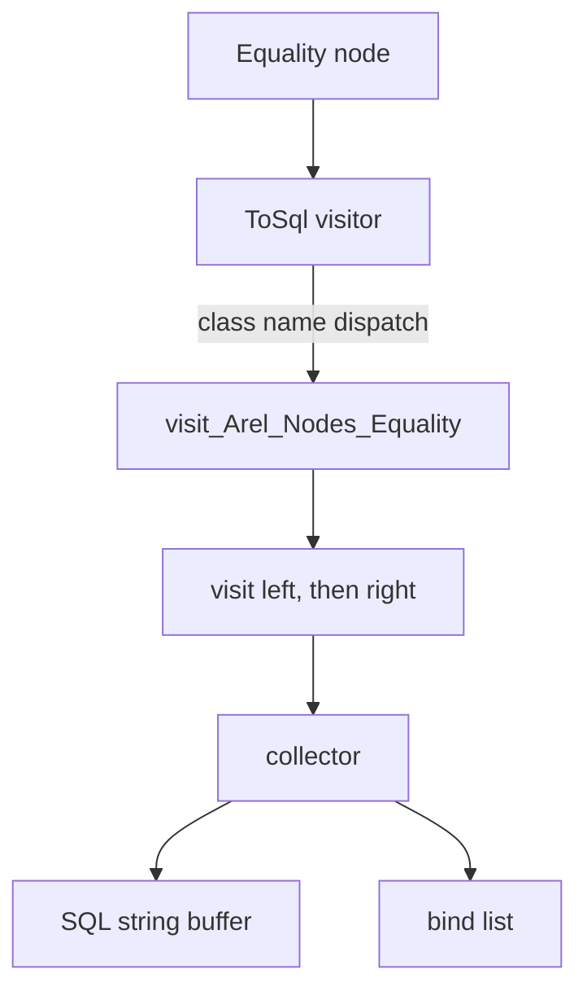

# 02 -- SQL generation with Arel: an AST and a visitor

ActiveRecord never assembles SQL by concatenating strings. It builds an abstract syntax tree (AST) of small node objects, then walks that tree with a visitor that writes SQL text into a collector. This chapter explains what that buys you and how it works end to end.

Arel is the name of the bundled library. Its files live under `/Users/darkvoid/.gems/gems/activerecord-8.1.4/lib/arel/`. The entry file is `/Users/darkvoid/.gems/gems/activerecord-8.1.4/lib/arel.rb`. When this chapter says "node", it means an instance of a subclass of `Arel::Nodes::Node`. When it says "visitor", it means `Arel::Visitors::ToSql`, the class that knows how to print SQL.

## Why not build SQL with strings

The naive way to generate a query is string interpolation:

```ruby
sql = "SELECT * FROM users WHERE name = '#{name}'"
```

This is how SQL injection happens. If `name` contains a quote character, the query breaks or becomes malicious. Every value has to be escaped, every identifier has to be quoted per dialect, and every dialect has different syntax. String building also makes it impossible to inspect or transform a query after it is built.

Arel solves all three problems at once:

1. Values become bind parameters, never inline text. The SQL has a `?` or `$1` placeholder; the value travels separately. See `visit_Arel_Nodes_BindParam` below.
2. Identifiers are quoted by the visitor through the connection's `quote_table_name` and `quote_column_name`.
3. A query is a data structure. Code can read it, rewrite it, merge it, or print it in a different dialect without string surgery.

The price is indirection: a query is no longer a string you can glance at. It is a tree you have to imagine. The payoff is correctness and composability.

## The AST: nodes all the way down

Arel represents every clause of SQL as a node object. A `SelectStatement` holds `cores` (the SELECT/FROM/WHERE/GROUP/HAVING part), plus `orders`, `limit`, `offset`, `lock`, and `with`. A `SelectCore` holds `projections`, `wheres`, `groups`, `havings`, and a `source` that is a `JoinSource`. Each of those is itself a node.



`Arel::Table` is the starting point. It represents one database table and produces attribute nodes on demand:

```ruby
def [](name, table = self)
  name = name.name if name.is_a?(Symbol)
  name = @klass.attribute_aliases[name] || name if @klass
  Attribute.new(table, name)
end

def where(condition)
  from.where condition
end

def order(*expr)
  from.order(*expr)
end

def project(*things)
  from.project(*things)
end

def take(amount)
  from.take amount
end
```

From `/Users/darkvoid/.gems/gems/activerecord-8.1.4/lib/arel/table.rb`, lines 58 through 72 and 82 through 86. `users[:name]` returns an `Arel::Attributes::Attribute` named `name` bound to the `users` table. `users.where(...)` delegates to `from`, which creates a `SelectManager` and appends to it.

An attribute is a small struct plus a bag of predicate methods. `eq`, `in`, `gt`, `between`, `matches`, and the rest all live in `Arel::Predications`, in `/Users/darkvoid/.gems/gems/activerecord-8.1.4/lib/arel/predications.rb`:

```ruby
def eq(other)
  Nodes::Equality.new self, quoted_node(other)
end

def in(other)
  case other
  when Arel::SelectManager
    Arel::Nodes::In.new(self, other.ast)
  when Enumerable
    Nodes::In.new self, quoted_array(other)
  else
    Nodes::In.new self, quoted_node(other)
  end
end
```

From `/Users/darkvoid/.gems/gems/activerecord-8.1.4/lib/arel/predications.rb`, lines 17 through 19 and 65 through 74. `quoted_node` wraps the value through `Nodes.build_quoted`, which turns a plain Ruby value into a quoted node. When that node is visited later, it becomes either a literal or a bind.

The `SelectManager` is the fluent builder over the AST. It holds a `@ctx` pointing at the current `SelectCore`, and every method pushes nodes into it:

```ruby
def where(expr)
  if Arel::TreeManager === expr
    expr = expr.ast
  end
  @ctx.wheres << expr
  self
end

def project(*projections)
  @ctx.projections.concat projections.map { |x|
    STRING_OR_SYMBOL_CLASS.include?(x.class) ? Nodes::SqlLiteral.new(x.to_s) : x
  }
  self
end

def take(limit)
  if limit
    @ast.limit = Nodes::Limit.new(limit)
  else
    @ast.limit = nil
  end
  self
end
```

From `/Users/darkvoid/.gems/gems/activerecord-8.1.4/lib/arel/select_manager.rb`, lines 189 through 195, 135 through 142, and 239 through 246. A manager is a `TreeManager`, whose `to_sql` method shows the whole pipeline in one line:

```ruby
def to_sql(engine = Table.engine)
  collector = Arel::Collectors::SQLString.new
  engine.with_connection do |connection|
    connection.visitor.accept(@ast, collector).value
  end
end
```

From `/Users/darkvoid/.gems/gems/activerecord-8.1.4/lib/arel/tree_manager.rb`, lines 53 through 58. The engine is ActiveRecord itself (wired in the overview at `lib/active_record.rb` line 625). The connection's visitor is told to accept the AST, and it writes into a collector.

## From Model.where to a tree

When you write `User.where(name: "DHH")`, ActiveRecord does not call `users[:name].eq("DHH")` directly. It goes through `PredicateBuilder`, which expands a Ruby hash into predicate nodes. The hash form and the explicit form produce the same tree; the class documentation in `/Users/darkvoid/.gems/gems/activerecord-8.1.4/lib/arel/nodes/node.rb` states this equivalence.

The entry point is `Relation#where!`, which calls `build_where_clause` in `/Users/darkvoid/.gems/gems/activerecord-8.1.4/lib/active_record/relation/query_methods.rb`, lines 1642 through 1682:

```ruby
def build_where_clause(opts, rest = []) # :nodoc:
  opts = sanitize_forbidden_attributes(opts)

  if opts.is_a?(Array)
    opts, *rest = opts
  end

  case opts
  when String
    if rest.empty?
      parts = [Arel.sql(opts)]
    elsif rest.first.is_a?(Hash) && /:\w+/.match?(opts)
      parts = [build_named_bound_sql_literal(opts, rest.first)]
    elsif opts.include?("?")
      parts = [build_bound_sql_literal(opts, rest)]
    else
      parts = [Arel.sql(model.sanitize_sql([opts, *rest]))]
    end
  when Hash
    opts = opts.transform_keys do |key|
      # ... resolve attribute aliases ...
    end
    references = PredicateBuilder.references(opts)
    self.references_values |= references unless references.empty?

    parts = predicate_builder.build_from_hash(opts) do |table_name|
      lookup_table_klass_from_join_dependencies(table_name)
    end
  when Arel::Nodes::Node
    parts = [opts]
  else
    raise ArgumentError, "Unsupported argument type: #{opts} (#{opts.class})"
  end

  Relation::WhereClause.new(parts)
end
```

From `/Users/darkvoid/.gems/gems/activerecord-8.1.4/lib/active_record/relation/query_methods.rb`, lines 1642 through 1682, shortened. Five input shapes become one output shape: a `WhereClause` holding predicate nodes.

- An array is unwrapped at the top, so `where(["name = ?", value])` is a string-plus-arguments shape.
- A string with no placeholders becomes a `SqlLiteral` through `Arel.sql`.
- A string with `?` placeholders becomes a `BoundSqlLiteral` that pairs the SQL fragment with bind values.
- A hash becomes a list of `Equality` nodes via `PredicateBuilder#build_from_hash`.
- An already-built node passes through unchanged.

`PredicateBuilder#build` is where the value turns into a bind. From `/Users/darkvoid/.gems/gems/activerecord-8.1.4/lib/active_record/relation/predicate_builder.rb`, lines 57 through 65:

```ruby
def build(attribute, value, operator = nil)
  value = value.id if value.respond_to?(:id)
  if operator ||= table.type(attribute.name).force_equality?(value) && :eq
    bind = build_bind_attribute(attribute.name, value)
    attribute.public_send(operator, bind)
  else
    handler_for(value).call(attribute, value)
  end
end
```

The interesting detail is `force_equality?`, which is true only for serialized columns (`type/serialized.rb:59`). A plain value takes the `else` branch and goes through the handler registered for its value class, which for most values is the default `BasicObjectHandler` (`predicate_builder.rb:16-20`). Some value classes (arrays, ranges) have dedicated handlers registered in the initializer, which produce `IN` lists, `BETWEEN` clauses, or subqueries. An array value goes to `ArrayHandler`, which builds an `In` node. A range goes to `RangeHandler`, which builds a `Between` node. This is why `where(age: 18..30)` and `where(id: [1, 2, 3])` produce correct SQL without special-casing in `where` itself.

## The visitor pattern

Once the AST exists, the visitor prints it. The design is a classic visitor: the node's class name determines which method is called, so adding a node type is just adding a `visit_` method. `ToSql` is the concrete visitor in `/Users/darkvoid/.gems/gems/activerecord-8.1.4/lib/arel/visitors/to_sql.rb`.



The equality visit is the most instructive, because it shows a semantic rewrite that no string builder would do:

```ruby
def visit_Arel_Nodes_Equality(o, collector)
  right = o.right

  return collector << "1=0" if unboundable?(right)

  collector = visit o.left, collector

  if right.nil?
    collector << " IS NULL"
  else
    collector << " = "
    visit right, collector
  end
end
```

From `/Users/darkvoid/.gems/gems/activerecord-8.1.4/lib/arel/visitors/to_sql.rb`, lines 633 through 646. `where(name: nil)` does not produce `name = NULL`, which would be wrong in SQL. It produces `name IS NULL`. The visitor decides this at print time based on the node's right-hand side.

Identifiers are quoted by the attribute visit:

```ruby
def visit_Arel_Attributes_Attribute(o, collector)
  join_name = o.relation.table_alias || o.relation.name
  collector << quote_table_name(join_name) << "." << quote_column_name(o.name)
end
```

From `/Users/darkvoid/.gems/gems/activerecord-8.1.4/lib/arel/visitors/to_sql.rb`, lines 736 through 739. `quote_table_name` and `quote_column_name` delegate to the connection, which knows the dialect's quote character (double quotes for PostgreSQL, backticks for MySQL). The same node prints differently per adapter.

Bind values are where the SQL and the data part ways:

```ruby
BIND_BLOCK = proc { "?" }
private_constant :BIND_BLOCK

def bind_block; BIND_BLOCK; end

def visit_ActiveModel_Attribute(o, collector)
  collector.add_bind(o, &bind_block)
end

def visit_Arel_Nodes_BindParam(o, collector)
  collector.add_bind(o.value, &bind_block)
end
```

From `/Users/darkvoid/.gems/gems/activerecord-8.1.4/lib/arel/visitors/to_sql.rb`, lines 741 through 752. `add_bind` asks the collector to append a placeholder to the SQL buffer and record the value in a separate list. When prepared statements are on, the collector is a `Composite` that keeps the two buffers apart. When they are off, `SubstituteBinds` quotes the value into the SQL buffer immediately.

The whole SELECT comes together in `visit_Arel_Nodes_SelectCore`:

```ruby
def visit_Arel_Nodes_SelectCore(o, collector)
  collector << "SELECT"

  collector = collect_optimizer_hints(o, collector)
  collector = maybe_visit o.set_quantifier, collector

  collect_nodes_for o.projections, collector, " "

  if o.source && !o.source.empty?
    collector << " FROM "
    collector = visit o.source, collector
  end

  collect_nodes_for o.wheres, collector, " WHERE ", " AND "
  collect_nodes_for o.groups, collector, " GROUP BY "
  collect_nodes_for o.havings, collector, " HAVING ", " AND "
  collect_nodes_for o.windows, collector, " WINDOW "

  maybe_visit o.comment, collector
end
```

From `/Users/darkvoid/.gems/gems/activerecord-8.1.4/lib/arel/visitors/to_sql.rb`, lines 145 through 164. Each section is emitted only when non-empty, and each section's nodes are joined with the right connector: `", "` for projections, `" AND "` for WHERE and HAVING.

## Putting it together

The relation assembles the whole tree in one method, `build_arel` in `/Users/darkvoid/.gems/gems/activerecord-8.1.4/lib/active_record/relation/query_methods.rb`, lines 1778 through 1800:

```ruby
def build_arel(aliases)
  arel = Arel::SelectManager.new(table)

  build_joins(arel.join_sources, aliases)

  arel.where(where_clause.ast) unless where_clause.empty?
  arel.having(having_clause.ast) unless having_clause.empty?
  arel.take(build_cast_value("LIMIT", limit_value)) if limit_value
  arel.skip(build_cast_value("OFFSET", offset_value.to_i)) if offset_value
  arel.group(*arel_columns(group_values)) unless group_values.empty?

  build_order(arel)
  build_with(arel)
  build_select(arel)

  arel.optimizer_hints(*optimizer_hints_values) unless optimizer_hints_values.empty?
  arel.comment(*annotate_values) unless annotate_values.empty?
  arel.distinct(distinct_value)
  arel.from(build_from) unless from_clause.empty?
  arel.lock(lock_value) if lock_value

  arel
end
```

From `/Users/darkvoid/.gems/gems/activerecord-8.1.4/lib/active_record/relation/query_methods.rb`, lines 1778 through 1800. The relation holds each clause as a value slot (`where_clause`, `having_clause`, `limit_value`, and so on). `build_arel` copies those slots into one `SelectManager` AST. This is the same tree the connection's visitor will later accept in `to_sql_and_binds`, described in [01-connection-and-adapters.md](./01-connection-and-adapters.md).

A concrete trace for `User.where(name: "DHH").limit(1)`:

```sql
SELECT "users".* FROM "users" WHERE "users"."name" = ? LIMIT 1
```

with one bind value `["DHH"]`. The `SELECT "users".*` came from `build_select`, which projects `table[Arel.star]` unless the relation has explicit select values. The `WHERE` came from a single `Equality` node whose left is `users.name` and whose right is a bind attribute. The `LIMIT` came from `arel.take`.

## The Aha Moment

**Aha:** SQL is data before it is text. Arel splits query construction into two phases that string builders conflate. In the build phase, every clause becomes an immutable node in a tree, and values become typed bind attributes on those nodes. In the print phase, a visitor walks the tree and emits text into a collector, one node at a time, applying dialect rules and pulling bind values into a separate list. Because the two phases are separated, the same tree can print differently for PostgreSQL and MySQL, and the same value can travel safely as a parameter instead of being interpolated.

The proof is that `User.where(name: nil)` and `User.where(name: "DHH")` produce the same node type (`Equality`) with different right-hand sides, and only the visitor decides between `IS NULL` and `= ?`. The tree does not know SQL; the visitor does not know your query. Chapter [04-query-interface.md](./04-query-interface.md) shows the `Relation` object that fills in this tree, and chapter [03-the-model.md](./03-the-model.md) shows how the model supplies the types that decide what "bind attribute" means.

Continue to [03-the-model.md](./03-the-model.md).
