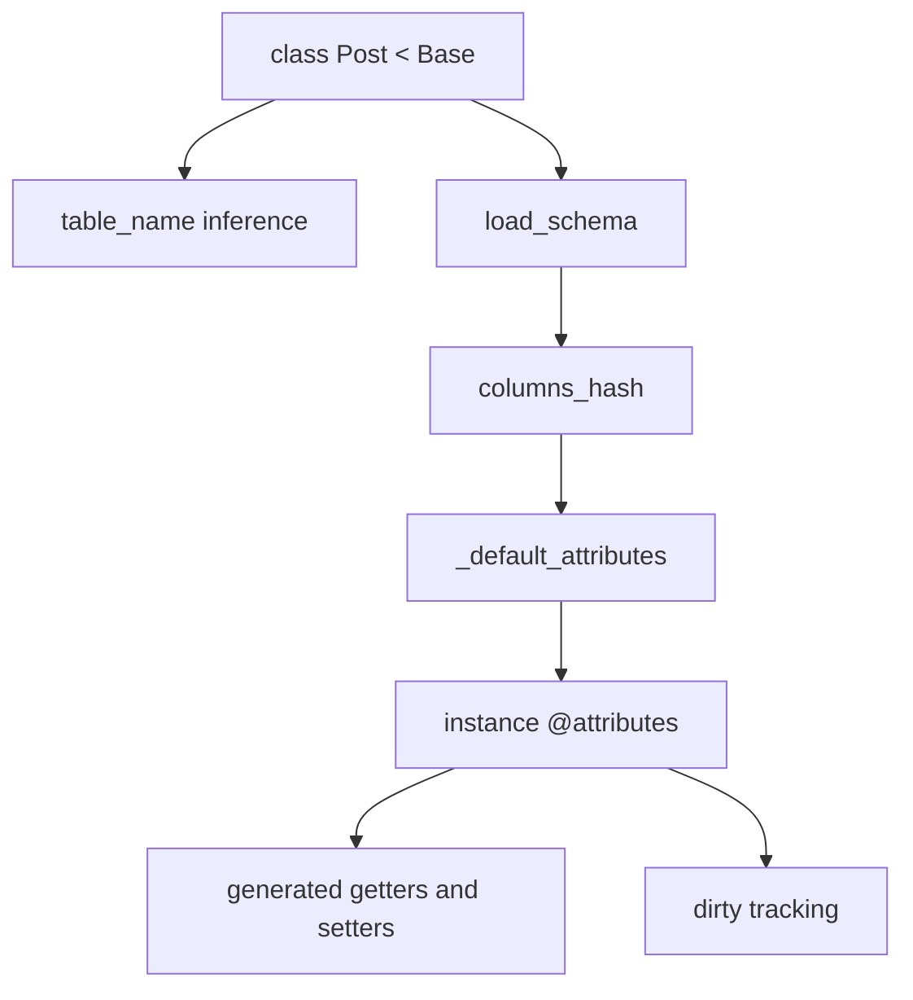
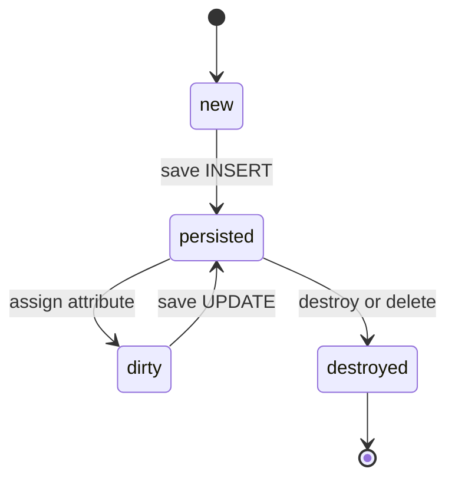

# 03 -- The model: a class that learns its own shape

The query half of ActiveRecord builds SQL. The model half turns the results of that SQL into Ruby objects. This chapter follows the model from class definition to a single instance with typed attributes, generated getters and setters, and dirty tracking.

When this chapter says "model", it means a subclass of `ActiveRecord::Base`. The base class is defined in `/Users/darkvoid/.gems/gems/activerecord-8.1.4/lib/active_record/base.rb` near line 282, and it pulls in dozens of modules. Most of the behavior described here comes from `Core`, `ModelSchema`, `Attributes`, `AttributeMethods`, and `Enum`.

## A class that learns its shape

The remarkable thing about an ActiveRecord model is how little you have to write:

```ruby
class Post < ActiveRecord::Base
end
```

From this empty class, ActiveRecord infers:

- The table name (`posts`).
- The columns (read from the database schema).
- The Ruby type of each column (a `Date` column becomes a `Date` attribute).
- The default value of each column.
- A getter, a setter, and a predicate for every column.

All of this is learned at runtime, not generated by a code generator. The class holds a reference to a schema, and the instance holds a set of attributes built from that schema.



## Table name and schema loading

The table name is computed by convention. `table_name` in `/Users/darkvoid/.gems/gems/activerecord-8.1.4/lib/active_record/model_schema.rb`, lines 263 through 266, lazily calls `reset_table_name`, which ends in `compute_table_name`:

```ruby
def compute_table_name
  if base_class?
    if module_parent < Base && !module_parent.abstract_class?
      contained = module_parent.table_name
      contained = contained.singularize if module_parent.pluralize_table_names
      contained += "_"
    end

    "#{full_table_name_prefix}#{contained}#{undecorated_table_name(model_name)}#{full_table_name_suffix}"
  else
    base_class.table_name
  end
end
```

From `/Users/darkvoid/.gems/gems/activerecord-8.1.4/lib/active_record/model_schema.rb`, lines 627 through 641. `undecorated_table_name` takes the class name, removes any module prefix (`demodulize`), converts CamelCase to snake_case (`underscore`), and pluralizes it. `Post` becomes `posts`; `Blog::Comment` becomes `comments`; `Person` becomes `people` (pluralize knows the irregular plural). Subclasses of a base class always use the base class's table, which is how single-table inheritance works.

The schema is loaded once per class, guarded by a monitor so two threads cannot load it twice. `load_schema` in the same file:

```ruby
def load_schema
  return if schema_loaded?
  @load_schema_monitor.synchronize do
    return if schema_loaded?

    load_schema!

    @schema_loaded = true
  rescue
    reload_schema_from_cache
    raise
  end
end
```

From `/Users/darkvoid/.gems/gems/activerecord-8.1.4/lib/active_record/model_schema.rb`, lines 550 through 562. `load_schema!` asks the connection for the table's columns and caches them in a `columns_hash`, a hash from column name to a `Column` object. Each `Column` knows its database type, its default, whether it allows NULL (no value), and whether it is the primary key. On a failure halfway through, the cache is reset so the next attempt starts clean.

## Columns, types, and defaults

The instance holds an `AttributeSet`, and the class builds the blueprint for it in `_default_attributes`:

```ruby
def _default_attributes # :nodoc:
  @default_attributes ||= begin
    attributes_hash = with_connection do |connection|
      columns_hash.transform_values do |column|
        ActiveModel::Attribute.from_database(column.name, column.default, type_for_column(connection, column))
      end
    end

    attribute_set = ActiveModel::AttributeSet.new(attributes_hash)
    apply_pending_attribute_modifications(attribute_set)
    attribute_set
  end
end
```

From `/Users/darkvoid/.gems/gems/activerecord-8.1.4/lib/active_record/attributes.rb`, lines 253 through 266. For every column, it wraps the column's default value in an `ActiveModel::Attribute` created `from_database`. That object carries three pieces: a name, a value, and a type object (a subclass of `ActiveRecord::Type::Value`).

The type object is where casting lives. A type implements `cast` (user input to typed value), `deserialize` (database value to typed value), and `serialize` (typed value to database value). `type_for_column` picks the right type object by looking up the column's database type in the adapter's type map. A PostgreSQL `timestamp` column gets a `DateTime` type; an `integer` column gets an `Integer` type; a `jsonb` column gets a `Json` type that parses JavaScript Object Notation (JSON) strings into Ruby hashes and arrays.

The same type objects decide how `where` builds binds, as seen in [02-sql-generation-arel.md](./02-sql-generation-arel.md). The model's `type_caster` (in `/Users/darkvoid/.gems/gems/activerecord-8.1.4/lib/active_record/core.rb`, lines 400 through 402) exposes them to the query side, so the two halves share one source of truth about types.

## Instantiation

A new record is created by `initialize` in `/Users/darkvoid/.gems/gems/activerecord-8.1.4/lib/active_record/core.rb`:

```ruby
def initialize(attributes = nil)
  @new_record = true
  @attributes = self.class._default_attributes.deep_dup

  init_internals
  initialize_internals_callback

  super

  yield self if block_given?
  _run_initialize_callbacks
end
```

From `/Users/darkvoid/.gems/gems/activerecord-8.1.4/lib/active_record/core.rb`, lines 472 through 483. Two things matter. First, `@attributes` is a `deep_dup` of the class-level defaults, so every instance owns its own attribute set; mutating one record never leaks into another. Second, `@new_record = true` marks the instance as not yet saved.

`init_internals` finishes the setup:

```ruby
def init_internals
  @readonly                 = false
  @previously_new_record    = false
  @destroyed                = false
  @marked_for_destruction   = false
  @destroyed_by_association = nil
  @_start_transaction_state = nil

  klass = self.class

  @primary_key         = klass.primary_key
  @strict_loading      = klass.strict_loading_by_default
  @strict_loading_mode = klass.strict_loading_mode

  klass.define_attribute_methods
end
```

From `/Users/darkvoid/.gems/gems/activerecord-8.1.4/lib/active_record/core.rb`, lines 837 through 852. The last line is the hinge: it triggers generation of the attribute methods if they are not generated yet.

Records loaded from the database do not go through `initialize`. They go through `instantiate_instance_of` in `/Users/darkvoid/.gems/gems/activerecord-8.1.4/lib/active_record/persistence.rb`, lines 311 through 314, which allocates the object without calling `initialize`, builds attributes with `build_from_database`, and calls `init_with_attributes`. That path skips the `@new_record = true` step and marks the record as persisted. This split is why `User.new` and `User.find(1)` produce objects with the same methods but different lifecycle state.

## Generated attribute methods

You never write `def title; end` in a model. ActiveRecord generates it. The reader for each attribute is defined by `define_method_attribute` in `/Users/darkvoid/.gems/gems/activerecord-8.1.4/lib/active_record/attribute_methods/read.rb`:

```ruby
def define_method_attribute(canonical_name, owner:, as: canonical_name)
  ActiveModel::AttributeMethods::AttrNames.define_attribute_accessor_method(
    owner, canonical_name
  ) do |temp_method_name, attr_name_expr|
    owner.define_cached_method(temp_method_name, as: as, namespace: :active_record) do |batch|
      batch <<
        "def #{temp_method_name}" <<
        "  _read_attribute(#{attr_name_expr}) { |n| missing_attribute(n, caller) }" <<
        "end"
    end
  end
end
```

From `/Users/darkvoid/.gems/gems/activerecord-8.1.4/lib/active_record/attribute_methods/read.rb`, lines 11 through 22. The generated method is a single call to `_read_attribute("title")`, which fetches the value from `@attributes`. The writer is symmetric, in `/Users/darkvoid/.gems/gems/activerecord-8.1.4/lib/active_record/attribute_methods/write.rb`:

```ruby
def write_attribute(attr_name, value)
  name = attr_name.to_s
  name = self.class.attribute_aliases[name] || name

  name = @primary_key if name == "id" && @primary_key
  @attributes.write_from_user(name, value)
end
```

From `/Users/darkvoid/.gems/gems/activerecord-8.1.4/lib/active_record/attribute_methods/write.rb`, lines 31 through 37. The generated setter calls `_write_attribute("title", value)`, which delegates to `write_from_user`. The "from user" part matters: the value is cast through the type's `cast` method, not its `deserialize` method, because a user assignment is not database input.

The methods are generated lazily and cached. `define_attribute_methods` in `/Users/darkvoid/.gems/gems/activerecord-8.1.4/lib/active_record/attribute_methods.rb`, lines 104 through 125, runs under a mutex, loads the schema, and calls `super(attribute_names)`. Once generated, the methods live in a `GeneratedAttributeMethods` module included in the model class.

The fallback path is `method_missing` in the same file:

```ruby
def method_missing(name, ...)
  self.class.define_attribute_methods

  method = if self.class.public_method_defined?(name)
    begin
      self.class.public_instance_method(name)
    rescue NameError
      nil
    end
  end

  method = method.super_method while method && !method.owner.is_a?(GeneratedAttributeMethods)
  if method
    method.bind_call(self, ...)
  else
    super
  end
end
```

From `/Users/darkvoid/.gems/gems/activerecord-8.1.4/lib/active_record/attribute_methods.rb`, lines 475 through 499. If a column method has not been generated yet (for example, after a schema change), the first call to `post.title` hits `method_missing`, which forces generation and then re-dispatches to the freshly defined method. The `super_method` walk handles the case where a model defines its own `title` that calls `super`.

## Dirty tracking

The model remembers what changed. Two mutation trackers do the work, both defined in `/Users/darkvoid/.gems/gems/activerecord-8.1.4/lib/active_record/attribute_methods/dirty.rb`.

- `@mutations_from_database` tracks changes since the record was loaded or last saved. It answers "what will change if I save now?"
- `@mutations_before_last_save` tracks changes from the previous save. It answers "what changed in the last save?"

The public API maps onto those two trackers:

```ruby
def will_save_change_to_attribute?(attr_name, **options)
  mutations_from_database.changed?(attr_name.to_s, **options)
end

def saved_change_to_attribute?(attr_name, **options)
  mutations_before_last_save.changed?(attr_name.to_s, **options)
end

def attribute_in_database(attr_name)
  mutations_from_database.original_value(attr_name.to_s)
end

def has_changes_to_save?
  mutations_from_database.any_changes?
end
```

From `/Users/darkvoid/.gems/gems/activerecord-8.1.4/lib/active_record/attribute_methods/dirty.rb`, lines 86 through 171, shortened. A save calls `changes_applied` inside `_update_record` or `_create_record` (lines 233 through 243 of the same file), which copies the "from database" mutations into the "before last save" slot and clears the current changes.

Dirty tracking also enables partial writes. `attribute_names_for_partial_updates` returns only `changed_attribute_names_to_save`, so an UPDATE statement sets only the columns that actually changed, not every column.



## Enum

An enum maps a small set of named values onto a database column. The `enum` macro in `/Users/darkvoid/.gems/gems/activerecord-8.1.4/lib/active_record/enum.rb` wraps the column's type with an `EnumType` that translates between the label and the stored value:

```ruby
class Conversation < ActiveRecord::Base
  enum :status, [ :active, :archived ]
end

conversation.active!          # sets status to 0 and saves
conversation.active?          # true
conversation.status           # "active"
Conversation.active           # a scope: WHERE status = 0
Conversation.not_active       # a scope: WHERE status != 0
```

From the documentation in `/Users/darkvoid/.gems/gems/activerecord-8.1.4/lib/active_record/enum.rb`, lines 7 through 43. Under the hood, `_enum` at line 223 stores the mapping, declares the attribute, wraps its type with `EnumType`, and defines predicate methods (`active?`), bang methods (`active!`), and scopes (`active`, `not_active`) in a generated module. The stored values are the array indexes by default (0, 1, 2, ...), which is why adding values must append to the end.

`EnumType#deserialize` converts the stored integer back to its label, and `#serialize` converts the label back to the integer:

```ruby
def cast(value)
  if mapping.has_key?(value)
    value.to_s
  elsif mapping.has_value?(value)
    mapping.key(value)
  else
    value.presence
  end
end

def deserialize(value)
  mapping.key(subtype.deserialize(value))
end

def serialize(value)
  subtype.serialize(mapping.fetch(value, value))
end
```

From `/Users/darkvoid/.gems/gems/activerecord-8.1.4/lib/active_record/enum.rb`, lines 181 through 197. The enum type is a decorator over the column's real type (`subtype`), so an integer-backed enum still stores integers and a string-backed enum stores strings.

## Lifecycle predicates

The record's lifecycle state is a handful of boolean flags, all set by `init_internals` and flipped by persistence methods. `new_record?` returns `@new_record`; `persisted?` returns `!(@new_record || @destroyed)`; `destroyed?` returns `@destroyed`. These are in `/Users/darkvoid/.gems/gems/activerecord-8.1.4/lib/active_record/persistence.rb`, lines 336 through 363.

`reload` discards in-memory state and re-reads the row from the database. It clears the query cache, re-fetches the record by primary key, and replaces `@attributes` and the association cache with the fresh object's state. The source is `/Users/darkvoid/.gems/gems/activerecord-8.1.4/lib/active_record/persistence.rb`, lines 774 through 789. Reloading is the standard way to see changes another process made to the same row.

## The Aha Moment

**Aha:** The model is not a place where you declare attributes. It is a place where attributes are discovered. An empty `Post < ActiveRecord::Base` already has a table name, a schema, typed defaults, generated accessors, and dirty tracking, because the class asks the database for its own definition and then generates Ruby code to match. The only thing the developer adds is behavior that the schema cannot express: validations, callbacks, associations, and scopes.

The split between `initialize` (new records) and `instantiate_instance_of` (loaded records) is the concrete evidence. Both produce a `Post`, but one starts with `@new_record = true` and user-cast attributes, while the other starts with database-deserialized attributes and a persisted state. Everything else — the getters, the types, the dirty tracking — is identical machinery applied to both. Chapter [04-query-interface.md](./04-query-interface.md) shows the query side that produces loaded records, and chapter [05-persistence.md](./05-persistence.md) shows how `new_record?` decides between INSERT and UPDATE.

Continue to [04-query-interface.md](./04-query-interface.md).
