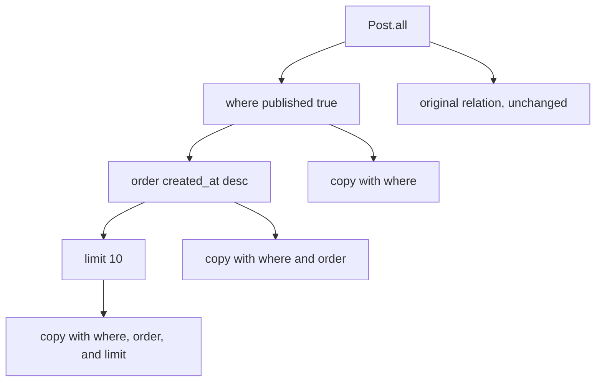
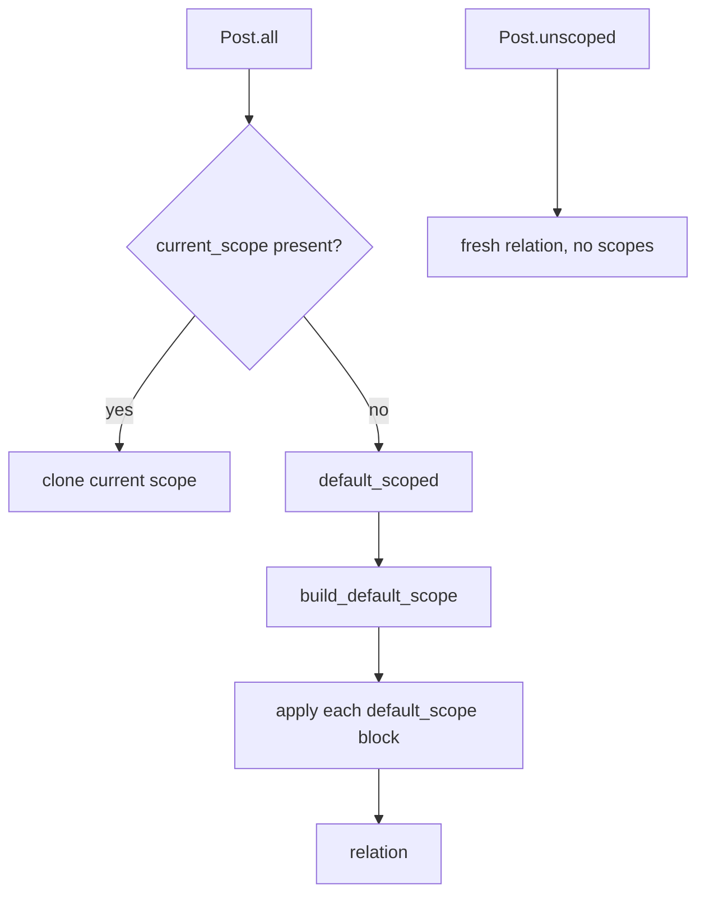

# 04 -- The query interface: a lazy immutable Relation

A `Relation` is a recipe for a query that has not run yet. This chapter explains how chaining methods builds that recipe without executing it, how the recipe becomes SQL at enumeration, and how scopes and merging fit on top.

The `Relation` class lives in `/Users/darkvoid/.gems/gems/activerecord-8.1.4/lib/active_record/relation.rb`. Its query methods come from `relation/query_methods.rb`, its lookup methods from `relation/finder_methods.rb`, its copying behavior from `relation/spawn_methods.rb`, and its scope machinery from `scoping/named.rb` and `scoping/default.rb`.

## A description, not a result

The most important fact about a `Relation` is that it does nothing when you build it:

```ruby
posts = Post.where(published: true).order(created_at: :desc).limit(10)
# No SQL has run yet.
```

`posts` is a value object holding a set of clauses. The query runs only when you enumerate it, fetch one record from it, or ask for a count. Enumeration goes through `to_ary`, which calls `records`, which calls `load`:

```ruby
def to_ary
  records.dup
end
alias to_a to_ary

def records # :nodoc:
  load
  @records
end
```

From `/Users/darkvoid/.gems/gems/activerecord-8.1.4/lib/active_record/relation.rb`, lines 347 through 355. `load` in the same file, lines 1207 through 1214, checks `@loaded` and calls `exec_queries` once, caching the resulting array. The second call to `to_a` on the same relation returns the cache.

The relation is immutable in the functional sense: every query method returns a copy, and the original is left alone. This is what makes scopes composable. `Post.where(published: true)` and `Post.where(published: true).order(...)` are two different objects; neither modifies the other.



## Value slots

A relation's entire state is a hash named `@values`, keyed by method name. The class declares which methods are multi-value, single-value, or clause methods:

```ruby
MULTI_VALUE_METHODS  = [:includes, :eager_load, :preload, :select, :group,
                        :order, :joins, :left_outer_joins, :references,
                        :extending, :unscope, :optimizer_hints, :annotate,
                        :with]

SINGLE_VALUE_METHODS = [:limit, :offset, :lock, :readonly, :reordering, :strict_loading,
                        :reverse_order, :distinct, :create_with, :skip_query_cache]

CLAUSE_METHODS = [:where, :having, :from]
INVALID_METHODS_FOR_UPDATE_AND_DELETE_ALL = [:distinct, :with, :with_recursive]

VALUE_METHODS = MULTI_VALUE_METHODS + SINGLE_VALUE_METHODS + CLAUSE_METHODS
```

From `/Users/darkvoid/.gems/gems/activerecord-8.1.4/lib/active_record/relation.rb`, lines 54 through 65. The distinction matters when two relations merge. Multi-value methods accumulate (two `order` clauses both apply, and the later one wins only when explicitly reordering). Single-value methods overwrite (a second `limit` replaces the first). Clause methods wrap their input in a `WhereClause`, `HavingClause`, or `FromClause` object, not a raw array.

The initializer is trivial, which is the point:

```ruby
def initialize(model, table: nil, predicate_builder: nil, values: {})
  if table
    predicate_builder ||= model.predicate_builder.with(TableMetadata.new(model, table))
  else
    table = model.arel_table
    predicate_builder ||= model.predicate_builder
  end

  @model  = model
  @table  = table
  @values = values
  @loaded = false
  @predicate_builder = predicate_builder
  @delegate_to_model = false
  @future_result = nil
  @records = nil
  @async = false
  @none = false
end
```

From `/Users/darkvoid/.gems/gems/activerecord-8.1.4/lib/active_record/relation.rb`, lines 77 through 95. A relation is a model, a table, a predicate builder, and a hash of values. Everything else is a cache flag.

## spawn: copy-on-write

Every bang method mutates in place, and every public method wraps a bang method in `spawn`. The split is in `/Users/darkvoid/.gems/gems/activerecord-8.1.4/lib/active_record/relation/spawn_methods.rb`:

```ruby
def spawn # :nodoc:
  already_in_scope?(model.scope_registry) ? model.all : clone
end
```

From `/Users/darkvoid/.gems/gems/activerecord-8.1.4/lib/active_record/relation/spawn_methods.rb`, lines 9 through 11. `clone` calls `initialize_copy`, which duplicates `@values` and calls `reset` to clear the caches. So `where` is `spawn.where!(...)`, and only the copy is mutated. The public and bang forms are paired in `query_methods.rb`:

```ruby
def where!(opts, *rest) # :nodoc:
  self.where_clause += build_where_clause(opts, rest)
  self
end
```

From `/Users/darkvoid/.gems/gems/activerecord-8.1.4/lib/active_record/relation/query_methods.rb`, lines 1071 through 1074. `build_where_clause` is the machinery from [02-sql-generation-arel.md](./02-sql-generation-arel.md): it turns a hash, string, array, or Arel node into a `WhereClause`. The `+=` on `WhereClause` concatenates predicate lists.

`limit` and `offset` are the simplest possible single-value methods:

```ruby
def limit!(value) # :nodoc:
  value = Integer(value) unless value.nil?
  self.limit_value = value
  self
end

def offset!(value) # :nodoc:
  self.offset_value = value
  self
end
```

From `/Users/darkvoid/.gems/gems/activerecord-8.1.4/lib/active_record/relation/query_methods.rb`, lines 1243 through 1263. The generated reader `limit_value` fetches from `@values` with a nil default, per the class-level generation loop at lines 162 through 183 of the same file.

## where in all its shapes

The public `where` accepts four shapes, as shown in `build_where_clause` in [02-sql-generation-arel.md](./02-sql-generation-arel.md):

- A hash: `where(published: true)` becomes equality predicates, one per key.
- A string with no placeholders: `where("published")` becomes a raw SQL literal.
- A string with `?` placeholders: `where("published_at > ?", 2.weeks.ago)` becomes a bound SQL literal.
- An array, which is just a string-plus-arguments shape unwrapped.
- An Arel node, passed through unchanged.

A hash value of an array becomes `IN`, a range becomes `BETWEEN`, and `nil` becomes `IS NULL`, all handled by the `PredicateBuilder` handlers. This is why the same single method covers most of the query language without the caller thinking about SQL.

`where` also chains by `AND`. Each call appends a `WhereClause` to the previous one. `or` is separate: `WhereClause#or` in `/Users/darkvoid/.gems/gems/activerecord-8.1.4/lib/active_record/relation/where_clause.rb`, lines 36 through 59, computes the left-only, common, and right-only predicates, then wraps the non-common parts in an `Arel::Nodes::Or` node inside a `Grouping`. `rewhere` (query_methods.rb line 1089) removes predicates that touch the same attributes first, so it replaces rather than accumulates.

## order, group, having, distinct

`order` accumulates. `reorder` discards existing order and starts over; it is the order-side counterpart to `rewhere`. `group` and `having` pair up, with `having` built by the same `build_where_clause` via the alias at `query_methods.rb` line 1683. `distinct` sets a single boolean.

The important subtlety is that these methods store symbols and strings, and the conversion to Arel attribute nodes happens later in `build_arel` through `arel_columns`. A string order like `"created_at DESC"` passes through as a SQL literal; a hash like `{ created_at: :desc }` is expanded to `ORDER BY "created_at" DESC`.

## pluck and select

`pluck` reads a single column (or several) without building model objects. It is in `/Users/darkvoid/.gems/gems/activerecord-8.1.4/lib/active_record/relation/calculations.rb`, lines 295 through 334:

```ruby
def pluck(*column_names)
  if @none
    if @async
      return Promise::Complete.new([])
    else
      return []
    end
  end

  if loaded? && all_attributes?(column_names)
    result = records.pluck(*column_names)
    if @async
      return Promise::Complete.new(result)
    else
      return result
    end
  end

  if has_include?(column_names.first)
    relation = apply_join_dependency
    relation.pluck(*column_names)
  else
    model.disallow_raw_sql!(flattened_args(column_names))
    relation = spawn
    columns = relation.arel_columns(column_names)
    relation.select_values = columns
    result = skip_query_cache_if_necessary do
      if where_clause.contradiction? && !possible_aggregation?(column_names)
        ActiveRecord::Result.empty(async: @async)
      else
        model.with_connection do |c|
          c.select_all(relation.arel, "#{model.name} Pluck", async: @async)
        end
      end
    end
    result.then do |result|
      type_cast_pluck_values(result, columns)
    end
  end
end
```

From `/Users/darkvoid/.gems/gems/activerecord-8.1.4/lib/active_record/relation/calculations.rb`, lines 295 through 334. Three shortcuts are visible: a null relation returns an empty array immediately; an already-loaded relation plucks from the in-memory records; and a relation with an impossible WHERE clause (a contradiction, such as `IN ()`) returns an empty result without hitting the database. Otherwise it selects only the requested columns and type-casts the raw result rows.

`select` changes the projection. `Post.select(:id)` returns relations whose records have only `id` loaded; the other attributes raise `ActiveModel::MissingAttributeError` when read. `select` is also how calculations such as `count`, `sum`, and `average` project aggregate expressions instead of columns.

## find, find_by, take, first, last

The lookup methods are thin wrappers over the query interface. From `/Users/darkvoid/.gems/gems/activerecord-8.1.4/lib/active_record/relation/finder_methods.rb`:

```ruby
def find(*args)
  return super if block_given?
  find_with_ids(*args)
end

def find_by(arg, *args)
  where(arg, *args).take
end

def take(limit = nil)
  limit ? find_take_with_limit(limit) : find_take
end

def first(limit = nil)
  if limit
    find_nth_with_limit(0, limit)
  else
    find_nth 0
  end
end

def last(limit = nil)
  return find_last(limit) if loaded? || has_limit_or_offset?

  result = ordered_relation.limit(limit)
  result = result.reverse_order!

  limit ? result.reverse : result.first
end
```

From `/Users/darkvoid/.gems/gems/activerecord-8.1.4/lib/active_record/relation/finder_methods.rb`, lines 98 through 209, shortened. `find` is for primary keys; it builds `WHERE id IN (...)` and preserves the order of the requested ids. `find_by` is just `where(...).take`. `first` and `last` apply a default order by primary key when none exists, because "first" and "last" are meaningless without an order. `last` without an explicit order reverses a primary-key-ordered relation and takes the first row of the reversal.

`none` is a special relation that always returns zero records. It is implemented as a contradiction:

```ruby
def none
  spawn.none!
end

def none! # :nodoc:
  unless @none
    where!("1=0")
    @none = true
  end
  self
end
```

From `/Users/darkvoid/.gems/gems/activerecord-8.1.4/lib/active_record/relation/query_methods.rb`, lines 1310 through 1320. `where!("1=0")` adds an always-false condition, so `none` composes with the rest of the API: `Post.none.order(...).limit(...)` still returns an empty set, and scopes can return `none` instead of an empty array without breaking chaining.

## Scopes and default_scope

A scope is just a class method that returns a relation. The `scope` macro stores a callable and defines a class method that runs it against `all`:

```ruby
def all(all_queries: nil)
  scope = current_scope

  if scope
    if self == scope.model
      scope.clone
    else
      relation.merge!(scope)
    end
  else
    default_scoped(all_queries: all_queries)
  end
end
```

From `/Users/darkvoid/.gems/gems/activerecord-8.1.4/lib/active_record/scoping/named.rb`, lines 22 through 34. `all` is the root of every chain. It returns the current scope if one is active (inside a `scoping` block), merged into the relation if the models differ, and otherwise falls back to `default_scoped`, which applies the default scope.

A default scope is a callable applied to every query on the model. `default_scope` in `/Users/darkvoid/.gems/gems/activerecord-8.1.4/lib/active_record/scoping/default.rb`:

```ruby
def default_scope(scope = nil, all_queries: nil, &block) # :doc:
  scope = block if block_given?

  if scope.is_a?(Relation) || !scope.respond_to?(:call)
    raise ArgumentError,
      "Support for calling #default_scope without a block is removed. For example instead " \
      "of `default_scope where(color: 'red')`, please use " \
      "`default_scope { where(color: 'red') }`. (Alternatively you can just redefine " \
      "self.default_scope.)"
  end

  default_scope = DefaultScope.new(scope, all_queries)

  self.default_scopes += [default_scope]
end
```

From `/Users/darkvoid/.gems/gems/activerecord-8.1.4/lib/active_record/scoping/default.rb`, lines 129 through 143. A block is required, and it must return a relation. Multiple default scopes are stored and merged. `build_default_scope` (lines 145 through 170) applies each stored scope with `instance_exec` against the current relation.

The escape hatch is `unscoped`, at lines 50 through 52 of the same file: it returns a fresh relation with no scopes, or, with a block, runs the block inside that unscoped context. Default scopes are powerful and dangerous, because every finder silently narrows the table.



## Merging

`merge` combines two relations. The entry is `merge!` in `spawn_methods.rb`, which delegates to `Relation::Merger` for relations. The core loop in `/Users/darkvoid/.gems/gems/activerecord-8.1.4/lib/active_record/relation/merger.rb`:

```ruby
def merge
  NORMAL_VALUES.each do |name|
    value = values[name]
    unless value.nil? || (value.blank? && false != value)
      relation.public_send(:"#{name}!", *value)
    end
  end

  relation.none! if other.null_relation?

  merge_select_values
  merge_multi_values
  merge_single_values
  merge_clauses
  merge_preloads
  merge_joins
  merge_outer_joins

  relation
end
```

From `/Users/darkvoid/.gems/gems/activerecord-8.1.4/lib/active_record/relation/merger.rb`, lines 58 through 81. Each value slot is merged with rules specific to its kind: multi-values union, single-values take the other relation's value, and clauses go through `WhereClause#merge`.

`WhereClause#merge` in `/Users/darkvoid/.gems/gems/activerecord-8.1.4/lib/active_record/relation/where_clause.rb`, lines 26 through 30, is the subtle part:

```ruby
def merge(other)
  predicates = except_predicates(other.extract_attributes)

  WhereClause.new(predicates | other.predicates)
end
```

It removes any existing predicate that touches the same attribute as an incoming predicate, then unions the rest. So merging `Post.where(published: true)` with `Post.where(published: false)` yields only the incoming condition, not a contradictory `AND` of both. For conditions on different attributes, both survive. This is why `merge` behaves like "the other relation wins on conflicts" instead of blind concatenation.

## The Aha Moment

**Aha:** A `Relation` is a frozen description until enumeration, and the entire query API is just a disciplined way to copy a hash. Every public method is `spawn` plus a bang method, every bang method writes one slot of `@values`, and `@values` is the only thing that matters until `load` runs. The immutability and the laziness are the same mechanism: because methods copy instead of mutate, the intermediate relations are cheap to build and safe to share, so scopes, merges, and conditional chaining all compose without surprises.

The proof is `none`, which is not a separate class or a special flag in the executor. It is an ordinary relation with `@none = true` and a `WHERE 1=0` clause. That is why `none` composes with `order`, `limit`, `merge`, and scopes for free: it plays by the same copy-the-hash rules as every other query. Chapter [05-persistence.md](./05-persistence.md) shows what happens when a model instance, rather than a relation, decides to write to the database, and [10-scoping-and-eager-loading.md](./10-scoping-and-eager-loading.md) goes deeper into scopes and eager loading.

Continue to [05-persistence.md](./05-persistence.md).
