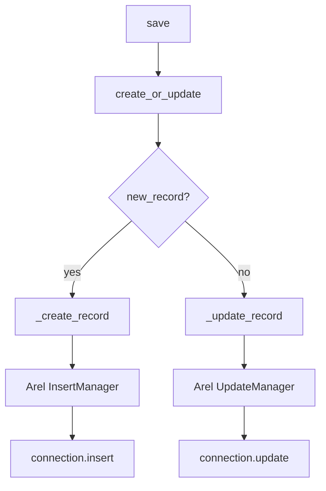
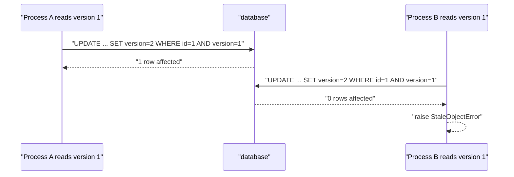

# 05 -- Persistence: from Ruby object to SQL and back

The query half reads rows. The persistence half writes them. This chapter follows one model instance as it moves from memory to a row in the database and back, through save, update, delete, bulk operations, locking, and transactions.

The main implementation is in `/Users/darkvoid/.gems/gems/activerecord-8.1.4/lib/active_record/persistence.rb`. Transactions are in `transactions.rb`, bulk inserts in `insert_all.rb`, and the two locking strategies in `locking/optimistic.rb` and `locking/pessimistic.rb`.

## The save decision: new or update

Every save starts with one question: is this a new record? The answer comes from `new_record?`, the flag set by `initialize` and cleared by `_create_record`. `create_or_update` in `/Users/darkvoid/.gems/gems/activerecord-8.1.4/lib/active_record/persistence.rb`:

```ruby
def create_or_update(**, &block)
  _raise_readonly_record_error if readonly?
  return false if destroyed?
  result = new_record? ? _create_record(&block) : _update_record(&block)
  result != false
end
```

From `/Users/darkvoid/.gems/gems/activerecord-8.1.4/lib/active_record/persistence.rb`, lines 923 through 928. The public `save` and `save!` are thin wrappers:

```ruby
def save(**options, &block)
  create_or_update(**options, &block)
rescue ActiveRecord::RecordInvalid
  false
end

def save!(**options, &block)
  create_or_update(**options, &block) || raise(RecordNotSaved.new("Failed to save the record", self))
end
```

From `/Users/darkvoid/.gems/gems/activerecord-8.1.4/lib/active_record/persistence.rb`, lines 390 through 425. `save` swallows validation failures and returns false; `save!` re-raises them. Both run the full callback chain, described in [07-callbacks-and-validations.md](./07-callbacks-and-validations.md).



## INSERT

`_create_record` asks for the returning columns, calls `_insert_record`, then writes the returned values back into the instance:

```ruby
def _create_record(attribute_names = self.attribute_names)
  attribute_names = attributes_for_create(attribute_names)

  self.class.with_connection do |connection|
    returning_columns = self.class._returning_columns_for_insert(connection)

    returning_values = self.class._insert_record(
      connection,
      attributes_with_values(attribute_names),
      returning_columns
    )

    returning_columns.zip(returning_values).each do |column, value|
      _write_attribute(column, type_for_attribute(column).deserialize(value)) if !_read_attribute(column)
    end if returning_values
  end

  @new_record = false
  @previously_new_record = true

  yield(self) if block_given?

  id
end
```

From `/Users/darkvoid/.gems/gems/activerecord-8.1.4/lib/active_record/persistence.rb`, lines 952 through 975. Two details matter. First, `returning_columns` lets the database return generated values (a serial primary key, database defaults, triggers) so the instance is correct after the INSERT. Second, the returned values are `deserialize`d through the column type before being written.

The SQL is built by `_insert_record` in the same file:

```ruby
def _insert_record(connection, values, returning) # :nodoc:
  primary_key = self.primary_key
  primary_key_value = nil

  if prefetch_primary_key? && primary_key
    values[primary_key] ||= begin
      primary_key_value = next_sequence_value
      _default_attributes[primary_key].with_cast_value(primary_key_value)
    end
  end

  im = Arel::InsertManager.new(arel_table)

  if values.empty?
    im.insert(connection.empty_insert_statement_value(primary_key))
  else
    im.insert(values.transform_keys { |name| arel_table[name] })
  end

  connection.insert(
    im, "#{self} Create", primary_key || false, primary_key_value,
    returning: returning
  )
end
```

From `/Users/darkvoid/.gems/gems/activerecord-8.1.4/lib/active_record/persistence.rb`, lines 238 through 261. This is the Arel insert path from [02-sql-generation-arel.md](./02-sql-generation-arel.md): the attribute names become `arel_table[name]` nodes, and `connection.insert` compiles and executes the `InsertManager`. When the primary key is a sequence-based value that the adapter can prefetch, the value is fetched before the INSERT and passed along.

## UPDATE

`_update_record` builds an `UpdateManager` and constrains it to this specific row:

```ruby
def _update_record(values, constraints) # :nodoc:
  constraints = constraints.map { |name, value| predicate_builder[name, value] }

  default_constraint = build_default_constraint
  constraints << default_constraint if default_constraint

  if current_scope = self.global_current_scope
    constraints << current_scope.where_clause.ast
  end

  um = Arel::UpdateManager.new(arel_table)
  um.set(values.transform_keys { |name| arel_table[name] })
  um.wheres = constraints

  with_connection do |c|
    c.update(um, "#{self} Update")
  end
end
```

From `/Users/darkvoid/.gems/gems/activerecord-8.1.4/lib/active_record/persistence.rb`, lines 263 through 280. The instance-level `_update_record` (lines 932 through 948) narrows the attribute names to the dirty ones and calls this through `_update_row`, so a normal save only writes changed columns. The constraints are the primary key (or composite key), plus any `all_queries: true` default scope, so the UPDATE always addresses exactly the row that was loaded.

The instance method also sets `@previously_new_record = false`, which is what makes `previously_new_record?` true only for records whose most recent save was an INSERT.

## DELETE: delete versus destroy

There are two ways to remove a row, and the difference is callbacks:

```ruby
def delete
  _delete_row if persisted?
  @destroyed = true
  @previously_new_record = false
  freeze
end

def destroy
  _raise_readonly_record_error if readonly?
  destroy_associations
  @_trigger_destroy_callback ||= persisted? && destroy_row > 0
  @destroyed = true
  @previously_new_record = false
  freeze
end
```

From `/Users/darkvoid/.gems/gems/activerecord-8.1.4/lib/active_record/persistence.rb`, lines 439 through 460. `delete` issues one `DELETE` statement with no callbacks. `destroy` runs `destroy_associations` (the `dependent:` handling) and the full `before_destroy`/`after_destroy` callback chain. `destroy` also checks `readonly?`. Both freeze the instance, so a deleted record cannot be mutated further.

The class-level `_delete_record` mirrors `_update_record` with a `DeleteManager`:

```ruby
def _delete_record(constraints) # :nodoc:
  constraints = constraints.map { |name, value| predicate_builder[name, value] }

  default_constraint = build_default_constraint
  constraints << default_constraint if default_constraint

  if current_scope = self.global_current_scope
    constraints << current_scope.where_clause.ast
  end

  dm = Arel::DeleteManager.new(arel_table)
  dm.wheres = constraints

  with_connection do |c|
    c.delete(dm, "#{self} Destroy")
  end
end
```

From `/Users/darkvoid/.gems/gems/activerecord-8.1.4/lib/active_record/persistence.rb`, lines 282 through 298.

## create, update, and update_columns

The class-level `create` is `new` plus `save`:

```ruby
def create(attributes = nil, &block)
  if attributes.is_a?(Array)
    attributes.collect { |attr| create(attr, &block) }
  else
    object = new(attributes, &block)
    object.save
    object
  end
end
```

From `/Users/darkvoid/.gems/gems/activerecord-8.1.4/lib/active_record/persistence.rb`, lines 33 through 41. `create!` is identical except it calls `save!`. Both return the object, whether or not it saved, so a failed `create` returns an unsaved object rather than raising.

`update` combines attribute assignment with save inside a transaction:

```ruby
def update(attributes)
  with_transaction_returning_status do
    assign_attributes(attributes)
    save
  end
end
```

From `/Users/darkvoid/.gems/gems/activerecord-8.1.4/lib/active_record/persistence.rb`, lines 565 through 572. `assign_attributes` is the same mass-assignment used by `new(attributes)`.

`update_columns` is the fast path: it skips validations, callbacks, and the normal save entirely, and issues one direct UPDATE:

```ruby
def update_columns(attributes)
  raise ActiveRecordError, "cannot update a new record" if new_record?
  raise ActiveRecordError, "cannot update a destroyed record" if destroyed?
  _raise_readonly_record_error if readonly?

  attributes = attributes.transform_keys do |key|
    name = key.to_s
    name = self.class.attribute_aliases[name] || name
    verify_readonly_attribute(name) || name
  end

  touch = attributes.delete("touch")
  if touch
    names = touch if touch != true
    names = Array.wrap(names)
    options = names.extract_options!
    touch_updates = self.class.touch_attributes_with_time(*names, **options)
    attributes.with_defaults!(touch_updates) unless touch_updates.empty?
  end

  update_constraints = _query_constraints_hash
  attributes = attributes.each_with_object({}) do |(k, v), h|
    h[k] = @attributes.write_cast_value(k, v)
    clear_attribute_change(k)
  end

  affected_rows = self.class._update_record(
    attributes,
    update_constraints
  )

  affected_rows == 1
end
```

From `/Users/darkvoid/.gems/gems/activerecord-8.1.4/lib/active_record/persistence.rb`, lines 620 through 652. Because callbacks and validations are bypassed, `updated_at` is not touched unless `touch: true` is passed. The method still goes through `_update_record` with the primary key constraint, and returns whether exactly one row changed.

## Bulk operations

`update_all` on a relation writes many rows with one statement. From `/Users/darkvoid/.gems/gems/activerecord-8.1.4/lib/active_record/relation.rb`:

```ruby
def update_all(updates)
  raise ArgumentError, "Empty list of attributes to change" if updates.blank?

  return 0 if @none

  ...

  model.with_connection do |c|
    arel = eager_loading? ? apply_join_dependency.arel : arel()
    arel.source.left = table

    key = if model.composite_primary_key?
      primary_key.map { |pk| table[pk] }
    else
      table[primary_key]
    end
    stmt = arel.compile_update(values, key)
    c.update(stmt, "#{model} Update All").tap { reset }
  end
end
```

From `/Users/darkvoid/.gems/gems/activerecord-8.1.4/lib/active_record/relation.rb`, lines 602 through 643, shortened. It does not instantiate models, so it skips callbacks and validations. A hash of updates is converted to bind values, an optimistic locking column is auto-incremented if present, and the statement is compiled from the relation's Arel.

`insert_all`, `insert_all!`, and `upsert_all` write many rows at once and skip model instantiation too. The executor is in `/Users/darkvoid/.gems/gems/activerecord-8.1.4/lib/active_record/insert_all.rb`:

```ruby
def execute
  return ActiveRecord::Result.empty if inserts.empty?

  message = +"#{model.name} "
  message << "Bulk " if inserts.many?
  message << (on_duplicate == :update ? "Upsert" : "Insert")
  connection.exec_insert_all to_sql, message
end
```

From `/Users/darkvoid/.gems/gems/activerecord-8.1.4/lib/active_record/insert_all.rb`, lines 48 through 55. `upsert_all` is `insert_all` with `on_duplicate: :update`; on a unique-key conflict it updates the specified columns instead of raising. The builder renders all the rows as one `VALUES` list and the connection executes a single multi-row INSERT.

## touch and increment!

`touch` updates only the timestamp columns (usually `updated_at`) directly, without running validations or callbacks:

```ruby
def touch(*names, time: nil)
  _raise_record_not_touched_error unless persisted?
  _raise_readonly_record_error if readonly?

  attribute_names = timestamp_attributes_for_update_in_model
  attribute_names = (attribute_names | names).map! do |name|
    name = name.to_s
    name = self.class.attribute_aliases[name] || name
    verify_readonly_attribute(name)
    name
  end

  unless attribute_names.empty?
    affected_rows = _touch_row(attribute_names, time)
    @_trigger_update_callback = affected_rows == 1
  else
    true
  end
end
```

From `/Users/darkvoid/.gems/gems/activerecord-8.1.4/lib/active_record/persistence.rb`, lines 825 through 843. It is commonly used to refresh a cache key after a child record changes, because it updates the parent's timestamp without touching the parent's other attributes.

`increment!` updates a single numeric column relative to its current value, using a SQL `UPDATE counters SET n = n + 1` style statement:

```ruby
def increment!(attribute, by = 1, touch: nil)
  raise ActiveRecordError, "cannot update a new record" if new_record?
  raise ActiveRecordError, "cannot update a destroyed record" if destroyed?

  increment(attribute, by)
  change = public_send(attribute) - (public_send(:"#{attribute}_in_database") || 0)
  self.class.update_counters(id, attribute => change, touch: touch)
  public_send(:"clear_#{attribute}_change")
  self
end
```

From `/Users/darkvoid/.gems/gems/activerecord-8.1.4/lib/active_record/persistence.rb`, lines 673 through 682. It computes the delta from the in-database value, so two processes incrementing the same counter do not lose each other's updates the way a plain read-modify-write would.

## Optimistic locking

Optimistic locking assumes conflicts are rare, so it does not lock the row during the read. Instead, each row carries a `lock_version` integer, and every UPDATE includes the version that was read and bumps it by one. If two processes read the same version and both try to write, the second UPDATE affects zero rows, and ActiveRecord raises `StaleObjectError`.

The implementation is in `/Users/darkvoid/.gems/gems/activerecord-8.1.4/lib/active_record/locking/optimistic.rb`, which overrides `_update_row`:

```ruby
def _update_row(attribute_names, attempted_action = "update")
  return super unless locking_enabled?

  begin
    locking_column = self.class.locking_column
    lock_attribute_was = @attributes[locking_column]

    update_constraints = _query_constraints_hash

    attribute_names = attribute_names.dup if attribute_names.frozen?
    attribute_names << locking_column

    if self[locking_column].nil?
      raise(<<-MSG.squish)
        For optimistic locking, locking_column ('#{locking_column}') can't be nil.
        Are you missing a default value or validation on '#{locking_column}'?
      MSG
    end

    self[locking_column] += 1

    affected_rows = self.class._update_record(
      attributes_with_values(attribute_names),
      update_constraints
    )

    if affected_rows != 1
      raise ActiveRecord::StaleObjectError.new(self, attempted_action)
    end

    affected_rows

  rescue Exception
    @attributes[locking_column] = lock_attribute_was
    raise
  end
end
```

From `/Users/darkvoid/.gems/gems/activerecord-8.1.4/lib/active_record/locking/optimistic.rb`, lines 92 through 129. The version bump happens in memory before the UPDATE, and the WHERE clause still carries the old version. A row that changed in between no longer matches, so the affected-row count is zero and the stale write is rejected.



The lock column is declared with `self.locking_column = :lock_version` on the model. The value is coerced to an integer by a dedicated type so a nil default becomes 0.

## Pessimistic locking

Pessimistic locking takes the opposite bet: conflicts are expected, so the row is locked in the database for the duration of the operation. `lock!` in `/Users/darkvoid/.gems/gems/activerecord-8.1.4/lib/active_record/locking/pessimistic.rb`:

```ruby
def lock!(lock = true)
  if self.class.current_preventing_writes
    raise ActiveRecord::ReadOnlyError, "Lock query attempted while in readonly mode"
  end

  if persisted?
    if has_changes_to_save?
      raise(<<-MSG.squish)
        Locking a record with unpersisted changes is not supported. Use
        `save` to persist the changes, or `reload` to discard them
        explicitly.
        Changed attributes: #{changed.map(&:inspect).join(', ')}.
      MSG
    end

    reload(lock: lock)
  end

  self
end

def with_lock(*args)
  transaction_opts = args.extract_options!
  lock = args.present? ? args.first : true
  transaction(**transaction_opts) do
    lock!(lock)
    yield
  end
end
```

From `/Users/darkvoid/.gems/gems/activerecord-8.1.4/lib/active_record/locking/pessimistic.rb`, lines 69 through 104. The lock is obtained by reloading the row with a `FOR UPDATE` clause (or a dialect-specific equivalent), inside a transaction. `with_lock` wraps the lock and the block in the same transaction, so the lock is held until the block commits or rolls back.

## Transactions and savepoints

Both locking strategies depend on transactions. The instance methods `save`, `save!`, `destroy`, and `touch` are all wrapped by `with_transaction_returning_status` in `/Users/darkvoid/.gems/gems/activerecord-8.1.4/lib/active_record/transactions.rb`. That wrapper is the core of the transaction machinery:

```ruby
def with_transaction_returning_status
  self.class.with_connection do |connection|
    connection.pool.with_pool_transaction_isolation_level(ActiveRecord.default_transaction_isolation_level, connection.transaction_open?) do
      status = nil
      ensure_finalize = !connection.transaction_open?

      connection.transaction do
        add_to_transaction(ensure_finalize || has_transactional_callbacks?)
        remember_transaction_record_state

        status = yield
        raise ActiveRecord::Rollback unless status
      end
      @_last_transaction_return_status = status
      status
    end
  end
end
```

From `/Users/darkvoid/.gems/gems/activerecord-8.1.4/lib/active_record/transactions.rb`, lines 431 through 448. Three things happen. The record registers itself with the open transaction (`add_to_transaction`), a snapshot of its state is remembered for rollback (`remember_transaction_record_state`), and the block's return value becomes a status flag: false triggers `ActiveRecord::Rollback`, which discards the transaction but does not raise.

Nested transactions use savepoints. The class method `transaction` delegates to the connection's `transaction` in the same file, lines 231 through 237, passing options such as `requires_new: true`. A `requires_new: true` nested transaction emits a `SAVEPOINT` so a rollback of the inner block only undoes work since the savepoint, not the whole outer transaction. `isolation:` selects the isolation level, and `joinable:` controls whether a nested transaction reuses the open one.

The record's state is restored on rollback by `rolledback!` and the commit callbacks run on `committed!`, both in the same file at lines 403 through 423. This is why a failed `save!` inside a transaction leaves the object looking as it did before the attempt.

## The Aha Moment

**Aha:** Every persistence operation is the same three-step shape: decide which rows to touch, build an Arel manager for the statement, and hand it to the connection. `save` is `new_record? ? insert : update`. `update_columns` is `_update_record` with the primary key constraint. `update_all` is the same UPDATE without instantiating models. The differences between the methods are which of the three steps they skip (callbacks, validations, instantiation, or the constraint check), not different machinery.

The locking strategies are the clearest illustration. Optimistic locking changes nothing about the read; it only adds `lock_version` to the WHERE clause and checks the affected-row count after the UPDATE. Pessimistic locking changes nothing about the write; it only wraps the read in `SELECT ... FOR UPDATE` inside a transaction. Both are thin overlays on the same `_update_record` and `reload` paths, which is why they coexist with every other persistence method instead of requiring a separate API. Chapter [06-associations.md](./06-associations.md) shows how these same save and delete paths extend to related records, and [11-query-cache-and-pool.md](./11-query-cache-and-pool.md) covers the connection pool that serializes them.

Continue to [06-associations.md](./06-associations.md).
