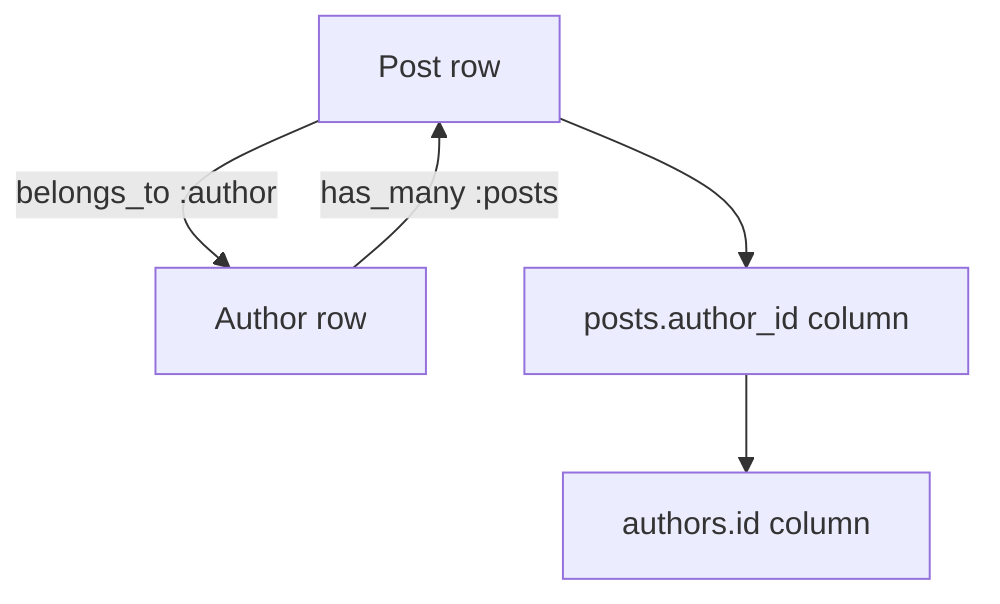
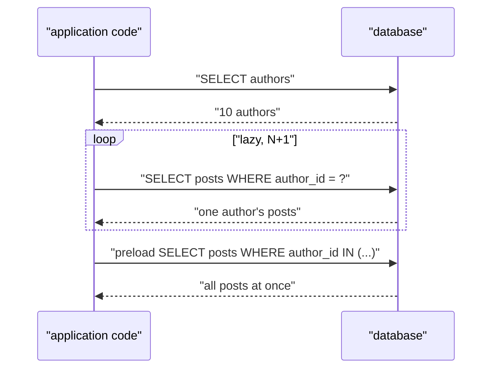

# 06 -- Associations: foreign keys as Ruby objects

A foreign key is a column that points at another table's primary key. An association is the Ruby object that walks that pointer for you. This chapter explains how the association macros build reflections and proxies, how a lazy proxy loads its target, and how preloading defeats the N+1 problem.

The macros live in `/Users/darkvoid/.gems/gems/activerecord-8.1.4/lib/active_record/associations.rb`. The runtime objects live under `associations/`: `association.rb`, `singular_association.rb`, `collection_association.rb`, `collection_proxy.rb`, `preloader.rb`, and the builders under `associations/builder/`.

## A foreign key is two relationships

Consider two tables, `posts` and `authors`, where `posts.author_id` references `authors.id`. One database column expresses two Ruby relationships, depending on which side you stand on:

- From a post, `post.author` looks up one author by the post's `author_id`. This is `belongs_to`, and the foreign key lives on the post's table.
- From an author, `author.posts` looks up all posts whose `author_id` matches the author's id. This is `has_many`, and the foreign key lives on the other table.



`has_one` is `has_many` restricted to a single row: `author.latest_post`. `has_many :through` and `has_and_belongs_to_many` are two-step paths through a join table or a middle model. All five are built from the same two primitive directions.

The rule for which macro to use is mechanical. If the foreign key is on your table, use `belongs_to`. If it is on the other table, use `has_one` (single target) or `has_many` (many targets). ActiveRecord does not care which you pick; the direction of the foreign key is what matters.

## The macros

Each macro is a one-liner that builds a reflection and registers it:

```ruby
def has_many(name, scope = nil, **options, &extension)
  reflection = Builder::HasMany.build(self, name, scope, options, &extension)
  Reflection.add_reflection(self, name, reflection)
end

def has_one(name, scope = nil, **options)
  reflection = Builder::HasOne.build(self, name, scope, options)
  Reflection.add_reflection(self, name, reflection)
end

def belongs_to(name, scope = nil, **options)
  reflection = Builder::BelongsTo.build(self, name, scope, options)
  Reflection.add_reflection(self, name, reflection)
end
```

From `/Users/darkvoid/.gems/gems/activerecord-8.1.4/lib/active_record/associations.rb`, lines 1427 through 1430, 1628 through 1631, and 1824 through 1827. A reflection is a plain data object that stores the macro kind, the name, the options, and the scope block. The model's class holds a hash of all reflections, keyed by name.

`has_and_belongs_to_many` is the outlier, because it synthesizes a middle model for the join table and then delegates to `has_many :through`:

```ruby
def has_and_belongs_to_many(name, scope = nil, **options, &extension)
  habtm_reflection = ActiveRecord::Reflection::HasAndBelongsToManyReflection.new(name, scope, options, self)

  builder = Builder::HasAndBelongsToMany.new(name, self, options)

  join_model = builder.through_model

  const_set(join_model.name, join_model)
  private_constant(join_model.name)

  middle_reflection = builder.middle_reflection(join_model)

  Builder::HasMany.define_callbacks(self, middle_reflection)
  Reflection.add_reflection(self, middle_reflection.name, middle_reflection)
  middle_reflection.parent_reflection = habtm_reflection

  include Module.new {
    class_eval <<-RUBY, __FILE__, __LINE__ + 1
      def destroy_associations
        association(:#{middle_reflection.name}).delete_all(:delete_all)
        association(:#{name}).reset
        super
      end
    RUBY
  }

  hm_options = {}
  hm_options[:through] = middle_reflection.name
  hm_options[:source] = join_model.right_reflection.name

  [:before_add, :after_add, :before_remove, :after_remove, :autosave, :validate, :join_table, :class_name, :extend, :strict_loading, :deprecated].each do |k|
    hm_options[k] = options[k] if options.key?(k)
  end

  has_many name, scope, **hm_options, &extension
  _reflections[name].parent_reflection = habtm_reflection
end
```

From `/Users/darkvoid/.gems/gems/activerecord-8.1.4/lib/active_record/associations.rb`, lines 2008 through 2044. It builds a hidden join model (for example `DevelopersProject` for the `developers_projects` table), defines a `has_many` to that join model, then defines the visible `has_many :through` that walks from the join model to the far side. The whole thing is layered on `has_many :through`, which is why the two APIs behave the same.

## How a macro expands

The builder's job is to turn a declaration into runtime code. `Builder::Association.build` in `/Users/darkvoid/.gems/gems/activerecord-8.1.4/lib/active_record/associations/builder/association.rb`:

```ruby
def self.build(model, name, scope, options, &block)
  if model.dangerous_attribute_method?(name)
    raise ArgumentError, "You tried to define an association named #{name} on the model #{model.name}, but " \
                         "this will conflict with a method #{name} already defined by Active Record. " \
                         "Please choose a different association name."
  end

  reflection = create_reflection(model, name, scope, options, &block)
  define_accessors(model, reflection)
  define_callbacks(model, reflection)
  define_validations(model, reflection)
  define_change_tracking_methods(model, reflection)
  reflection
end
```

From `/Users/darkvoid/.gems/gems/activerecord-8.1.4/lib/active_record/associations/builder/association.rb`, lines 25 through 38. Five steps: create the reflection, define the getter and setter, define the callbacks (including the `dependent:` destroy hook), define validations (for `has_many` with `validate: true`), and define change tracking methods (`saved_change_to_author?` and friends).

The accessors are tiny generated methods that delegate to an association object:

```ruby
def self.define_readers(mixin, name)
  mixin.class_eval <<-CODE, __FILE__, __LINE__ + 1
    def #{name}
      association = association(:#{name})
      deprecated_associations_api_guard(association, __method__)
      association.reader
    end
  CODE
end
```

From `/Users/darkvoid/.gems/gems/activerecord-8.1.4/lib/active_record/associations/builder/association.rb`, lines 102 through 110. `post.author` is not a method that queries the database; it is a method that calls `association(:author)`, gets (or creates) a proxy object, and asks the proxy to read. The setter `post.author=` is the mirror image, calling `association.writer`.

## The association proxy

The proxy is the heart of the system. It is a small object holding three pieces: an `owner` (the record), a `reflection` (the declaration's data), and a `target` (the loaded record or records, or nil if not loaded). The owner caches one proxy per association in `@association_cache`, so `post.author` twice returns the same proxy. `association` in `/Users/darkvoid/.gems/gems/activerecord-8.1.4/lib/active_record/associations.rb`:

```ruby
def association(name) # :nodoc:
  association = association_instance_get(name)

  if association.nil?
    unless reflection = self.class._reflect_on_association(name)
      raise AssociationNotFoundError.new(self, name)
    end
    association = reflection.association_class.new(self, reflection)
    association_instance_set(name, association)
  end

  association
end
```

From `/Users/darkvoid/.gems/gems/activerecord-8.1.4/lib/active_record/associations.rb`, lines 53 through 65. `reflection.association_class` picks the proxy class: `BelongsToAssociation` and `HasOneAssociation` for singular associations, `HasManyAssociation` for collections. The cache is initialized on the instance by `@association_cache` in `init_internals`.

Loading is lazy. `Association#load_target` in `/Users/darkvoid/.gems/gems/activerecord-8.1.4/lib/active_record/associations/association.rb`:

```ruby
def load_target
  @target = find_target(async: false) if (@stale_state && stale_target?) || find_target?

  loaded! unless loaded?
  target
rescue ActiveRecord::RecordNotFound
  reset
end
```

From `/Users/darkvoid/.gems/gems/activerecord-8.1.4/lib/active_record/associations/association.rb`, lines 189 through 196. The target is fetched only when it is stale or was never loaded. `find_target` (lines 260 through 286) builds the association scope, checks strict loading, executes the query through the connection, and calls `set_inverse_instance` on every returned record so the far side knows its owner without another query.

The scope is the association's SQL shape: the target class's default scope merged with the association scope (the `where`, `order`, and `includes` block you passed), constrained by the foreign key. `Association#scope` at lines 107 through 117 builds it, with special handling for `disable_joins` and the global current scope.

## Singular versus collection

The reader differs by cardinality. `SingularAssociation#reader` in `/Users/darkvoid/.gems/gems/activerecord-8.1.4/lib/active_record/associations/singular_association.rb`:

```ruby
def reader
  ensure_klass_exists!

  if !loaded? || stale_target?
    reload
  end

  target
end

def writer(record)
  replace(record)
end
```

From `/Users/darkvoid/.gems/gems/activerecord-8.1.4/lib/active_record/associations/singular_association.rb`, lines 7 through 27. A singular reader returns the target record or nil. The writer replaces the target: `post.author = new_author` sets the foreign key and, for `has_one`, updates or replaces the old associated record.

`CollectionAssociation#reader` in `/Users/darkvoid/.gems/gems/activerecord-8.1.4/lib/active_record/associations/collection_association.rb`:

```ruby
def reader
  ensure_klass_exists!

  if stale_target?
    reload
  end

  @proxy ||= CollectionProxy.create(klass, self)
  @proxy.reset_scope
end
```

From `/Users/darkvoid/.gems/gems/activerecord-8.1.4/lib/active_record/associations/collection_association.rb`, lines 34 through 43. A collection reader returns a `CollectionProxy`, not an array.

## The CollectionProxy

`CollectionProxy` is what makes `author.posts.where(...)` and `author.posts << post` work. It is a subclass of `Relation`, so it inherits the entire query interface from [04-query-interface.md](./04-query-interface.md), but it knows which association it came from:

```ruby
class CollectionProxy < Relation
  def initialize(klass, association, **) # :nodoc:
    @association = association
    super klass

    extensions = association.extensions
    extend(*extensions) if extensions.any?
  end

  def target
    @association.target
  end

  def load_target
    @association.load_target
  end
end
```

From `/Users/darkvoid/.gems/gems/activerecord-8.1.4/lib/active_record/associations/collection_proxy.rb`, lines 31 through 46. `count`, `pluck`, and other relation methods operate through the association scope, so `author.posts.count` issues a `SELECT COUNT(*) ... WHERE author_id = ?` without instantiating any posts. Enumeration (`each`, `to_a`) triggers `load_target` and materializes the records. Append, replace, and delete are association methods layered on top: `<<` builds a new record with the foreign key set and saves it.

## Preloading and the N+1 problem

The N+1 problem is the failure mode of lazy loading. For ten authors, `authors.each { |a| a.posts }` issues one query for the authors and ten more queries for the posts, one per author. Each lazy proxy loads independently, so no information is shared.

The fix is `includes`, which asks ActiveRecord to load the association for all records up front. The `Preloader` in `/Users/darkvoid/.gems/gems/activerecord-8.1.4/lib/active_record/associations/preloader.rb` builds a tree of branches, then executes one batch per branch:

```ruby
def initialize(records:, associations:, scope: nil, available_records: [], associate_by_default: true)
  @records = records
  @associations = associations
  @scope = scope
  @available_records = available_records || []
  @associate_by_default = associate_by_default

  @tree = Branch.new(
    parent: nil,
    association: nil,
    children: @associations,
    associate_by_default: @associate_by_default,
    scope: @scope
  )
  @tree.preloaded_records = @records
end

def call
  Batch.new([self], available_records: @available_records).call

  loaders
end
```

From `/Users/darkvoid/.gems/gems/activerecord-8.1.4/lib/active_record/associations/preloader.rb`, lines 99 through 124. The batch collects the foreign key values from all owners, issues a single `WHERE foreign_key IN (...)` query, and assigns each target record back to its owner through the inverse. Ten authors with `includes(:posts)` becomes two queries total.



`preload` always issues a separate query for the association. `eager_load` uses a `LEFT OUTER JOIN` to fetch owners and targets in one query; the preloader's class documentation (lines 40 through 45) notes that the join strategy produces redundant rows and is only used when necessary, such as when an association condition must filter the owners. `joins` performs the join but does not load the associated records into memory. The distinction is the subject of [10-scoping-and-eager-loading.md](./10-scoping-and-eager-loading.md).

## dependent:, autosave, and inverse_of

The `dependent:` option wires a callback into the owner's destroy path. `Builder::Association#define_callbacks` calls `add_destroy_callbacks` when the option is present, which registers a `before_destroy` that calls the association's `handle_dependency`. Each association class implements the actual behavior:

- `BelongsToAssociation#handle_dependency` (in `associations/belongs_to_association.rb`, lines 7 through 39): `dependent: :destroy` destroys the target (the parent), `:destroy_async` enqueues its destruction, and other values call the corresponding method on the target.
- `HasManyAssociation#handle_dependency` (in `associations/has_many_association.rb`, lines 14 through 59) has explicit cases for `:restrict_with_exception`, `:restrict_with_error`, `:destroy` (load and destroy each child), and `:destroy_async` (enqueue destruction of each child); the `else` branch calls `delete_all`, which dispatches to `delete_or_nullify_all_records` for `:nullify` and `:delete_all`.

`autosave: true` means the associated records save when the owner saves, inside the owner's transaction, so a parent and its new children commit or roll back together. `inverse_of` names the association on the far side, which lets the two proxies share a target without an extra query: when you load `post.author`, the author's `posts` proxy is told the post is already loaded, and vice versa.

## The Aha Moment

**Aha:** An association is not a query and not an array; it is a lazy proxy that remembers its owner, its declaration, and whether it has loaded. The entire system follows from that one object. The macro generates a getter that asks for the proxy; the proxy builds a scope only when its target is first read; a `CollectionProxy` subclasses `Relation` so it is simultaneously a query and a collection; and the preloader is just a way to load many proxies' targets at once by sharing the foreign-key lookup.

The N+1 problem is the proof, in both directions. Lazy loading produces N+1 queries because each proxy loads in isolation and no proxy knows what the others need. `includes` fixes it by loading all targets up front and assigning them through `inverse_of`, so by the time each proxy's reader runs, its target is already there and the extra queries never happen. The rest of the behavior — `dependent:`, `autosave`, `counter_cache`, `through` — is bookkeeping layered on the same owner, reflection, and target triple. Chapter [07-callbacks-and-validations.md](./07-callbacks-and-validations.md) covers the callback machinery that `dependent:` and `autosave` hook into, and [10-scoping-and-eager-loading.md](./10-scoping-and-eager-loading.md) expands on preload versus eager load.

Continue to [07-callbacks-and-validations.md](./07-callbacks-and-validations.md).
