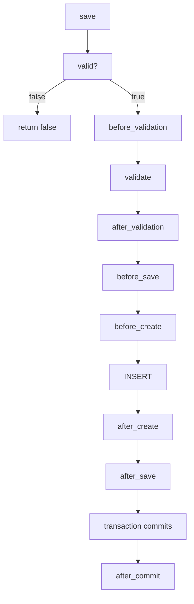
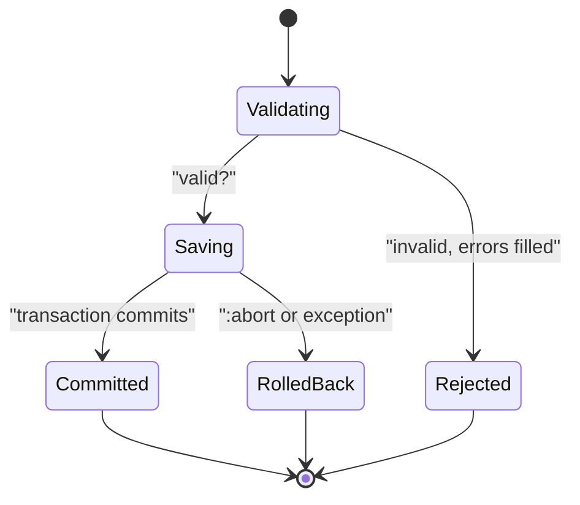

# 07 -- Callbacks and validations: the model life cycle

A model is more than a table row. A model decides when your code runs and when a row is refused. Two systems do that work in Active Record: callbacks and validations. A callback is a hook that runs around a life cycle event such as save or destroy. A validation is a rule that stops a save when a value is wrong. This document explains both and how they meet in the save path.

Source files are from the `activerecord-8.1.4` gem at `/Users/darkvoid/.gems/gems/activerecord-8.1.4/lib`. Short paths below are relative to that `lib` directory.

For the base mechanics of `save` and `destroy`, see [05-persistence.md](./05-persistence.md). For what a model is and how it binds to a table, see [03-the-model.md](./03-the-model.md).

## The save life cycle

`save` is not one action. It is a pipeline. The documentation at the top of `active_record/callbacks.rb` spells out the full chain for a new record. The order matters:

- `save` starts.
- `valid?` runs. If it fails, the pipeline stops here.
- `before_validation` runs.
- `validate` runs the actual validation methods.
- `after_validation` runs.
- `before_save` runs.
- `before_create` runs (a new record) or `before_update` runs (an existing record).
- The INSERT or UPDATE runs.
- `after_create` or `after_update` runs.
- `after_save` runs.
- `after_commit` runs, but only after the surrounding transaction commits.

That list comes directly from the comment block in `active_record/callbacks.rb:10-24`. The comment also names the nineteen callbacks in the module, at `active_record/callbacks.rb:280-285`:

```ruby
CALLBACKS = [
  :after_initialize, :after_find, :after_touch, :before_validation, :after_validation,
  :before_save, :around_save, :after_save, :before_create, :around_create,
  :after_create, :before_update, :around_update, :after_update,
  :before_destroy, :around_destroy, :after_destroy, :after_commit, :after_rollback
]
```

The chain for a new record is easier to see as a diagram:



For an existing record, the shape is identical, but `before_create` becomes `before_update`, the INSERT becomes an UPDATE, and `after_create` becomes `after_update`.

## How the chain is wired

The wrapping is literal. `ActiveRecord::Callbacks` does not call `super` in some magic way for each hook; it defines private methods that run the callback chain and then call `super` to reach the real persistence code. Read `active_record/callbacks.rb:438-449`:

```ruby
private
  def create_or_update(**)
    _run_save_callbacks { super }
  end

  def _create_record
    _run_create_callbacks { super }
  end

  def _update_record
    _run_update_callbacks { record_update_timestamps { super } }
  end
```

`_run_save_callbacks { super }` runs the `before_save`, `around_save`, and `after_save` chain, then `super` continues to `create_or_update` in `active_record/persistence.rb:923-928`. That method chooses `_create_record` or `_update_record`, which are themselves wrapped again. The result is a stack of `_run_*_callbacks` blocks, each unwinding in order.

`destroy` gets the same treatment in `active_record/callbacks.rb:418-428`, with one extra detail: a guard flag stops a callback from re-entering `destroy` on the same object during the chain.

The chain itself is built by `ActiveModel::Callbacks`. Active Record declares the chains at `active_record/callbacks.rb:411-416`:

```ruby
included do
  include ActiveModel::Validations::Callbacks

  define_model_callbacks :initialize, :find, :touch, only: :after
  define_model_callbacks :save, :create, :update, :destroy
end
```

`define_model_callbacks` comes from `active_model/callbacks.rb:109-126`. It turns each name into a set of `before_*`, `around_*`, and `after_*` methods. The `:abort` halting behavior is inherited from Active Support callbacks: if a `before_*` callback throws the symbol `:abort`, the chain stops and the action does not run.

### Halting with `:abort`

A `before_save` or `before_destroy` callback can refuse the operation. It does so by `throw :abort`. The documentation in `active_record/callbacks.rb:165-176` explains the contract: `save` returns `false`, nothing is added to `errors`, and all later callbacks plus the action are cancelled. When `save!` is used instead, the halt becomes a raised `ActiveRecord::RecordNotSaved` (`active_record/errors.rb:147-167`). When `destroy!` is used, a halted `before_destroy` raises `ActiveRecord::RecordNotDestroyed` (`active_record/errors.rb:169-188`).

This is a key difference between callbacks and validations: a validation writes to `errors`; a halting callback does not. Use a validation when the user should see a message. Use `:abort` when the refusal is internal.



## `after_commit` and `after_rollback`

`after_save` runs inside the transaction. If the transaction later rolls back, whatever `after_save` did is undone with it. That is wrong for side effects that cannot be rolled back, such as sending email or enqueueing a background job. `after_commit` solves this: it fires only when the surrounding transaction actually commits.

The callback is registered in `active_record/transactions.rb:285-288`:

```ruby
def after_commit(*args, &block)
  set_options_for_callbacks!(:after, args)
  set_callback(:commit, :after, *args, &block)
end
```

The `on:` option restricts the callback to one action. The same file defines shortcuts at `active_record/transactions.rb:290-312`: `after_save_commit` (create or update), `after_create_commit`, `after_update_commit`, and `after_destroy_commit`. `after_rollback` at `active_record/transactions.rb:317-320` fires when the transaction rolls back instead.

```ruby
class Comment < ApplicationRecord
  after_create_commit :notify_subscribers

  private

  def notify_subscribers
    SubscribersMailer.new_comment(self).deliver_later
  end
end
```

The mail is enqueued only after the INSERT commits. If the INSERT is inside a transaction that rolls back, the mail is never enqueued. This pattern connects directly to background jobs; see [13-globalid-and-activejob-integration.md](./13-globalid-and-activejob-integration.md).

## `before_validation`, `touch`, ordering, and `skip_callback`

`before_validation` is the workhorse for normalizing input before rules run. It is the first callback in the chain. A common use is to strip whitespace or format a phone number before `validates_presence_of` and `validates_format_of` inspect the value:

```ruby
class CreditCard < ApplicationRecord
  before_validation(on: :create) do
    self.number = number.gsub(/[^0-9]/, "") if attribute_present?("number")
  end
end
```

That example is from `active_record/callbacks.rb:40-46`. The `on: :create` option is handled by `ActiveModel::Validations::Callbacks`, which maps it to the validation context.

`touch` is the smallest write. It updates `updated_at` and runs `after_touch`. The hook wraps the persistence method at `active_record/callbacks.rb:430-432`:

```ruby
def touch(*, **) # :nodoc:
  _run_touch_callbacks { super }
end
```

The real work in `active_record/persistence.rb:825-843` collects the timestamp columns, writes the current time, and issues an UPDATE. `belongs_to :author, touch: true` uses this same path so a parent's `updated_at` moves when a child changes.

Callback ordering is definition order for non-transactional callbacks. If a `has_many ..., dependent: :destroy` association destroys children during the parent's `destroy`, a plain `before_destroy` runs too late. The `prepend: true` option solves that; the example is at `active_record/callbacks.rb:184-212`. For `after_commit` and `after_rollback`, the order can be reversed by a configuration flag described at `active_record/callbacks.rb:238-245`.

`skip_callback` removes a registered callback. It comes from Active Support callbacks through `ActiveModel::Callbacks` (which includes `ActiveSupport::Callbacks` at `active_model/callbacks.rb:66-69`). You name the chain, the kind, and the filter:

```ruby
class AdminComment < Comment
  skip_callback :commit, :after, :notify_subscribers
end
```

This is why the callback list is a first-class object you can inspect: `Topic._save_callbacks.select { |cb| cb.kind.eql?(:before) }` shows the `before_save` chain, per `active_record/callbacks.rb:259-275`.

## Validations

Validations answer one question: is this record allowed to be written? They run inside `save` because `ActiveRecord::Validations` replaces `save` with a validating version. Read `active_record/validations.rb:47-55`:

```ruby
def save(**options)
  perform_validations(options) ? super : false
end

def save!(**options)
  perform_validations(options) ? super : raise_validation_error
end
```

`perform_validations` at `active_record/validations.rb:90-92` skips the check only with `validate: false`, and otherwise calls `valid?`. `valid?` at `active_record/validations.rb:69-73` chooses the context (`:create` for a new record, `:update` otherwise) and then checks that `errors` is empty. `save!` raises `ActiveRecord::RecordInvalid`, which carries the record and builds a message from `errors.full_messages` (`active_record/validations.rb:15-28`).

### Declaring rules

The `validates` helper is inherited from `ActiveModel::Validations`. The ActiveRecord-specific validators live under `active_record/validations/`. `validates_presence_of` is one of them, at `active_record/validations/presence.rb:40-42`:

```ruby
def validates_presence_of(*attr_names)
  validates_with PresenceValidator, _merge_attributes(attr_names)
end
```

The ActiveRecord `PresenceValidator` at `active_record/validations/presence.rb:5-12` adds one behavior on top of Active Model: a value that is an association marked for destruction is treated as blank. That stops a parent from validating while its required child is about to be deleted.

```ruby
class User < ApplicationRecord
  validates :name, presence: true, length: { maximum: 80 }
  validates :email, presence: true, uniqueness: true
  validates :role, inclusion: { in: %w[member admin owner] }
  validates_presence_of :profile

  validate :birthday_not_in_future

  private

  def birthday_not_in_future
    errors.add(:birthday, "cannot be in the future") if birthday&.future?
  end
end
```

A custom `validate :method` lets a rule call `errors.add(attribute, message)` directly. `errors` is an `ActiveModel::Errors` instance bound to the record.

### `ActiveModel::Errors`

`errors` is a collection of `ActiveModel::Error` objects, not a raw hash. The class is in `active_model/errors.rb:60`. The internal array is exposed at `active_model/errors.rb:100-105`. `add(attribute, type, **options)` at `active_model/errors.rb:340` appends an error. `full_messages` at `active_model/errors.rb:413` turns each error into a human sentence by looking up an internationalization (i18n) template through `generate_message` at `active_model/errors.rb:477`.

```ruby
user = User.new
user.valid?                       # => false
user.errors[:email]               # => ["can't be blank", "has already been taken"]
user.errors.details[:email]       # => [{ error: :blank }, { error: :taken }]
user.errors.full_messages          # => ["Email can't be blank", "Email has already been taken"]
user.invalid?                     # => true
```

`errors.details` is the machine-readable form: each entry is a symbol plus options. Applications use it for JSON responses; `full_messages` is the human form.

### Uniqueness is a database race

`uniqueness` is the one validation that must query the database. The validator is `active_record/validations/uniqueness.rb`. Its `validate_each` at `active_record/validations/uniqueness.rb:20-52` builds a relation that looks for an existing row with the same value, excludes the record itself when it is persisted, applies any `scope:` and `conditions:`, and adds `:taken` if the relation `exists?`.

The source documentation is explicit about the race, at `active_record/validations/uniqueness.rb:228-283`: two requests can both run the SELECT and both see "no match", then both INSERT. The only reliable guard is a unique index in the database. The application-level check is a convenience that produces a friendly message; the database constraint is the guarantee. When the database rejects the duplicate, adapters raise `ActiveRecord::RecordNotUnique` (`active_record/errors.rb:227-229`).

Because of that race, `uniqueness` is the one ActiveRecord validation that cannot run in parallel with itself safely, and the one whose absence from the schema matters. When a unique index covers the attribute and scope, the validator can skip the SELECT entirely for unchanged values; see `covered_by_unique_index?` at `active_record/validations/uniqueness.rb:83-96`.

## The Aha Moment

**Aha:** Callbacks and validations are two halves of one pipeline, not two features bolted on. `save` is not "write the row". `save` is "validate, then transform, then write, then react". Validation answers can-we-write and fills `errors` for the user. Callbacks answer when-should-your-code-run and transform the record around the write. The whole chain is assembled from `_run_*_callbacks { super }` wrappers, so every hook is literally a stack frame around the same SQL you would have written by hand. `after_commit` exists because some reactions must not be rolled back; `:abort` exists because some refusals should not show a message. Once you see `save` as a pipeline with two kinds of stops, both systems read as one design.

Continue to [08-migrations-and-schema.md](./08-migrations-and-schema.md).
