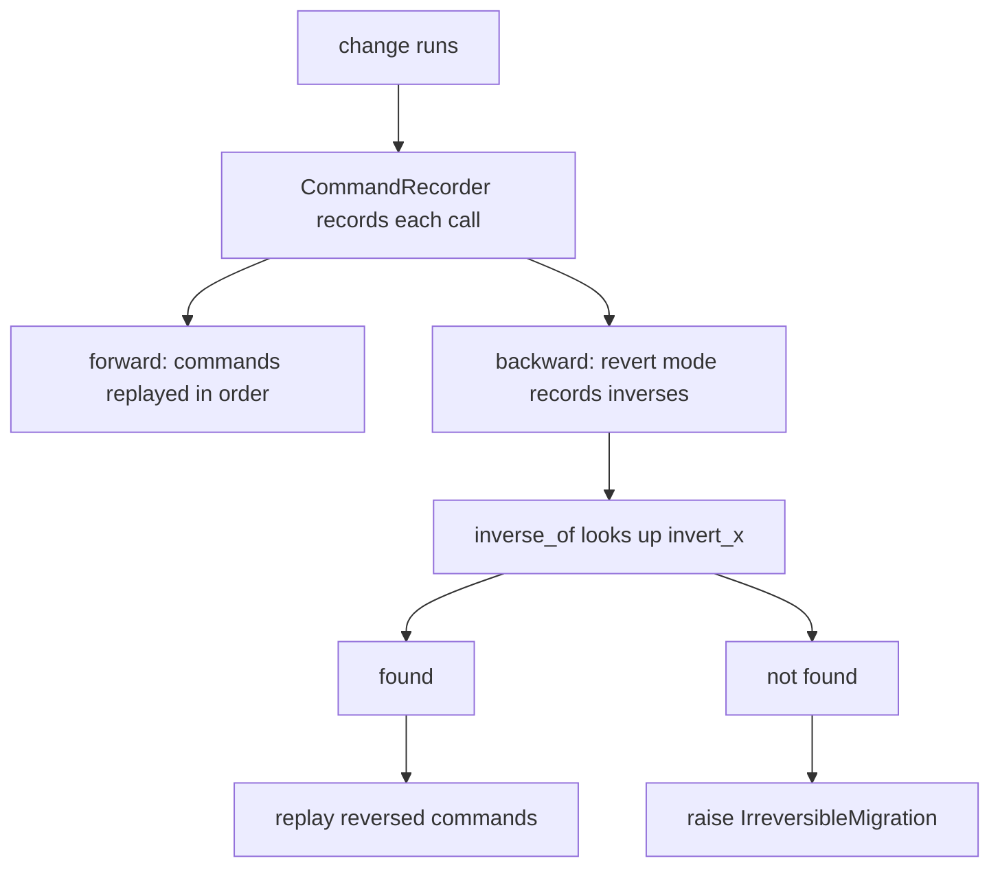
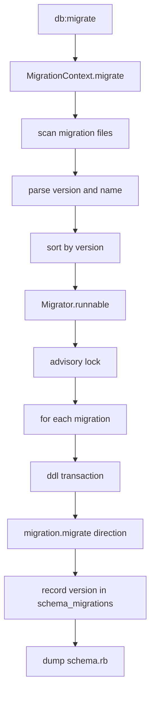

# 08 -- Migrations and schema: evolving the database in Ruby

A database schema changes over time. Tables are created, columns are added, indexes appear, and foreign keys link tables. Active Record records each change as a migration: a Ruby class with a version number that knows how to apply the change and, usually, how to undo it. This document explains the migration Domain Specific Language (DSL), how reversibility works, how the runner tracks applied versions, and how `schema.rb` is produced.

Source files are from the `activerecord-8.1.4` gem at `/Users/darkvoid/.gems/gems/activerecord-8.1.4/lib`. Short paths below are relative to that `lib` directory. `db:migrate` is a Rake task in Rails; the code it drives lives here.

For how the connection executes the resulting Structured Query Language (SQL), see [01-connection-and-adapters.md](./01-connection-and-adapters.md). For how those SQL fragments are built, see [02-sql-generation-arel.md](./02-sql-generation-arel.md).

## The migration DSL

A migration is a class that subclasses `ActiveRecord::Migration`. Its `change` method calls DSL helpers such as `create_table` and `add_column`. The same helpers appear in `ActiveRecord::Schema`, whose documentation at `active_record/schema.rb:13-28` shows the canonical shape:

```ruby
ActiveRecord::Schema[7.0].define do
  create_table :authors do |t|
    t.string :name, null: false
  end

  add_index :authors, :name, unique: true

  create_table :posts do |t|
    t.integer :author_id, null: false
    t.string :subject
    t.text :body
    t.boolean :private, default: false
  end

  add_index :posts, :author_id
end
```

The block argument `t` is a `TableDefinition`. It defines one column per method call. The column type methods are generated at `active_record/connection_adapters/abstract/schema_definitions.rb:331-332`:

```ruby
define_column_methods :bigint, :binary, :boolean, :date, :datetime, :decimal,
  :float, :integer, :json, :string, :text, :time, :timestamp, :virtual
```

Each method, such as `t.string :name`, becomes a call to `TableDefinition#column` at `active_record/connection_adapters/abstract/schema_definitions.rb:484`, which stores a column specification and its options. The options you saw (`null: false`, `default: false`) become part of that specification, not part of SQL yet. SQL generation happens later in the connection adapter.

The same file holds the table-level helpers. `index` at `active_record/connection_adapters/abstract/schema_definitions.rb:509` records an index on one or more columns. `foreign_key` at `active_record/connection_adapters/abstract/schema_definitions.rb:513` records a reference constraint. `timestamps` at `active_record/connection_adapters/abstract/schema_definitions.rb:525` adds the two columns `created_at` and `updated_at`. `references` at `active_record/connection_adapters/abstract/schema_definitions.rb:543` adds a `*_id` column plus an index in one call, and `belongs_to` is an alias for it.

The actual SQL for each DSL call is produced by the connection adapter in `active_record/connection_adapters/abstract/schema_statements.rb`. `create_table` is at line 297, `create_join_table` at 408, `add_column` at 655, `add_reference` at 1095 (with `alias :add_belongs_to :add_reference`), `add_foreign_key` at 1205, and `remove_foreign_key` at 1247. The split matters: `TableDefinition` is data, and `SchemaStatements` is the translator that turns that data into dialect-specific SQL.

## Reversibility

A migration must be able to run both ways. `change` is the short form; `up` and `down` are the explicit form. When only `change` is defined, Active Record records every DSL call and later computes the inverse.

The recorder is `ActiveRecord::Migration::CommandRecorder` in `active_record/migration/command_recorder.rb`. Its job is at lines 7-9: it "records commands done during a migration and knows how to reverse those commands". The inverse lookup is `inverse_of` at `active_record/migration/command_recorder.rb:117-126`:

```ruby
def inverse_of(command, args, &block)
  method = :"invert_#{command}"
  raise IrreversibleMigration, <<~MSG unless respond_to?(method, true)
    This migration uses #{command}, which is not automatically reversible.
    To make the migration reversible you can either:
    1. Define #up and #down methods in place of the #change method.
    2. Use the #reversible method to define reversible behavior.
  MSG
  send(method, args, &block)
end
```

Most inverses are just a swapped pair. `StraightReversions` at `active_record/migration/command_recorder.rb:158-176` maps `create_table` to `drop_table`, `add_column` to `remove_column`, `add_index` to `remove_index`, `add_foreign_key` to `remove_foreign_key`, and so on. Each mapping generates two `invert_*` methods, so `invert_create_table` returns a `drop_table` command and `invert_drop_table` returns a `create_table` command.

Some inverses need more information than the forward command carries. `remove_column` needs the column's type to re-add it, so `invert_remove_column` at `active_record/migration/command_recorder.rb:241-246` raises `IrreversibleMigration` unless a type was given. `drop_table` needs a block to recreate the table, so `invert_drop_table` at lines 217-232 raises unless a block or options were given. The error message tells you exactly how to fix the migration.



### `reversible`, `up_only`, and `revert`

When the inverse is not a simple swap, `reversible` gives the two directions a shared block with a `dir` helper. It is defined at `active_record/migration.rb:914-917`:

```ruby
def reversible
  helper = ReversibleBlockHelper.new(reverting?)
  execute_block { yield helper }
end
```

Inside the block you write `dir.up { ... }` and `dir.down { ... }`. The documentation example at `active_record/migration.rb:902-909` splits a `full_name` column into `first_name` and `last_name` on the way up and rejoins them on the way down.

`up_only` at `active_record/migration.rb:933-935` runs its block only when migrating up:

```ruby
def up_only(&block)
  execute_block(&block) unless reverting?
end
```

This is for data changes that have no meaningful reverse, such as backfilling a new column from existing rows. `revert` records the block in reverting mode, which inverts each command and reverses their order; the mechanism is `CommandRecorder#revert` at `active_record/migration/command_recorder.rb:83-91`.

## The migration runtime

When `db:migrate` runs, three classes cooperate. `MigrationContext` reads the migration files and decides the direction. `Migrator` executes them in order. `MigrationProxy` wraps a file so its class is loaded lazily only when it actually runs.

The flow starts at `MigrationContext#migrate` at `active_record/migration.rb:1242-1253`: with no target version it goes up, with a lower target it goes down. `MigrationContext#migrations` at `active_record/migration.rb:1312-1326` scans the migration paths, matches the filename pattern, parses the version and name, and builds one `MigrationProxy` per file, sorted by version. The filename pattern is `MigrationFilenameRegexp` at `active_record/migration.rb:637`, and the glob that finds files is `[0-9]*_*.rb` at `active_record/migration.rb:1379`.

`Migrator` decides which migrations to run. Its `runnable` method at `active_record/migration.rb:1469-1478` starts from the current version and, going up, rejects migrations whose version already exists in the `schema_migrations` table. Going down, it reverses the list and keeps only applied migrations.

Each migration then runs inside a transaction. Read `active_record/migration.rb:1537-1604`:

```ruby
def execute_migration_in_transaction(migration)
  return if down? && !migrated.include?(migration.version.to_i)
  return if up?   &&  migrated.include?(migration.version.to_i)

  message = up? ? "Migrating to" : "Reverting"
  Base.logger.info "#{message} #{migration.name} (#{migration.version})" if Base.logger

  ddl_transaction(migration) do
    migration.migrate(@direction)
    record_version_state_after_migrating(migration.version)
  end
rescue => e
  msg = +"An error has occurred, "
  msg << "this and " if use_transaction?(migration)
  msg << "all later migrations canceled:\n\n#{e}"
  raise StandardError, msg, e.backtrace
end
```

`ddl_transaction` at `active_record/migration.rb:1594-1600` wraps the block in a database transaction only when `use_transaction?` is true. `use_transaction?` at lines 1602-1604 returns false if the migration calls `disable_ddl_transaction!` or if the adapter does not support Data Definition Language (DDL) transactions. Some databases, and some statements such as `CREATE INDEX CONCURRENTLY`, cannot run inside a transaction; `disable_ddl_transaction!` is the escape hatch.

The whole run is guarded by an advisory lock. `with_advisory_lock` at `active_record/migration.rb:1610-1623` computes a lock identifier from a salt and the database name, takes the lock, and raises `ConcurrentMigrationError` if another process holds it. This prevents two servers from running the same migration set at once.



## The `schema_migrations` table

The applied versions live in a real database table, by default named `schema_migrations`. The class that manages it is `SchemaMigration` in `active_record/schema_migration.rb`. It uses `version` as its primary key at `active_record/schema_migration.rb:45-47`. The table is created at `active_record/schema_migration.rb:53-61`:

```ruby
def create_table
  @pool.with_connection do |connection|
    unless connection.table_exists?(table_name)
      connection.create_table(table_name, id: false) do |t|
        t.string :version, **connection.internal_string_options_for_primary_key
      end
    end
  end
end
```

`create_version` at `active_record/schema_migration.rb:19-25` inserts the version with an Arel INSERT, and `delete_version` at lines 27-34 deletes it on rollback. `Migrator#record_version_state_after_migrating` at `active_record/migration.rb:1575-1583` calls those methods after each migration, inside the same transaction. Because the version row is written in the same transaction as the schema change, a migration is all-or-nothing: if the DDL fails, the version row rolls back with it.

The practical consequence: "which migrations are applied" is not a file on disk. It is a table in the database. Two databases can be at different versions while sharing the same code, and a fresh database starts empty and applies every migration in order.

## `schema.rb` versus SQL dumps

After migrating, Rails can regenerate `db/schema.rb`, a single Ruby file that describes the whole current schema. It is produced by `SchemaDumper` in `active_record/schema_dumper.rb`. `dump` at line 60 writes the header, extensions, types, tables, virtual tables, and trailer in that order.

The header at `active_record/schema_dumper.rb:96-111` explains the file's role:

```ruby
stream.puts <<~HEADER
  # This file is auto-generated from the current state of the database. Instead
  # of editing this file, please use the migrations feature of Active Record to
  # incrementally modify your database, and then regenerate this schema definition.
  #
  # This file is the source Rails uses to define your schema when running `bin/rails
  # db:schema:load`. When creating a new database, `bin/rails db:schema:load` tends to
  # be faster and is potentially less error prone than running all of your
  # migrations from scratch. Old migrations may fail to apply correctly if those
  # migrations use external dependencies or application code.
  #
  # It's strongly recommended that you check this file into your version control system.

  ActiveRecord::Schema[#{ActiveRecord::Migration.current_version}].define(#{define_params}) do
HEADER
```

The version is formatted by `formatted_version` at `active_record/schema_dumper.rb:86-90`, which turns a timestamp like `20170404131909` into `2017_04_04_131909`. `tables` at lines 134-156 sorts the tables and dumps foreign keys last, so every referenced table exists before the constraint that points to it.

Loading `schema.rb` is faster than replaying every migration. `ActiveRecord::Schema[version].define` at `active_record/schema.rb:49-65` evaluates the block against a connection, creates the `schema_migrations` table, and marks all versions up to `info[:version]` as applied with `assume_migrated_upto_version`.

`schema.rb` is a Ruby dump and therefore portable across database types, but it cannot express every database feature, such as triggers, custom types, or checks that the DSL does not model. When you need those, you switch the format to `structure.sql`, a raw SQL dump produced by the database's own dump tool. The choice is configured in Rails; the Ruby dump is the default, and the SQL dump is the fallback for schemas that outgrow the DSL.

## The Aha Moment

**Aha:** A migration system is a log of versioned programs plus a table that remembers which programs already ran. The clever part is not the DSL; it is that reversibility is computed, not written. You write `create_table`, and the `CommandRecorder` derives `drop_table` for you by consulting a table of inverses. The runtime then treats the whole change and its version bookkeeping as one transaction, so a half-applied migration cannot exist. `schema.rb` falls out for free because the same DSL that builds the schema can also describe it. Once you see "versioned program + version table + transactional replay", the entire feature reads as one small, honest design.

Continue to [09-attribute-methods-and-types.md](./09-attribute-methods-and-types.md).
