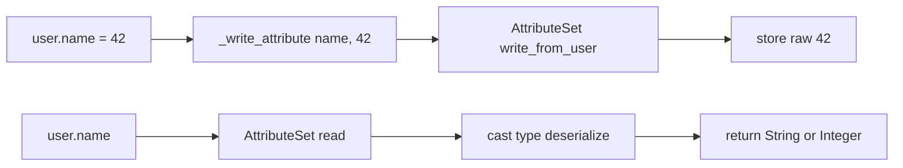
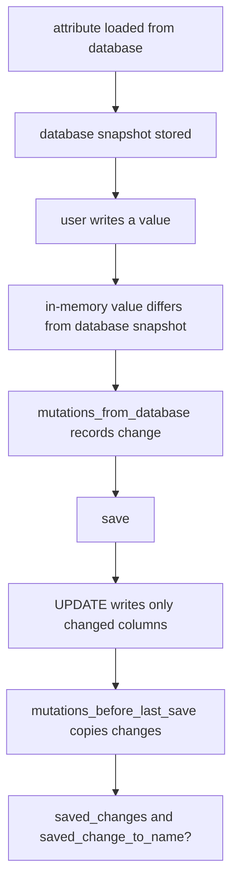

# 09 -- Attribute methods and types: from column to Ruby object

A model column is a database type such as `varchar` or `integer`. A Ruby object wants clean values: a `String`, an `Integer`, a `Date`. Between them sits the attribute layer. Every column becomes an attribute with a cast type, and every attribute grows three methods (`name`, `name=`, `name?`). This document explains how accessors are generated, how the type registry chooses a cast type, how structured data is stored with `serialize`, `store`, and `enum`, and how dirty tracking remembers what changed.

Source files are from the `activerecord-8.1.4` gem at `/Users/darkvoid/.gems/gems/activerecord-8.1.4/lib`. Short paths below are relative to that `lib` directory.

For what a model is before this layer runs, see [03-the-model.md](./03-the-model.md). For how queries read attributes back, see [04-query-interface.md](./04-query-interface.md).

## Generated accessors

Attribute methods are not written by hand. They are generated once per class from the database schema. The entry point is `define_attribute_methods` at `active_record/attribute_methods.rb:104-125`:

```ruby
def define_attribute_methods # :nodoc:
  return false if @attribute_methods_generated
  # Use a mutex; we don't want two threads simultaneously trying to define
  # attribute methods.
  GeneratedAttributeMethods::LOCK.synchronize do
    return false if @attribute_methods_generated

    superclass.define_attribute_methods unless base_class?

    unless abstract_class?
      load_schema
      super(attribute_names)
      alias_attribute :id_value, :id if _has_attribute?("id") && !_has_attribute?("id_value")
    end

    generate_alias_attributes

    @attribute_methods_generated = true
  end
end
```

`load_schema` reads the columns from the schema cache, and `super(attribute_names)` hands the names to Active Model's `define_attribute_methods`, which generates readers, writers, and query methods into a per-class module called `GeneratedAttributeMethods`. A mutex guards the generation because two threads can reach a missing method at the same time.

When code calls `user.name = "Ada"` before the methods exist, `method_missing` at `active_record/attribute_methods.rb:475-499` triggers generation and then re-dispatches to the generated method. The generated writer is defined by `active_record/attribute_methods/write.rb:15-26` as a call to `_write_attribute`, and `write_attribute` at `active_record/attribute_methods/write.rb:31-37` resolves aliases, treats `id` specially through the primary key, and finally calls `@attributes.write_from_user(name, value)`.

The key sentence is that last one: the public setter does not touch an instance variable. It writes into `@attributes`, an `ActiveModel::AttributeSet`, which stores the raw user value and casts it on read. Reading is the mirror: `read_attribute` pulls from `@attributes` and returns the cast value. `name?` is the query form, generated by `active_record/attribute_methods/query.rb`, which casts the value and checks it against the database's truthiness rules. `id` and `id=` are special-cased in `active_record/attribute_methods/primary_key.rb` through the `@primary_key` attribute name.



## The type registry

Every attribute needs a cast type. The registry maps names such as `:string` and `:integer` to cast type classes. The registry lives in `active_record/type.rb`. It is an `AdapterSpecificRegistry` at `active_record/type.rb:23`, which means the same name can resolve to a different class per database adapter. The built-in types are registered at `active_record/type.rb:69-81`:

```ruby
register(:big_integer, Type::BigInteger, override: false)
register(:binary, Type::Binary, override: false)
register(:boolean, Type::Boolean, override: false)
register(:date, Type::Date, override: false)
register(:datetime, Type::DateTime, override: false)
register(:decimal, Type::Decimal, override: false)
register(:float, Type::Float, override: false)
register(:integer, Type::Integer, override: false)
register(:immutable_string, Type::ImmutableString, override: false)
register(:json, Type::Json, override: false)
register(:string, Type::String, override: false)
register(:text, Type::Text, override: false)
register(:time, Type::Time, override: false)
```

`Type.register` at `active_record/type.rb:37-39` delegates to that registry, so applications can add their own cast types. `Type.lookup` at lines 41-43 resolves a name for the current adapter.

Underneath, a `TypeMap` at `active_record/type/type_map.rb` is the actual table. `lookup` at line 14 tries a cached fetch and falls back to `Type.default_value` for unknown keys. The important detail is `perform_fetch` at lines 43-55: it matches keys with `===`, so a key can be a `Regexp` or a class as well as a string. The adapter-specific registry builds these maps lazily per adapter, then freezes the result for thread safety.

The direction matters. A cast type has three methods with different jobs: `deserialize` turns a database value into a Ruby value, `serialize` turns a Ruby value into something the database can store, and `cast` turns a user input into the in-memory Ruby value. `user.name` uses `deserialize` or `cast` depending on where the value came from; `user.name = value` stores the value raw and casts it on read.

## The `attribute` DSL and defaults

Sometimes you want a typed attribute that has no column: a virtual attribute, or an override of a column's type. The `attribute` class method declares it. The implementation is `define_attribute` at `active_record/attributes.rb:243-251`:

```ruby
def define_attribute(
  name,
  cast_type,
  default: NO_DEFAULT_PROVIDED,
  user_provided_default: true
)
  attribute_types[name] = cast_type
  define_default_attribute(name, default, cast_type, from_user: user_provided_default)
end
```

The type name is resolved through `resolve_type_name` at `active_record/attributes.rb:310-312`, which calls `Type.lookup(name, adapter: Type.adapter_name_from(self))`. That is how `attribute :price, :decimal` finds the right cast type without a schema column.

Defaults are stored in `_default_attributes` at `active_record/attributes.rb:253-266`. It builds one `ActiveModel::Attribute` per column from the column's database default and the cast type, then applies any declared `attribute` modifications. When you pass `default:` to `attribute`, `define_default_attribute` at lines 290-304 wraps it in `ActiveModel::Attribute::UserProvidedDefault`, which means the value is cast through the user-facing `cast` path, not the database `deserialize` path. A proc default is re-evaluated each time a new record needs it.

```ruby
class Event < ApplicationRecord
  attribute :starts_at, :datetime
  attribute :secret_token, :string, default: -> { SecureRandom.hex(16) }
  attribute :price_cents, :integer
end
```

`attribute` with no column creates a virtual attribute that is read and written in memory and does not persist. This is the bridge between Active Model form objects and full database models.

## `serialize`, `store`, and `enum`

Three features build on the same attribute machinery to store structured data in a single column.

### `serialize`

`serialize` stores an object in a text column by encoding it, usually as YAML or JavaScript Object Notation (JSON). It is defined at `active_record/attribute_methods/serialization.rb:193-215`:

```ruby
def serialize(attr_name, coder: nil, type: Object, comparable: false, yaml: {}, **options)
  coder ||= default_column_serializer
  unless coder
    raise ArgumentError, <<~MSG.squish
      missing keyword: :coder
      ...
    MSG
  end

  column_serializer = build_column_serializer(attr_name, coder, type, yaml)

  attribute(attr_name, **options)

  decorate_attributes([attr_name]) do |attr_name, cast_type|
    if type_incompatible_with_serialize?(cast_type, column_serializer, type)
      raise ColumnNotSerializableError.new(attr_name, cast_type)
    end

    cast_type = cast_type.subtype if Type::Serialized === cast_type
    Type::Serialized.new(cast_type, column_serializer, comparable: comparable)
  end
end
```

The result is a `Type::Serialized` wrapper: the underlying column type casts the raw text, and the coder converts between the object and the text. `build_column_serializer` at lines 218-234 handles `Coders::JSON`, `Coders::YAMLColumn`, and custom coders. `serialize :preferences` without a coder uses the default, which is YAML unless Rails is configured otherwise.

### `store`

`store` specializes `serialize` for hashes. `active_record/store.rb:106-110` shows the composition:

```ruby
def store(store_attribute, options = {})
  coder = build_column_serializer(store_attribute, options[:coder], Object, options[:yaml])
  serialize store_attribute, coder: IndifferentCoder.new(store_attribute, coder)
  store_accessor(store_attribute, options[:accessors], **options.slice(:prefix, :suffix)) if options.has_key? :accessors
end
```

`IndifferentCoder` at `active_record/store.rb:291-306` makes the loaded hash indifferent to symbol versus string keys. `store_accessor` at `active_record/store.rb:112-169` generates per-key accessors such as `settings.color` and `settings.color=`, plus their dirty-tracking variants. Each accessor reads or writes one key inside the stored hash through `HashAccessor` at `active_record/store.rb:235-262`, so changing one key marks only the whole `settings` attribute as changed, and the change helpers compare the before and after hashes key by key.

### `enum`

`enum` stores a small set of allowed values as integers or strings, and generates predicate, bang, and scope methods. The cast type is `EnumType` at `active_record/enum.rb:171-215`. Its three directions are explicit:

```ruby
def deserialize(value)
  mapping.key(subtype.deserialize(value))
end

def serialize(value)
  subtype.serialize(mapping.fetch(value, value))
end
```

`deserialize` turns the stored integer back into the label symbol; `serialize` turns the label into the stored integer. The mapping is the hash you declared, such as `{ active: 0, archived: 1 }`. `_enum` at `active_record/enum.rb:223-288` registers the mapping, declares the attribute, and wraps its type with `EnumType`.

The generated methods are defined in `define_enum_methods` at `active_record/enum.rb:303-323`:

```ruby
if instance_methods
  # def active?() status_for_database == 0 end
  define_method("#{value_method_name}?") { public_send(:"#{name}_for_database") == value }

  # def active!() update!(status: 0) end
  define_method("#{value_method_name}!") { update!(name => value) }
end

if scopes
  # scope :active, -> { where(status: 0) }
  klass.scope value_method_name, -> { where(name => value) }

  # scope :not_active, -> { where.not(status: 0) }
  klass.scope "not_#{value_method_name}", -> { where.not(name => value) }
end
```

So `conversation.active?` compares the database form of `status` to `0`, `conversation.active!` calls `update!(status: 0)`, and `Conversation.active` is a scope filtering to `status: 0`. The predicate method reads `status_for_database` rather than the label form, so it is exact even when the underlying column stores strings.

## Dirty tracking

The attribute layer remembers what changed, in two snapshots. `mutations_from_database` holds changes that are not yet saved; `mutations_before_last_save` holds the changes from the most recent save. This gives two families of methods, both in `active_record/attribute_methods/dirty.rb`.

Before saving, `will_save_change_to_attribute?` at lines 138-140 and `attribute_change_to_be_saved` at lines 152-154 read from `mutations_from_database`. After saving, `saved_change_to_attribute?` at lines 86-88 and `saved_change_to_attribute` at lines 98-100 read from `mutations_before_last_save`:

```ruby
def saved_change_to_attribute?(attr_name, **options)
  mutations_before_last_save.changed?(attr_name.to_s, **options)
end
```

`changes_to_save` at `active_record/attribute_methods/dirty.rb:175-177` returns the hash of pending changes, and `changed_attribute_names_to_save` at lines 181-183 lists just the names. That name list drives partial updates: `_update_record` at `active_record/attribute_methods/dirty.rb:233` writes only the changed columns instead of the whole row, and `attribute_names_for_partial_updates` at lines 245 selects them. When a record is fresh, all columns are "changed" and the INSERT includes them all.

```ruby
user = User.find(1)
user.name = "Grace"
user.name_changed?          # => true
user.will_save_change_to_name?  # => true
user.changes_to_save[:name]      # => ["Ada", "Grace"]
user.save
user.saved_change_to_name?  # => true
user.saved_changes[:name]   # => ["Ada", "Grace"]
```



The two-snapshot design is why callbacks can ask two different questions. In a `before_save` or validation, `will_save_change_to_name?` answers "what is about to happen". In an `after_save` or `after_commit`, `saved_change_to_name?` answers "what just happened". The same split powers `previous_changes`, which is `saved_changes` under an older name.

## The Aha Moment

**Aha:** The attribute layer is the real model, and the database column is just its schema hint. `user.name` is not "read the instance variable"; it is "ask the `AttributeSet` for a cast value through the registered type". Once you see that, the rest follows: generated accessors are just syntax over `@attributes`, `serialize` and `store` are just coders wrapped around a type, `enum` is just a mapping type with convenience methods, and dirty tracking is just two snapshots of the `AttributeSet` at different moments. The database gives Active Record the column names and types; everything else about the attribute is a Ruby object you can extend.

Continue to [10-scoping-and-eager-loading.md](./10-scoping-and-eager-loading.md).
