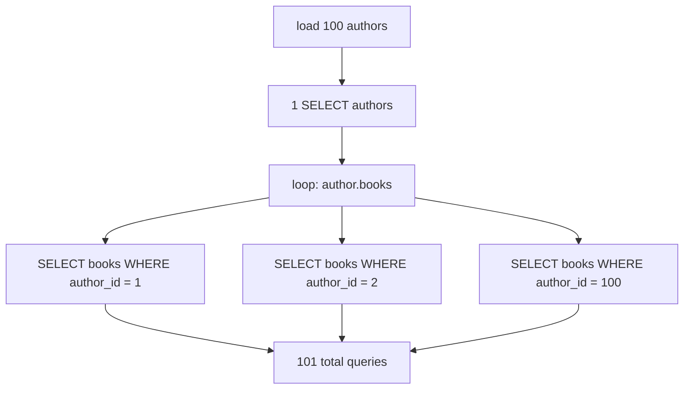
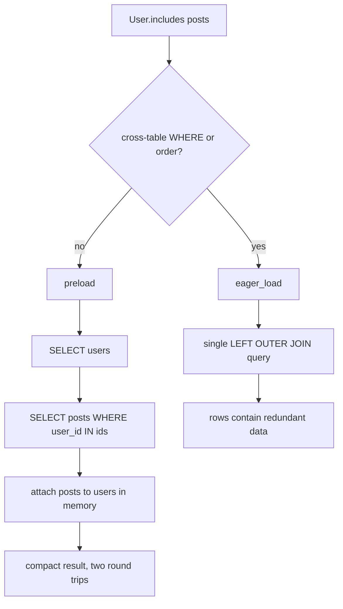

# 10 -- Scoping and eager loading: narrowing queries, avoiding N+1

A query can be narrowed with a reusable template, called a scope. A query can also fetch related rows ahead of time, called eager loading. These two features solve opposite problems. Scopes stop you from repeating WHERE clauses. Eager loading stops you from issuing one Structured Query Language (SQL) query per row in a loop. This document explains both and the machinery under each.

Source files are from the `activerecord-8.1.4` gem at `/Users/darkvoid/.gems/gems/activerecord-8.1.4/lib`. Short paths below are relative to that `lib` directory.

For how the query interface chains methods in general, see [04-query-interface.md](./04-query-interface.md). For how associations are declared, see [06-associations.md](./06-associations.md).

## Named scopes

A scope is a class method that returns a relation. The `scope` macro defines such a method for you. Its implementation is at `active_record/scoping/named.rb:154-189`:

```ruby
def scope(name, body, &block)
  unless body.respond_to?(:call)
    raise ArgumentError, "The scope body needs to be callable."
  end

  if dangerous_class_method?(name)
    raise ArgumentError, "You tried to define a scope named \"#{name}\" " \
      "on the model \"#{self.name}\", but Active Record already defined " \
      "a class method with the same name."
  end

  if method_defined_within?(name, Relation)
    raise ArgumentError, "You tried to define a scope named \"#{name}\" " \
      "on the model \"#{self.name}\", but ActiveRecord::Relation already defined " \
      "an instance method with the same name."
  end

  extension = Module.new(&block) if block

  if body.respond_to?(:to_proc)
    singleton_class.define_method(name) do |*args|
      scope = all._exec_scope(*args, &body)
      scope = scope.extending(extension) if extension
      scope
    end
  else
    singleton_class.define_method(name) do |*args|
      scope = body.call(*args) || all
      scope = scope.extending(extension) if extension
      scope
    end
  end
  singleton_class.send(:ruby2_keywords, name)

  generate_relation_method(name)
end
```

The important line is `all._exec_scope(*args, &body)`. A scope always starts from `all` and then applies the callable inside a relation scope context. That is why scopes compose: `Article.published.featured` works because `published` returns a relation, and `featured` is also generated on `Relation` by `generate_relation_method` at line 188, so it can be called on the result.

```ruby
class Article < ApplicationRecord
  scope :published, -> { where(published: true) }
  scope :featured,  -> { where(featured: true) }
  scope :recent,    ->(limit = 10) { order(created_at: :desc).limit(limit) }
end

Article.published.featured.recent(5)
```

The guard clauses prevent a scope from shadowing an existing `Relation` method or a dangerous class method. The body must be callable so Active Record can defer its execution until the relation is loaded, rather than running it at class definition time.

## Default and current scope

A default scope is a scope that is always applied, unless you opt out. It is defined with `default_scope` and skipped with `unscoped`. `unscoped` is at `active_record/scoping/default.rb:50-52`:

```ruby
def unscoped(&block)
  block_given? ? relation.scoping(&block) : relation
end
```

The scopes themselves are tracked in a registry that is local to the current thread or fiber. `ScopeRegistry` is in `active_record/scoping.rb:75-89`:

```ruby
class ScopeRegistry # :nodoc:
  class << self
    delegate :current_scope, :set_current_scope, :ignore_default_scope, :set_ignore_default_scope,
      :global_current_scope, :set_global_current_scope, to: :instance

    def instance
      ActiveSupport::IsolatedExecutionState[:active_record_scope_registry] ||= new
    end
  end

  def initialize
    @current_scope        = {}
    @ignore_default_scope = {}
    @global_current_scope = {}
  end
end
```

The key is `ActiveSupport::IsolatedExecutionState` at line 81: the registry is stored per thread or per fiber, depending on configuration. This is why a `default_scope` in one request does not leak into another request in a multi-threaded server. The class methods `current_scope` and `current_scope=` at `active_record/scoping.rb:25-31` read and write that per-execution storage, and `unscoped` works by setting the `ignore_default_scope` flag inside a scoping block.

```ruby
class Article < ApplicationRecord
  default_scope { where(published: true) }
end

Article.all                 # SELECT * FROM articles WHERE published = true
Article.unscoped.all        # SELECT * FROM articles
```

The default scope also fills attributes when building a new record, via `populate_with_current_scope_attributes` at `active_record/scoping.rb:46-56`, so `Article.new.published` is `true`. It is not applied when updating or deleting, which avoids silently changing rows you intended to target.

## The N+1 problem

Associations are loaded lazily by default. This means a loop over parents that touches an association issues one extra query per parent. If you load 100 authors and then read each author's books, you issue 1 query for the authors plus 100 queries for the books. That is the N+1 problem.

```ruby
authors = Author.limit(100).to_a
authors.each do |author|
  puts author.books.map(&:title)  # one SELECT per author
end
```



Eager loading fixes this by fetching the association records ahead of time and attaching them to the parents in memory.

## `preload` versus `eager_load` versus `includes`

There are two eager loading strategies. `preload` issues separate queries: one for the parents, one per association level using `IN` lists of primary keys. `eager_load` issues a single query with `LEFT OUTER JOIN` clauses. Both are defined in `active_record/relation/query_methods.rb`.

`preload` at `active_record/relation/query_methods.rb:322-325`:

```ruby
def preload(*args)
  check_if_method_has_arguments!(__callee__, args)
  spawn.preload!(*args)
end
```

`eager_load` at lines 290-293:

```ruby
def eager_load(*args)
  check_if_method_has_arguments!(__callee__, args)
  spawn.eager_load!(*args)
end
```

`includes` at lines 250-253 records the associations but does not choose a strategy yet. The choice happens at load time. When the relation has a WHERE clause or an order that references a joined table, `includes` must use `eager_load` (the JOIN), because the filter must happen in the database. Otherwise it falls back to `preload` (the separate queries). The documentation at `active_record/associations/preloader.rb:34-45` describes exactly this: a cross-table condition forces the single joined query, which produces redundant rows and performs worse at scale.

```ruby
User.includes(:posts)                              # preload strategy
User.includes(:posts).where(posts: { title: "x" }) # eager_load strategy, needs the JOIN
```

`references` at `active_record/relation/query_methods.rb:355-358` tells the relation that a string SQL fragment names a table, so `includes` will join it: `User.includes(:posts).where("posts.name = 'foo'").references(:posts)`.

The actual preloading happens in `Relation#preload_associations` at `active_record/relation.rb:1349-1356`:

```ruby
def preload_associations(records) # :nodoc:
  preload = preload_values
  preload += includes_values unless eager_loading?
  scope = strict_loading_value ? StrictLoadingScope : nil
  preload.each do |associations|
    ActiveRecord::Associations::Preloader.new(records: records, associations: associations, scope: scope).call
  end
end
```

When the strategy is `eager_load` (`eager_loading?` returns true), the JOIN query already loaded the association columns, so `includes_values` are not preloaded separately. When it is `preload`, the `includes_values` are folded into the preload list and handled by the `Preloader`.

## The Preloader

`ActiveRecord::Associations::Preloader` in `active_record/associations/preloader.rb` is the engine. Its constructor at lines 99-114 builds a tree of `Branch` nodes from the association argument, where a `Branch` is one association level and its children are the nested levels. `Batch` (autoloaded at line 51) loads one association for a batch of parents. The tree shape mirrors the `includes` argument shape:

```ruby
User.includes(:posts, friends: [:avatar])
# Branch :posts, and Branch :friends with child Branch :avatar
```

Each batch follows the same pattern shown in the Preloader documentation at `active_record/associations/preloader.rb:22-31`: collect the primary keys from the loaded parents, then run one query with `WHERE foreign_key IN (...)`, then distribute the fetched rows onto the parents by their foreign keys. Nested levels repeat the process using the already-loaded children as their new parents.

A `ThroughAssociation` (autoloaded at line 53) handles `has_many :through` by preloading the middle records first, then the target records through them.

## Counter cache

Some associations are frequent targets of a `count`. A counter cache column stores that count on the parent so the count is read from a column instead of computed with `SELECT COUNT(*)`. The class methods live in `active_record/counter_cache.rb`. `update_counters` at lines 142-145 issues a single direct UPDATE for one or more ids:

```ruby
def update_counters(id, counters)
  id = [id] if composite_primary_key? && id.is_a?(Array) && !id[0].is_a?(Array)
  unscoped.where!(primary_key => id).update_counters(counters)
end
```

`increment_counter` and `decrement_counter` at lines 175-177 and 205-207 wrap it with `by: 1` or `by: -1`. The counter is maintained automatically during the record life cycle. `_create_record` at `active_record/counter_cache.rb:227-235` increments each counter-cached association after the INSERT:

```ruby
def _create_record(attribute_names = self.attribute_names)
  id = super

  counter_cached_association_names.each do |association_name|
    association(association_name).increment_counters
  end

  id
end
```

`destroy_row` at lines 237-251 decrements them after the DELETE, unless the parent was itself destroyed through an association with a matching foreign key (in which case the association layer handles it, avoiding a double decrement). The generated SQL looks like `UPDATE posts SET comments_count = COALESCE(comments_count, 0) + 1 WHERE id IN (...)`, per the examples at `active_record/counter_cache.rb:130-141`.

The counter column is declared on the `belongs_to` side: `belongs_to :post, counter_cache: true` expects a `comments_count` column on the posts table, and `counter_cache: :replies_count` names it explicitly.

## `strict_loading`

Eager loading is opt-in, so a missed `includes` silently produces N+1 queries in production. `strict_loading` turns that silence into a loud error. It is at `active_record/relation/query_methods.rb:1353-1355`:

```ruby
def strict_loading(value = true)
  spawn.strict_loading!(value)
end
```

A record loaded through a strict-loading relation raises `ActiveRecord::StrictLoadingViolationError` (`active_record/errors.rb:411`) when its association is lazily loaded. Rails also supports `strict_loading_by_default` on a model and `strict_loading!(n_plus_one_only: true)` to warn only about collection associations, which are the usual N+1 source.

```ruby
user = User.strict_loading.first
user.comments.to_a  # => ActiveRecord::StrictLoadingViolationError
```

The preloader honors the mode too: `preload_associations` passes a `StrictLoadingScope` when the relation is strict-loading, at `active_record/relation.rb:1352`, so associations preloaded along with a strict relation stay allowed.



## The Aha Moment

**Aha:** Scopes and eager loading are both "defer the decision until load". A scope is a callable that Active Record evaluates against `all` inside a per-execution scope registry, which is why scopes compose and why a default scope can be unscoped. Eager loading is the same deferral for associations: `includes` records the intent, and only at load time does the relation choose between two queries with `IN` lists and one query with `JOIN`s, based on whether your WHERE clause already forced a join. N+1 is not an optimization failure; it is the default lazy behavior, and `strict_loading` exists because opt-in silence is how the problem hides. Counter caches are the same idea pushed into the schema: replace a repeated `COUNT` with a column that the INSERT and DELETE paths maintain.

Continue to [11-query-cache-and-pool.md](./11-query-cache-and-pool.md).
