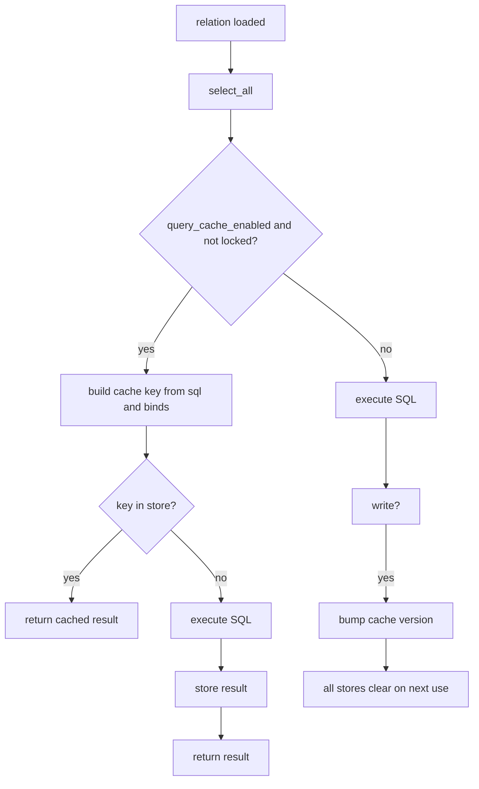
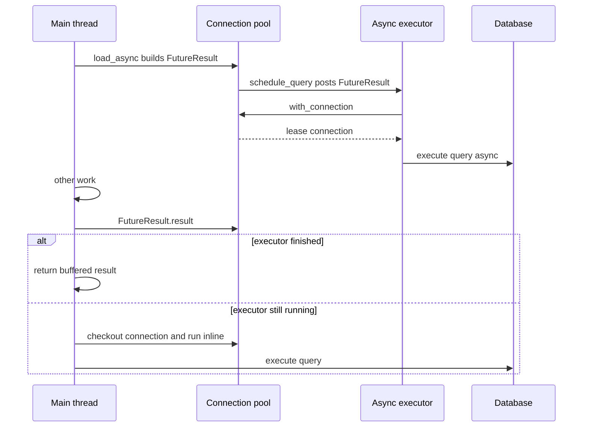

# 11 -- Query cache and connection pool: sharing the work

Between your model and the database sit two machines that share work. The query cache remembers the result of an identical Structured Query Language (SQL) query within one request, so it does not run twice. The connection pool shares a small set of database connections among many threads, so the server does not open one socket per thread. This document explains both, and the asynchronous query path that lets one thread run a query while another waits.

Source files are from the `activerecord-8.1.4` gem at `/Users/darkvoid/.gems/gems/activerecord-8.1.4/lib`. Short paths below are relative to that `lib` directory.

For how a connection executes SQL at all, see [01-connection-and-adapters.md](./01-connection-and-adapters.md). For how a relation becomes SQL, see [04-query-interface.md](./04-query-interface.md).

## The query cache store

The query cache is a hash keyed by SQL. The store is in `active_record/connection_adapters/abstract/query_cache.rb`. The size limit is `DEFAULT_SIZE = 100` at line 9. The store's own documentation at lines 32-43 states the keys precisely: a SQL string when there are no binds, or an array `[SQL, binds]` when there are. Values are `ActiveRecord::Result` objects. Eviction is Least Recently Used (LRU).

The heart is `compute_if_absent` at `active_record/connection_adapters/abstract/query_cache.rb:77-91`:

```ruby
def compute_if_absent(key)
  check_version

  return yield unless @enabled

  if entry = @map.delete(key)
    return @map[key] = entry
  end

  if @max_size && @map.size >= @max_size
    @map.shift # evict the oldest entry
  end

  @map[key] ||= yield
end
```

On a hit, the entry is deleted and reinserted, which moves it to the newest end of the hash and implements LRU order. On a miss, the oldest entry is evicted when the map is full, then the block executes the query and stores its result. The store is disabled unless a request explicitly enables it.

`check_version` at lines 99-104 is the invalidation guard. Every store in a pool shares a version counter. When any write dirties the pool, the version increments. The next cache operation sees the mismatch, clears its map, and records the new version. This is cheaper than walking every cached key to decide what a write invalidated: one version bump wipes all stores for the pool at once.

The query path is `select_all` at `active_record/connection_adapters/abstract/query_cache.rb:263-280`:

```ruby
def select_all(arel, name = nil, binds = [], preparable: nil, async: false, allow_retry: false) # :nodoc:
  arel = arel_from_relation(arel)

  # If arel is locked this is a SELECT ... FOR UPDATE or somesuch.
  # Such queries should not be cached.
  if query_cache_enabled && !(arel.respond_to?(:locked) && arel.locked)
    sql, binds, preparable, allow_retry = to_sql_and_binds(arel, binds, preparable, allow_retry)

    if async
      result = lookup_sql_cache(sql, name, binds) || super(sql, name, binds, preparable: preparable, async: async, allow_retry: allow_retry)
      FutureResult.wrap(result)
    else
      cache_sql(sql, name, binds) { super(sql, name, binds, preparable: preparable, async: async, allow_retry: allow_retry) }
    end
  else
    super
  end
end
```

Two details matter. First, a `SELECT ... FOR UPDATE` is never cached, because it must hit the database to take the lock. Second, `cache_sql` at lines 305-325 does the actual store lookup and, on a cache hit, instruments a `sql.active_record` notification so monitoring tools still see the query that was served from memory. `lookup_sql_cache` at lines 287-303 is the read-only variant used on the async path.

## `cache`, `uncached`, and executor hooks

The query cache is off by default. It is enabled per request by the Rails executor, and manually with `cache` and `uncached`. Both are class methods in `active_record/query_cache.rb`. `cache` at lines 10-22 enables the cache for a block and clears it after if it was not already enabled. `uncached` at lines 33-39 disables it for a block, restoring the previous state.

The `dirties` option on `uncached` matters. Write operations normally clear all query caches for the pool, because a replica might have served a cached result that the write just made stale. The code that makes writes dirty the cache is `dirties_query_cache` at `active_record/connection_adapters/abstract/query_cache.rb:12-30`:

```ruby
def dirties_query_cache(base, *method_names)
  method_names.each do |method_name|
    base.class_eval <<-end_code, __FILE__, __LINE__ + 1
      def #{method_name}(...)
        if pool.dirties_query_cache
          ActiveRecord::Base.clear_query_caches_for_current_thread
        end
        super
      end
    end_code
  end
end
```

`exec_query`, `execute`, `insert`, `update`, `delete`, and the rest each clear the cache before running, at lines 13-15.

The per-request wiring is `QueryCache::ExecutorHooks` at `active_record/query_cache.rb:42-60`. Its `run` method enables the query cache on every pool that does not already have it enabled, and `complete` disables and clears it. The hooks are installed with `ActiveSupport::Executor`, so every web request gets a fresh cache.



## How the pool works

A database connection is expensive to open. The pool keeps a small set of them and hands them out to threads one at a time. The options are documented at `active_record/connection_adapters/abstract/connection_pool.rb:99-118`: `checkout_timeout` defaults to 5 seconds, `idle_timeout` to 300 seconds, `keepalive` to 600 seconds, `max_age` to infinity, and `max_connections` to 5.

Checking out and checking in are explicit. `checkout` at `active_record/connection_adapters/abstract/connection_pool.rb:639-660` acquires a connection, waiting up to `checkout_timeout`, and raises `ActiveRecord::ConnectionTimeoutError` if the pool is at capacity. `checkin` at lines 667-677 returns the connection:

```ruby
def checkin(conn)
  return if @pinned_connection.equal?(conn)

  conn.lock.synchronize do
    synchronize do
      connection_lease.clear(conn)
      conn.expire
      @available.add conn
    end
  end
end
```

A `Lease` binds a connection to the current thread or fiber. The lease registry is a weak map keyed by execution context, defined as `WeakThreadKeyMap` at `active_record/connection_adapters/abstract/connection_pool.rb:132-157`, so a dead thread's lease is not kept alive. Most application code never calls `checkout` directly; `with_connection` (at `connection_pool.rb:452`) checks out a connection for a block and checks it back in.

Two maintenance methods clean up after failures. `reap` at `active_record/connection_adapters/abstract/connection_pool.rb:713-731` finds connections whose owning thread or fiber is dead, steals them, and either resets them or removes them. `flush` at lines 736-770 disconnects connections idle for at least `idle_timeout` seconds, while respecting `min_connections`. `stat` at lines 875-887 returns the pool's health in one hash:

```ruby
def stat
  synchronize do
    {
      size: size,
      connections: @connections.size,
      busy: @connections.count { |c| c.in_use? && c.owner.alive? },
      dead: @connections.count { |c| c.in_use? && !c.owner.alive? },
      idle: @connections.count { |c| !c.in_use? },
      waiting: num_waiting_in_queue,
      checkout_timeout: checkout_timeout
    }
  end
end
```

## Asynchronous queries

Normally a query blocks its thread until the database answers. `load_async` changes that: the query is scheduled on a separate thread pool, and the calling thread can do other work before asking for the result. The pool schedules the work with `schedule_query` at `active_record/connection_adapters/abstract/connection_pool.rb:889-892`:

```ruby
def schedule_query(future_result) # :nodoc:
  @async_executor.post { future_result.execute_or_skip }
  Thread.pass
end
```

The executor is built by `build_async_executor` at lines 917-933. It is either a `Concurrent::ThreadPoolExecutor` sized per database, or the global executor, chosen by `ActiveRecord.async_query_executor`.

The pending query is a `FutureResult` in `active_record/future_result.rb`. `execute_or_skip` at lines 100-122 runs on the executor thread: it checks that the result is still pending, takes a session read lock, checks out a connection, and executes the query with instrumentation buffered for later. `execute_or_wait` at lines 146-161 is the calling thread's side: if the executor has not finished, the caller itself checks out a connection and runs the query inline, so a slow executor cannot stall a result forever.

`result` at `active_record/future_result.rb:124-135` is the payoff:

```ruby
def result
  execute_or_wait
  @event_buffer&.flush

  if canceled?
    raise Canceled
  elsif @error
    raise @error
  else
    @result
  end
end
```

The session model prevents leaks. `AsynchronousQueriesTracker::Session` at `active_record/asynchronous_queries_tracker.rb:8-29` holds an atomic active flag and a read-write lock. While a session is active, in-flight async queries may proceed. When the request ends, `finalize` marks it inactive; any result that was canceled raises `Canceled` from `future_result.rb:51`. The tracker's `run` and `complete` hooks at `asynchronous_queries_tracker.rb:36-42` install with the executor, mirroring the query cache hooks.

```ruby
posts = Post.where(published: true).load_async
# do other work here
posts.each { |post| puts post.title }  # blocks only now, if not already done
```



## The Aha Moment

**Aha:** The query cache and the connection pool are both answers to "this operation is too expensive to repeat, so share it". The cache shares results: identical SQL within a request is served from a 100-entry LRU map, and writes invalidate it with one version counter instead of per-key analysis. The pool shares sockets: a `Lease` hands one connection to one thread at a time, `checkin` returns it, and `reap` recovers the ones whose owners died. Async queries add a third sharing axis: a thread pool borrows the waiting time between issuing a query and needing its result. Each layer makes a different resource reusable, and the executor hooks tie them all to the request life cycle so nothing leaks between requests.

Continue to [12-the-nice-ruby-experience.md](./12-the-nice-ruby-experience.md).
