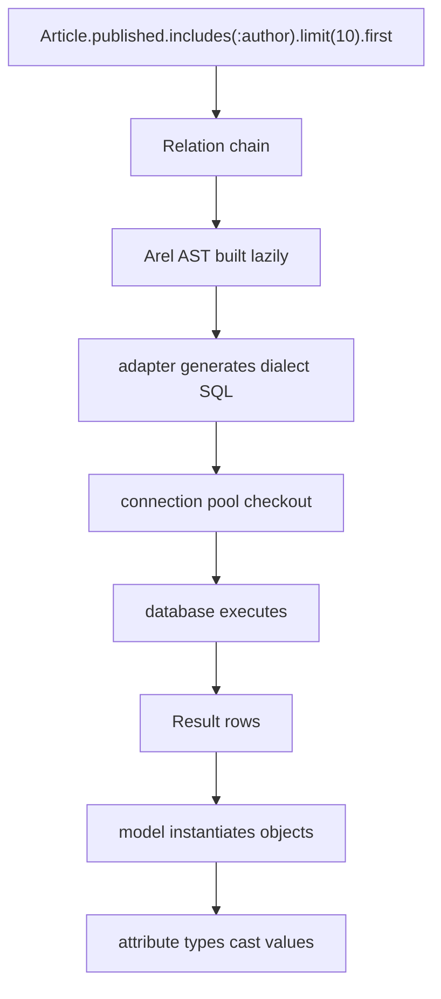
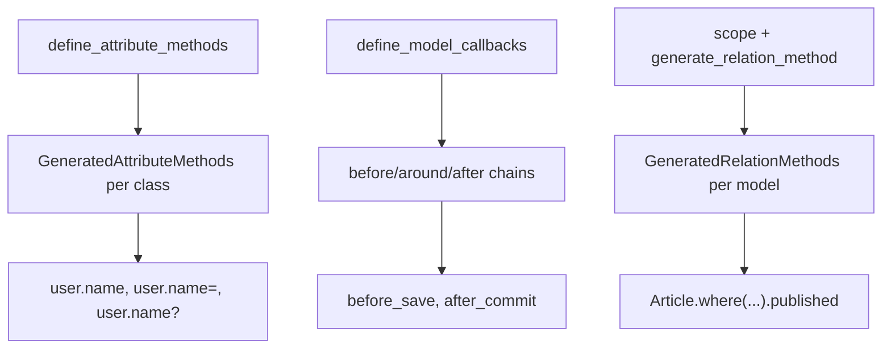

# 12 -- The nice Ruby experience: a DSL that reads like English

Active Record is famous for reading like English. `Article.published.includes(:author).limit(10)` is a sentence, not a program. This chapter is a synthesis: it shows how the pieces from documents 00 through 11 combine into that experience, and where the sugar hides real machinery.

Source files are from the `activerecord-8.1.4` gem at `/Users/darkvoid/.gems/gems/activerecord-8.1.4/lib`. Short paths below are relative to that `lib` directory.

Start with [00-overview.md](./00-overview.md) for the whole map. This chapter assumes you have read the earlier documents.

## The layers, revisited

The "nice Ruby" surface is thin. Under one call, five layers cooperate:

- The **connection adapter** turns abstract operations into dialect SQL and moves bytes over a socket. See [01-connection-and-adapters.md](./01-connection-and-adapters.md).
- **Arel** builds an abstract syntax tree of the query, so the adapter does not parse strings. See [02-sql-generation-arel.md](./02-sql-generation-arel.md).
- The **model** binds a class to a table and turns columns into attributes. See [03-the-model.md](./03-the-model.md) and [09-attribute-methods-and-types.md](./09-attribute-methods-and-types.md).
- The **relation** is a lazily evaluated, immutable query builder. See [04-query-interface.md](./04-query-interface.md).
- **Persistence, associations, callbacks, validations, migrations, scoping, and the pool** add behavior around those four. See [05-persistence.md](./05-persistence.md) through [11-query-cache-and-pool.md](./11-query-cache-and-pool.md).



The key property is that nothing runs until you ask for data. `published`, `includes`, and `limit` each return a new relation. Only `first`, `to_a`, `each`, or another terminal method triggers `select_all`, which walks down to the adapter. The DSL is a declarative description that the library interprets later.

## Chaining is spawning

A relation never mutates. `where` does not change the relation you called it on; it returns a copy with one more condition. That is why chaining is safe and composable:

```ruby
base   = Article.where(published: true)
recent = base.order(created_at: :desc)
long   = base.where("body LIKE ?", "%Active Record%")

# base still has no order and no body filter
```

The copy is called a spawn. Each query method records its value on the spawned relation, and the terminal method builds the Arel tree from the accumulated values.

The second half of chaining is delegation. A scope such as `published` is a class method on `Article`, but you can also call it on a relation, as in `Article.where(featured: true).published`. That works because `GeneratedRelationMethods` compiles the call into a delegate. Read `active_record/relation/delegation.rb:73-88`:

```ruby
def generate_method(method)
  MUTEX.synchronize do
    return if method_defined?(method)

    if /\A[a-zA-Z_]\w*[!?]?\z/.match?(method) && !::ActiveSupport::Delegation::RESERVED_METHOD_NAMES.include?(method.to_s)
      module_eval <<-RUBY, __FILE__, __LINE__ + 1
        def #{method}(...)
          scoping { model.#{method}(...) }
        end
      RUBY
    else
      define_method(method) do |*args, **kwargs, &block|
        scoping { model.public_send(method, *args, **kwargs, &block) }
      end
    end
  end
end
```

The generated method runs the model's scope inside `scoping { ... }`, which sets the current scope so the model method starts from this relation instead of from `all`. That is the exact mechanism behind `scope` returning `all._exec_scope` (see [10-scoping-and-eager-loading.md](./10-scoping-and-eager-loading.md)) and behind `generate_relation_method` at `active_record/scoping/named.rb:188`.

## Method generation everywhere

Active Record generates methods instead of writing them by hand, in three places.

- **Attribute accessors.** `name`, `name=`, and `name?` are generated once per class by `define_attribute_methods` at `active_record/attribute_methods.rb:104-125`, then dispatched by `method_missing` on first use. See [09-attribute-methods-and-types.md](./09-attribute-methods-and-types.md).
- **Callback chains.** `before_save` and friends come from `define_model_callbacks` in Active Model, which builds the before, around, and after variants. See [07-callbacks-and-validations.md](./07-callbacks-and-validations.md).
- **Relation delegation.** Scopes and other class methods are copied onto a per-model relation subclass by `GeneratedRelationMethods`, above.



All three share one trick: a module or subclass is created once, populated with compiled methods, and included. The first use may trigger generation lazily; later uses are plain Ruby method calls, which is why the sugar does not cost much at runtime.

## A model reads like a spec

The payoff is that one class states the whole contract of a row, in one place:

```ruby
class Article < ApplicationRecord
  belongs_to :author, counter_cache: true
  has_many :comments, dependent: :destroy

  scope :published, -> { where(published: true) }
  scope :recent,    -> { order(created_at: :desc) }

  enum :status, { draft: 0, published: 1, archived: 2 }, default: :draft

  validates :title, presence: true, length: { maximum: 200 }
  validates :status, inclusion: { in: statuses.keys }

  before_validation :strip_title
  after_create_commit :notify_author

  private

  def strip_title
    self.title = title&.strip
  end

  def notify_author
    AuthorMailer.new_article(self).deliver_later
  end
end
```

Every line is a separate DSL with a separate source: `belongs_to` and `has_many` are associations ([06-associations.md](./06-associations.md)), `scope` is scoping, `enum` is a structured type plus generated predicates and scopes ([09-attribute-methods-and-types.md](./09-attribute-methods-and-types.md)), `validates` and `before_validation` are the validation and callback pipelines ([07-callbacks-and-validations.md](./07-callbacks-and-validations.md)), and `after_create_commit` is the transactional callback that only fires after the INSERT commits. The class reads top to bottom as: what it connects to, how it is filtered, what values it allows, what rules it enforces, and what happens around saves.

The same idea applies to schema. A migration reads like a recipe:

```ruby
class CreateArticles < ActiveRecord::Migration[8.1]
  def change
    create_table :articles do |t|
      t.string :title, null: false
      t.text :body
      t.references :author, null: false, foreign_key: true
      t.integer :comments_count, default: 0, null: false
      t.timestamps
    end
  end
end
```

`create_table` and `t.references` are the migration DSL, and `change` plus the `CommandRecorder` make the whole recipe reversible, as shown in [08-migrations-and-schema.md](./08-migrations-and-schema.md).

## The price of the sugar

Every convenience hides a decision you must still make. Four are worth remembering as you finish this series.

- **N+1.** Associations load lazily, so a loop over parents produces one query per parent. `includes`, `preload`, and `eager_load` fix it; `strict_loading` makes the mistake loud. See [10-scoping-and-eager-loading.md](./10-scoping-and-eager-loading.md).
- **Uniqueness is not a guarantee.** `validates :email, uniqueness: true` checks the database but cannot prevent a race; only a unique index guarantees it. See [07-callbacks-and-validations.md](./07-callbacks-and-validations.md).
- **`after_save` runs inside the transaction.** A side effect there is rolled back with the transaction. `after_commit` fires only after the commit. See [07-callbacks-and-validations.md](./07-callbacks-and-validations.md).
- **`default_scope` applies everywhere.** It changes `all`, and it must be escaped with `unscoped`. See [10-scoping-and-eager-loading.md](./10-scoping-and-eager-loading.md).

The English sentence hides the cost model. `Article.includes(:author)` reads as an afterthought but controls the join strategy, the number of round trips, and the memory layout of the result. The nice Ruby is not free; it is honest about its machinery, and the machinery is what these documents describe.

## The Aha Moment

**Aha:** The "nice Ruby experience" is not one magic DSL. It is four thin layers (adapter, Arel, model, relation) plus a family of small DSLs (associations, validations, callbacks, scopes, migrations, types) that all compile into plain Ruby methods on per-class modules. Chaining works because relations are immutable spawns and scopes are deferred callables run inside a scope context. Reading like English works because each DSL is declarative: you state what should be true, and Active Record decides when and how to make it true, which is exactly why the later questions are about when things run, how many queries they run, and what the database guarantees.

Continue to [13-globalid-and-activejob-integration.md](./13-globalid-and-activejob-integration.md).
