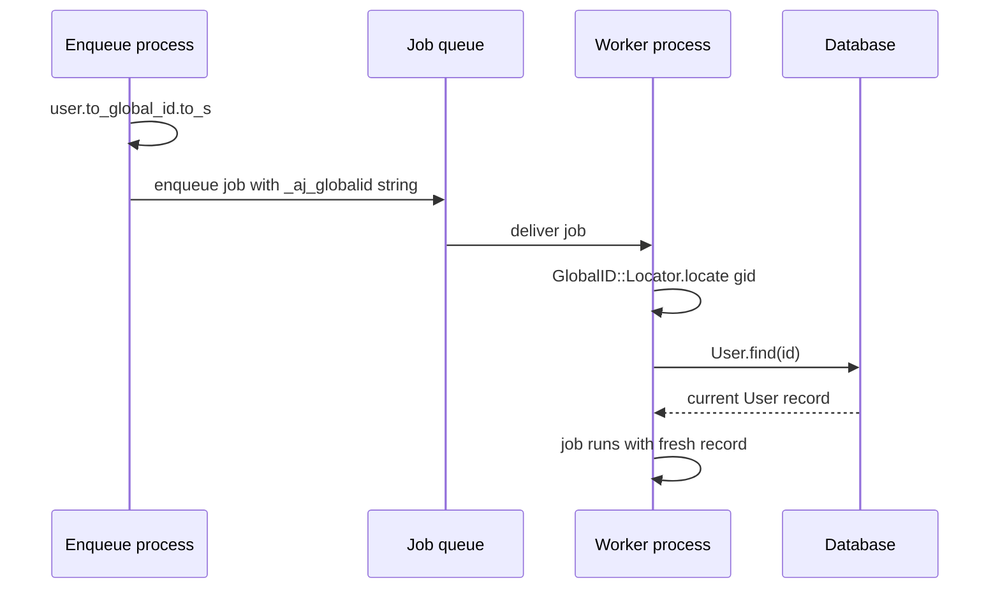
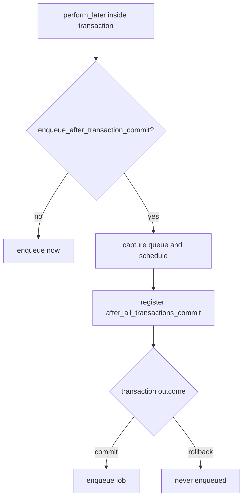

# 13 -- GlobalID and ActiveJob: passing records to background jobs

A background job runs in a different process, later. It cannot receive a Ruby object such as `user = User.find(1)`, because that object cannot be serialized into the job queue and would be stale anyway. The job must receive a locator, a string that names the record, and re-load the record when it runs. GlobalID produces that locator. Active Job recognizes Active Record models and converts them to GlobalIDs automatically. This document explains both halves and the enqueue-after-commit guarantee that ties them to transactions.

Source files: Active Record is at `/Users/darkvoid/.gems/gems/activerecord-8.1.4/lib`, Active Job at `/Users/darkvoid/.gems/gems/activejob-8.1.4/lib`, and GlobalID at `/Users/darkvoid/.gems/gems/globalid-1.4.0/lib`. Short paths below are relative to each gem's `lib` directory.

For the `after_commit` callback that pairs with this, see [07-callbacks-and-validations.md](./07-callbacks-and-validations.md). For associations and `dependent:` options, see [06-associations.md](./06-associations.md).

## GlobalID: a locator string

`GlobalID::Identification` gives any model with a `find` method two methods: `to_global_id` and `to_signed_global_id`. The first is at `global_id/identification.rb:38-41`:

```ruby
def to_global_id(options = {})
  GlobalID.create(self, options)
end
alias to_gid to_global_id
```

The result is a string in the form `gid://app/Person/1`, shown in the documentation at `global_id/identification.rb:21-28`. It names the application, the model class, and the primary key. `GlobalID::Locator.locate` reverses it: it constantizes the model name and calls `find` with the id. The signed variant, `to_sgid` at `global_id/identification.rb:108-111`, adds a signature so the value cannot be tampered with, and it expires by default after one month (see the discussion at lines 51-96).

A GlobalID is deliberately not the record. It is a small, stable string that survives any queue and any serializer. The record itself is re-fetched at job run time, so the job always works on the current database state.

## How Active Record gets GlobalID

Active Record does not require GlobalID itself. The integration is injected by GlobalID's railtie, at `global_id/railtie.rb:33-36`:

```ruby
ActiveSupport.on_load(:active_record) do
  require 'global_id/identification'
  send :include, GlobalID::Identification
end
```

`ActiveSupport.on_load(:active_record)` runs its block the first time `ActiveRecord::Base` is loaded, so the `Identification` module is included into `ActiveRecord::Base` lazily. This is a clean example of the load-hook pattern: GlobalID depends on Active Record, so it waits for Active Record to load rather than Active Record depending on GlobalID.

## ActiveJob argument serialization

Active Job serializes every job argument before enqueueing. `ActiveJob::Arguments#serialize_argument` at `active_job/arguments.rb:38-76` is a case expression over Ruby types. Strings, numbers, and booleans pass through unchanged. Arrays and hashes recurse. Symbols get a serializer marker. And the interesting branch is at lines 54-55:

```ruby
when GlobalID::Identification
  convert_to_global_id_hash(argument)
```

`convert_to_global_id_hash` at `active_job/arguments.rb:191-196` produces the wire form:

```ruby
def convert_to_global_id_hash(argument)
  { GLOBALID_KEY => argument.to_global_id.to_s }
rescue URI::GID::MissingModelIdError
  raise SerializationError, "Unable to serialize #{argument.class} " \
    "without an id. (Maybe you forgot to call save?)"
end
```

`GLOBALID_KEY` is `"_aj_globalid"`, defined at `active_job/arguments.rb:90`. So `SomeJob.perform_later(user)` does not enqueue a user; it enqueues the hash `{ "_aj_globalid" => "gid://app/User/1" }`. A new, unsaved record has no id, and the rescue turns that into `ActiveJob::SerializationError` with the hint "Maybe you forgot to call save?".

On the worker side, `deserialize_argument` at `active_job/arguments.rb:109-126` inspects each hash. `serialized_global_id?` at lines 128-130 is true when the hash has exactly one key, `"_aj_globalid"`. `deserialize_global_id` at lines 132-134 then calls `GlobalID::Locator.locate`, which re-fetches the record.



The distinction between the GlobalID string and the record is the whole point. The queue stores a string; the worker loads a fresh object. If the record was deleted between enqueue and run, `locate` returns `nil` or raises, and Active Job wraps that in `ActiveJob::DeserializationError`.

## Enqueueing after commit

A job enqueued inside a transaction can be picked up by a worker before the transaction commits. The worker then loads a record that does not exist yet. The fix is to defer the enqueue until the transaction commits. Active Job provides `enqueue_after_transaction_commit`, and its implementation is in `active_job/enqueue_after_transaction_commit.rb:25-47`:

```ruby
def raw_enqueue
  if self.class.enqueue_after_transaction_commit
    self.successfully_enqueued = true
    deferred_scheduled_at = scheduled_at
    deferred_queue_name = queue_name
    deferred_priority = priority
    ActiveRecord.after_all_transactions_commit do
      previous_scheduled_at, previous_queue_name, previous_priority = scheduled_at, queue_name, priority
      self.scheduled_at = deferred_scheduled_at
      self.queue_name = deferred_queue_name
      self.priority = deferred_priority
      self.successfully_enqueued = false
      super
    ensure
      self.scheduled_at = previous_scheduled_at
      self.queue_name = previous_queue_name
      self.priority = previous_priority
    end
    self
  else
    super
  end
end
```

The actual enqueue (`super`) moves into an `ActiveRecord.after_all_transactions_commit` block, along with the queue, priority, and schedule captured at call time. If the transaction rolls back, the block never runs and no job is enqueued. `perform_all_later` gets the same treatment at lines 15-21: jobs with the setting are partitioned out and enqueued only after commit.

This is the mechanism behind the common pattern from document 07:

```ruby
class Comment < ApplicationRecord
  after_create_commit :notify_subscribers

  private

  def notify_subscribers
    SubscribersMailer.new_comment(self).deliver_later
  end
end
```

`after_create_commit` fires after commit, and the mailer's job inherits the deferred enqueue behavior, so the mail is enqueued only when the INSERT is durable.



## DestroyAssociationAsyncJob

Destroying a large dependent association can be slow enough to belong in a background job. The `dependent: :destroy_async` option on a `has_many` association does exactly that: it enqueues `ActiveRecord::DestroyAssociationAsyncJob` instead of destroying the children inline. The job is in `active_record/destroy_association_async_job.rb:10-31`:

```ruby
class DestroyAssociationAsyncJob < ActiveJob::Base
  queue_as { ActiveRecord.queues[:destroy] }

  discard_on ActiveJob::DeserializationError

  def perform(
    owner_model_name: nil, owner_id: nil,
    association_class: nil, association_ids: nil, association_primary_key_column: nil,
    ensuring_owner_was_method: nil
  )
    association_model = association_class.constantize
    owner_class = owner_model_name.constantize
    owner = owner_class.find_by(owner_class.primary_key => [owner_id])

    if !owner_destroyed?(owner, ensuring_owner_was_method)
      raise DestroyAssociationAsyncError, "owner record not destroyed"
    end

    association_model.where(association_primary_key_column => association_ids).find_each do |r|
      r.destroy
    end
  end
end
```

The job receives plain values, not records: the owner's class name and id, the association's class name and ids, and the primary key column. It re-loads the owner, checks that the owner is actually gone (or that the association was configured to run anyway), and destroys the children in batches with `find_each`. `queue_as { ActiveRecord.queues[:destroy] }` puts these jobs on the destroy queue, and `discard_on ActiveJob::DeserializationError` means a record that vanished before the job ran is quietly ignored rather than retried forever.

The mirror image holds: the job does not receive the owner object for the same reason your own jobs should not. It receives the ids and re-fetches. This is the GlobalID principle applied by hand, inside Active Record itself.

## The Aha Moment

**Aha:** Passing a record to a background job is a lie that works by indirection. You write `perform_later(user)`, but the queue stores the string `"gid://app/User/1"`, not the user. At run time `GlobalID::Locator` turns that string back into `User.find(1)`, so the worker always sees the current row, not a stale copy. Every other rule follows from that one idea: an unsaved record cannot be serialized because it has no id, a deleted record raises `DeserializationError` because `find` fails, and enqueueing after commit matters because the worker may otherwise run `find` before the row exists. The whole integration is just "store a locator string, re-fetch on the other side".

Continue to [README.md](./README.md).
