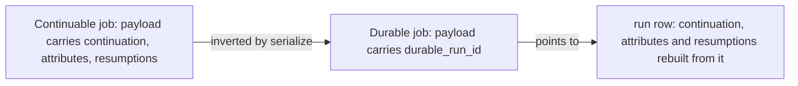
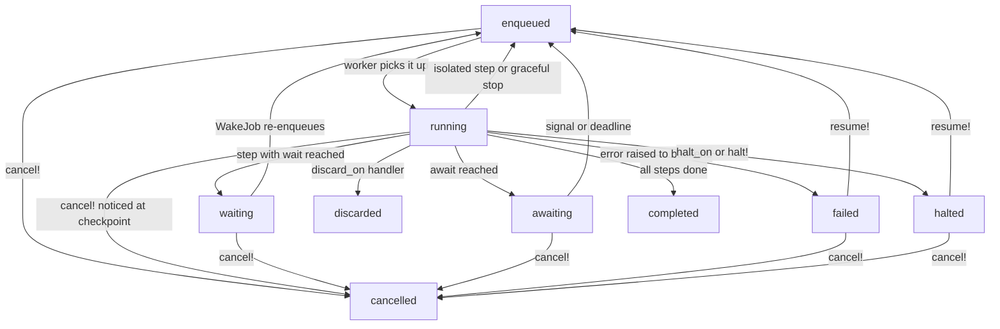

# 00 -- Overview: durable continuation on Active Job

AJ/DC is short for **Active Job Durable Continuation**. It is a Ruby gem, published on RubyGems as `ajdc`, that takes the continuation machinery Rails 8.1 added to Active Job and makes its progress *durable*: a run and its steps become rows in a relational database, not just fields inside a job payload. The gem is written by Vladimir Dementyev (known as `palkan`), is licensed under the MIT License, and is at version 0.1.0 at the time of writing (`lib/ajdc/version.rb`). It requires Ruby (MRI) 3.3 or newer, Rails 8.1 or newer, and one of SQLite, PostgreSQL or MySQL. The `ActiveJob::Attributes` feature that stores typed attribute values on a job requires Rails 8.2 (`README.md`).

## The problem: a payload is not a record

Rails 8.1 ships `ActiveJob::Continuable`. A continuable job declares named steps, each step can carry a cursor, and the framework serializes the *continuation* -- which steps are completed, which step is in progress, and its cursor -- into the job payload under the `continuation` key. When a job is interrupted gracefully (the queue adapter signals it is stopping), the framework re-enqueues the job and the payload travels with it, so progress survives a deploy or a restart.

The weakness is that the payload is the *only* record of progress. It lives inside the queue backend, between the worker that wrote it and the worker that will read it. A hard crash (a `SIGKILL`, an out-of-memory kill, a power cut) loses whatever was not yet written back to the queue. Nothing in the application can answer "where is this workflow right now" by reading a table, nothing can wait for a clock or an external approval without holding a worker, and nothing can stop a run and later resume it from the exact step and cursor where it stopped.

AJ/DC closes that gap with one architectural decision: **the run is a row, and the row is the single source of truth**. The Active Job payload is demoted to a pointer.

## The core idea in one sentence

A durable job is still a `step`-based continuable job. But the payload carries only `durable_run_id`; the continuation, the attribute values and the resumption count are rebuilt from the run row on every deserialize, and every row is written *before* the job is re-enqueued, on every path. The gem's own header states this directly (`lib/active_job/durable.rb:24-31`):

```ruby
# Steps, cursors and attributes behave exactly as in `ActiveJob::Continuable`,
# but the run row is the single source of truth: the payload carries
# `"durable_run_id"` instead of `"continuation"`, `"attributes"` and
# `"resumptions"`, and every execution rebuilds the continuation, the attribute
# values and the resumption count from `active_job_durable_runs` and the
# current attempt in `active_job_durable_steps`. The rows are written before
# the job is re-enqueued, in every path.
```

Using a durable job is a drop-in change. The job changes one line, from `include ActiveJob::Continuable` to `include ActiveJob::Durable` (`lib/active_job/durable.rb:15-22`):

```ruby
#   class ProcessImportJob < ApplicationJob
#     include ActiveJob::Durable
#
#     def perform(import)
#       step :validate
#       step :process, isolated: true
#     end
#   end
```

The payload transformation is performed by the `serialize` hook (`lib/active_job/durable/execution.rb:22-27`). The base continuation fields are dropped from the payload and replaced with the run identifier:

```ruby
def serialize(payload)
  payload = payload.except("continuation", "attributes", "resumptions").merge("durable_run_id" => run_id)
  # A workflow key makes sense only when the row exists
  payload["durable_workflow_key"] = workflow_key if workflow_key && !@run
  payload
end
```

The result is a payload of a few bytes that names the row, while the row carries everything else.



## What the run row buys you

Because the run is an Active Record model, an entire category of machinery that was previously hand-rolled -- a status enum on a model, a `*_sent_at` column per reminder, a job that re-enqueues itself, a settings row that remembers "the last run" -- collapses into ordinary queries and model methods:

- **Timers.** A step can carry `wait:` or `wait_until:`. Reaching that line parks the run as `waiting` with a `wake_at`, and a single recurring clock job re-enqueues due runs. No worker sits idle, no queue slot is held.
- **Signals.** An `await :name` parks the run as `awaiting` until an external caller delivers a value with `run.wake_up(:name, value)`.
- **Uniqueness.** `unique_by :import` enforces one live run per identity; a second enqueue is skipped, rejected, or replaces the first, depending on `on_conflict:`.
- **Halting and resuming.** `halt_on SomeError` or `halt!(:reason)` stops the run as `halted` but keeps it resumable; `run.resume!` puts it back in the queue at the same step and cursor.
- **Observability.** `MyJob.workflow_runs.failed.at_step(:process)` is a plain relation with scopes for every status.

## The shape of the data

AJ/DC keeps its state in two tables (`db/durable_schema.rb`):

- `active_job_durable_runs` -- one row per run, from the first enqueue to a terminal status, across every retry, interrupt and resume.
- `active_job_durable_steps` -- one row per *step attempt*. A step that is interrupted, fails, or halts and then re-enters gets a new row with the next attempt number.

The full column-by-column treatment, including all six run indexes and two step indexes, is in [04-data-model.md](./04-data-model.md).

A run is always in one of nine string statuses: `enqueued`, `running`, `waiting`, `awaiting`, `failed`, `halted`, `completed`, `discarded`, `cancelled`. They group into live (`enqueued`, `running`, `waiting`, `awaiting`), attention (`failed`, `halted`) and terminal (`completed`, `discarded`, `cancelled`) sets, and the model exposes a scope for each group and each status (`lib/active_job/durable/run.rb:46-50`).



The terminal statuses `completed`, `discarded` and `cancelled` are the end of the line: a terminal run can never be written again, which is why housekeeping can delete old ones safely.

## How the pieces fit

The gem is small and layered. At the top is the concern `ActiveJob::Durable`, which a job includes. It exposes the DSL (`step`, `await`, `halt!`, `identified_by`, `unique_by`, `halt_on`) and installs Active Job hooks. Most of the work happens in `ActiveJob::Durable::Execution`, a mediator object (one per job instance) that keeps the run and step rows in sync with the in-flight job. The rows themselves are the Active Record models `ActiveJob::Durable::Run` and `ActiveJob::Durable::Step`. Two scheduled jobs -- `WakeJob` and `HousekeepingJob` -- wake due runs and delete old terminal runs. The full map is in [01-architecture.md](./01-architecture.md).

The enqueue hook shows the fundamental ordering guarantee. The run is created *before* the job is handed to the adapter, so the row participates in the caller's transaction when enqueuing is deferred to after commit (`lib/active_job/durable.rb:173-178`):

```ruby
def enqueue(options = {})
  durable_job.workflow_key = options[:workflow_key]&.to_s
  return false unless durable_job.enqueued! # `on_conflict: :skip`: nothing to enqueue

  super
end
```

Every later write is equally conservative: the row is committed before control leaves the worker, whether the outcome is a completion, a re-enqueue for an isolated step, a graceful-stop interrupt, or a resume after an error.

## The Aha Moment

**Aha:** A continuable job's payload is a snapshot that only survives as long as the queue holds it, and only moves forward when a worker is alive to re-serialize it. AJ/DC's insight is to invert the relationship: the database row is the durable record of the run, and the queue message is merely a pointer to it (`durable_run_id`). Every execution *rebuilds* the continuation, the attribute values and the resumption count from the row rather than trusting the payload, and every row write happens before the job is re-enqueued. That single inversion turns "progress survives a graceful restart" into "progress survives a crash", and it is what makes timers, signals, uniqueness, halting, resuming and querying all fall out of ordinary relational reads and guarded writes.

## What comes next

The next document, [01-architecture.md](./01-architecture.md), opens the hood and follows one run through the mediator and its hooks. The deeper dive into the upstream `ActiveJob::Continuable` foundation it builds on is [02-continuable-foundation.md](./02-continuable-foundation.md).

Continue to [01-architecture.md](./01-architecture.md).
