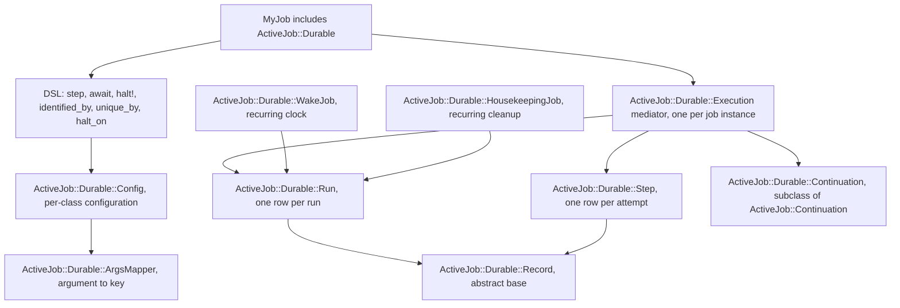
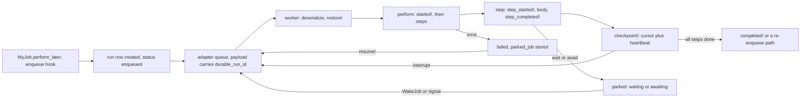

# 01 -- Architecture: the mediator and its records

AJ/DC is a thin layer between a job class and its run row. Three ideas carry the whole design: a concern (`ActiveJob::Durable`) that owns the public DSL and installs Active Job hooks; a mediator (`ActiveJob::Durable::Execution`) that translates between the in-flight job and the database; and two Active Record models (`Run` and `Step`) that are the durable state. This document follows one run end to end.

## The layers



Every box is a single file under `lib/active_job/durable/`, and every one is autoloaded from the concern (`lib/active_job/durable.rb:35-43`). The design rule is that only the concern talks to Active Job, and only the mediator talks to the database. Job code never touches `Run` or `Step` directly; it declares steps and lets the hooks do the rest.

## The concern: hooks plus DSL

`ActiveJob::Durable` is an `ActiveSupport::Concern` that includes `ActiveJob::Continuable::Callbacks` and, in its `included` block, wires itself into the job's lifecycle (`lib/active_job/durable.rb:111-123`):

```ruby
included do
  self.continuation_class = Continuation

  # Ensure run checkpoints are written before any other callback
  around_step(prepend: true) { |_job, block| durable_job.step(&block) }

  # Add our hook before Continuable's `around_perform :continue`,
  # so we can wrap it
  around_perform(prepend: true) { |_job, block| durable_job.perform(&block) }

  after_discard { |_job, error| durable_job.record_discard(error) }
  rescue_from(Halt) { |error| durable_job.halted!(error) }
end
```

The two `prepend: true` callbacks matter. The step wrapper must run before any user `around_step`, and the perform wrapper must run before Continuable's own `around_perform :continue`, so the durable layer wraps the continuation layer rather than the other way around. The remaining hooks close the gap for `discard_on` and `halt!`.

The concern also owns the DSL. `step` adds timer options on top of Continuable's signature (`lib/active_job/durable.rb:192-196`), `await` is a step whose body is a signal handler (`lib/active_job/durable.rb:210-213`), `halt!` raises a `Halt` exception that the `rescue_from` above converts into a `halted` row (`lib/active_job/durable.rb:217-221`). The class macros `identified_by`, `unique_by` and `halt_on` all delegate into a per-class `Config` object, which is inherited and duplicated on subclassing (`lib/active_job/durable.rb:125-168`).

The `deserialize` path is the crux of durability. After the base deserialization runs, the concern restores from the row (`lib/active_job/durable.rb:230-244`):

```ruby
def serialize = durable_job.serialize(super) # :nodoc:

def deserialize(job_data) # :nodoc:
  super
  durable_job.deserialize(job_data)
end

def perform_now = durable_job.perform_now { super } # :nodoc:

private

def durable_job = @durable_job ||= Execution.new(self)

def deserialize_arguments_if_needed
  super
  durable_job.restore!
end
```

Note `deserialize_arguments_if_needed`: the run must be restored *after* arguments are deserialized (so the row can be looked up by `active_job_id`) and *before* `perform` runs.

## The mediator: the single source of truth

`ActiveJob::Durable::Execution` is marked `# :nodoc:` but is the heart of the gem. It is created lazily, one per job instance, and holds the job and, once loaded, the run (`lib/active_job/durable/execution.rb:8-18`). Its job is to keep the row in sync with execution, and to fail loudly when a concurrent write changed the row first.

`restore!` rebuilds everything the payload used to carry (`lib/active_job/durable/execution.rb:36-55`):

```ruby
def restore!
  run_id, @serialized_run_id = @serialized_run_id, nil
  return unless run_id

  run = Run.find_by(id: run_id, active_job_id: job.job_id)
  raise RunNotFoundError, "Run #{run_id} for #{job.class.name} (Job ID: #{job.job_id}) was not found" unless run

  @run = run
  @state_written = run.serialized_state
  @deadline, @deadline_step = run.wake_at, run.current_step
  job.resumptions = run.resumptions
  job.continuation = job.continuation_class.new(job, serialized_progress(run))
  # A run that starts from its parked job was re-enqueued by `resume!` (or by
  # the backend), not by Continuation, so it is not one of its resumptions;
  # `continue` still adds one when the run has progress, so we need to adjust
  job.resumptions -= 1 if run.parked_job.present? && job.continuation.started?
  if run.state.present? && job.respond_to?(:deserialize_attribute_values, true)
    job.send(:deserialize_attribute_values, run.serialized_state)
  end
end
```

If the row is missing -- or belongs to another job id -- the job raises `RunNotFoundError`, which is a normal `StandardError` so the job's own `retry_on`, `discard_on` and `rescue_from` handlers can see it. The `resumptions -= 1` adjustment is a subtle correctness detail: a run re-enqueued from its parked job is a *resume* by AJ/DC, not by Continuable, so Continuable's `continue` would double-count it.

Execution is then wrapped around every stage. `perform` wraps Continuable's `continue` (`lib/active_job/durable/execution.rb:84-94`):

```ruby
def perform
  return if run&.terminal? # cancelled while the job was in the queue

  @resumed = false
  @parked = false
  started! or return # false means skip due to the uniqueness constraints
  yield
  completed! unless @resumed
rescue Cancelled
  # `Run#cancel!` ended the run; nothing happens after
end
```

`step` wraps each step's body (`lib/active_job/durable/execution.rb:97-110`):

```ruby
def step
  step, options = job.current_step, job.continuation.step_options
  wait!(step, **options.slice(:wait, :wait_until, :await)) if options.values_at(:wait, :wait_until, :await).any?
  step_started!(step, **options.slice(:isolated, :await))
  begin
    yield
    step_completed!(step)
  rescue Exception => error # rubocop:disable Lint/RescueException
    step_stopped!(step, error)
    raise
  end
ensure
  @step = nil
end
```

The `step` wrapper (`execution.rb:97-110`) and `perform_now` (`67-75`) rescue `Exception`, not `StandardError`, because the control-flow signals `Halt` and `Cancelled` inherit from `Exception` directly (they must pass through `retry_on`/`rescue_from` untouched); the `perform` wrapper (`84-94`) rescues only `Cancelled`. The `step` wrapper maps the outcome into a step row: `step_started!` writes `current_step` and creates the attempt row, `step_completed!` appends to `completed_steps` and clears `current_step`, and `step_stopped!` records `interrupted`, `cancelled`, `halted` or `failed` with the error, depending on what was raised (`lib/active_job/durable/execution.rb:304-359`).

## Guarded writes: last write wins, within a status

Every write goes through one of two helpers. `write_run` applies an optimistic `if_status:` guard -- the update only lands if the row still has that status -- and returns whether it landed (`lib/active_job/durable/execution.rb:291-302`):

```ruby
def write_run(if_status: nil, **attributes)
  run = self.run or return true

  @state_written = attributes[:state] if attributes.key?(:state)
  scope = Run.where(id: run.id)
  scope = scope.where(status: if_status) if if_status
  scope.update_all(**attributes, updated_at: Time.current).positive?
end

def write_running!(**attributes)
  write_run(if_status: "running", **attributes) or raise Cancelled, "Run #{run.id} was cancelled"
end
```

This is the concurrency model. Two workers can never both "win": a worker whose guarded write returns false knows another caller ended or moved the run first, and raises `Cancelled`, which the `perform` wrapper swallows. The same guard protects `cancel!`, `resume!` and `wake_up` on the `Run` model, using `update_all` on a status-scoped relation (`lib/active_job/durable/run.rb:108-116`):

```ruby
def cancel!
  now = Time.current
  updated = self.class.where(id:, status: CANCELLABLE_STATUSES).update_all(
    status: "cancelled", active_key: nil, parked_job: nil, finished_at: now, transitioned_at: now, updated_at: now
  )
  raise NotCancellable, "Run #{id} is #{reload.status}; a terminal run cannot be cancelled" if updated.zero?

  reload
end
```

A run that was already cancelled (or completed) returns zero updated rows, and the caller gets `NotCancellable` instead of a silent no-op.

## The run model and its helpers

`ActiveJob::Durable::Run` is the public record. It defines the nine statuses and their groupings, one scope per status plus group scopes, and the `for`, `at_step`, `stuck_for` and `due` query scopes (`lib/active_job/durable/run.rb:8-13`, `46-66`). Its instance methods are the operational verbs: `resume!` re-enqueues a halted or failed run in place, `cancel!` ends a non-terminal run, `wake_up` delivers a signal, and `reenqueue_parked_job!` performs the one status-guarded transition back to `enqueued` and then re-enqueues the parked job after all open transactions commit (`lib/active_job/durable/run.rb:149-162`):

```ruby
def reenqueue_parked_job!(from:, **changes) # :nodoc:
  now = Time.current
  updated = self.class.where(id:, status: from).update_all(
    status: "enqueued", error_class: nil, error_message: nil, halt_reason: nil,
    finished_at: nil, transitioned_at: now, updated_at: now, **changes
  )
  return false if updated.zero?

  reload
  job = ActiveJob::Base.deserialize(parked_job)
  job.scheduled_at = nil # a retry's or a resume's delay does not carry over
  ActiveRecord.after_all_transactions_commit { job.enqueue }
  true
end
```

The class-level `wake_due` and `clear_terminal` methods are what the two recurring jobs call, so the clock and the cleanup logic live on the model and the jobs are one-liners (`lib/active_job/durable/wake_job.rb`, `lib/active_job/durable/housekeeping_job.rb`).

## One run, end to end



The invariant that makes this correct is stated in the header: the rows are written before the job is re-enqueued, in every path. When the worker returns control to the adapter, the database already reflects whatever the adapter is being told to do next.

## The Aha Moment

**Aha:** AJ/DC does not add a state machine alongside Active Job; it *mediates* between two things that were already there -- the in-flight job object and the row. The `Execution` object is the only component allowed to touch the run row, and it always writes through a status-guarded update. That is why cancellation, resumption and signals can all be "last write wins" operations with a single guard clause: if the guard returns false, some other caller ended or moved the run first, and the current caller either raises a precise error (`NotCancellable`, `NotResumable`, `NotLive`) or raises `Cancelled` and stops. The whole concurrency story is one helper (`write_run` with `if_status:`), applied consistently.

## Where this sits on top of Continuable

Everything in this document assumes the step and continuation semantics of Rails' `ActiveJob::Continuable`, which AJ/DC subclasses rather than replaces. [02-continuable-foundation.md](./02-continuable-foundation.md) examines that foundation in detail. For the database itself, see [04-data-model.md](./04-data-model.md).

Continue to [02-continuable-foundation.md](./02-continuable-foundation.md).
