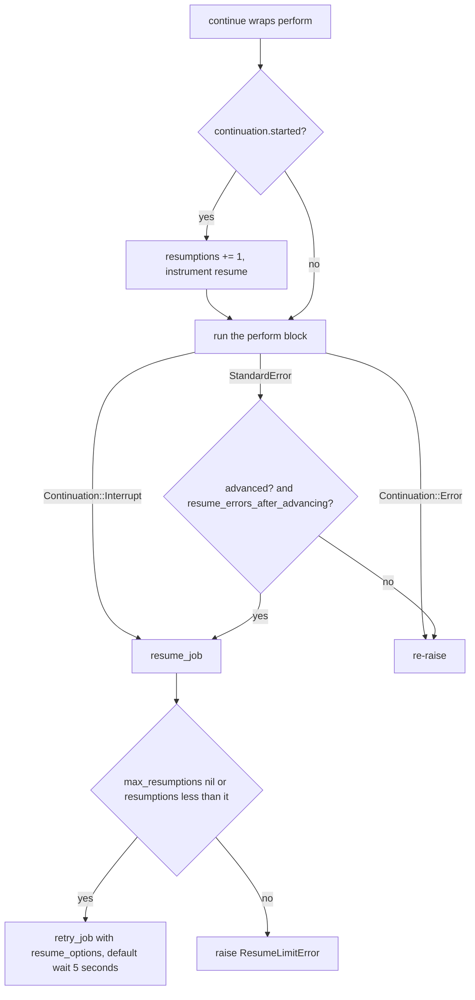
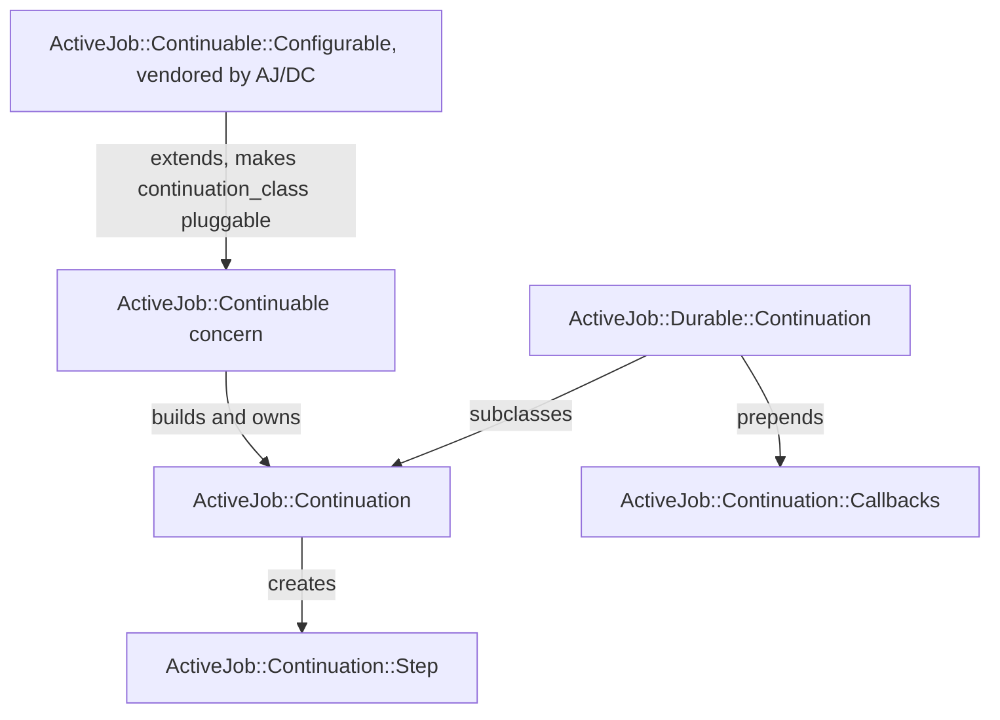

# 02 -- The Continuable foundation

AJ/DC does not reimplement continuation. It subclasses the continuation machinery that Rails 8.1 ships in Active Job, and changes only where durability requires it. To understand what the durable layer does, you first need the upstream foundation: `ActiveJob::Continuable`, `ActiveJob::Continuation` and `ActiveJob::Continuation::Step`. This document reads them from the installed `activejob-8.1.4` gem under `lib/active_job/`, which is the exact version AJ/DC builds against.

## The Continuable module: the job's side

`ActiveJob::Continuable` is an `ActiveSupport::Concern` a job includes. Its `included` block installs three class attributes and the resume loop (`lib/active_job/continuable.rb:16-28`):

```ruby
included do
  class_attribute :max_resumptions, instance_writer: false
  class_attribute :resume_options, instance_writer: false, default: { wait: 5.seconds }
  class_attribute :resume_errors_after_advancing, instance_writer: false, default: true

  around_perform :continue

  def initialize(...)
    super(...)
    self.resumptions = 0
    self.continuation = Continuation.new(self, {})
  end
end
```

Three facts matter. `max_resumptions` has no default, so it is `nil`, meaning unlimited resumes. `resume_options` defaults to `{ wait: 5.seconds }`, the keyword options passed to `retry_job` on every resume. `resume_errors_after_advancing` defaults to `true`, so an ordinary error raised *after* progress resumes the job instead of failing it. The whole module is one `around_perform` callback named `continue`.

The `step` DSL builds a block from a method name when no block is given, checks that the method takes zero or one positional argument and no keywords, and then defers to the continuation (`lib/active_job/continuable.rb:36-50`):

```ruby
def step(step_name, start: nil, isolated: false, &block)
  unless block_given?
    step_method = method(step_name)

    raise ArgumentError, "Step method '#{step_name}' must accept 0 or 1 arguments" if step_method.arity > 1

    if step_method.parameters.any? { |type, name| type == :key || type == :keyreq }
      raise ArgumentError, "Step method '#{step_name}' must not accept keyword arguments"
    end

    block = step_method.arity == 0 ? -> (_) { step_method.call } : step_method
  end
  checkpoint! if continuation.advanced?
  continuation.step(step_name, start: start, isolated: isolated, &block)
end
```

The line `checkpoint! if continuation.advanced?` is the *automatic checkpoint before each step*: after the first step of an execution has completed (or a cursor has moved), reaching the next step checks whether the queue adapter wants the job to stop.

`checkpoint!` and `interrupt!` are the mechanism (`lib/active_job/continuable.rb:62-69`):

```ruby
def checkpoint! # :nodoc:
  interrupt!(reason: :stopping) if queue_adapter.stopping?
end

def interrupt!(reason:) # :nodoc:
  instrument :interrupt, reason: reason, **continuation.instrumentation
  raise Continuation::Interrupt, "Interrupted #{continuation.description} (#{reason})"
end
```

`Interrupt` inherits from `Exception`, not `StandardError`, precisely so the job's own `retry_on` and `rescue_from` handlers never catch it.

The resume loop, `continue`, is the module's core (`lib/active_job/continuable.rb:72-89`):

```ruby
def continue(&block)
  if continuation.started?
    self.resumptions += 1
    instrument :resume, **continuation.instrumentation
  end

  block.call
rescue Continuation::Interrupt => e
  resume_job(e)
rescue Continuation::Error
  raise
rescue StandardError => e
  if resume_errors_after_advancing? && continuation.advanced?
    resume_job(e)
  else
    raise
  end
end
```



Two classes of problem resume the job: a `Continuation::Interrupt` (always), and a plain `StandardError` (only if progress was made and resuming after advancing is enabled). A `Continuation::Error` is a programming mistake and propagates. `resume_job` records the execution, then either calls `retry_job` with the configured options or raises `ResumeLimitError` when the resumption budget is spent (`lib/active_job/continuable.rb:91-98`).

## The Continuation class: the state

`ActiveJob::Continuation` is the object that knows the progress. Its constructor takes the job and a serialized progress hash and rebuilds the in-memory state (`lib/active_job/continuation.rb:214-222`):

```ruby
def initialize(job, serialized_progress) # :nodoc:
  @job = job
  @completed = serialized_progress.fetch("completed", []).map(&:to_sym)
  @current = new_step(*serialized_progress["current"], resumed: true) if serialized_progress.key?("current")
  @encountered = []
  @advanced = false
  @running_step = false
  @isolating = false
end
```

The state is six fields:

- `completed` -- the names of finished steps, as symbols.
- `current` -- the step that was in progress when the job was serialized, rebuilt with `resumed: true`, or nil.
- `encountered` -- the names seen so far in *this* execution, used by validation.
- `advanced` -- whether progress was made this execution (a step completed or a cursor moved).
- `running_step` -- whether a step body is currently executing, used to reject nesting.
- `isolating` -- whether the run is in an isolated-step boundary, used to interrupt before and after isolated steps.

The `step` entry point validates the name, records it as encountered, and either skips it (already completed) or runs it (`lib/active_job/continuation.rb:224-233`):

```ruby
def step(name, **options, &block) # :nodoc:
  validate_step!(name)
  encountered << name

  if completed?(name)
    skip_step(name)
  else
    run_step(name, **options, &block)
  end
end
```

This is why a resumed job re-executes the code *outside* steps but skips completed steps: `perform` runs again, each `step :name` line runs again, but completed steps are short-circuited. Isolation is handled in `run_step` (`lib/active_job/continuation.rb:289-297`):

```ruby
def run_step(name, start:, isolated:, &block)
  @isolating ||= isolated

  if isolating? && advanced?
    job.interrupt!(reason: :isolating)
  else
    run_step_inline(name, start: start, &block)
  end
end
```

An isolated step interrupts *before* it runs if progress was already made (so the step starts in a fresh execution with progress serialized), and the `advanced` flag set after it completes causes the *next* step to interrupt too. The actual execution is `run_step_inline` (`lib/active_job/continuation.rb:299-313`): it marks the step running, reuses the current step or creates a fresh one, calls the block with the step, then records the completion and sets `advanced`.

`to_h` produces the payload form (`{"completed" => [...], "current" => [name, cursor]}`), and `instrumentation` exposes `description`, `completed_steps` and `current_step` for Active Support notifications and for the durable layer's queries (`lib/active_job/continuation.rb:235-264`).

## The Step class: the cursor

`ActiveJob::Continuation::Step` is what a step block receives. It has a `name` and a `cursor`, and three operations (`checkpoint!`, `set!`, `advance!`) plus two predicates (`resumed?`, `advanced?`) (`lib/active_job/continuation/step.rb:35-69`):

```ruby
def checkpoint!
  job.checkpoint!
end

def set!(cursor)
  @cursor = cursor
  checkpoint!
end

def advance!(from: nil)
  from = cursor if from.nil?

  begin
    to = from.succ
  rescue NoMethodError
    raise UnadvanceableCursorError, "Cursor class '#{from.class}' does not implement 'succ'"
  end

  set! to
end
```

`set!` assigns the cursor and checkpoints. `advance!` calls `succ` on the cursor and checkpoints with the successor; if the cursor has no `succ`, it raises `UnadvanceableCursorError`. The `from:` keyword lets iteration over non-contiguous record ids advance to an explicit value. Every one of these operations ends in a checkpoint, which is the place a job can be interrupted. `resumed?` reports whether the step was rebuilt from a previous execution, and `advanced?` compares the cursor to its initial value (`lib/active_job/continuation/step.rb:62-69`).

## The validation rules

`ActiveJob::Continuation::Validation` enforces five invariants, all raising `InvalidStepError` (`lib/active_job/continuation/validation.rb:7-13`):

```ruby
def validate_step!(name)
  validate_step_symbol!(name)
  validate_step_not_encountered!(name)
  validate_step_not_nested!(name)
  validate_step_resume_expected!(name)
  validate_step_expected_order!(name)
end
```

- **Symbol** -- the name must be a `Symbol` (`validate_step_symbol!`).
- **Not encountered** -- the same name cannot appear twice in one execution (`validate_step_not_encountered!`).
- **Not nested** -- a step cannot begin while another step body is running (`validate_step_not_nested!`).
- **Resume expected** -- on a resumed run, the first step reached must be the one in progress, unless it is already completed (`validate_step_resume_expected!`).
- **Expected order** -- if a run has more completed steps than this execution has encountered, the next step must match the next completed name, so reordering steps after a deploy fails loudly (`validate_step_expected_order!`).

Together these make a step graph that is linear and deterministic: a run replays the same steps in the same order on every execution, and any edit that breaks that replay is a hard error rather than silent corruption.

## The test helper

`ActiveJob::Continuation::TestHelper` provides `interrupt_job_during_step` and `interrupt_job_after_step`, which install a `stopping:` predicate on the test adapter that fires when the job's serialized continuation matches a given step (and cursor), so tests can interrupt at an exact point (`lib/active_job/continuation/test_helper.rb:36-68`).

The class relationships, including where AJ/DC subclasses, look like this:



## What AJ/DC layers on top

AJ/DC reuses all of this and changes three things.

First, `ActiveJob::Durable::Continuation` subclasses `ActiveJob::Continuation` and prepends its own callbacks, adding a `step_options` reader and a `run_step` override that accepts `wait:`, `wait_until:` and `await:` alongside `start:` and `isolated:` (`lib/active_job/durable/continuation.rb:7-22`):

```ruby
class Continuation < ActiveJob::Continuation
  prepend ActiveJob::Continuation::Callbacks

  # The options of the running step (`isolated:`, `wait:`, `wait_until:`,
  # `await:`), `nil` between steps.
  attr_reader :step_options

  private

  def run_step(name, start:, isolated:, wait: nil, wait_until: nil, await: false, &block)
    @step_options = {isolated:, wait:, wait_until:, await:}
    super(name, start:, isolated:, &block)
  ensure
    @step_options = nil
  end
end
```

The extra options ride through to the durable `step` wrapper, which reads `step_options` to know whether to park the run before running the step.

Second, `ActiveJob::Continuable::Configurable` (a module AJ/DC vendors under its own `lib/active_job/continuable/`) makes the continuation class pluggable with a `class_attribute :continuation_class`, and `ActiveJob::Durable` sets it to its own subclass. It also moves `step`-block resolution into a reusable `step_method_block` helper (`lib/active_job/continuable/configurable.rb:40-72`).

Third, `ActiveJob::Continuation::Callbacks` and `ActiveJob::Continuable::Callbacks` add `before_step`, `after_step` and `around_step` around each step body, with `current_step` reading the running step. AJ/DC uses these hooks for its own `around_step` (to wrap each step in the durable row writes) and exposes them to applications (`lib/active_job/continuable/callbacks.rb:24-33`, `lib/active_job/continuation/callbacks.rb:11-16`).

Finally, `ActiveJob::Continuation::RescueHandlersFirst` is prepended to `ActiveJob::Continuable` by the Railtie so that the job's own `discard_on`, `retry_on` and `rescue_from` handlers get precedence over Continuable's catch-all resume-after-error behavior: when a handler exists for the error, `resume_job` re-raises it and the normal handler runs (`lib/active_job/continuation/rescue_handlers_first.rb:21-26`).

## The Aha Moment

**Aha:** "Making progress" is not a fuzzy notion in Continuable; it is a single boolean, `continuation.advanced?`, which becomes true when a step completes or when a cursor moves (`set!`/`advance!`). That one flag is the load-bearing condition for the entire error policy: `continue` resumes a `StandardError` only when `resume_errors_after_advancing? && continuation.advanced?`. A job that raises before any progress fails immediately and loses nothing; a job that raises after progress re-enqueues with the progress serialized. Everything else -- automatic checkpoints before steps, isolated-step interrupts, the validation that makes replay deterministic -- exists to make sure that flag, and the state behind it, can be reconstructed exactly on the next execution. The durable layer later replaces the payload with a row, but it inherits this exact definition of progress unchanged.

## Where this goes next

The foundation described here is what [01-architecture.md](./01-architecture.md) wraps in database writes, and [00-overview.md](./00-overview.md) motivates. Installing the gem and the two tables it uses is covered in [03-installation-and-setup.md](./03-installation-and-setup.md).

Continue to [03-installation-and-setup.md](./03-installation-and-setup.md).
