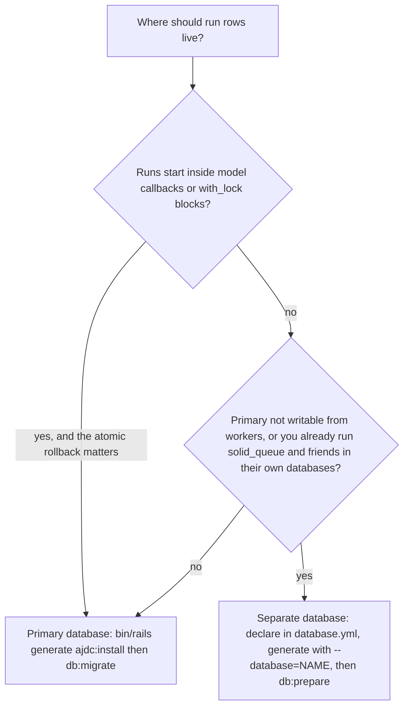
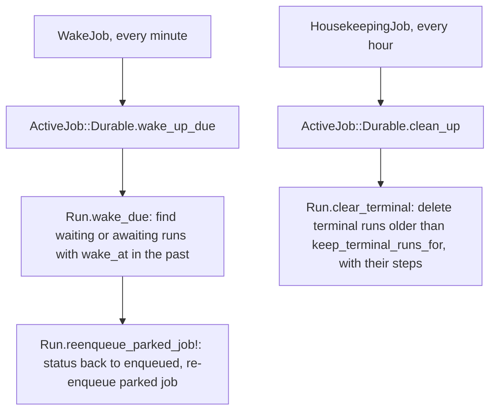

# 03 -- Installation and setup

AJ/DC installs like any Rails gem, but it owns a small piece of the application's data layer: two tables and a recurring clock. This document covers the gem dependency, the generator, the database placement decision, the initializer, and the two scheduled jobs. The architecture those pieces plug into is in [01-architecture.md](./01-architecture.md); the exact columns the generator creates are in [04-data-model.md](./04-data-model.md).

## Adding the gem

The gem is named `ajdc`. Add it with Bundler (`README.md`):

```bash
bundle add ajdc
```

The requirements are Ruby (MRI) 3.3 or newer, Rails 8.1 or newer, and SQLite, PostgreSQL or MySQL (`ajdc.gemspec:29-34` pins `activerecord`, `activejob` and `railties` to `>= 8.1`). The `attribute` DSL on jobs is provided by `ActiveJob::Attributes`, which exists only in Rails 8.2 and later; on Rails 8.1 a durable job works but has no typed attributes to persist (`README.md:57-61`). The test matrix runs Rails 8.1 and Rails main on SQLite, and Rails 8.2 on SQLite, PostgreSQL and MySQL, against Ruby 3.3, 3.4 and 4.0 (`.github/workflows/test.yml:20-33`).

## The install generator

One command creates the migration (`lib/generators/ajdc/install/install_generator.rb:16-32`):

```ruby
class InstallGenerator < Rails::Generators::Base
  include ActiveRecord::Generators::Migration

  source_root File.expand_path("templates", __dir__)

  class_option :database, type: :string, aliases: %i[--db],
    desc: "The database for the tables. By default, the current environment's primary database is used."

  def create_migration_file
    migration_template "create_active_job_durable_tables.rb.tt", File.join(db_migrate_path, "create_active_job_durable_tables.rb")
  end

  def create_initializer
    return unless options[:database]

    template "initializer.rb.tt", "config/initializers/active_job_durable.rb"
  end
```

The default invocation, `bin/rails generate ajdc:install`, writes one migration into `db/migrate` and creates nothing else -- the tables live in the primary database. With `--database=durable`, the migration lands in that database's `migrations_paths` (the conventional `db/durable_migrate` if the database is not declared yet) and an initializer is also written. The generator ends with a printed reminder to add the database to `config/database.yml` when it is not declared yet (`lib/generators/ajdc/install/install_generator.rb:34-48`).

The migration template is a thin wrapper over the gem's own canonical schema (`lib/generators/ajdc/install/templates/create_active_job_durable_tables.rb.tt`): it creates `active_job_durable_runs` and `active_job_durable_steps` with `if_not_exists: true`, no database defaults (so the same file loads on all three adapters), and the six run indexes plus two step indexes. The gem's own test suite loads the identical definition from `db/durable_schema.rb`, so the shipped migration and the tested schema never drift apart.

```bash
bin/rails generate ajdc:install
bin/rails db:migrate
```

## The database decision: one or two

The only decision worth pausing on is where the two tables live, because it changes transaction semantics. The choice is between the primary database and a separate one (the Solid Queue pattern), and the trade-off is documented in the shipped skill (`skills/ajdc/references/installation.md:12-27`):



The reason is the enqueue hook. The run row is created inside `enqueue`, before the adapter is called, and when enqueuing is deferred to after commit the row participates in the caller's transaction. On the primary database, a rollback removes the record *and* the run row together; on a separate database the two are separate transactions, and a rollback can leave an orphaned `enqueued` run. The recommendation in the skill is the primary database unless there is a stated reason not to.

The separate-database path works exactly like Solid Queue's. Declare the database in `config/database.yml` with its own `migrations_paths`, then generate with its name:

```yaml
production:
  primary:
    <<: *default
  durable:
    <<: *default
    database: storage/production_durable.sqlite3
    migrations_paths: db/durable_migrate
```

```bash
bin/rails generate ajdc:install --database=durable
bin/rails db:prepare
```

The generated initializer points AJ/DC at that database (`lib/generators/ajdc/install/templates/initializer.rb.tt:3-4`):

```ruby
# ActiveJob::Durable keeps its runs and steps in the "<%= options[:database] %>" database.
Rails.application.config.active_job_durable.connects_to = { database: { writing: :<%= options[:database] %> } }
```

The rendered file for the example above sets `config.active_job_durable.connects_to = { database: { writing: :durable } }`.

## The Railtie: configuration plumbing

The Railtie is what makes `config.active_job_durable` real (`lib/ajdc/railtie.rb:6-23`):

```ruby
class Railtie < ::Rails::Railtie # :nodoc:
  # Every option is an `ActiveJob::Durable` setting:
  #
  #   config.active_job_durable.connects_to = { database: { writing: :durable } }
  #   config.active_job_durable.keep_terminal_runs_for = 30.days
  config.active_job_durable = ActiveSupport::OrderedOptions.new

  # After the config initializers, so that an initializer can set them too.
  initializer "ajdc.config", after: :load_config_initializers do |app|
    app.config.active_job_durable.each { |name, value| ActiveJob::Durable.public_send(:"#{name}=", value) }
  end

  initializer "ajdc.rescue_handlers_first" do
    ActiveSupport.on_load(:active_job_continuable) do
      prepend ActiveJob::Continuation::RescueHandlersFirst
    end
  end
end
```

`config.active_job_durable` is an `ActiveSupport::OrderedOptions`, and every key is applied verbatim to a setter on `ActiveJob::Durable` *after* the config initializers run, so an initializer can set them either way. The two settings are `connects_to` (no default) and `keep_terminal_runs_for` (default `14.days`, `nil` keeps runs forever), both declared as `mattr_accessor` on the concern (`lib/active_job/durable.rb:45-49`). The abstract base class consumes `connects_to` when the models load (`lib/active_job/durable/record.rb:5-15`):

```ruby
class Record < ActiveRecord::Base
  self.abstract_class = true
  self.strict_loading_by_default = false

  connects_to(**Durable.connects_to) if Durable.connects_to
end
```

The Railtie's second initializer prepends `ActiveJob::Continuation::RescueHandlersFirst` to `ActiveJob::Continuable` when it loads, giving a job's own `discard_on`, `retry_on` and `rescue_from` precedence over the continuation layer's resume-after-error behavior (see [02-continuable-foundation.md](./02-continuable-foundation.md)).

## The clock and the cleaner: two recurring jobs

Two pieces of the system do not run unless you schedule them. Timers and signal deadlines are woken by `ActiveJob::Durable::WakeJob`, and old terminal runs are deleted by `ActiveJob::Durable::HousekeepingJob`. Both are one-line jobs over model methods (`lib/active_job/durable/wake_job.rb:12-14`, `lib/active_job/durable/housekeeping_job.rb:12-14`):

```ruby
class WakeJob < ActiveJob::Base
  def perform = Durable.wake_up_due
end
```

```ruby
class HousekeepingJob < ActiveJob::Base
  def perform = Durable.clean_up
end
```

With Solid Queue recurring tasks, add them to `config/recurring.yml` (`README.md:315-320` and `README.md:381-386`):

```yaml
# config/recurring.yml
durable_wake:
  class: ActiveJob::Durable::WakeJob
  schedule: every minute

durable_housekeeping:
  class: ActiveJob::Durable::HousekeepingJob
  schedule: every hour
```



`wake_up_due` wakes each due run exactly once and returns the count; it is also safe to call directly in tests inside `travel_to`. The interval of the wake job is the precision of every `wait:`, `wait_until:` and `await` deadline. `clean_up` returns `0` and deletes nothing when `keep_terminal_runs_for` is `nil`; otherwise it removes terminal runs (and their steps) that ended before the retention cutoff, one batch per transaction, and never touches `failed` or `halted` runs.

## Verifying the install

The skill's verification step is two one-liners (`skills/ajdc/references/installation.md:85-93`):

```bash
bin/rails runner 'puts ActiveJob::Durable::Run.count'   # 0, no error
bin/rails runner 'puts ActiveJob::Durable.wake_up_due'  # 0, no error
```

Then convert one job (`include ActiveJob::Durable` in place of `ActiveJob::Continuable`), run its tests, enqueue it once, and read `MyJob.workflow_runs.last`. The step DSL, cursors and attributes behave the same, so an existing continuable job should pass its tests unchanged (`README.md:63-67`).

## The agent skill

The gem ships a coding-agent skill in `skills/ajdc/`, following the skills.sh layout. Its `SKILL.md` is a decision procedure: it decides whether a workflow is the right tool, recognizes the durable shape in existing code, and then walks through implementing it, with do-not rules at the end. `references/installation.md` is the expanded version of this document, and `references/` also holds API, testing, transactions and decision-guide references. With Rails Hyperdrive the skill installs itself; otherwise `npx skills add palkan/ajdc` or copying `skills/ajdc` into the agent's skills directory works (`README.md:22-33`).

## The Aha Moment

**Aha:** The entire installation is one generator and two scheduled jobs, and the only real decision is *where* the tables live -- not because of scale, but because of transactions. The run row is written inside `enqueue`, before the adapter is called, and when enqueuing is deferred to after commit the row commits or rolls back with the surrounding transaction. On the primary database that gives you atomicity for free: the business record and the run row live or die together. On a separate database they do not, and a rollback can strand an `enqueued` run. So "primary versus separate" is really "do you need the run row to roll back with the model that started it, or are you willing to guard for orphans." Everything else -- the migration, the initializer, the wake clock -- is mechanical.

Continue to [04-data-model.md](./04-data-model.md).
