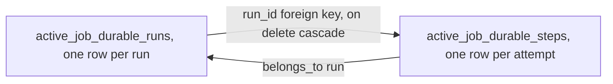
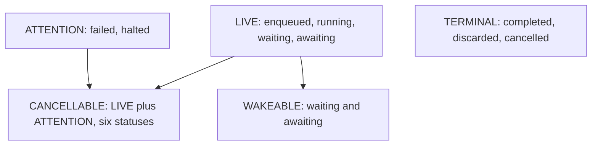
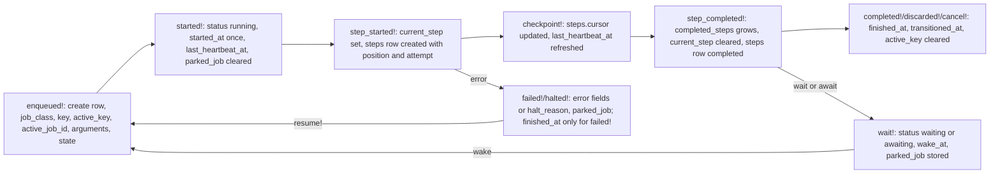

# 04 -- The data model

AJ/DC's entire durable state lives in two tables. `active_job_durable_runs` holds one row per run, and `active_job_durable_steps` holds one row per step *attempt*. This document reads the canonical schema at `db/durable_schema.rb` and documents every column and index, then explains how the columns map to the run lifecycle described in [01-architecture.md](./01-architecture.md).

## The schema in one look



The runs table is created first (`db/durable_schema.rb:9-38`):

```ruby
create_table "active_job_durable_runs", if_not_exists: true do |t|
  t.string "job_class", null: false
  t.string "key", null: false
  t.string "active_key"
  t.string "active_job_id", null: false
  t.json "arguments", null: false
  t.string "status", null: false
  t.string "current_step"
  t.json "completed_steps", null: false
  t.json "state", null: false
  t.datetime "wake_at"
  t.json "pending_signals", null: false
  t.json "parked_job"
  t.integer "resumptions", default: 0, null: false
  t.datetime "last_heartbeat_at"
  t.string "error_class"
  t.text "error_message"
  t.string "halt_reason"
  t.datetime "started_at"
  t.datetime "finished_at"
  t.datetime "transitioned_at"
  t.timestamps

  t.index ["job_class", "active_key"], name: "index_active_job_durable_runs_on_active_key", unique: true
  t.index ["job_class", "key"], name: "index_active_job_durable_runs_on_key"
  t.index ["active_job_id"], name: "index_active_job_durable_runs_on_active_job_id", unique: true
  t.index ["status"], name: "index_active_job_durable_runs_on_status"
  t.index ["status", "wake_at"], name: "index_active_job_durable_runs_on_status_and_wake_at"
  t.index ["status", "transitioned_at"], name: "index_active_job_durable_runs_on_status_and_transitioned_at"
end
```

The steps table follows (`db/durable_schema.rb:40-56`):

```ruby
create_table "active_job_durable_steps", if_not_exists: true do |t|
  t.references "run", null: false, index: false,
    foreign_key: {to_table: "active_job_durable_runs", on_delete: :cascade}
  t.string "name", null: false
  t.integer "position", null: false
  t.integer "attempt", default: 1, null: false
  t.string "status", null: false
  t.json "cursor"
  t.boolean "isolated", default: false, null: false
  t.string "error_class"
  t.text "error_message"
  t.datetime "started_at"
  t.datetime "finished_at"

  t.index ["run_id", "name", "attempt"], name: "index_active_job_durable_steps_on_attempt", unique: true
  t.index ["run_id", "position"], name: "index_active_job_durable_steps_on_position"
end
```

The header comment sets the ground rules (`db/durable_schema.rb:3-7`): JSON columns hold Active Job-serialized values (`ActiveJob::Arguments.serialize`), nothing in them is indexed, and they carry no database defaults so the same file loads on SQLite, PostgreSQL and MySQL -- the models set the defaults.

## The runs table, column by column

The runs table has twenty explicit columns plus the two `t.timestamps` columns (`created_at`, `updated_at`). They fall into four groups.

### Identity

- `job_class` (string, not null) -- the run's class name, e.g. `"ImportJob"`. Every index that needs to scope by class starts with this column.
- `key` (string, not null) -- the run's *identity inside the class*: the workflow key. It is derived from the `identified_by` components (or the `unique_by` components when only `unique_by` is declared, or every argument when nothing is declared), and can be overridden per enqueue with `set(workflow_key:)`. Two runs of the same class may share a `key` (a renewal after a terminal run); `key` names the *workflow*, not the run.
- `active_key` (string, nullable) -- the run's *uniqueness* identity, from `unique_by`. At most one live or attention run of a class holds a given `active_key`; it is cleared when the run becomes terminal (or cancelled), freeing the key.
- `active_job_id` (string, not null) -- the Active Job `job_id`. This is how `restore!` finds the row on deserialize: it matches both the `durable_run_id` and the job id, so a payload pointing at someone else's run raises `RunNotFoundError`.
- `arguments` (json, not null) -- the serialized `perform` arguments, in Active Job argument form. It is stored for the digest-key fallback when a key must be computed from already-serialized arguments.

### Progress

- `status` (string, not null) -- one of the nine statuses, described below.
- `current_step` (string, nullable) -- the name of the step currently running, or parked on (waiting/awaiting/failed/halted). Cleared when a step completes and at completion.
- `completed_steps` (json, not null) -- the array of completed step names, e.g. `["validate", "process"]`. It is the durable twin of the continuation's `completed` list.
- `state` (json, not null) -- the typed attribute values (from `ActiveJob::Attributes`), in the argument form the attribute deserializer restores from. Detailed below.
- `resumptions` (integer, default 0, not null) -- the continuation's resumption count, persisted so it survives being stripped from the payload.

### Parking and waiting

- `wake_at` (datetime, nullable) -- when a `waiting` or `awaiting` run should be woken. This is the clock's column.
- `pending_signals` (json, not null) -- signals received before their `await` line was reached, keyed by signal name. When the step is reached, the signal is consumed from here.
- `parked_job` (json, nullable) -- the job's fully serialized form, parked on the row while the run is not in the queue (waiting, awaiting, failed, halted). Re-enqueueing deserializes this and enqueues it.

### Timing and diagnostics

- `last_heartbeat_at` (datetime, nullable) -- written by `started!`, `checkpoint!`, `step_completed!` and `resume!`, not at every step boundary. `stuck_for` reads `running` runs by this column to find dead workers.
- `error_class` / `error_message` (string / text, nullable) -- the error that halted or failed (or discarded) the run; `halt_reason` (string, nullable) is the human-readable reason from `halt!(reason)`.
- `started_at` (datetime, nullable) -- set once, at the first execution. An `enqueued` run with no `started_at` has never run.
- `finished_at` (datetime, nullable) -- when the run ended (terminal or failed); a halted run keeps `finished_at` null.
- `transitioned_at` (datetime, nullable) -- the last status transition. A terminal row is never written again, so `transitioned_at` is its end time and doubles as the housekeeping cutoff.
- `created_at` / `updated_at` -- the standard Rails timestamps.

## The runs indexes, one by one

There are six, and each exists to serve exactly the query that uses it:

- `index_active_job_durable_runs_on_active_key`, **unique** on `[job_class, active_key]` -- enforces that one live/attention run holds an active key, and settles the race between two first enqueues: the loser's `INSERT` violates the unique index and re-looks (`lib/active_job/durable/execution.rb:204-213`).
- `index_active_job_durable_runs_on_key` on `[job_class, key]` -- serves `workflow_runs` and the `for` scope, which look up runs by class and derived key.
- `index_active_job_durable_runs_on_active_job_id`, **unique** on `[active_job_id]` -- serves the deserialize lookup in `restore!`, and guarantees one run per job id.
- `index_active_job_durable_runs_on_status` on `[status]` -- serves every status scope.
- `index_active_job_durable_runs_on_status_and_wake_at` on `[status, wake_at]` -- serves the `due` scope that the wake clock scans.
- `index_active_job_durable_runs_on_status_and_transitioned_at` on `[status, transitioned_at]` -- serves `clear_terminal` (terminal rows by end time) and the `enqueued` leg of `stuck_for`.

Note the shared shape: where a query filters by status plus a time, the index is `(status, time)` in that order, because the status equality is always the leading predicate.

## The steps table

The steps table has eleven columns: the `run_id` reference plus ten data columns, and no timestamps.

- `run_id` -- the owning run, via a foreign key to `active_job_durable_runs` with `on_delete: :cascade`. It is declared `index: false` because both composite indexes below already begin with `run_id`.
- `name` (string, not null) -- the step's name, e.g. `"process"`.
- `position` (integer, not null) -- the step's ordinal within the run, so a run's steps read back in execution order.
- `attempt` (integer, default 1, not null) -- the attempt number. A step that is interrupted, fails or halts and then re-enters gets a *new* row with the next attempt; the earlier rows keep their errors. The unique index below makes one row per `(run, name, attempt)`.
- `status` (string, not null) -- `started`, `completed`, `interrupted`, `cancelled`, `halted` or `failed`.
- `cursor` (json, nullable) -- the last committed cursor of that attempt, in Active Job argument serialization form. This is the durable twin of the continuation step's cursor.
- `isolated` (boolean, default false, not null) -- whether the step was declared `isolated: true`.
- `error_class` / `error_message` (string / text, nullable) -- the error that stopped the attempt, for failed or halted attempts.
- `started_at` / `finished_at` (datetime, nullable) -- the attempt's boundaries.

The two step indexes:

- `index_active_job_durable_steps_on_attempt`, **unique** on `[run_id, name, attempt]` -- one row per attempt of a named step, and it serves the "latest attempt" reads such as `Step.where(run_id:, name:).order(attempt: :desc).pick(:cursor, :attempt)` in `serialized_progress` (`lib/active_job/durable/execution.rb:163`).
- `index_active_job_durable_steps_on_position` on `[run_id, position]` -- serves the `has_many :steps` association, whose default order is `position, attempt` (`lib/active_job/durable/run.rb:40`).

## The `state` column and StateType

The `state` column is the subtle one. Its declared type is a custom `StateType` (`lib/active_job/durable/run.rb:18-36`):

```ruby
class StateType < ActiveRecord::Type::Json
  def deserialize(value)
    decoded = super
    decoded.present? ? ActiveJob::Arguments.deserialize([decoded]).first : {}
  end

  def serialize(value) = super(self.class.serialized(value))

  # The argument form of `value`; an already-serialized hash (marked with
  # `_aj_` keys) is returned as is.
  def self.serialized(value)
    value = value.to_h
    if value.each_key.any? { |key| key.to_s.start_with?("_aj_") }
      value
    else
      ActiveJob::Arguments.serialize([value]).first
    end
  end
end
```

The column stores the attribute values in *Active Job argument form* -- the exact form `ActiveJob::Attributes#deserialize_attribute_values` expects, with `_aj_` marker keys. On read, `Run#state` unwraps to a plain hash like `{"processed_count" => 128}`. On write, both forms are accepted: a plain hash is wrapped, an already-wrapped hash is passed through. `Run#serialized_state` exposes the argument form for `restore!` to hand to the job's attribute deserializer (`lib/active_job/durable/run.rb:92`). The model sets the default to `{}` (and `completed_steps` to `[]`, `pending_signals` to `{}`) in Ruby because the columns carry no database defaults (`lib/active_job/durable/run.rb:42-44`).

## Statuses, groups and scopes

There is no numeric status enum. The status is a plain string column, and the nine values are defined as string constants on the model (`lib/active_job/durable/run.rb:8-13`):

```ruby
LIVE_STATUSES = %w[enqueued running waiting awaiting].freeze
ATTENTION_STATUSES = %w[failed halted].freeze
TERMINAL_STATUSES = %w[completed discarded cancelled].freeze
STATUSES = (LIVE_STATUSES + ATTENTION_STATUSES + TERMINAL_STATUSES).freeze
CANCELLABLE_STATUSES = (LIVE_STATUSES + ATTENTION_STATUSES).freeze
WAKEABLE_STATUSES = %w[waiting awaiting].freeze
```



- **Live** -- `enqueued` (in the queue), `running` (a worker is executing), `waiting` (parked on a timer), `awaiting` (parked on a signal). A live run is actively in play.
- **Attention** -- `failed` (an error reached the backend) or `halted` (a `halt_on` error or an explicit `halt!`). These are paused and resumable, and are never deleted by housekeeping.
- **Terminal** -- `completed`, `discarded`, `cancelled`. The end of the line; a terminal row is never written again.
- **Cancellable** -- live plus attention: the six statuses from which `cancel!` can end a run.
- **Wakeable** -- `waiting` and `awaiting`: the statuses the clock scans.

The model defines a scope per status plus the group scopes, and the query scopes (`lib/active_job/durable/run.rb:46-66`):

```ruby
scope :newest_first, -> { order(created_at: :desc, id: :desc) }
scope :live, -> { where(status: LIVE_STATUSES) }
scope :attention, -> { where(status: ATTENTION_STATUSES) }
scope :terminal, -> { where(status: TERMINAL_STATUSES) }
STATUSES.each { |status| scope status, -> { where(status:) } }

scope :at_step, ->(name) { where(current_step: name.to_s) }
scope :stuck_for, ->(duration) {
  since = duration.ago
  where(status: "running").where(last_heartbeat_at: ...since)
    .or(where(status: "enqueued").where(transitioned_at: ...since))
    .or(where(status: WAKEABLE_STATUSES).where(wake_at: ...since))
}
scope :due, ->(now = Time.current) { where(status: WAKEABLE_STATUSES, wake_at: ..now) }
scope :for, ->(*args, **kwargs) {
  next where(key: kwargs[:workflow_key]) if kwargs.key?(:workflow_key)

  job_class = where_values_hash["job_class"] or raise ArgumentError, "for needs a job class; use MyJob.workflow_runs.for(...)"
  where(key: job_class.constantize.durable_config.workflow_key(*args, **kwargs))
}
```

The three index-backed scopes are `due` (the wake clock), `stuck_for` (dead workers and missed clocks) and the terminal leg of housekeeping's `clear_terminal` (terminal rows by `transitioned_at`).

## The columns as a lifecycle

Every column is written by a specific moment in the lifecycle, which is why the two tables read as a log of the run:



The invariant from the overview is visible in the columns: `parked_job` is written on every path that removes the run from the queue, and cleared on every path that puts it back, so the row always holds whatever the queue no longer does.

## The Aha Moment

**Aha:** The schema is deliberately *denormalized toward the read path*. Six run indexes, each matching exactly one query's predicate order, and no index on any JSON column -- because JSON columns hold Active Job-serialized values that are never filtered on, only round-tripped. The two "mystery" columns, `key` and `active_key`, are the load-bearing split: `key` names the workflow (many runs over time, one per renewal), while `active_key` names the *slot* (at most one live run at a time). The unique index on `[job_class, active_key]` turns uniqueness from an application-level check into a database constraint that also resolves the race between two simultaneous first enqueues. Everything the gem queries is a covered index; everything it serializes is a JSON blob.

## Where the schema comes from

The generator and the placement decision that produces these tables are in [03-installation-and-setup.md](./03-installation-and-setup.md). The next document, [05-steps-cursors-checkpoints.md](./05-steps-cursors-checkpoints.md), follows the step and cursor mechanics that fill these columns.

Continue to [05-steps-cursors-checkpoints.md](./05-steps-cursors-checkpoints.md).
