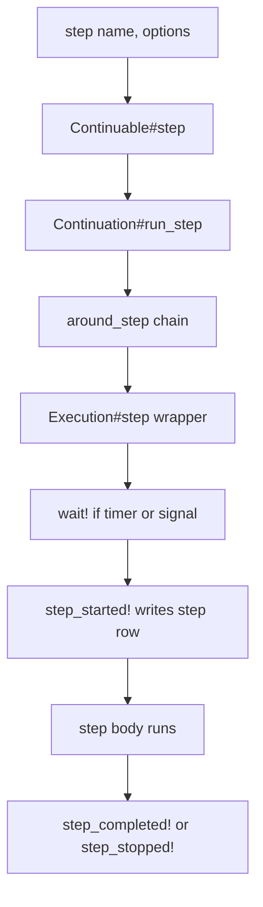
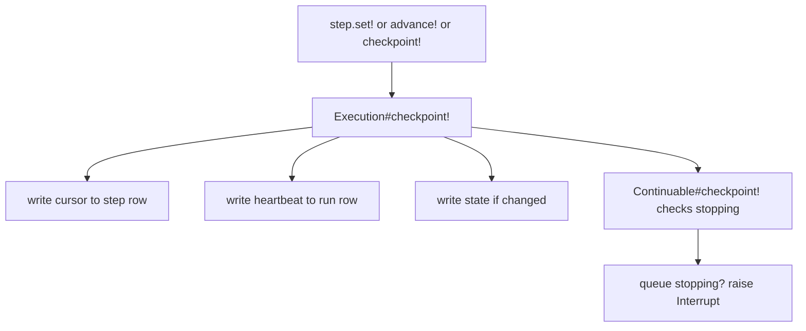

# 05 -- Steps, cursors, and checkpoints

A durable job expresses its work as a sequence of `step` calls. Each step has a
name, an optional cursor, and a set of options. The job is the same shape as an
`ActiveJob::Continuable` job; the difference is that every step also becomes a
row in the `active_job_durable_steps` table, and every cursor change is committed
to that row as the job runs. This document explains how a step runs, how its
cursor advances, and how a checkpoint commits progress so a crash loses only the
work since the last one.

The foundation is `ActiveJob::Continuable`, the part of Active Job that lets a
job interrupt and resume. If that is new, read
[02-continuable-foundation.md](./02-continuable-foundation.md) first. The tables
that hold the rows are described in
[04-data-model.md](./04-data-model.md).

## The step is the unit of progress

In `ActiveJob::Continuable`, a job's `perform` method lists steps in order. A
step is a name plus a block, or a name that matches a method on the job. When
the job is interrupted, steps that already completed are skipped on the next
execution, and the step that was running resumes with its last cursor. That
logic lives in `Continuation#step` in the Active Job gem.

AJ/DC keeps the same `step` method but adds two capabilities. First, it allows
timer options on a step. Second, it forces every step through a database wrapper.
The method in `lib/active_job/durable.rb` (lines 192-196) shows the timer part:

```ruby
def step(step_name, wait: nil, wait_until: nil, **, &block)
  raise ArgumentError, "Step '#{step_name}' takes wait: or wait_until:, not both" if wait && wait_until

  super
end
```

The `**` collects the options `ActiveJob::Continuable` already knows about,
`start:` and `isolated:`, and passes them through. The `wait:` and `wait_until:`
options are consumed later by the execution wrapper; they are the subject of
[09-timers.md](./09-timers.md). There is also an `await:` option, added by the
`await` helper, which is the subject of [10-signals.md](./10-signals.md).

## The wiring: one around_step to rule them all

The hook that makes every step durable is one `around_step` callback, registered
in the `included` block of the concern, in
`lib/active_job/durable.rb` (lines 111-123):

```ruby
included do
  self.continuation_class = Continuation

  # Ensure run checkpoints are written before any other callback
  around_step(prepend: true) { |_job, block| durable_job.step(&block) }

  # Add our hook before Continuable's `around_perform :continue`,
  # so we can wrap it
  around_perform(prepend: true) { |_job, block| durable_job.perform(&block) }

  after_discard { |_job, error| durable_job.record_discard(error) }
  rescue_from(Halt) { |error| durable_job.halted!(error) }
end
```

The `prepend: true` matters. Active Job step callbacks run in a chain: the
`before_step` callbacks, then the step body, then the `after_step` callbacks,
with any `around_step` callbacks wrapping the whole thing. Prepending means
`durable_job.step` becomes the outermost callback, so it wraps the user's
callbacks and the step body. The `block` passed to it is the rest of the chain.

Inside the step, `durable_job` is an `ActiveJob::Durable::Execution` instance,
one per job. Its `step` method, in
`lib/active_job/durable/execution.rb` (lines 97-110), is the actual wrapper:

```ruby
def step
  step, options = job.current_step, job.continuation.step_options
  wait!(step, **options.slice(:wait, :wait_until, :await)) if options.values_at(:wait, :wait_until, :await).any?
  step_started!(step, **options.slice(:isolated, :await))
  begin
    yield
    step_completed!(step)
  rescue Exception => error # rubocop:disable Lint/RescueException
    step_stopped!(step, error)
    raise
  end
ensure
  @step = nil
end
```

Two pieces of state make this possible. `job.current_step` is the running
`ActiveJob::Continuation::Step` object, exposed by the step-callbacks module in
`lib/active_job/continuable/callbacks.rb` (line 45). `job.continuation.step_options`
is the options of the running step, captured by the AJ/DC `Continuation` subclass
in `lib/active_job/durable/continuation.rb` (lines 16-21), which stores
`isolated:`, `wait:`, `wait_until:` and `await:` before delegating to the parent
`run_step`. Between steps, `current_step` is `nil` and `step_options` is `nil`.

The wrapper does three things. If the step has a timer or signal option, it first
calls `wait!`, which may park the run and stop execution before the step even
starts. It then calls `step_started!`, which writes the step row. Finally it runs
the body (`yield`), and on the way out calls `step_completed!` on success or
`step_stopped!` on any error, including an interrupt. The diagram shows the
chain:



## The cursor

A cursor is the loop position inside a step. It can be any value that Active Job
can serialize, and it defaults to `nil`. The step's own code uses the cursor to
resume from the right place. The cursor API lives in
`lib/active_job/continuation/step.rb` in the Active Job gem (lines 40-59):

```ruby
# Set the cursor and interrupt the job if necessary.
def set!(cursor)
  @cursor = cursor
  checkpoint!
end

# Advance the cursor from the current or supplied value
def advance!(from: nil)
  from = cursor if from.nil?

  begin
    to = from.succ
  rescue NoMethodError
    raise UnadvanceableCursorError, "Cursor class '#{from.class}' does not implement 'succ'"
  end

  set! to
end
```

`set!` stores a value. `advance!` calls `succ` on the current cursor, or on a
`from:` value, and then calls `set!`. Both end in `checkpoint!`, so a cursor
change is always a checkpoint. This is the typical iteration pattern, from the
AJ/DC README (lines 94-101):

```ruby
def perform(import)
  step :validate
  step :process do |step|
    import.records.find_each(start: step.cursor) do |record|
      record.process!
      self.processed_count += 1
      step.advance! from: record.id
    end
  end
end
```

`advance! from: record.id` handles record identifiers that are not contiguous.
When the job resumes, the step block runs again, but `step.cursor` is the last
committed value, so the loop starts after the records it already processed.

The cursor is stored on the step row in Active Job argument form, not as a raw
value. `Execution#step_started!` and `Execution#checkpoint!` both write it via
`serialize_cursor`, which is `Arguments.serialize([cursor]).first` in
`lib/active_job/durable/execution.rb` (line 413). A plain integer stays an
integer; a `Date` becomes a `{"_aj_serialized" => ...}` marker. The reverse step
runs on restore, when the serialized value is turned back into the object the
step code expects. That round trip is described in
[07-serialization-and-restore.md](./07-serialization-and-restore.md).

## Checkpoints commit

A checkpoint is the point where progress is written to the database and where the
job may be interrupted. There is an automatic checkpoint before every step except
the first in each execution, because `Continuable#step` calls
`checkpoint! if continuation.advanced?`. Inside a step, `step.set!`,
`step.advance!` and `step.checkpoint!` all create one.

The AJ/DC override of `checkpoint!` in `lib/active_job/durable.rb` (lines
223-226) writes the database first, then hands off to the parent, which checks
whether the queue adapter is stopping:

```ruby
def checkpoint! # :nodoc:
  durable_job.checkpoint!
  super
end
```

`Execution#checkpoint!`, in `lib/active_job/durable/execution.rb` (lines
113-124), is the write:

```ruby
def checkpoint!
  return unless run

  if @step && (current = job.continuation.instrumentation[:current_step])
    @step.update_columns(cursor: serialize_cursor(step_cursor(current)))
  end

  attributes = {last_heartbeat_at: Time.current}
  state = self.state
  attributes[:state] = state unless state == @state_written
  write_running!(**attributes)
end
```

Three writes happen at a checkpoint. The open step row gets its current cursor.
The run row gets a fresh `last_heartbeat_at` timestamp. And the run's `state`
column, which holds the attribute values, is updated if it changed since the last
write. `write_running!` is a guarded update: it only matches the row if the run
status is `running`, and raises `ActiveJob::Durable::Cancelled` if a concurrent
`cancel!` changed the status first. That guard is the heart of the run lifecycle,
covered in [06-run-lifecycle.md](./06-run-lifecycle.md).

The ordering of `durable_job.checkpoint!` before `super` is load-bearing. The
parent `checkpoint!` checks `queue_adapter.stopping?` and raises an
`ActiveJob::Continuation::Interrupt` to stop the job gracefully. Because the
database write runs first, a graceful stop commits the cursor before the job is
re-enqueued. A graceful interrupt loses nothing at the boundary; only a forced
termination, such as a `SIGKILL` signal, loses the uncommitted work since the
last checkpoint.



## Isolated steps

A step declared `isolated: true` always runs in its own job execution. The
mechanism is in the Active Job `Continuation#run_step` method, in
`lib/active_job/continuation.rb` (lines 289-297):

```ruby
def run_step(name, start:, isolated:, &block)
  @isolating ||= isolated

  if isolating? && advanced?
    job.interrupt!(reason: :isolating)
  else
    run_step_inline(name, start: start, &block)
  end
end
```

When the continuation has already made progress, reaching an isolated step raises
an interrupt instead of running the step. The job is re-enqueued, and on the next
execution the isolated step is the first step, so `advanced?` is false and the
step runs. Each isolated step therefore gets a fresh execution, and a run with
three isolated steps performs three times. The test
`test/cases/step_lifecycle_test.rb` (lines 114-126) confirms this: a three-step
isolated job performs three times and writes three `completed` step rows.

The purpose is flush-before-run. An isolated step is for work that may run longer
than the shutdown grace period, where the surrounding run might otherwise be
killed before it can checkpoint. Because the interrupt parks the job back in the
queue before the step starts, the step's row and all prior progress are already
committed when the worker picks it up. On resume the step runs exactly once, so
its side effects are not repeated by the surrounding run.

## Step options in summary

A step accepts the options `start:`, `isolated:` from `ActiveJob::Continuable`,
plus three AJ/DC additions. `wait:` and `wait_until:` park the run for a time and
are the subject of [09-timers.md](./09-timers.md). `await:` is set by the `await`
helper and parks the run for an external signal, the subject of
[10-signals.md](./10-signals.md). The `await:` option changes the cursor
semantics: for an `await` step, the cursor is the signal value, computed by
`Execution#step_cursor` in `lib/active_job/durable/execution.rb` (line 411).

## The Aha Moment

**Aha:** because the wrapper is an ordinary callback,
the step body does not know it is durable. `step.set!`, `step.advance!` and
`step.checkpoint!` behave exactly as in `ActiveJob::Continuable`, but each one
now commits to a row, and the only thing that changed is where the continuation's
cursor and attribute values are written between executions.

Continue to [06-run-lifecycle.md](./06-run-lifecycle.md).
