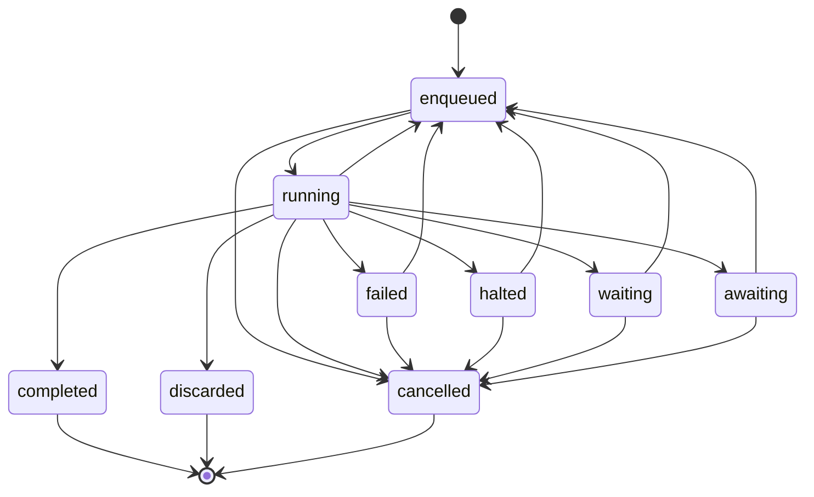
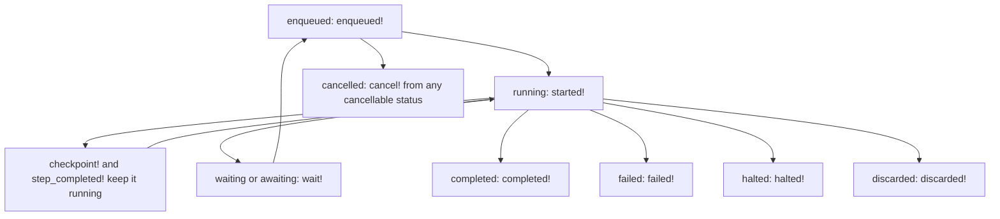

# 06 -- Run lifecycle

Every durable job has one run row from its first enqueue to a terminal status.
That row crosses retries, interrupts, resumes, timer parks and signal parks. This
document explains the nine statuses, the guarded updates that move between them,
and the exceptions raised when a transition is illegal.

The statuses are strings, not an Active Record enum and not integers. There is no
database check constraint on the column; the model enforces the vocabulary by
only ever writing values from its constants. The nine values are defined in
`lib/active_job/durable/run.rb` (lines 8-13):

```ruby
LIVE_STATUSES = %w[enqueued running waiting awaiting].freeze
ATTENTION_STATUSES = %w[failed halted].freeze
TERMINAL_STATUSES = %w[completed discarded cancelled].freeze
STATUSES = (LIVE_STATUSES + ATTENTION_STATUSES + TERMINAL_STATUSES).freeze
CANCELLABLE_STATUSES = (LIVE_STATUSES + ATTENTION_STATUSES).freeze
WAKEABLE_STATUSES = %w[waiting awaiting].freeze
```

The nine statuses fall into three groups. Live statuses mean the run has work to
do or is doing it. Attention statuses mean the run stopped on a problem a person
can fix, and it is resumable. Terminal statuses mean the run ended and will never
be written again.

## The nine statuses

`enqueued` means a message is in the queue. It is written at the first enqueue
and at every re-enqueue: an isolated step, a graceful-stop interrupt, a resume
after an error, or a `retry_on` retry. `running` means a worker is executing the
job. `waiting` means the run is parked on a timer; `awaiting` means it is parked
on a signal. The two parked statuses together are `WAKEABLE_STATUSES`.

`failed` means the job raised an error that was not handled, and the run parked
with its error and serialized job. `halted` means the job stopped itself, either
via `halt!` or via a `halt_on` error class, and parked for a human to fix and
resume. Both are resumable.

`completed` means `perform` returned normally. `discarded` means an Active Job
handler such as `discard_on` swallowed the error. `cancelled` means someone called
`Run#cancel!` from outside. All three are terminal and free the run's uniqueness
key, which is why the `active_key` column is cleared when they are reached.

The full transition graph:



## Guarded last-write-wins

Every transition is a single status-guarded `UPDATE` on the run row. The guard is
the `if_status` precondition: the update's `WHERE` clause includes `status =
<expected>`, so the write matches zero rows if another caller changed the status
first. This is last-write-wins without a lock, and it is what makes `cancel!`
and a running job safe to race. The mechanism is in
`lib/active_job/durable/execution.rb` (lines 291-302):

```ruby
def write_run(if_status: nil, **attributes)
  run = self.run or return true

  @state_written = attributes[:state] if attributes.key?(:state)
  scope = Run.where(id: run.id)
  scope = scope.where(status: if_status) if if_status
  scope.update_all(**attributes, updated_at: Time.current).positive?
end

def write_running!(**attributes)
  write_run(if_status: "running", **attributes) or raise Cancelled, "Run #{run.id} was cancelled"
end
```

`write_run` returns true if the update matched a row, false otherwise. Most
transitions during execution use `write_running!`, which is guarded on
`status = 'running'`. If a concurrent `cancel!` flipped the status to
`cancelled` in between, `write_running!` raises `ActiveJob::Durable::Cancelled`,
and the job stops at that boundary. The step wrapper in
`lib/active_job/durable/execution.rb` (lines 97-110) catches nothing, so the
exception propagates and the run is already `cancelled`; nothing is re-enqueued.



Some transitions use `upsert_run!`, which either creates the row (on a first
execution such as `perform_now`) or performs the guarded update. The `if_status`
for these is `Run::CANCELLABLE_STATUSES`, the six non-terminal statuses. This
makes a transition legal from any non-terminal status.

## The transitions during execution

The mediator drives the lifecycle. `started!`, in
`lib/active_job/durable/execution.rb` (lines 234-248), moves the run into
`running`:

```ruby
def started!
  now = Time.current
  written = upsert_run!(
    if_status: Run::CANCELLABLE_STATUSES,
    status: "running",
    started_at: run&.started_at || now,
    last_heartbeat_at: now,
    resumptions: job.continuation.started? ? job.resumptions + 1 : job.resumptions,
    parked_job: nil,
    transitioned_at: now
  )
  return false if @conflict

  written or raise Cancelled, "Run #{run.id} was cancelled"
end
```

`started_at` is set only once. The `run&.started_at || now` expression keeps the
first value, so an `enqueued` run with no `started_at` has never run. `started!`
also counts a resumption: if the continuation already has progress, the counter
goes up by one. If the row could not be written because of a uniqueness conflict,
`started!` returns false and the job performs nothing.

`completed!` (lines 250-261) writes the terminal success state, clears
`current_step` and `active_key`, and records `finished_at`. `step_completed!`
(lines 331-339) is the per-step cousin that appends the step name to
`completed_steps` and clears `current_step` while still `running`.

The park transitions are `wait!` (lines 363-388), which moves `running` to
`waiting` or `awaiting` and stores the serialized job in `parked_job`. The wake
transitions are `Run#wake_up` and `Run.wake_due`, which move a parked run back to
`enqueued`. Timers are described in [09-timers.md](./09-timers.md) and signals in
[10-signals.md](./10-signals.md).

The failure transitions are `failed!` (lines 263-276), `discarded!` (lines
278-289) and `halted!` (lines 136-149). `failed!` runs when an error escapes to
the backend; it writes the error columns and parks the job. `discarded!` runs
when Active Job's own handler swallowed the error. `halted!` is guarded on
`running` only, writes the `halt_reason` or error columns, and parks the job.

## The exceptions

The five transition exceptions, declared in `lib/active_job/durable.rb` (lines 66-82),
mark illegal transitions. `RunAlreadyExists` (lines 86-93), the uniqueness
exception raised by `on_conflict: :reject`, is declared alongside them and is
covered in [08-identity-and-uniqueness.md](./08-identity-and-uniqueness.md).
`RunNotFoundError` is raised inside `perform_now` when
the payload references a run row that does not exist, so `retry_on`, `discard_on`
and `rescue_from` handlers can see it. `NotResumable` is raised by `Run#resume!`
when the run is not `halted` or `failed`, or when another caller resumed it
first. `NotCancellable` is raised by `Run#cancel!` when the run is terminal.
`NotWaiting` is raised by `Run#wake_up` when a nameless wake targets a run that
is not parked. `NotLive` is raised by `Run#wake_up(name, value)` when a signal
targets a run that is not live.

These are the result of the guarded update matching zero rows. `Run#cancel!` in
`lib/active_job/durable/run.rb` (lines 108-116) is the clearest example:

```ruby
def cancel!
  now = Time.current
  updated = self.class.where(id:, status: CANCELLABLE_STATUSES).update_all(
    status: "cancelled", active_key: nil, parked_job: nil, finished_at: now, transitioned_at: now, updated_at: now
  )
  raise NotCancellable, "Run #{id} is #{reload.status}; a terminal run cannot be cancelled" if updated.zero?

  reload
end
```

`cancel!` never touches the queue. A queued message for a cancelled run performs
nothing, because `Execution#perform` returns early when the run is terminal
(lines 84-94). A running job stops at its next checkpoint or step boundary, where
`write_running!` raises `Cancelled`. The interplay of these guards with a
transaction is documented in
`skills/ajdc/references/transactions.md` and in
[11-halting-resuming-cancelling.md](./11-halting-resuming-cancelling.md).

## Heartbeat and transition timestamps

Three timestamps carry the lifecycle timing. `transitioned_at` is written on
every transition and is the timestamp used to find a stuck `enqueued` run whose
message never arrived. `started_at` is written once at the first execution.
`last_heartbeat_at` is written at `started!`, at every step completion, and at
every checkpoint, and is the timestamp used to find a `running` run whose worker
died. The `stuck_for` scope in `lib/active_job/durable/run.rb` (lines 54-59)
reads these:

```ruby
scope :stuck_for, ->(duration) {
  since = duration.ago
  where(status: "running").where(last_heartbeat_at: ...since)
    .or(where(status: "enqueued").where(transitioned_at: ...since))
    .or(where(status: WAKEABLE_STATUSES).where(wake_at: ...since))
}
```

The heartbeat is not written continuously. A long stretch of a step body with no
checkpoint produces no heartbeat, so the duration passed to `stuck_for` must be
longer than the longest such stretch. This is stated in the README (lines
401-402).

## The Aha Moment

**Aha:** the
status column is just a guard on a database `UPDATE`. Every transition is a
single `UPDATE ... WHERE status = <expected>`, and "the run moved on" is simply
"the update matched zero rows." That is why the same mechanism answers three
different questions at once: a concurrent `cancel!` wins a race against a running
job, a stale `resume!` raises `NotResumable`, and a double `cancel!` raises
`NotCancellable`, all without an explicit lock.

Continue to [07-serialization-and-restore.md](./07-serialization-and-restore.md).
