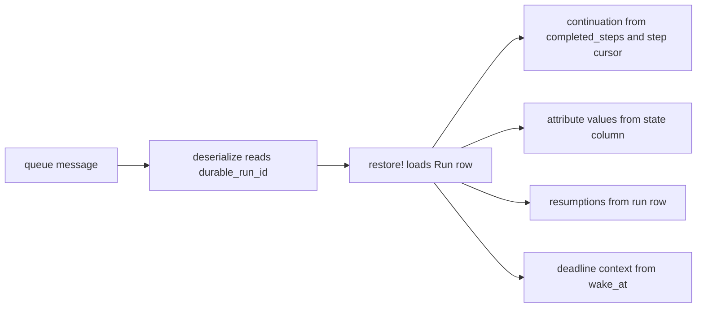
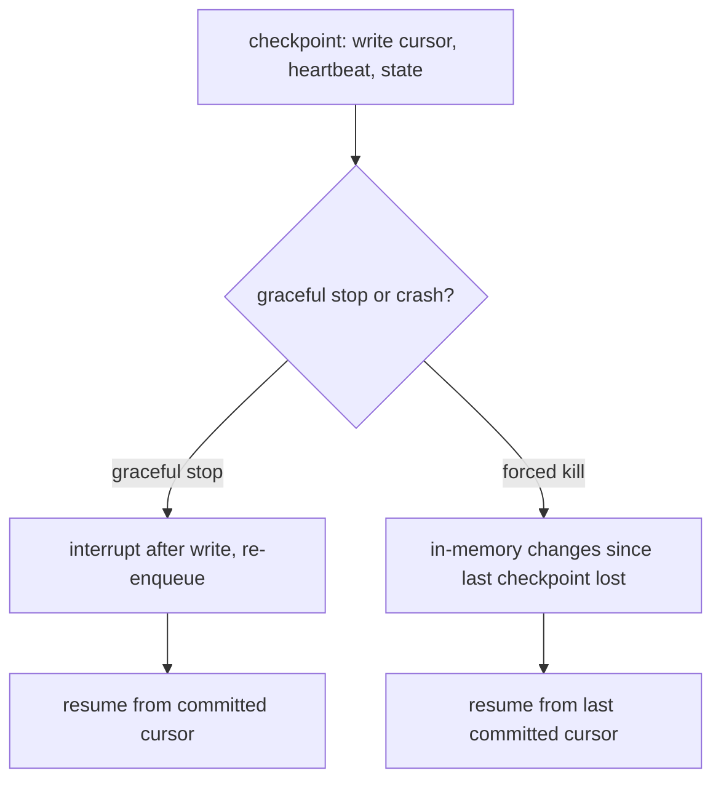

# 07 -- Serialization and restore

A durable job's queue message does not carry the job's progress. It carries one
identifier, the run's primary key. Everything else, the continuation, the
attribute values and the resumption count, is rebuilt on every execution from the
run row in the database. This document explains what the payload looks like, how
the row is turned back into a job, and what is lost or kept on a crash.

The contrast is `ActiveJob::Continuable`, which serializes the whole continuation
into the job payload under the `continuation`, `attributes` and `resumptions`
keys; that behavior is described in
[02-continuable-foundation.md](./02-continuable-foundation.md). AJ/DC drops those
keys and replaces them with a pointer. The module comment in
`lib/active_job/durable.rb` (lines 24-30) states the rule: the run row is the
single source of truth.

## The payload is a pointer

The `serialize` override in `lib/active_job/durable.rb` (line 228) delegates to
the mediator. `Execution#serialize`, in
`lib/active_job/durable/execution.rb` (lines 22-27), produces the payload:

```ruby
def serialize(payload)
  payload = payload.except("continuation", "attributes", "resumptions").merge("durable_run_id" => run_id)
  # A workflow key makes sense only when the row exists
  payload["durable_workflow_key"] = workflow_key if workflow_key && !@run
  payload
end
```

`payload` is the result of the parent `serialize`, which contains the job class,
arguments, queue, and the continuation keys. The mediator removes the three
progress keys and adds `durable_run_id`. The `durable_workflow_key` key appears only when a job is serialized before its
run row exists (e.g. `perform_all_later`); a normal `perform_later` first enqueue
has already created the row, so the key is absent.
The test `test/cases/durable_state_test.rb` (lines 120-127) asserts the payload
has the run id and no `continuation` key.

The rest of the payload is whatever Active Job normally needs. The arguments stay
in the message so the backend can route and retry it. But progress does not,
which means a stale message, retried long after it was first enqueued, still
reads fresh progress from the row.

## The rebuild

Deserialization has two steps. `Execution#deserialize` in
`lib/active_job/durable/execution.rb` (lines 29-32) only records the identifier:

```ruby
def deserialize(job_data)
  @serialized_run_id = job_data["durable_run_id"]
  self.workflow_key = job_data["durable_workflow_key"]
end
```

The real work happens in `restore!` (lines 36-55), which the concern calls after
the arguments are deserialized, from `deserialize_arguments_if_needed` in
`lib/active_job/durable.rb` (lines 241-244):

```ruby
def restore!
  run_id, @serialized_run_id = @serialized_run_id, nil
  return unless run_id

  run = Run.find_by(id: run_id, active_job_id: job.job_id)
  raise RunNotFoundError, "Run #{run_id} for #{job.class.name} (Job ID: #{job.job_id}) was not found" unless run

  @run = run
  @state_written = run.serialized_state
  @deadline, @deadline_step = run.wake_at, run.current_step
  job.resumptions = run.resumptions
  job.continuation = job.continuation_class.new(job, serialized_progress(run))
  # A run that starts from its parked job was re-enqueued by `resume!` (or by
  # the backend), not by Continuation, so it is not one of its resumptions;
  # `continue` still adds one when the run has progress, so we need to adjust
  job.resumptions -= 1 if run.parked_job.present? && job.continuation.started?
  if run.state.present? && job.respond_to?(:deserialize_attribute_values, true)
    job.send(:deserialize_attribute_values, run.serialized_state)
  end
end
```

`restore!` loads the row by its id and the job's own id. The `active_job_id`
match is what ties the row to the exact job instance, so a payload from one job
cannot read another job's run. If the row is missing, it raises
`RunNotFoundError`, which the job's own handlers can see. It then rebuilds four
pieces of in-memory state: the resumption count, the continuation, the attribute
values, and the timer deadline context.

The continuation is built from `serialized_progress` (lines 161-167), which reads
the completed steps and the current step's cursor straight from the rows:

```ruby
def serialized_progress(run)
  progress = {"completed" => Array(run.completed_steps)}
  if run.current_step && (cursor, _ = Step.where(run_id: run.id, name: run.current_step).order(attempt: :desc).pick(:cursor, :attempt))
    progress["current"] = [run.current_step, cursor_for_continuation(cursor)]
  end
  progress
end
```

The cursor is read from the latest attempt of the current step, in Active Job
argument form. `cursor_for_continuation` (lines 169-175) converts it: on Rails
8.2 and later the continuation itself deserializes the serialized form, and on
earlier Rails the mediator deserializes it first. The net effect is that the step
code sees the same Ruby object it set, whether an integer, a `Date`, or a nested
array.



## The state column

The attribute values live in the run's `state` JSON column, one of the columns
mapped in [04-data-model.md](./04-data-model.md). The column stores
Active Job argument form, which the `StateType` in
`lib/active_job/durable/run.rb` (lines 18-36) handles:

```ruby
class StateType < ActiveRecord::Type::Json
  def deserialize(value)
    decoded = super
    decoded.present? ? ActiveJob::Arguments.deserialize([decoded]).first : {}
  end

  def serialize(value) = super(self.class.serialized(value))

  def self.serialized(value)
    value = value.to_h
    if value.each_key.any? { |key| key.to_s.start_with?("_aj_") }
      value
    else
      ActiveJob::Arguments.serialize([value]).first
    end
  end
end
```

Reads return a plain hash, such as `{"processed_count" => 128}`. Writes accept
either the plain hash or the already-serialized form, so both the model and the
mediator can write the column. The `state` written by the mediator is the job's
`serialize_attribute_values` output, which is already in the argument form that
`deserialize_attribute_values` restores from. The column is only updated when the
values changed, because `Execution#checkpoint!` compares against the last written
state before adding the `state` key to the update.

## Crash versus graceful interrupt

The difference between the two failure modes is where the last committed cursor
is. A checkpoint writes the cursor to the step row and the heartbeat and state to
the run row, in that order, and only then does the job check whether the adapter
is stopping. On a graceful interrupt, the write has already happened, so the
re-enqueued job resumes from the checkpoint with nothing lost.

On a forced termination, such as a `SIGKILL` signal, the process stops without
running any more Ruby code. Whatever cursor changes happened since the last
checkpoint exist only in the worker's memory and are lost. The bounded loss is
the interval between checkpoints, which the job's own code controls by how often
it calls `step.set!`, `step.advance!` or `step.checkpoint!`. The README states
this precisely (line 107): "Every checkpoint commits the run and the current
step's cursor to the database, so a `SIGKILL` loses at most the work since the
last checkpoint."



Because the run row is the single source of truth, even a manual change to the
row is picked up on the next execution. The test
`test/cases/durable_state_test.rb` (lines 129-144) changes the step cursor and
the state column directly, then performs the enqueued job, and the job resumes
from the edited values. The payload in the queue was already stale by then; it
does not matter, because the payload only points at the row.

## The Aha Moment

**Aha:** the
payload is a foreign key, and the row is the record. Because only the row holds
progress, there is no two-copies problem to reconcile. A message that sat in the
queue for an hour, a cursor fixed by hand in the console, and a worker that was
killed mid-step all resolve the same way: the next execution asks the database,
not the message, what happened.

Continue to [08-identity-and-uniqueness.md](./08-identity-and-uniqueness.md).
