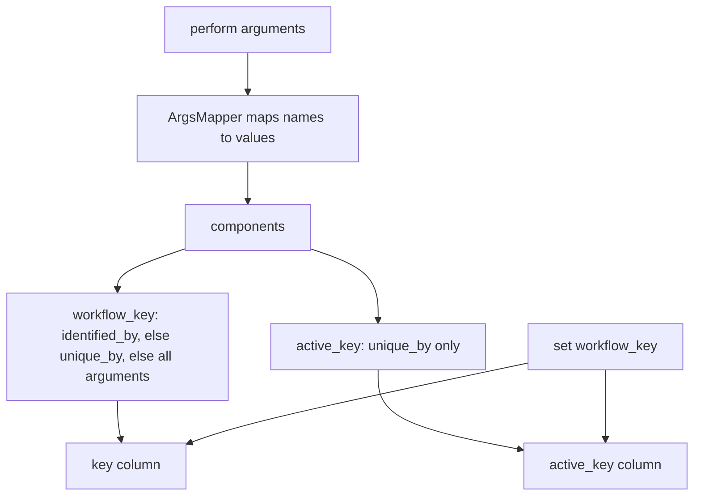
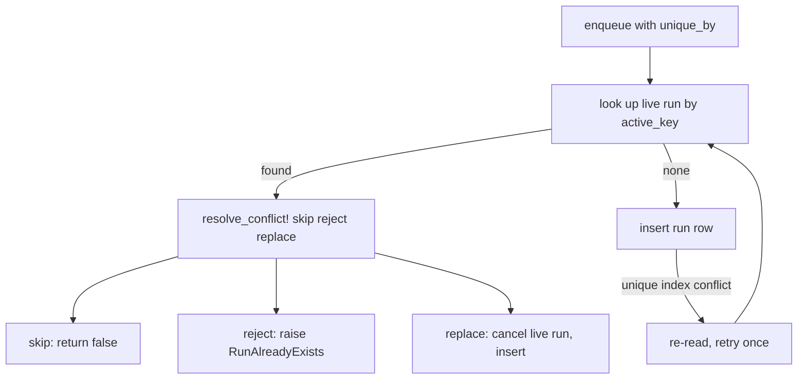

# 08 -- Identity and uniqueness

Every run row has two identity columns: `key` and `active_key`. They answer two
different questions. The `key` answers "what is this run about?" and is for
querying. The `active_key` answers "may two live runs exist for this?" and is the
uniqueness constraint. This document explains how each is computed, how
`identified_by`, `unique_by` and `set(workflow_key:)` shape them, and how the
database settles a race between two concurrent enqueues.

## key and active_key

The two columns are declared in `db/durable_schema.rb`. The `key` is indexed but
not unique; the `active_key` is part of a unique index together with the job
class:

```sql
t.index ["job_class", "active_key"], name: "index_active_job_durable_runs_on_active_key", unique: true
t.index ["job_class", "key"], name: "index_active_job_durable_runs_on_key"
```

The unique index on `[job_class, active_key]` is the last line of defence for
concurrency. The `active_key` is `NULL` for runs without a uniqueness
declaration, and terminal runs clear it, so the index never blocks two completed
runs of the same subject.

The mediator computes the two values separately in
`lib/active_job/durable/execution.rb`. The `key` (lines 421-426) falls back to a
digest of the serialized arguments when the arguments are not yet deserialized,
then to the configuration's `workflow_key`. The `active_key` (lines 430-435) does
the same but uses the configuration's `active_key`:

```ruby
def key
  return workflow_key if workflow_key
  return Config.digest_key(job.send(:serialize_arguments_if_needed, job.arguments)) if job.send(:arguments_serialized?)

  config.workflow_key(*job.arguments)
end

def active_key
  return workflow_key if workflow_key
  return Config.digest_key(job.send(:serialize_arguments_if_needed, job.arguments)) if job.send(:arguments_serialized?)

  config.active_key(*job.arguments)
end
```

The `workflow_key` here is the value set by `set(workflow_key:)`. When it is
present it overrides both columns, so a `set(workflow_key:)` run is both
identified and unique by that verbatim string. The digest fallback covers the
`perform_all_later` case, where the arguments exist in serialized form before the
run row is created.

## How a key is built

The `Config` class in `lib/active_job/durable/config.rb` derives keys from the
job's `perform` arguments. The two derivation rules are `workflow_key` (line 54),
used for `key`, and `active_key` (line 57), used for uniqueness:

```ruby
def workflow_key(...) = build_key((identity || !uniqueness) ? identity : uniqueness, ...)
def active_key(...) = build_key(uniqueness, ...)
```

The subtle rule is in `workflow_key`: if `identified_by` is declared, it names
the key; if only `unique_by` is declared, the uniqueness components also name the
key; if neither is declared, every argument names the key. In other words,
`unique_by` alone covers both columns, and declaring both macros makes the two
derive independently. The test `test/cases/uniqueness_test.rb` (lines 175-183)
shows both: `identified_by :card` with `unique_by :card, :style` produces `key`
`cards/42` for two runs but distinct `active_key` values `cards/42:plain` and
`cards/42:bold`.

`build_key` (lines 78-85) turns the components into one string. The `ArgsMapper`
in `lib/active_job/durable/args_mapper.rb` maps the declared names to argument
values; with no declaration it returns positional arguments in order followed by
keywords sorted by name as `name=value`. Each component is then rendered by
`build_key_component` (lines 87-97):

```ruby
def build_key_component(value)
  case value
  when ArgsMapper::Keyword then "#{value.name}=#{build_key_component(value.value)}"
  when GlobalID::Identification
    collection = value.respond_to?(:model_name) ? value.model_name.collection : ActiveModel::Name.new(value.class).collection
    "#{collection}/#{value.id}"
  when Symbol, String, Integer, Float, true, false then value.to_s
  when nil then ""
  else Digest::SHA256.hexdigest(ActiveSupport::JSON.encode(Arguments.serialize([value])))[0, 16]
  end
end
```

An Active Record object renders as `collection/id`, so a `Card` with id 42
becomes `cards/42`. A symbol, string, number or boolean renders as itself. A
value that is none of those, such as a hash or a non-record object, becomes the
first 16 characters of a Secure Hash Algorithm 256-bit (SHA-256) digest of its
serialized form. The class-level `Config.digest_key` (line 60) uses the same
digest for whole serialized argument lists.



## identified_by and unique_by

The two macros are defined in `lib/active_job/durable.rb` (lines 125-150). They
accept either a list of `perform` parameter names or a block called with the
`perform` arguments:

```ruby
def identified_by(...) = durable_config.identified_by(...)

def unique_by(*names, on_conflict: :skip, &block) = durable_config.unique_by(*names, on_conflict:, &block)
```

A name that is not a `perform` parameter raises `ArgumentError`, either at
declaration time or at the first key build, via `ArgsMapper#check!` in
`lib/active_job/durable/args_mapper.rb` (lines 14-17). The block form receives
the arguments and returns one component or an array of them, which is how a value
nested inside an argument, such as a webhook payload, becomes the identity.

`identified_by` narrows the `key` so `workflow_runs.for(card)` finds the run
whatever the other arguments were. `unique_by` declares that only one live or
attention run may hold the identity, and its `on_conflict:` option chooses what a
second enqueue does: `:skip` enqueues nothing and `perform_later` returns false,
`:reject` raises `ActiveJob::Durable::RunAlreadyExists`, and `:replace` cancels
the live run and starts the new one. These are spelled out in
`skills/ajdc/examples/uniqueness.md`.

## The atomic race

The uniqueness check runs at enqueue, inside the caller's transaction, and again
at `started!` for jobs whose run row was not created at enqueue. The check and
the insert are one operation, in `Execution#create_run` in
`lib/active_job/durable/execution.rb` (lines 204-213):

```ruby
def create_run(attributes, retried: false)
  Run.transaction(requires_new: true) do
    if config.unique? && (live = Run.find_by(job_class: job.class.name, active_key: attributes[:active_key]))
      resolve_conflict!(live) or next
    end
    Run.create!(active_job_id: job.job_id, **attributes)
  end
rescue ActiveRecord::RecordNotUnique
  Run.find_by(active_job_id: job.job_id) || (retried ? raise : create_run(attributes, retried: true))
end
```

The transaction first looks for a live run holding the same `active_key`. If one
exists, `resolve_conflict!` (lines 216-232) applies the policy: `:skip` records
the conflict and refuses the insert, `:reject` records it and raises
`RunAlreadyExists`, `:replace` cancels the live run first and proceeds. If no
live run is seen, it inserts directly.

Two concurrent first enqueues can both pass the `find_by` lookup and race to
insert. The unique index on `[job_class, active_key]` lets exactly one of them
win; the loser raises `ActiveRecord::RecordNotUnique`. The rescue in `create_run`
(`execution.rb:204-213`) then re-reads the row, and if it was not this job's own
row, retries the whole create once, this time seeing the winner's live run and
applying the conflict policy. The test `test/cases/uniqueness_test.rb` (lines
216-225) has a `RacingLookup` module that overrides `durable_live_run`, but that
method is not defined or called in production code, so the `RecordNotUnique` path
does not actually fire in that test.



## Reading runs back

The `key` is what `workflow_runs.for` queries. The `for` scope in
`lib/active_job/durable/run.rb` (lines 61-66) either matches a
`workflow_key` verbatim or re-derives the key from the same arguments
`perform_later` would have used:

```ruby
scope :for, ->(*args, **kwargs) {
  next where(key: kwargs[:workflow_key]) if kwargs.key?(:workflow_key)

  job_class = where_values_hash["job_class"] or raise ArgumentError, "for needs a job class; use MyJob.workflow_runs.for(...)"
  where(key: job_class.constantize.durable_config.workflow_key(*args, **kwargs))
}
```

So `ImportJob.workflow_runs.for(import)` finds the runs whose key matches
`ImportJob.perform_later(import)`, and `for(workflow_key: "imports/42")` matches
a `set(workflow_key:)` string exactly. The full query surface is in
[12-querying-and-observability.md](./12-querying-and-observability.md).

## The Aha Moment

**Aha:** `key` is for looking a run up later and never
changes, while `active_key` is a lock that is set while the run is live or
attention and cleared the moment the run becomes terminal. Uniqueness is not a
"duplicate detection" scan over old rows; it is the presence of a non-NULL
`active_key` under a unique index, which is why a finished run frees its identity
automatically and two concurrent first enqueues resolve with one insert retry.

Continue to [09-timers.md](./09-timers.md).
