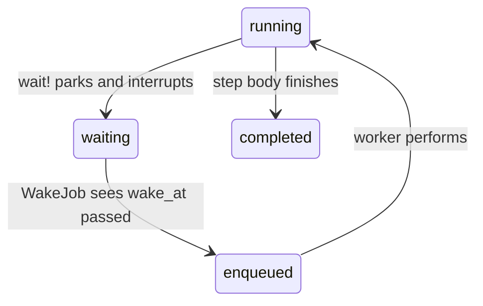
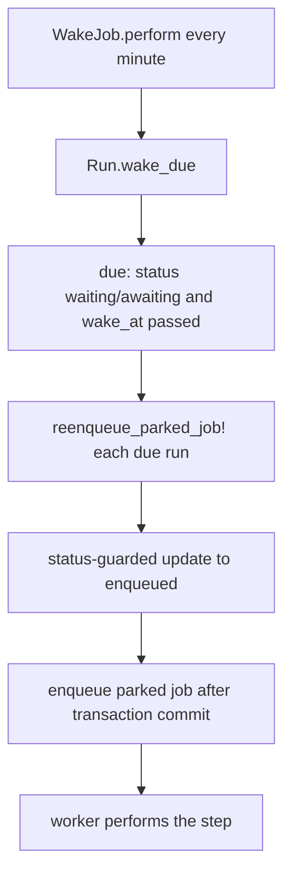

# 09 -- Timers

A durable run can go to sleep and wake up later without holding a worker. A step
declared with `wait:` or `wait_until:` parks the run in the `waiting` status, a
single recurring job acts as the clock, and the run is a database row the whole
time. This document explains the two timer keywords, how the park and wake work,
and why the timer does not occupy a queue slot.

The step options are declared in `lib/active_job/durable.rb` (lines 192-196),
which also rejects the mistake of using both on one step:

```ruby
def step(step_name, wait: nil, wait_until: nil, **, &block)
  raise ArgumentError, "Step '#{step_name}' takes wait: or wait_until:, not both" if wait && wait_until

  super
end
```

## wait versus wait_until

The two keywords answer different questions. `wait:` means "run this step a
given duration after the previous point." `wait_until:` means "run this step at
a given time." Both accept a value or a callable, and the callable is evaluated
only when the step line is reached, which matters because `perform` re-runs on
every resume and skips completed steps. The API reference in
`skills/ajdc/references/api.md` (lines 53-71) states the difference: `wait:` is
anchored once, while `wait_until:` is re-evaluated on every pass, including every
wake.

The distinction is visible in the deadline computation in
`lib/active_job/durable/execution.rb` (lines 392-400):

```ruby
def deadline(name, wait, wait_until)
  if wait_until
    timer_value(wait_until)
  elsif wait
    (@deadline if @deadline_step == name) || Time.current + timer_value(wait)
  end
end

def timer_value(value) = value.respond_to?(:call) ? value.call : value
```

For `wait:`, the deadline is `now + interval` the first time the line is
reached, and the mediator remembers it in `@deadline` and `@deadline_step`, so it
does not drift. For `wait_until:`, the target is read again at every pass, so if
the underlying time moved, the run re-arms itself. The comment above the method
says it plainly: "A `wait_until:` is read again at every wake; a `wait:` counts
from the first time the line is reached and is then kept on the row." The
re-arm behavior is the reason the license example in
`skills/ajdc/examples/timers.md` uses `wait_until:` for dates that can move.

## Parking

The park happens in `Execution#wait!` in
`lib/active_job/durable/execution.rb` (lines 363-388), before the step body runs:

```ruby
def wait!(step, wait:, wait_until:, await:)
  run or return
  name = step.name.to_s
  resumed = step.resumed? && !(await && halted?(name))
  @await_value = (step.cursor if resumed) if await
  return if resumed

  status = Run.transaction do
    next if pending_signals(lock: true).key?(name)

    deadline = deadline(name, wait, wait_until)
    next if deadline && deadline <= Time.current

    parked = await ? "awaiting" : "waiting"
    write_running!(
      status: parked, current_step: name, wake_at: deadline, state:, resumptions: job.resumptions,
      parked_job: job.serialize, transitioned_at: Time.current
    )
    @deadline, @deadline_step = deadline, name
    parked
  end
  return unless status

  @parked = true
  job.interrupt!(reason: status.to_sym)
end
```

Several details matter. A step that was already resumed does not wait again; the
`return if resumed` means the timer fires once and the step then runs to
completion. A deadline in the past is skipped, so the step runs at once. The
`parked_job` stores the job's serialized form on the run row, so nothing needs
the queue to remember the job. Finally, `wait!` raises an interrupt, which stops
the job. The interrupt is not a retry: the `resume_job` path sees the run is
parked and does not re-enqueue it, as covered in
[06-run-lifecycle.md](./06-run-lifecycle.md). The run is now a `waiting` row and
is gone from the queue.

The state machine for one timer step:



## The single clock

Nothing about a parked run is scheduled in the backend. There is no per-run
timer, no `set(wait:)` on a delayed message. The only clock is one recurring job,
`ActiveJob::Durable::WakeJob`, in
`lib/active_job/durable/wake_job.rb` (lines 5-14):

```ruby
class WakeJob < ActiveJob::Base # rubocop:disable Rails/ApplicationJob
  def perform = Durable.wake_up_due
end
```

It is one call. `ActiveJob::Durable.wake_up_due` delegates to
`Run.wake_due`, in `lib/active_job/durable/run.rb` (lines 60-70):

```ruby
scope :due, ->(now = Time.current) { where(status: WAKEABLE_STATUSES, wake_at: ..now) }

def self.wake_due(now = Time.current)
  due(now).find_each.count { |run| run.reenqueue_parked_job!(from: WAKEABLE_STATUSES) }
end
```

The `due` scope selects `waiting` and `awaiting` runs whose `wake_at` has passed,
which the index on `[status, wake_at]` makes cheap. For each due run,
`reenqueue_parked_job!` (lines 149-162) performs one status-guarded update back
to `enqueued`, then puts the parked job back in the queue after the transaction
commits:

```ruby
def reenqueue_parked_job!(from:, **changes) # :nodoc:
  now = Time.current
  updated = self.class.where(id:, status: from).update_all(
    status: "enqueued", error_class: nil, error_message: nil, halt_reason: nil,
    finished_at: nil, transitioned_at: now, updated_at: now, **changes
  )
  return false if updated.zero?

  reload
  job = ActiveJob::Base.deserialize(parked_job)
  job.scheduled_at = nil # a retry's or a resume's delay does not carry over
  ActiveRecord.after_all_transactions_commit { job.enqueue }
  true
end
```

The guarded update means each due run is woken exactly once even if two wake jobs
overlap: the second one's update matches zero rows and is a no-op. The test
`test/cases/timers_test.rb` (lines 256-270) confirms a second `wake_up_due` call
returns zero. `scheduled_at` is cleared so a previous retry delay does not push
the wake further into the future.

The schedule is the application's choice. The README (lines 313-320) shows a
Solid Queue recurring entry with a one-minute interval;
`skills/ajdc/references/installation.md` (section 3) notes that the interval is
the precision of every deadline. A run due at 10:00:30 wakes at the
10:01:00 tick.



## Why the timer holds no worker

The design trades a scheduler for a database row plus a poll. A run that waits
two weeks is a `waiting` row with a `wake_at` timestamp, not a worker sleeping
and not a delayed queue message. Two consequences follow. A sleeping run costs
one row, so a million parked runs cost a million rows, not a million workers; the
decision guide in `skills/ajdc/SKILL.md` warns not to replace a table-wide sweep
with millions of parked runs without reading that trade-off. And nothing wakes
unless the recurring job is scheduled, which the installation reference in
`skills/ajdc/references/installation.md` (lines 69-83) makes a hard requirement.

A run can also be woken early and individually with `Run#wake_up` with no name,
which ends the wait now, or stopped entirely with `Run#cancel!`, which turns off
the clock for that run. Both are documented in
[10-signals.md](./10-signals.md) and
[11-halting-resuming-cancelling.md](./11-halting-resuming-cancelling.md).

## Deadline and heartbeat

A parked run is not heartbeating. Its liveness is its `wake_at`: the `stuck_for`
scope in `lib/active_job/durable/run.rb` (lines 54-59) finds a `waiting` or
`awaiting` run whose `wake_at` passed but was not woken, which means the clock
missed it. A `running` run is instead judged by `last_heartbeat_at`, written at
checkpoints and step boundaries. The two timestamps answer the same question for
two different states: has this run been left behind.

## The Aha Moment

**Aha:** a timer is a `wake_at`
column and a recurring job that asks "whose `wake_at` has passed?" The run does
not wait; it stops, and a clock that already exists for other purposes turns it
back on. That is why a two-week wait has the same cost as a two-second one, and
why the precision of every deadline is simply the interval of the one recurring
job.

Continue to [10-signals.md](./10-signals.md).
