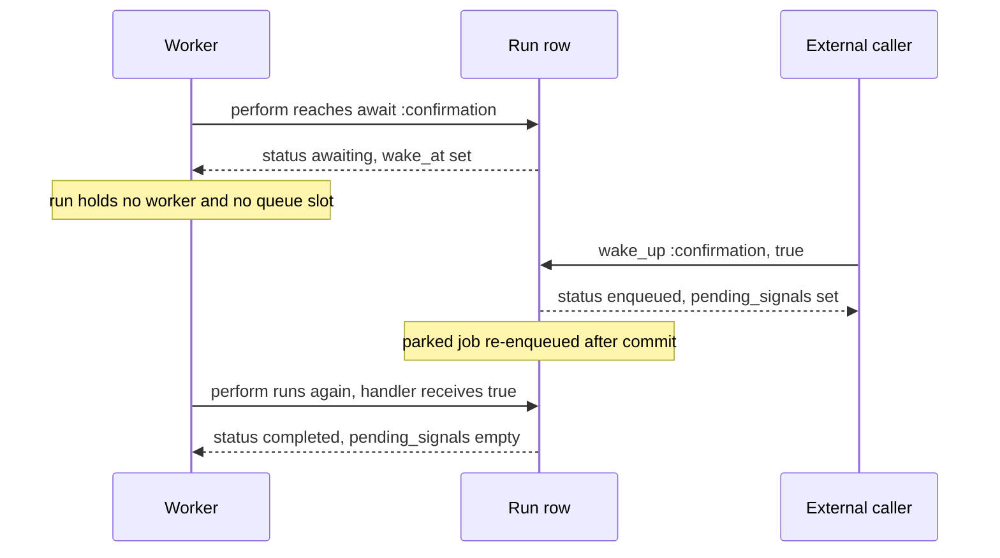
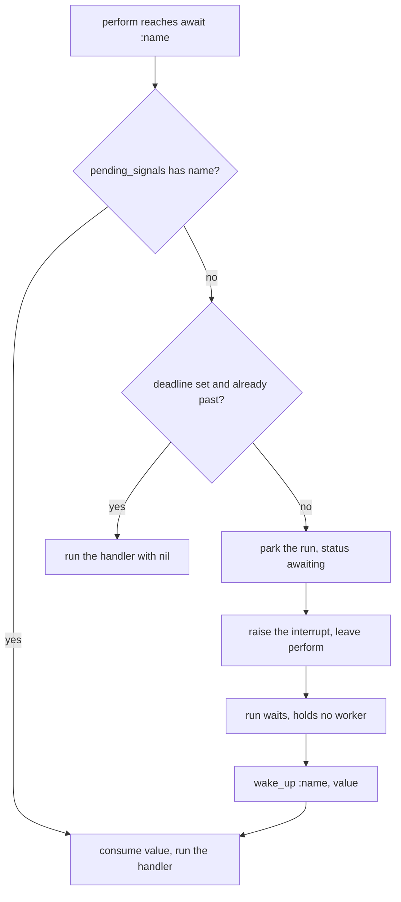

# 10 -- Signals: await and wake_up

A durable run can stop mid-flow and wait for a value that only an outside caller can supply: a confirmation click, a webhook, a human verdict. Active Job Durable Continuation (AJ/DC) models this wait as a signal. The run calls `await :name`; a caller delivers the signal with `run.wake_up(:name, value)`; the run wakes and continues with the delivered value. The essential property is that the run does not hold a worker, a thread, or a queue slot while it waits. It is a parked row in the database, and nothing else.

The waiting state for a signal is `awaiting`, one of the four live statuses. You saw the sibling state `waiting` in [09-timers.md](./09-timers.md), where the trigger is a clock deadline. A signal is the same mechanism with a person or a system as the trigger instead of a time. The two share the `wake_at` deadline column and the `WakeJob` clock, so an `await` can carry a deadline too.

## The shape of a signal step

`await` is a method on the job, defined in `lib/active_job/durable.rb`. It is a step whose body is a signal handler rather than a block of work:

```ruby
# lib/active_job/durable.rb (lines 198-213)
def await(name, wait: nil, wait_until: nil, &block)
  handler = block || step_method_block(name)
  step(name, wait:, wait_until:, await: true) { handler.call(durable_job.await_value) }
end
```

The handler is either the block passed to `await` or a method named after the signal. The handler receives one argument: the delivered value, or `nil` when the deadline passed. The delivered value is exposed to the handler as `durable_job.await_value`, an attribute reader on the mediator object (`lib/active_job/durable/execution.rb`, line 12).

Here is the canonical approval flow from the test suite, trimmed to its essentials:

```ruby
# test/cases/signals_test.rb (lines 15-31)
class BulkImportJob < ActiveJob::Base
  include ActiveJob::Durable

  def perform(import)
    @import = import
    await :confirmation, wait: 10.minutes
    return import.update!(state: "dropped") unless import.state == "confirmed"

    step(:apply) { import.update!(state: "applied") }
  end

  private

  def confirmation(signal) = @import.update!(state: signal ? "confirmed" : "missed")
end
```

The caller finds the run and delivers the signal from a controller, a webhook handler, or a console:

```ruby
# README.md (line 364)
BulkImportJob.workflow_runs.for(import).live.sole.wake_up(:confirmation, true)
```

When `perform` reaches the `await` line, the run parks as `awaiting`. The test asserts that nothing stays in the queue and the run row records the park (`test/cases/signals_test.rb`, lines 101-115): `status` is `"awaiting"`, `current_step` is `"confirmation"`, `wake_at` is ten minutes from now, `pending_signals` is an empty hash, and the serialized job is parked on the row.

## How a run parks and wakes

The mediator, `ActiveJob::Durable::Execution`, does the work of parking. When the continuation reaches the `await` step, the `around_step` wrapper calls `Execution#step`, which first calls `wait!`:

```ruby
# lib/active_job/durable/execution.rb (lines 363-388)
def wait!(step, wait:, wait_until:, await:)
  run or return
  name = step.name.to_s
  resumed = step.resumed? && !(await && halted?(name))
  @await_value = (step.cursor if resumed) if await
  return if resumed

  status = Run.transaction do
    next if pending_signals(lock: true).key?(name)

    deadline = deadline(name, wait, wait_until)
    next if deadline && deadline <= Time.current

    parked = await ? "awaiting" : "waiting"
    write_running!(
      status: parked, current_step: name, wake_at: deadline, state:, resumptions: job.resumptions,
      parked_job: job.serialize, transitioned_at: Time.current
    )
    @deadline, @deadline_step = deadline, name
    parked
  end
  return unless status

  @parked = true
  job.interrupt!(reason: status.to_sym)
end
```

The decision is read top to bottom. If the signal already arrived, the method returns without parking. If a deadline exists and already passed, the method returns without parking and the handler runs with `nil`. Only when neither is true does the run park: the row becomes `awaiting`, `wake_at` holds the deadline, and the serialized job is stored in `parked_job`. Then `job.interrupt!` raises an interrupt that unwinds `perform`, so the execution ends with the run parked and the queue empty.

The interrupt unwinds before `step_started!` runs, so no step row is written at park time. The step row is created later, when the run wakes and the handler actually executes. That is why the test sees zero step rows for a parked run.



Delivery is `Run#wake_up`. It takes the row lock, decides whether the run is parked at that name, and either re-enqueues the parked job or buffers the value:

```ruby
# lib/active_job/durable/run.rb (lines 126-144)
def wake_up(name = nil, value = nil)
  transaction do
    lock!
    unless name
      WAKEABLE_STATUSES.include?(status) or raise NotWaiting, "Run #{id} is #{status}; only a waiting or awaiting run can be woken up"
      name = current_step
    end
    live? or raise NotLive, "Run #{id} is #{status}; a signal needs a live run"

    signals = pending_signals.merge(name.to_s => value)
    if WAKEABLE_STATUSES.include?(status) && current_step == name.to_s
      reenqueue_parked_job!(from: status, pending_signals: signals)
    else
      self.class.where(id:, status:).update_all(pending_signals: signals, updated_at: Time.current)
      reload
    end
  end
  self
end
```

When the run is parked at exactly that name, `wake_up` writes `pending_signals` and re-enqueues the parked job. When the run is live but parked elsewhere, or still on its way to the `await` line, `wake_up` only writes `pending_signals`; the value waits there. On the next execution, `wait!` sees the key present and does not park, and `step_started!` consumes it:

```ruby
# lib/active_job/durable/execution.rb (lines 304-316)
def step_started!(step, isolated:, await:)
  run = self.run or return
  name = step.name.to_s

  @step_await = await
  Run.transaction do
    signals = pending_signals(lock: true)
    attributes = {current_step: name, wake_at: nil}
    if signals.key?(name)
      attributes[:pending_signals] = signals.except(name)
      @await_value = signals[name] if @step_await
    end
    write_running!(**attributes)
```

The value moves from `pending_signals` into `@await_value`, and the key is removed from the run row in the same transaction. The handler then runs with that value.

## The race: signal before await

The interesting case is a signal that arrives before the run reaches its `await` line. The signal and the run race. If the caller's `wake_up` wins, the value must not be lost; it has to be waiting when the run finally parks.

The `pending_signals` column solves this. `wake_up` on an `enqueued` or `running` run takes the else branch: it merges `{name => value}` into `pending_signals` and leaves the status alone. When the run later reaches `wait!`, the transaction sees the key and skips parking. The handler runs in the same execution, on the spot. The test `a signal sent before the await is reached is consumed on the spot` (`test/cases/signals_test.rb`, lines 166-183) sends two signals while the run is still `enqueued`, and asserts the run completes without ever parking.



The same buffer covers a signal sent during an earlier step. `test/cases/signals_test.rb` lines 185-202 send `:review` while the run is inside an isolated `moderate` step; the value sits in `pending_signals` until the `await :review` line is reached.

Two more rules fall out of the buffer. A second signal for the same name overwrites the first: the code does a plain `merge`, so the last write wins. And the deadline does not matter for a value that arrived early: the early value is consumed immediately, and the deadline is simply never consulted.

## Multiple awaits and the nameless wake

A run can have more than one `await` step, each with its own name. The signal names are keys in `pending_signals`, so they stay separate. One documented pattern is one `await` per approver (`skills/ajdc/references/decision-guide.md`, lines 81-101), where the name is built from an identifier: `await :"decision_#{approval.approver_id}"`.

`wake_up` called with no name wakes whatever the run is parked on. The code reads the parked step's own name from `current_step` and proceeds with a `nil` value. For an `await`, the handler receives `nil`; for a timer `waiting` step, the wait ends now. This is the manual clock, the same mechanism `WakeJob` uses in bulk in [09-timers.md](./09-timers.md).

The two guards are distinct and their order matters. A nameless wake checks first that the run is parked; a run that is merely `enqueued` raises `ActiveJob::Durable::NotWaiting`. A named wake checks first that the run is live; a run that ended, or one that needs attention, raises `ActiveJob::Durable::NotLive`. The tests pin these down in `test/cases/signals_test.rb`, lines 291-307.

## How wake_up finds the awaiting run

`wake_up` does not search for anything. The caller already holds the run record, found through the query surface in [12-querying-and-observability.md](./12-querying-and-observability.md). The run is the handle: `BulkImportJob.workflow_runs.for(import).live.sole` is the one live run for that import, and calling `wake_up` on it delivers the signal. Identity scopes (`for`) come from [08-identity-and-uniqueness.md](./08-identity-and-uniqueness.md).

To enumerate runs waiting for a signal rather than reach one run, the per-status scope and `at_step` combine into a review queue:

```ruby
# README.md (line 374)
CardGenerationJob.workflow_runs.awaiting.at_step(:review)
```

## The Aha Moment

**Aha:** A signal is not a callback and not a queue entry. It is a value written into a JSON (JavaScript Object Notation) column on the run row, guarded by a row lock, and consumed by the same transaction that starts the step. Because the value lives in `pending_signals` before the `await` line and in the step cursor after it, delivery and execution can happen in either order, and a crash in the handler replays the exact value on `resume!`. The run never holds a worker while it waits; the database is the waiting room.

The deadline side of this column is shared with timers, so the full lifecycle of `wake_at`, the recurring `WakeJob`, and manual waking is described in [09-timers.md](./09-timers.md). What a signal handler can do when it decides to stop rather than continue, using `halt!`, is the subject of [11-halting-resuming-cancelling.md](./11-halting-resuming-cancelling.md).

Continue to [11-halting-resuming-cancelling.md](./11-halting-resuming-cancelling.md).
