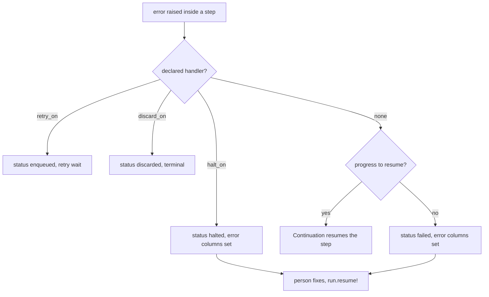
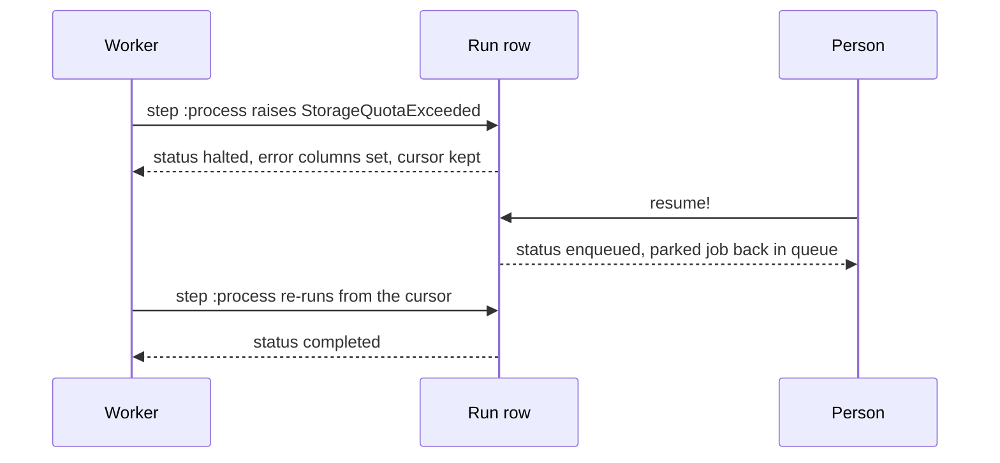

# 11 -- Halting, resuming, cancelling

Every durable run reaches one of three endings: it finishes (`completed`), it is given up on (`discarded`), or it is ended from outside (`cancelled`). But two statuses are deliberately not endings. A run can be `halted` when a person must fix something before the run can continue, and it can be `failed` when an exception escaped the job and reached the queue backend. Both are parked, both hold their checkpoint, and both are resumable.

This document covers the three verbs that move a run between those states: `halt!` (and its declarative cousin `halt_on`), `resume!`, and `cancel!`. The statuses themselves and the full run lifecycle are in [06-run-lifecycle.md](./06-run-lifecycle.md).

## Three verbs for three kinds of failure

A background job meets three kinds of failure, and AJ/DC gives each its own verb:

- `retry_on` is the machine trying again. The error is transient; Active Job schedules a retry.
- `discard_on` is giving up. Nothing can fix it; the run ends `discarded`.
- `halt_on` is a person deciding. The error is fixable by a human or an agent; the run parks `halted` until someone calls `resume!`.

The declaration is on the job class:

```ruby
# lib/active_job/durable.rb (lines 152-157)
def halt_on(*errors)
  durable_config.halt_on(*errors)
  rescue_from(*errors) { |error| durable_job.halted!(error) }
end
```

`halt_on` does two things. It records the error classes in the configuration, and it registers an Active Job `rescue_from` handler for each one. When that error is raised inside a step, the handler runs and the run is written as `halted`. The run keeps `current_step` pointing at the step that stopped, and the step row keeps its cursor, so a resume continues in place.

`halt!` is the same stop without an exception. It is called from inside a step body when the stop is a decision, not a failure:

```ruby
# lib/active_job/durable.rb (lines 215-221)
def halt!(reason = nil)
  raise ArgumentError, "halt! must be called inside a step" unless current_step

  raise Halt.new(reason)
end
```

`halt!` requires an open step, otherwise it raises `ArgumentError`. It then raises `ActiveJob::Durable::Halt`, a control-flow exception, which the included block catches:

```ruby
# lib/active_job/durable.rb (lines 121-122)
after_discard { |_job, error| durable_job.record_discard(error) }
rescue_from(Halt) { |error| durable_job.halted!(error) }
```

Both paths land in the same writer, `Execution#halted!`:

```ruby
# lib/active_job/durable/execution.rb (lines 136-149)
def halted!(error)
  halt = error.is_a?(Halt)
  write_run(
    if_status: "running",
    status: "halted",
    state:,
    resumptions: job.resumptions,
    parked_job: job.serialize,
    halt_reason: (error.reason&.to_s if halt),
    error_class: (error.class.name unless halt),
    error_message: (error.message unless halt),
    transitioned_at: Time.current
  )
end
```

The two flavors write different columns. A `halt_on` error stores `error_class` and `error_message`. A `halt!` stores only `halt_reason`. The run is parked with the serialized job, exactly like an `awaiting` run in [10-signals.md](./10-signals.md), and `finished_at` stays `nil`: the run has not ended, it is waiting for a person. The test in `test/cases/halting_test.rb` (lines 112-136) asserts the exact row: `status` is `"halted"`, `error_class` is the full error name, `halt_reason` is `nil`, and the step row is `"halted"` with its cursor.



## Halted versus failed

The line between `halted` and `failed` is not the severity of the error. It is who acts next.

A `halted` run means a person or an agent must act: upgrade the plan, fix the file, approve the tool call. The stop was declared as a halt, either by `halt_on` or by an explicit `halt!`. The run parks with `finished_at` empty, and it appears in the `attention` group, not among the dead runs.

A `failed` run means an exception escaped with no declared handler and no progress to resume. The run stores the error and parks its serialized job too, but it is the job backend's normal failure path made durable. `finished_at` is set for a `failed` run (the test asserts this in `test/cases/resuming_test.rb`, line 209), because from the backend's point of view the job failed, even though the run can still be resumed.

Both are resumable. `Run#resume!` accepts exactly the two attention statuses:

```ruby
# lib/active_job/durable/run.rb (lines 98-102)
def resume!
  reenqueue_parked_job!(from: ATTENTION_STATUSES) ||
    raise(NotResumable, "Run #{id} is #{reload.status}; only a halted or failed run can be resumed")
  self
end
```

`ATTENTION_STATUSES` is the pair `%w[failed halted]` (`lib/active_job/durable/run.rb`, line 9). The resume is a single status-guarded update to `enqueued`, followed by a re-enqueue of the parked job after the transaction commits:

```ruby
# lib/active_job/durable/run.rb (lines 149-162)
def reenqueue_parked_job!(from:, **changes)
  now = Time.current
  updated = self.class.where(id:, status: from).update_all(
    status: "enqueued", error_class: nil, error_message: nil, halt_reason: nil,
    finished_at: nil, transitioned_at: now, updated_at: now, **changes
  )
  return false if updated.zero?

  reload
  job = ActiveJob::Base.deserialize(parked_job)
  job.scheduled_at = nil # a retry's or a resume's delay does not carry over
  ActiveRecord.after_all_transactions_commit { job.enqueue }
  true
end
```

The guard is the status. If the run is no longer `halted` or `failed`, the update matches zero rows and `resume!` raises `ActiveJob::Durable::NotResumable`. That is also what stops a second resume: the first resume already moved the run to `enqueued`, so the second caller's guarded update finds nothing. The test `a second resume! of the same run raises` (`test/cases/resuming_test.rb`, lines 249-259) confirms this.

The resume itself re-runs the stopped step from its cursor, as a new attempt. The earlier attempt keeps its error columns. The manual resume does not count toward the Continuation's `max_resumptions`; the test asserts `resumptions` stays at zero after a resume (`test/cases/resuming_test.rb`, lines 146-153).



## Cancelling

`cancel!` is the outside-in ending. It does not touch the queue; it flips the row and lets the job stop cooperatively:

```ruby
# lib/active_job/durable/run.rb (lines 104-116)
def cancel!
  now = Time.current
  updated = self.class.where(id:, status: CANCELLABLE_STATUSES).update_all(
    status: "cancelled", active_key: nil, parked_job: nil, finished_at: now, transitioned_at: now, updated_at: now
  )
  raise NotCancellable, "Run #{id} is #{reload.status}; a terminal run cannot be cancelled" if updated.zero?

  reload
end
```

The guard `CANCELLABLE_STATUSES` is every non-terminal status: the four live ones plus the two attention ones (`lib/active_job/durable/run.rb`, line 12). A `cancelled` run is terminal, so a terminal run, or one another caller ended first, raises `ActiveJob::Durable::NotCancellable`.

Cancelling a run that is merely `enqueued` is clean: the row becomes `cancelled`, and when the queued message later runs, `Execution#perform` sees the terminal status and performs nothing (`lib/active_job/durable/execution.rb`, line 85). Cancelling a `running` run is cooperative: the next checkpoint or step boundary notices that the row left the `running` status, and raises `ActiveJob::Durable::Cancelled` inside the job. The `Cancelled` exception unwinds the step, the open step row is written `cancelled` with its cursor, and nothing reaches the backend. This is why `Cancelled` and `Halt` both inherit from `Exception` rather than `StandardError`: they are control flow, and they must bypass both the Continuation's `continue` rescue and any `retry_on`/`discard_on` handler.

The test suite pins the cooperative behavior precisely. `cancel!` on an `enqueued` run performs nothing (`test/cases/cancelling_test.rb`, lines 138-163). A running export loop that cancels itself after two items stops at the next checkpoint with the step row `cancelled` at cursor 2 (lines 214-233). A cancel between isolated steps makes the next execution a no-op (lines 251-267).

## The exception surface

Eight exception classes belong to these transitions, all declared in `lib/active_job/durable.rb` (lines 66-109):

- `Halt` — raised by `halt!`; a control-flow signal caught by the included `rescue_from(Halt)`.
- `Cancelled` — raised inside the job when `cancel!` ended the run meanwhile; a control-flow signal, never an error.
- `RunNotFoundError` — raised inside `perform_now` when the payload references a run row that does not exist or belongs to another job.
- `NotResumable` — `resume!` on a run that is not `halted` or `failed`, or a second resume.
- `NotCancellable` — `cancel!` on a terminal run, or a second cancel.
- `NotWaiting` — a nameless `wake_up` on a run that is not parked.
- `NotLive` — a named `wake_up` on a run that is not live.
- `RunAlreadyExists` — `unique_by ..., on_conflict: :reject` when a run holding the same `active_key` is live or needs attention.

The first two are not errors in the application sense; they are how one process stops another or stops itself. The last five are the guard rails that turn a race between two callers into an exception instead of a silent lost update.

## The Aha Moment

**Aha:** Halt, resume, and cancel are all the same shape: one status-guarded `UPDATE` whose `WHERE status = ...` clause is the concurrency control. `halted!` writes `if_status: "running"`, `resume!` writes `from: ATTENTION_STATUSES`, and `cancel!` writes `status: CANCELLABLE_STATUSES`. Each checks how many rows it matched, and raises a specific exception on zero. That is why a stale run object, loaded minutes earlier, cannot corrupt the row: its guarded update simply fails, and the caller reloads and sees the truth. The statuses do not just describe the run; they are the locking protocol.

The query side of this protocol, reading halted and failed runs and acting on them, is in [12-querying-and-observability.md](./12-querying-and-observability.md). The reason a `halt_on` error reaches its `rescue_from` handler instead of being converted into an automatic resumption is the rescue ordering explained in [13-callbacks-and-rescue.md](./13-callbacks-and-rescue.md).

Continue to [12-querying-and-observability.md](./12-querying-and-observability.md).
