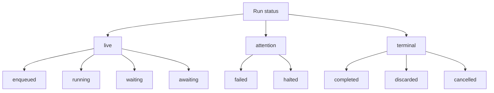
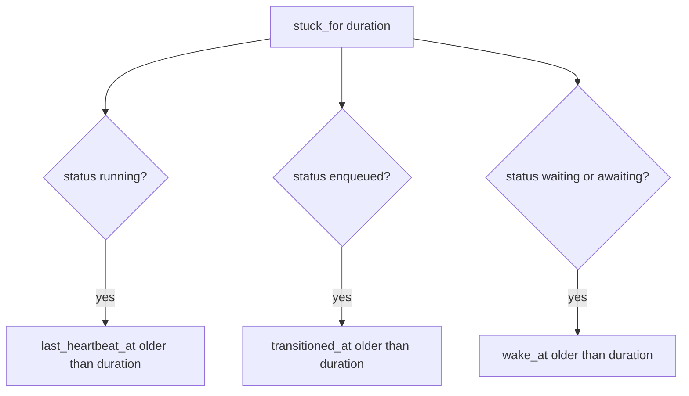

# 12 -- Querying and observability

A durable run is an Active Record model, and the run rows are the application's own observability surface. There is no separate dashboard and no metrics subsystem; you query the two tables directly. Because every run has an identity, a status, a current step, a heartbeat, and an error trail, a single model method replaces the hand-written status columns and "last run" settings rows that a non-durable job would need.

This document walks the read surface: the `workflow_runs` entry point, every scope on `Run`, and the concrete queries an operations person or a controller action writes. The statuses behind the scopes are defined in [06-run-lifecycle.md](./06-run-lifecycle.md).

## The entry point: workflow_runs

Each job class knows its own runs:

```ruby
# lib/active_job/durable.rb (line 162)
def workflow_runs = Run.where(job_class: name).newest_first
```

The result is a plain Active Record relation scoped to that class, ordered newest first. Every scope below chains onto it. `workflow_runs` is scoped by `job_class`, which is why the `for` scope demands it: `for` derives the key through the job class's configuration, so a bare `Run.for(...)` raises `ArgumentError` ("for needs a job class") instead of guessing.

## The scope surface

The scopes live in `lib/active_job/durable/run.rb`. The three group scopes partition the nine statuses:

```ruby
# lib/active_job/durable/run.rb (lines 46-50)
scope :newest_first, -> { order(created_at: :desc, id: :desc) }
scope :live, -> { where(status: LIVE_STATUSES) }
scope :attention, -> { where(status: ATTENTION_STATUSES) }
scope :terminal, -> { where(status: TERMINAL_STATUSES) }
STATUSES.each { |status| scope status, -> { where(status:) } }
```

The groups are `LIVE_STATUSES = %w[enqueued running waiting awaiting]`, `ATTENTION_STATUSES = %w[failed halted]`, and `TERMINAL_STATUSES = %w[completed discarded cancelled]` (`run.rb`, lines 8-10). The `STATUSES.each` line generates nine per-status scopes with the same names: `enqueued`, `running`, `waiting`, `awaiting`, `failed`, `halted`, `completed`, `discarded`, `cancelled`.



`for` finds the runs `perform_later` would have created with the same arguments. It re-derives the key with the same configuration, so it needs the `job_class` scoping that `workflow_runs` provides:

```ruby
# lib/active_job/durable/run.rb (lines 61-66)
scope :for, ->(*args, **kwargs) {
  next where(key: kwargs[:workflow_key]) if kwargs.key?(:workflow_key)

  job_class = where_values_hash["job_class"] or raise ArgumentError, "for needs a job class; use MyJob.workflow_runs.for(...)"
  where(key: job_class.constantize.durable_config.workflow_key(*args, **kwargs))
}
```

The two forms cover both cases: `for(card)` matches the key derived from the arguments, and `for(workflow_key: "imports/42")` matches a key verbatim. How a key is derived, and how `identified_by` narrows it, is in [08-identity-and-uniqueness.md](./08-identity-and-uniqueness.md).

Two more scopes locate specific trouble. `at_step` matches the `current_step` column, so it names the step a run is parked or stuck on. `stuck_for` detects runs the machinery abandoned:

```ruby
# lib/active_job/durable/run.rb (lines 52-59)
scope :at_step, ->(name) { where(current_step: name.to_s) }
scope :stuck_for, ->(duration) {
  since = duration.ago
  where(status: "running").where(last_heartbeat_at: ...since)
    .or(where(status: "enqueued").where(transitioned_at: ...since))
    .or(where(status: WAKEABLE_STATUSES).where(wake_at: ...since))
}
```

`stuck_for` has three branches, one per way a run can be left behind:



A `running` run whose worker died stops writing heartbeats, so `last_heartbeat_at` goes stale. An `enqueued` run whose message never arrived stops transitioning, so `transitioned_at` goes stale. A parked run whose clock tick was missed sits past its `wake_at`. Each branch is one column compared against `duration.ago`. The `due` scope is the parked-run half of this, used by the clock: `where(status: WAKEABLE_STATUSES, wake_at: ..now)` (`run.rb`, line 60), described with the timers in [09-timers.md](./09-timers.md).

## Concrete read patterns

Find the one run for a subject, live if it exists:

```ruby
# README.md (lines 167-169)
ImportJob.workflow_runs.for(import)                       # same key as ImportJob.perform_later(import)
ImportJob.workflow_runs.for(import).live.first            # the run in progress, or nil
```

The idiomatic place for that expression is a method on the model, so a controller or webhook can reach the run without a class-level helper:

```ruby
# skills/ajdc/references/api.md (lines 148-150)
def job_run = ImportJob.workflow_runs.for(self).live.sole
```

List the runs that need a person, and the ones that need a look:

```ruby
# skills/ajdc/references/api.md (line 140), README.md (lines 210-213)
MyJob.workflow_runs.halted / .failed / .attention
MyJob.workflow_runs.at_step(:process)
MyJob.workflow_runs.stuck_for(1.hour)
```

The signal-specific query is the review queue: the runs parked on an `await`, at the exact step whose name is the signal:

```ruby
# README.md (line 374)
CardGenerationJob.workflow_runs.awaiting.at_step(:review)
```

Because the scopes chain, an operations person can compose them freely. `MyJob.workflow_runs.failed.at_step(:process)` narrows to the failed runs on a particular step; `Run.stuck_for(1.hour).running.find_each(&:cancel!)` ends every run whose worker died (`README.md`, line 398). The scopes are just `where` clauses, so the result supports the full Active Record interface: `count`, `pluck`, `find_each`, `sole`, and ordering.

## A run is a model you act on

Reading is half the surface. A `Run` instance carries the transition verbs from [11-halting-resuming-cancelling.md](./11-halting-resuming-cancelling.md) and the signal verb from [10-signals.md](./10-signals.md): `resume!`, `cancel!`, and `wake_up`. It also exposes three status predicates, `live?`, `attention?` and `terminal?` (`lib/active_job/durable/run.rb:85-89`), which test membership in the three groups. The run row is not a read-only projection; it is the handle through which a person or a controller drives the workflow.

The readable columns tell the whole story of one run:

```ruby
# skills/ajdc/references/api.md (line 142)
run.status, run.current_step, run.completed_steps, run.state, run.wake_at, run.halt_reason
```

`status` says where the job is. `current_step` names the open step. `completed_steps` is the list of steps already finished, in order. `state` is the job's attribute values, in the plain-hash form the job restores them from (`Run::StateType`, `run.rb` lines 18-36). `wake_at` is the parked deadline. `halt_reason` is the human-readable stop reason from a `halt!`. The error trail is `error_class` and `error_message`. The step attempts, each with its own cursor, status, and error, are `run.steps`, one row per attempt ordered by position then attempt (`run.rb`, line 40).

## The Aha Moment

**Aha:** The observability layer is the same table the machinery writes. A run does not need a separate "audit" or "events" stream to answer "where is my import?"; the `status`, `current_step`, `completed_steps`, and `error_class` columns are the answer, written at every step boundary and checkpoint as a side effect of execution. The scopes are not a query API bolted on afterward; they are thin `where` clauses over the columns the execution path already maintains, which is why `stuck_for` can be defined as three comparisons against heartbeat and transition timestamps.

The columns those scopes read, and the timestamps they compare, are defined in [04-data-model.md](./04-data-model.md). The heartbeat that makes `stuck_for` meaningful is written by the checkpoint machinery described in [05-steps-cursors-checkpoints.md](./05-steps-cursors-checkpoints.md). What happens to a stuck or terminal run once it is found, and how `cancel!` ends it, is in [11-halting-resuming-cancelling.md](./11-halting-resuming-cancelling.md).

Continue to [13-callbacks-and-rescue.md](./13-callbacks-and-rescue.md).
