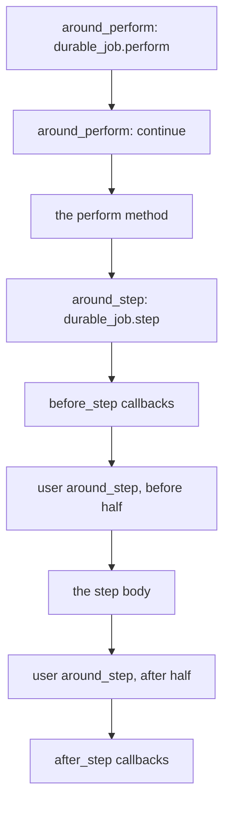
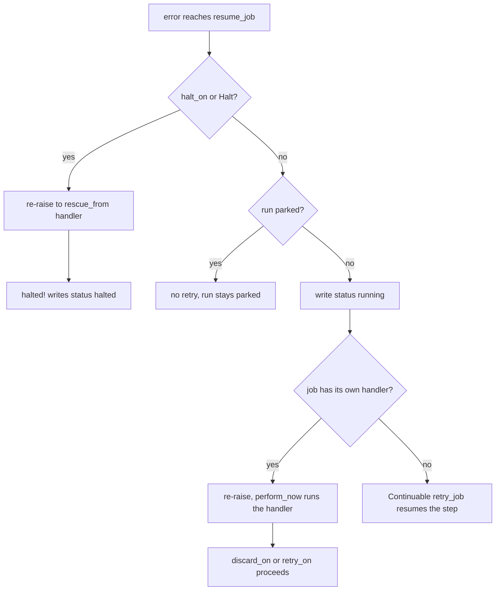

# 13 -- Callbacks and rescue

AJ/DC adds two callback layers to the Active Job job lifecycle. The first is the step callbacks, `before_step`, `after_step`, and `around_step`, which run around every step that executes. The second is a set of internal wrappers that keep the run row in sync, and a rescue-ordering rule that decides whose handler sees an error first. Together they are the machinery that makes `await`, `halt!`, `cancel!`, and the run's `discarded` status work.

The step callbacks are Active Support callbacks with the same shape as `before_perform` and friends. They are not a new system; they reuse the framework's callback engine.

## The three step hooks

The macros come from `ActiveJob::Continuable::Callbacks`, which `ActiveJob::Durable` includes (`lib/active_job/durable.rb`, line 33):

```ruby
# lib/active_job/continuable/callbacks.rb (lines 24-46)
included do
  define_callbacks :step, skip_after_callbacks_if_terminated: true

  unless continuation_class <= Continuation::Callbacks
    self.continuation_class = Class.new(continuation_class) do
      prepend Continuation::Callbacks

      set_temporary_name "#{superclass.name}(WithCallbacks)"
    end
  end
end

class_methods do
  def before_step(*filters, &blk) = set_callback(:step, :before, *filters, &blk)
  def after_step(*filters, &blk) = set_callback(:step, :after, *filters, &blk)
  def around_step(*filters, &blk) = set_callback(:step, :around, *filters, &blk)
end
```

`define_callbacks :step` creates a callback chain named `:step`. The macros register callbacks onto it. `current_step` returns the step that is running, `nil` between steps (`continuable/callbacks.rb`, line 45).

The chain is driven from the continuation side. `ActiveJob::Continuation::Callbacks` is prepended to the continuation class, and it wraps the step instrumentation point with a callback run:

```ruby
# lib/active_job/continuation/callbacks.rb (lines 9-16)
module Callbacks
  def running_step = (current if running_step?)

  private

  def instrumenting_step(step, &block) = super { job.run_callbacks(:step, &block) }
end
```

When the continuation runs a step, `instrumenting_step` yields to `job.run_callbacks(:step, &block)`, so the job's `:step` chain fires around the step body. A step skipped on resume runs no callbacks, and `after_step` runs only when the step body completes normally. The test `after_step does not run for a halted or a failed step` (`test/cases/step_hooks_test.rb`, lines 127-135) pins the second rule: when a step body raises, the `after` half of the chain never runs.

## The two built-in wrappers and why they are prepended

`ActiveJob::Durable`'s `included` block installs two wrappers with `prepend: true`:

```ruby
# lib/active_job/durable.rb (lines 111-123)
included do
  self.continuation_class = Continuation

  around_step(prepend: true) { |_job, block| durable_job.step(&block) }
  around_perform(prepend: true) { |_job, block| durable_job.perform(&block) }

  after_discard { |_job, error| durable_job.record_discard(error) }
  rescue_from(Halt) { |error| durable_job.halted!(error) }
end
```

The first wraps every step body with `Execution#step`, the durability wrapper that parks the run, creates the step row, and marks it completed, halted, failed, interrupted, or cancelled (`execution.rb`, lines 97-110). The second wraps the whole `perform` with `Execution#perform`, the wrapper that writes the run `running` on start and `completed` at the end, and skips a run that was cancelled while queued (`execution.rb`, lines 84-94).

Why `prepend: true`? Active Support `around` callbacks run in definition order, and the first-defined callback is the outermost wrapper. By prepending, Durable forces its two wrappers to the front of their chains, so they wrap everything else:

- The step wrapper must be outermost so it sees the step body and every user callback around it. That is what lets it write `step_stopped!` when a `halt!` or an error escapes from a user's `around_step` or the body, and what lets `wait!` park the run before any `before_step` callback runs.
- The perform wrapper must be outermost so it wraps Continuable's own `around_perform :continue`. `continue` is the callback that turns an error-after-progress into a resumption; the durable wrapper must sit outside it to decide `completed!` only when no resume happened.



The ordering test (`test/cases/step_hooks_test.rb`, lines 95-104) shows the exact sequence for one step: all `before_step` callbacks in definition order, then each `around_step`'s before half in definition order, then the body, then the `after_step` callbacks in reverse definition order, then each `around_step`'s after half in reverse. The durable wrapper is invisible in that log precisely because it is prepended: it is the first thing in and the last thing out, outside the recorded region.

## Rescue ordering: RescueHandlersFirst

The subtler layer is a rescue-ordering rule. Continuable's `continue` rescues any `StandardError` raised after the job made progress and resumes the job. Left alone, that would swallow errors the job has declared handlers for: a `discard_on` or `retry_on` would never see an error raised after a cursor advanced. The module `ActiveJob::Continuation::RescueHandlersFirst` fixes this by prepending to `ActiveJob::Continuable`:

```ruby
# lib/active_job/continuation/rescue_handlers_first.rb (lines 16-27)
module RescueHandlersFirst
  private

  def resume_job(exception)
    error = exception.is_a?(Hash) ? exception[:exception] : exception
    raise error if !error.is_a?(Continuation::Interrupt) && handler_for_rescue(error)

    super
  end
end
```

The railtie installs it for every Continuable job in the application, not only durable ones:

```ruby
# lib/ajdc/railtie.rb (lines 18-22)
initializer "ajdc.rescue_handlers_first" do
  ActiveSupport.on_load(:active_job_continuable) do
    prepend ActiveJob::Continuation::RescueHandlersFirst
  end
end
```

The rule: when an error reaches `resume_job` and the job has its own handler (`rescue_from`, `discard_on`, `retry_on`), re-raise it. `perform_now` then runs that handler exactly as it would for a non-durable job. An error with no handler, and an interrupt, fall through to `super` and resume as before.

The tests make the three outcomes explicit (`test/cases/rescue_handlers_first_test.rb`): `discard_on` sees an error raised after progress instead of resuming (lines 46-54); `retry_on` retries it while keeping the cursor (lines 56-67); an error without a handler is resumed (lines 69-76).

## The resume_job chain

For a durable job, three `resume_job` methods stack. The job class includes `ActiveJob::Durable`, so Durable's override runs first:

```ruby
# lib/active_job/durable.rb (lines 246-249)
def resume_job(exception)
  error = exception.is_a?(Hash) ? exception[:exception] : exception
  super if durable_job.resume!(error)
end
```

`Execution#resume!` decides whether this is really a resume:

```ruby
# lib/active_job/durable/execution.rb (lines 126-134)
def resume!(error)
  raise error if halt?(error)

  @resumed = true
  return false if @parked

  write_running!(state:, resumptions: job.resumptions, last_heartbeat_at: Time.current)
  true
end
```

The chain, outermost first, is `Durable#resume_job`, then `RescueHandlersFirst#resume_job`, then the framework's `Continuable#resume_job` (which records executions and calls `retry_job`). Each layer decides one thing:



The `halt?` check at the top is what makes `halt_on` work end to end. A `halt_on`-declared error raised after progress is a `StandardError`, so `continue` catches it and calls `resume_job`. `Execution#resume!` re-raises it, because it is a halt error, so the `rescue_from` handler that `halt_on` registered runs and writes `halted!`. Without that first check, `halt_on` errors would be resumed like any other. This is the mechanism behind the behavior described in [11-halting-resuming-cancelling.md](./11-halting-resuming-cancelling.md).

The `@parked` guard handles the interrupt. When a step parks itself for a timer or a signal, `wait!` raises an interrupt and sets `@parked = true` (`execution.rb`, lines 386-387). `continue` rescues the interrupt and calls `resume_job`; `Execution#resume!` returns `false`, so no `retry_job` runs. The run is already parked with its serialized job, so the backend must not re-enqueue it. This is the bridge to [10-signals.md](./10-signals.md) and [09-timers.md](./09-timers.md).

## The discard path

The last hook in the included block is `after_discard`. When a `discard_on` handler discards a job, Active Job runs the `after_discard` callbacks. Durable records the error, and the perform wrapper writes the row once `perform_now` returns:

```ruby
# lib/active_job/durable/execution.rb (lines 67-81)
def perform_now
  @discarded_error = nil
  result = yield
  discarded!(@discarded_error) if @discarded_error
  result
rescue Exception => error # rubocop:disable Lint/RescueException
  failed!(error) unless @conflict
  raise
end

def record_discard(error)
  @discarded_error = error
end
```

The `rescue Exception` here is the last resort: it fires only for an error that escaped every `rescue_from` handler. That is the `failed` status, an exception that reached the backend. The `discarded` status is the opposite: the framework swallowed the error, so `perform_now` returns normally and the recorded error is written after the fact.

## The Aha Moment

**Aha:** The two `prepend: true` wrappers and the `RescueHandlersFirst` module are all the same trick, applied at three levels. Prepend puts a wrapper first in a callback chain, so it becomes the outermost layer, and prepend puts a method before a framework module in the ancestor chain, so it intercepts a call. The durable step wrapper owns the step row, the durable perform wrapper owns the run status, and `RescueHandlersFirst` owns the question of which handler sees an error. Ordering is not a detail here; it is the entire mechanism, and the reason the code comments say "so we can wrap it" rather than "so it runs at the end."

The steps these callbacks wrap, and the cursor and checkpoint machinery inside them, are in [05-steps-cursors-checkpoints.md](./05-steps-cursors-checkpoints.md). The run statuses that the perform wrapper writes, and how they relate to retries and interrupts, are in [06-run-lifecycle.md](./06-run-lifecycle.md). What a halt error does once the `halted!` writer runs is in [11-halting-resuming-cancelling.md](./11-halting-resuming-cancelling.md).

Continue to [14-housekeeping-and-agent-skill.md](./14-housekeeping-and-agent-skill.md).
