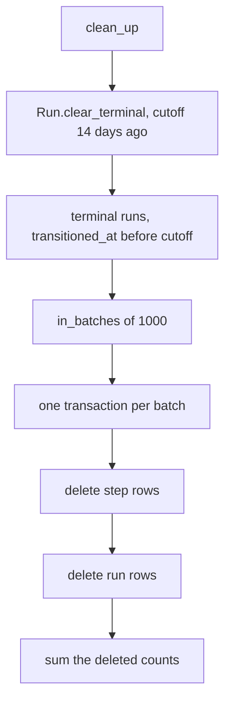
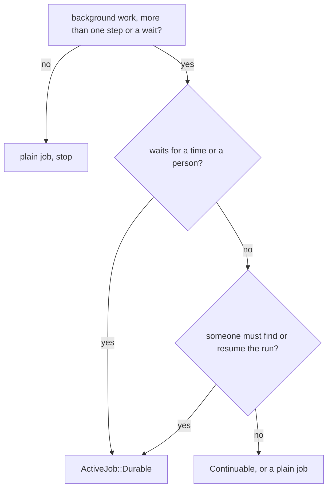

# 14 -- Housekeeping and the agent skill

The last two pieces of AJ/DC are about operating the system over time. One is a recurring job that deletes old, finished runs so the two tables do not grow forever. The other is a shipped skill that teaches a coding agent how to build durable workflows. One keeps the data small; the other keeps the workflows correct.

## Housekeeping: deleting old terminal runs

A run never changes after it reaches a terminal status. A `completed`, `discarded`, or `cancelled` row is a finished record, written once and then only read. Without a cleanup, those records accumulate with every run the application ever executes.

The cleanup entry point is a class-level method with a retention window:

```ruby
# lib/active_job/durable.rb (lines 47-61)
mattr_accessor :keep_terminal_runs_for, instance_accessor: false, default: 14.days

def self.wake_up_due = Run.wake_due

def self.clean_up
  return 0 unless keep_terminal_runs_for

  Run.clear_terminal(ended_before: keep_terminal_runs_for.ago)
end
```

The retention window defaults to 14 days. `clean_up` deletes terminal runs that ended before that window, and returns how many. Setting the window to `nil` disables deletion entirely, and `clean_up` returns zero without touching anything. The window is configurable through the railtie, which maps application configuration onto the module attributes:

```ruby
# lib/ajdc/railtie.rb (lines 7-16)
config.active_job_durable = ActiveSupport::OrderedOptions.new

initializer "ajdc.config", after: :load_config_initializers do |app|
  app.config.active_job_durable.each { |name, value| ActiveJob::Durable.public_send(:"#{name}=", value) }
end
```

So an application raises the retention to 30 days in `config/application.rb`:

```ruby
# README.md (lines 390-392)
config.active_job_durable.keep_terminal_runs_for = 30.days
```

The actual deletion is `Run.clear_terminal`, which removes runs and their step rows together, one batch per transaction:

```ruby
# lib/active_job/durable/run.rb (lines 72-83)
def self.clear_terminal(ended_before:, batch_size: 1_000)
  terminal.where(transitioned_at: ...ended_before).in_batches(of: batch_size).sum do |batch|
    ids = batch.ids
    transaction do
      Step.where(run_id: ids).delete_all
      where(id: ids).delete_all
    end
  end
end
```

Two details make this safe and cheap. First, the cutoff reads `transitioned_at`, not `finished_at`, because a terminal row is never written again, so `transitioned_at` is the moment it ended (the comment on `run.rb` lines 72-74 states this). Second, the steps are deleted before the runs, inside one transaction, so the foreign key from `active_job_durable_steps` to `active_job_durable_runs` is honored even though the run delete happens in the same batch. The schema indexes `[status, transitioned_at]` (`db/durable_schema.rb`, line 37), which is exactly the column pair this query walks.



The recurring job that drives it is one line, and it pairs with the clock job from [09-timers.md](./09-timers.md):

```ruby
# lib/active_job/durable/housekeeping_job.rb (lines 12-14)
class HousekeepingJob < ActiveJob::Base
  def perform = Durable.clean_up
end
```

Scheduling it is the application's job, for example with Solid Queue's recurring tasks (`README.md`, lines 381-386). The retention defaults on for a reason: the two tables are append-only for terminal runs, so leaving cleanup off means unbounded growth. Attention runs (`failed`, `halted`) are never deleted, because a person may still need them. Stuck runs are deliberately left to the application: `stuck_for` finds them and `cancel!` ends them, as described in [12-querying-and-observability.md](./12-querying-and-observability.md) and [11-halting-resuming-cancelling.md](./11-halting-resuming-cancelling.md).

## The agent skill

The gem ships a skill for coding agents in `skills/ajdc/`, following the skills.sh layout so any agent that reads `SKILL.md` can use it (`README.md`, lines 22-34). The skill's purpose is explicit in its frontmatter: to turn the messy, ad-hoc shapes of background work into one durable, resumable workflow. It names the cases it applies to, and says to reach for it when a feature is a multi-step background process, a timer, an approval or webhook wait, a job that re-enqueues itself, a status field that tracks a job's position, or a job that must survive a crash and be resumable.

`SKILL.md` is a decision procedure, not an API reference. It has five parts. The first is a decision tree that asks the only two decisive questions: does the process wait for a time or a person, and does anyone need to find or resume the run after a failure?



The second part maps shapes an agent sees in existing code to the durable shape that replaces them: a chain of jobs with status fields is a pipeline of `step` calls; a self-re-enqueuing job with a state machine is steps with `isolated: true`; a controller action that flips state and enqueues is a signal; a settings row holding "the last run" is a run record. The third part is the implementation sequence, the ten numbered steps of the `Implement` step: decide where each piece of state lives, switch the include, name the identity (`identified_by` and `unique_by`), move waits into steps (`wait:` and `wait_until:`), move signals into `await`, classify errors (`retry_on` / `discard_on` / `halt_on`), move broadcasts into step callbacks, replace the hand-written records, check the transaction story, and write the tests. The fourth part is a list of "do not" rules: do not mirror a status onto a model, do not `sleep` in a step, do not put `wait:` and `wait_until:` on one step, and do not replace a sweep over millions of rows with millions of parked runs without reading the guide. The fifth part is a report of what was converted and which queries the UI now uses.

The skill ships five references and six worked examples.

The references are the knowledge base behind the procedure. `api.md` is the full API surface and the differences that matter: the identity table (`identified_by` versus `unique_by` versus `set(workflow_key:)`), the `on_conflict` values, the timer semantics, the signal semantics, the stop verbs, the statuses, and the callback rules. `transactions.md` is the transaction story: when the run row commits with the entity, how the guarded updates join the caller's transaction, and what breaks when the run rows live in a separate database. `decision-guide.md` decides workflow versus sweep versus hybrid, when a signal beats a state column, and when `halt!` beats `await` beats `retry_on`. `installation.md` decides one database versus two and adds the recurring wake job, without which no timer or deadline ever fires. `testing.md` teaches the test harness and, more importantly, what not to assert: the logic on the models first, then the run's `status` and `completed_steps`, never the internal `parked_job` or step attempt counts.

The examples are before-and-after transformations, each named for the shape it replaces: `pipeline.md` (a job chain and a status field), `timers.md` (cron sweeps and `set(wait_until:)` with hand-made invalidation), `signals.md` (a state column plus a controller, and a webhook that continues a flow), `halting.md` (an error a person fixes), `uniqueness.md` (one live run per identity, with `:skip`, `:replace`, and `:reject`), and `agent-loop.md` (an LLM loop with a tool approval). The agent-loop example is the sharpest statement of the skill's purpose: a non-deterministic agent that talks to a large language model (LLM) stops at a tool approval with `halt!(:tool_approval)`, a human approves in a controller, and `resume!` re-enters the loop step exactly where it stopped.

## The Aha Moment

**Aha:** Housekeeping and the agent skill solve opposite sides of the same problem. The recurring job deletes what is finished, so the database holds only what is live or needs attention. The skill exists because the hard part of a durable workflow is not the API, it is the recognition problem: seeing that a status field, a controller action, and a cron sweep are one workflow trying to express itself without a home. The skill's decision tree and the before-and-after examples teach that recognition, and the housekeeping job ensures the records that recognition produces do not pile up forever.

The terminal statuses that housekeeping deletes, and the lifecycle that produces them, are in [06-run-lifecycle.md](./06-run-lifecycle.md). The `wake_up_due` counterpart that pairs with `clean_up`, and the clock job that drives it, are in [09-timers.md](./09-timers.md). The full map of the document set is in [00-overview.md](./00-overview.md).

Continue to [README.md](./README.md).
