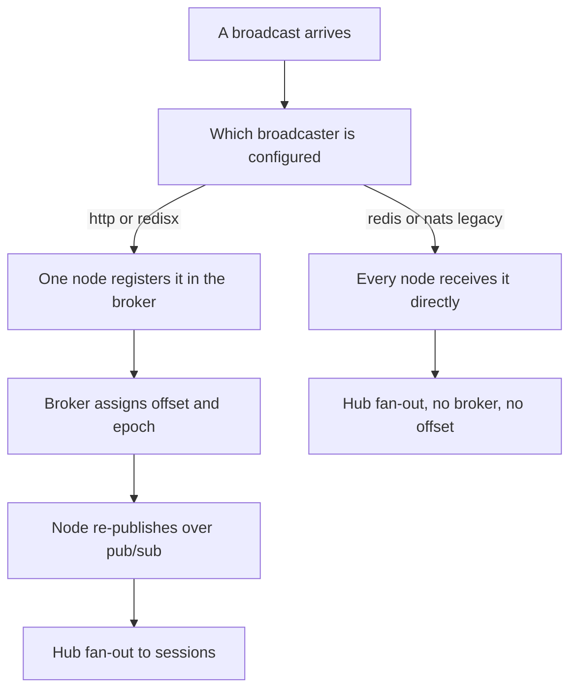
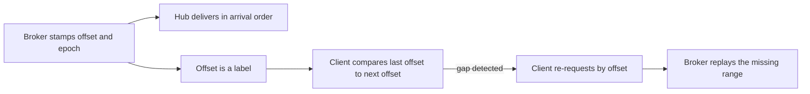

# 00 -- The delivery question: what ordered and at-least-once actually mean here

AnyCable-Go is a server that copies a message published to a stream out to every
session subscribed to that stream. The project documentation promises two
properties. The Reliable Streams guide says the design moves "from at-most-once
to at-least-once and even exactly-once delivery" when a broker is enabled:

```text
# Source: docs/reliable_streams.md, line 3
Since v1.4, AnyCable allows you to enhance the consistency of your real-time data and go from **at-most-once** to **at-least-once** and even **exactly-once delivery**.
```

This exploration checks that claim against the Go code. The finding, in one
sentence: the server does **not** implement an acknowledged, totally ordered,
push-based protocol. It implements two cooperating mechanisms:

1. An in-process, in-order fan-out per stream (a hash-sharded hub plus one
   per-connection First In First Out (FIFO) queue).
2. A client-pulled replay: the broker stamps each message with a monotonic
   offset, keeps a bounded per-stream history, and a reconnecting client asks
   "give me everything after offset N".

The broker is the server component that assigns the offsets, keeps the
per-stream history, and answers the client's replay requests.

"At-least-once" here means replay-on-request, not push-with-acknowledgement.
There is no per-message acknowledgement from client to server anywhere in the
delivery path. The client reports its position by asking for history.

## Two delivery regimes, not one

The code has two different delivery architectures, and they give different
guarantees. Which one you get is a configuration choice, not a code path the
server always takes.



The left branch is the broker architecture. It assigns offsets and keeps
history, so a client can catch up after a gap. The right branch is the legacy
fan-out. It bypasses the broker entirely; messages carry no offset and are not
stored, so a disconnected client misses them forever.

## What the message actually carries

The message type shows the ordering metadata as optional fields, not as
something the server always fills:

```go
// Source: common/common.go, lines 369-379
// StreamMessage represents a pub/sub message to be sent to stream
type StreamMessage struct {
	Stream string                 `json:"stream"`
	Data   string                 `json:"data"`
	Meta   *StreamMessageMetadata `json:"meta,omitempty"`

	// Offset is the position of this message in the stream
	Offset uint64 `json:"offset,omitempty"`
	// Epoch is the uniq ID of the current storage state
	Epoch string `json:"epoch,omitempty"`
}
```

`Offset` and `Epoch` are populated only by a broker. The epoch is the unique
identifier of the current broker storage state, regenerated when a broker
starts, so an offset is only meaningful together with its epoch. The memory
broker fills them in its broadcast handler:

```go
// Source: broker/memory.go, lines 306-320
func (b *Memory) HandleBroadcast(msg *common.StreamMessage) (err error) {
	if msg.Meta != nil && msg.Meta.Transient {
		b.broadcaster.Broadcast(msg)
		return
	}

	offset := b.add(msg.Stream, msg.Data)

	msg.Epoch = b.GetEpoch()
	msg.Offset = offset

	b.broadcaster.Broadcast(msg)

	return
}
```

So ordering metadata is a broker feature. No broker means no offset, no epoch,
and no replay.

## The honest boundary

The strongest guarantees the code actually enforces are these:

- On one node, messages on one stream are fanned out to a session in the order
  the node's hub received them. This is a single-goroutine chain, described in
  document 02.
- The broker assigns strictly increasing offsets per stream, so a client can
  detect a gap and re-request the missing range. This is described in document 04.
- The Redis (an in-memory data store) Streams broadcaster (the `redisx` adapter)
  delivers each publication at least once from the Ruby application to a node,
  using a consumer group with reclaim. This is described in document 03.

The guarantees the code does **not** enforce:

- No total order across two different streams, even on one node. A session
  subscribed to two streams can receive their messages interleaved in any order.
- No total order across nodes. Two messages on one stream, re-published by two
  different nodes, can reach a third node in either order. The offsets are
  correct but are never used to reorder delivery.
- No exactly-once. The replay can produce duplicates, and the history can expire,
  producing a gap. Both are covered in document 06.



## The Aha Moment

**Aha:** The word "ordered" in AnyCable means two different, unrelated things.
The broker's offset is a *label* attached to a message so a client can detect and
fill a gap; it does not order delivery. The delivery order itself comes only from
the in-process queue chain, which is per stream and per node. "At-least-once"
comes from the client pulling history by offset, not from the server pushing with
acknowledgements. The server never sorts by offset and never waits for an
acknowledgement.

## Cross-References

- [01-stream-model-subscriptions.md](./01-stream-model-subscriptions.md) — how a session ends up subscribed to a stream.
- [03-cross-node-broadcasts.md](./03-cross-node-broadcasts.md) — the two delivery regimes in detail.
- [06-where-the-guarantee-holds.md](./06-where-the-guarantee-holds.md) — the full map of what holds and what breaks.

Continue to [01-stream-model-subscriptions.md](./01-stream-model-subscriptions.md).
