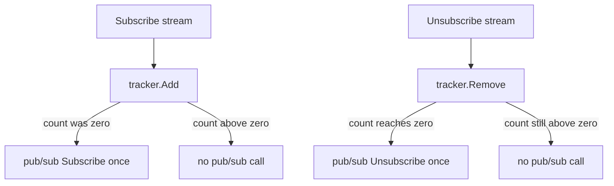
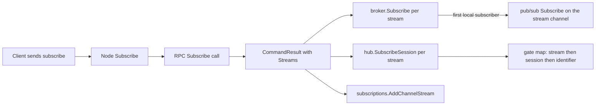

# 01 -- The stream model: subscribe, unsubscribe, and the broker tracker

A stream in AnyCable-Go is just a string name. There is no stream object, no
stream owner, and no per-stream state outside the broker. A stream exists only
as a key in two places: the hub's per-gate subscription maps, and the broker's
history map. A session becomes a subscriber when the remote procedure call (RPC)
application returns a stream name, and it stops being one when the application
stops that stream.

## Where subscriptions come from

The RPC application does not tell the server about streams up front. It returns
stream names in the result of a `subscribe`, `perform`, or `unsubscribe` RPC
call. The node applies those names to the hub and to the broker:

```go
// Source: node/node.go, lines 1041-1049
	if reply.Streams != nil {
		isDirty = true

		for _, stream := range reply.Streams {
			streamId := n.broker.Subscribe(stream)
			n.hub.SubscribeSession(s, streamId, msg.Identifier)
			s.subscriptions.AddChannelStream(msg.Identifier, streamId)
		}
	}
```

Three things happen for each returned stream, in this order: the broker's
reference tracker is incremented, the hub records the session-to-stream edge,
and the session's own subscription state records the stream under the channel
identifier. The same `msg.Identifier` can own several streams.

Unsubscribing is the reverse. When the session disconnects, every stream it held
is released through the same tracker:

```go
// Source: node/node.go, lines 919-933
func (n *Node) unsubscribeSessionStreams(s *Session) {
	s.smu.Lock()
	allStreams := s.subscriptions.ToMap()
	s.smu.Unlock()

	for _, streams := range allStreams {
		for _, stream := range streams {
			n.broker.Unsubscribe(stream)
		}
	}

	if len(allStreams) > 0 {
		s.Log.Debug("unsubscribed from broker streams", "channels", len(allStreams))
	}
}
```

## The reference tracker gates pub/sub

The broker keeps a reference count per stream. Only the first local subscriber
subscribes to the stream's pub/sub channel, and only the last one unsubscribes.
This is what makes the broker architecture scale: a node receives cross-node
messages only for streams that have at least one local session.

```go
// Source: broker/broker.go, lines 92-137
type StreamsTracker struct {
	store map[string]uint64

	mu sync.Mutex
}

func NewStreamsTracker() *StreamsTracker {
	return &StreamsTracker{store: make(map[string]uint64)}
}

func (s *StreamsTracker) Add(name string) (isNew bool) {
	s.mu.Lock()
	defer s.mu.Unlock()
	if _, ok := s.store[name]; !ok {
		s.store[name] = 1
		return true
	}

	s.store[name]++
	return false
}

func (s *StreamsTracker) Has(name string) bool {
	s.mu.Lock()
	defer s.mu.Unlock()

	_, ok := s.store[name]

	return ok
}

func (s *StreamsTracker) Remove(name string) (isLast bool) {
	s.mu.Lock()
	defer s.mu.Unlock()
	if _, ok := s.store[name]; !ok {
		return false
	}

	if s.store[name] == 1 {
		delete(s.store, name)
		return true
	}

	s.store[name]--
	return false
}
```

The memory broker wraps that tracker:

```go
// Source: broker/memory.go, lines 329-347
func (b *Memory) Subscribe(stream string) string {
	isNew := b.tracker.Add(stream)

	if isNew {
		b.broadcaster.Subscribe(stream)
	}

	return stream
}

func (b *Memory) Unsubscribe(stream string) string {
	isLast := b.tracker.Remove(stream)

	if isLast {
		b.broadcaster.Unsubscribe(stream)
	}

	return stream
}
```

`broadcaster` here is the pub/sub subscriber (Redis (an in-memory data store) or
NATS (an open-source messaging system)). So the pub/sub subscription follows the
local head count, not the hub. This is the mechanism behind "only interested
nodes receive the stream".



## The hub side of a subscription

The hub records two maps: sessions by identifier, and per-session the list of
stream and identifier pairs. The subscribe path registers the session if it is
not yet registered:

```go
// Source: hub/hub.go, lines 276-291
func (h *Hub) SubscribeSession(session HubSession, stream string, identifier string) {
	h.gates[index(stream, h.gatesNum)].Subscribe(session, stream, identifier)

	h.mu.Lock()
	defer h.mu.Unlock()

	sid := session.GetID()

	if _, ok := h.sessions[sid]; !ok {
		h.sessions[sid] = NewHubSessionInfo(session)
	}

	h.sessions[sid].AddStream(stream, identifier)

	h.log.With("sid", sid).Debug("subscribed", "identifier", common.FilteredIdentifier(identifier), "stream", stream)
}
```

The gate subscription itself is a nested map: stream, then session, then
identifier. One session can appear under one stream several times, once per
identifier, which is why the inner map holds `map[string]bool`.



## The no-RPC stream controller

There is a second controller that does not call Ruby at all. It resolves a stream
name directly from the subscription identifier, verifies a signature if required,
and returns the stream to subscribe to. This is the path used by the "streams"
mode, Turbo, and CableReady:

```go
// Source: streams/controller.go, lines 55-95
func (c *Controller) Subscribe(ctx context.Context, sid string, env *common.SessionEnv, ids string, identifier string) (*common.CommandResult, error) {
	request, stream, err := c.VerifiedStream(identifier)

	if err != nil {
		c.log.With("identifier", common.FilteredIdentifier(identifier)).Debug("subscription failed", "error", err)

		return &common.CommandResult{
				Status:        common.FAILURE,
				Transmissions: []string{common.RejectionMessage(identifier)},
			},
			err
	}

	if request.SignedStreamName != "" {
		c.log.With("identifier", common.FilteredIdentifier(identifier)).Debug("subscribed verified", "stream", stream)
	} else {
		c.log.With("identifier", common.FilteredIdentifier(identifier)).Debug("", "stream", stream)
	}

	var state map[string]string

	if request.whisper {
		state = make(map[string]string)
		state[common.WHISPER_STREAM_STATE] = stream
	}

	if request.presence {
		if state == nil {
			state = make(map[string]string)
		}
		state[common.PRESENCE_STREAM_STATE] = stream
	}

	return &common.CommandResult{
		Status:             common.SUCCESS,
		Transmissions:      []string{common.ConfirmationMessage(identifier)},
		Streams:            []string{stream},
		DisconnectInterest: -1,
		IState:             state,
	}, nil
}
```

The important detail for delivery: even in this mode, the result is a
`CommandResult.Streams` list, and the node feeds it through the same
`handleCommandReply` loop shown above. So every subscription converges on the
same hub and broker path regardless of whether Ruby or the stream controller
produced the stream name.

## The Aha Moment

**Aha:** The stream is not a first-class object; it is a name that exists only
as a count in the broker tracker and as a key in the hub's nested maps. The
broker reference count is the load-bearing part: it is what decides whether a
node receives a stream's cross-node traffic, and it is shared by every
subscription path, RPC or not. Ordering is decided later, in the hub fan-out;
here the code only decides membership.

## Cross-References

- [02-hub-fanout-send-queue.md](./02-hub-fanout-send-queue.md) — what happens once a session is in the gate map.
- [03-cross-node-broadcasts.md](./03-cross-node-broadcasts.md) — the pub/sub channel the tracker subscribes to.
- [05-session-resume-offsets.md](./05-session-resume-offsets.md) — how these same subscription maps are restored on reconnect.

Continue to [02-hub-fanout-send-queue.md](./02-hub-fanout-send-queue.md).
