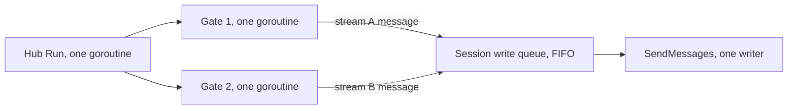
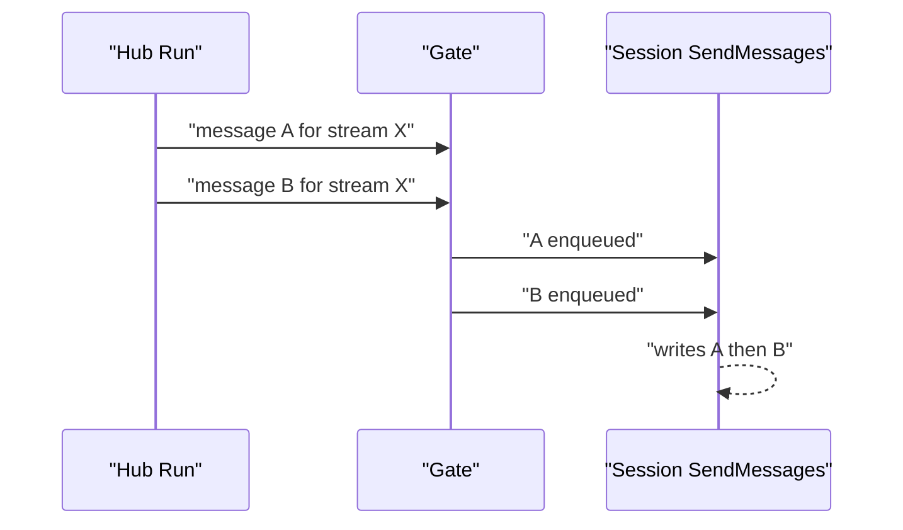

# 02 -- The sharded hub and the per-connection send queue: one goroutine preserves per-stream order

This document covers the strongest ordering guarantee in the code: on one node,
messages on one stream reach one session in the order the node's hub received
them. The guarantee is not a sort, not a sequence-number check. It is the shape
of the queue chain itself: a single goroutine per hub, a single goroutine per
gate, and a single writer goroutine per session.

## The hub is sharded by stream hash

The hub owns a fixed number of gates. A stream name is hashed to one gate, so a
given stream always lands on the same gate. The default is 16 gates:

```go
// Source: node/config.go, lines 41-51
func NewConfig() Config {
	return Config{
		PingInterval:               3,
		StatsRefreshInterval:       5,
		HubGopoolSize:              16,
		ShutdownDisconnectPoolSize: 16,
		PingTimestampPrecision:     "s",
		DisconnectMode:             DISCONNECT_MODE_AUTO,
		ShutdownTimeout:            30,
	}
}
```

The hash is Fowler-Noll-Vo (FNV-1a) 64-bit, taken modulo the gate count:

```go
// Source: hub/hub.go, lines 372-389
func buildGates(ctx context.Context, num int, l *slog.Logger) []*Gate {
	gates := make([]*Gate, 0, num)
	for i := 0; i < num; i++ {
		gates = append(gates, NewGate(ctx, l.With("component", "hub", "gate", i)))
	}

	return gates
}

func index(stream string, size int) int {
	if size == 1 {
		return 0
	}

	hash := fnv.New64a()
	hash.Write([]byte(stream))
	return int(hash.Sum64() % uint64(size))
}
```

## One goroutine consumes the broadcast channel

Every broadcast funnels into a single buffered channel on the hub. The hub's
`Run` loop is the only reader of that channel, and it dispatches each message to
the gate that owns its stream:

```go
// Source: hub/hub.go, lines 113-136
func (h *Hub) Run() {
	h.done.Add(1)
	for {
		select {
		case r := <-h.register:
			if r.event == "add" {
				h.AddSession(r.session)
			} else {
				h.RemoveSession(r.session)
			}

		case message := <-h.broadcast:
			h.broadcastToStream(message)

		case command := <-h.disconnect:
			h.disconnectSessions(command.Identifier, command.Reconnect)

		case <-h.shutdown:
			h.doneFn()
			h.done.Done()
			return
		}
	}
}
```

`broadcastToStream` is a one-line dispatch:

```go
// Source: hub/hub.go, lines 308-310
func (h *Hub) broadcastToStream(streamMsg *common.StreamMessage) {
	h.gates[index(streamMsg.Stream, h.gatesNum)].Broadcast(streamMsg)
}
```

Because `Run` is a single goroutine, the order in which messages enter the
`broadcast` channel is the order in which they are handed to each gate. Two
messages for the same stream cannot be dispatched concurrently.

## Each gate has its own loop and its own queue

Each gate is itself a small single-consumer queue. `Broadcast` pushes onto a
buffered channel, and one `broadcastLoop` goroutine drains it and calls
`performBroadcast`:

```go
// Source: hub/gate.go, lines 47-63
func (g *Gate) Broadcast(streamMsg *common.StreamMessage) {
	stream := streamMsg.Stream

	ctx := g.log.With("stream", stream)

	ctx.Debug("schedule broadcast", "message", streamMsg)

	g.mu.RLock()
	if _, ok := g.streams[stream]; !ok {
		ctx.Debug("no sessions")
		g.mu.RUnlock()
		return
	}
	g.mu.RUnlock()

	g.sender <- streamMsg
}
```

```go
// Source: hub/gate.go, lines 117-126
func (g *Gate) broadcastLoop(ctx context.Context) {
	for {
		select {
		case <-ctx.Done():
			return
		case msg := <-g.sender:
			g.performBroadcast(msg)
		}
	}
}
```

The gate channel is buffered at 256:

```go
// Source: hub/gate.go, lines 32-44
func NewGate(ctx context.Context, l *slog.Logger) *Gate {
	g := Gate{
		streams:         make(map[string]map[HubSession]map[string]bool),
		sessionsStreams: make(map[HubSession]map[string][]string),
		// Use a buffered channel to avoid blocking
		sender: make(chan *common.StreamMessage, 256),
		log:    l,
	}

	go g.broadcastLoop(ctx)

	return &g
}
```

`performBroadcast` snapshots the subscribers of the stream and sends to each one
synchronously, in the gate's single goroutine:

```go
// Source: hub/gate.go, lines 128-158
func (g *Gate) performBroadcast(streamMsg *common.StreamMessage) {
	stream := streamMsg.Stream

	buf := make(map[string]encoders.EncodedMessage)

	var bdata encoders.EncodedMessage

	g.mu.RLock()
	rows := createStreamSessionsSnapshot(g.streams[stream])
	g.mu.RUnlock()

	exclude := ""
	if streamMsg.Meta != nil {
		exclude = streamMsg.Meta.ExcludeSocket
	}

	for _, row := range rows {
		if exclude != "" && row.session.GetID() == exclude {
			continue
		}

		if msg, ok := buf[row.id]; ok {
			bdata = msg
		} else {
			bdata = buildMessage(streamMsg, row.id)
			buf[row.id] = bdata
		}

		row.session.Send(bdata)
	}
}
```

So for any two messages on the same stream: `Hub.Run` hands both to the same
gate in order, the gate's `broadcastLoop` processes them in that order, and the
same session's `Send` is called in that order. That is the per-stream,
per-session order guarantee.

## The per-connection send queue

`session.Send` does not write to the socket directly. It encodes the message and
pushes a frame onto a bounded queue. A dedicated writer goroutine drains that
queue in order:

```go
// Source: node/session.go, lines 487-519
func (s *Session) SendMessages() {
	for {
		if !s.writeQueue.Wait() {
			return
		}

		item, ok := s.writeQueue.Remove()
		if !ok {
			return
		}

		message := item.Data

		err := s.writeFrame(message)

		if message.FrameType == ws.CloseFrame {
			s.disconnectNow("Close frame sent", ws.CloseNormalClosure)
			return
		}

		if err != nil {
			if nerr, ok := err.(net.Error); ok && nerr.Timeout() {
				s.Log.Debug("write timed out", "error", err, "msg", logger.CompactValue(message.Payload))
				s.metrics.CounterIncrement(metricsWriteTimeout)
			}
			s.metrics.CounterIncrement(metricsFailedSent)
			s.disconnectNow("Write Failed", ws.CloseAbnormalClosure)
			return
		}

		s.metrics.CounterIncrement(metricsSentMsg)
	}
}
```

The queue has a byte-size bound. The default is 1 megabyte from the WebSocket
config, applied at session build time:

```go
// Source: ws/config.go, lines 21-30
func NewConfig() Config {
	return Config{
		Paths:           []string{"/cable"},
		ReadBufferSize:  1024,
		WriteBufferSize: 1024,
		MaxMessageSize:  65536,
		MaxPendingSize:  1024 * 1024, // 1 MB
		WriteTimeout:    2,
	}
}
```

When the pending bytes exceed that bound, the queue is cleared and the client is
disconnected as slow:

```go
// Source: node/session.go, lines 721-737
func (s *Session) sendFrame(message *ws.SentFrame) {
	maxPending := s.maxPendingSize.Load()
	size := uint64(len(message.Payload))
	item := utils.Item[*ws.SentFrame]{Data: message, Size: size}

	switch s.writeQueue.Push(item, maxPending) {
	case utils.PushClosed:
		return
	case utils.PushOK:
		break
	case utils.PushOverflow:
		s.maxPendingSize.Store(0)
		s.Log.Debug("slow client detected, disconnecting", "max", maxPending)
		s.metrics.CounterIncrement(metricsDisconnectedSlowClients)
		s.DisconnectWithMessage(common.NewDisconnectMessage(common.SLOW_CLIENT_REASON, true), common.SLOW_CLIENT_REASON)
	}
}
```

The queue itself is a first in, first out (FIFO) ring buffer. `Push` is the interesting part: on
overflow it clears the queue rather than blocking, and reports `PushOverflow`:

```go
// Source: utils/queue.go, lines 75-96
func (q *Queue[T]) Push(i Item[T], maxSize uint64) PushResult {
	q.mu.Lock()
	if q.closed {
		q.mu.Unlock()
		return PushClosed
	}
	if maxSize > 0 && q.size >= maxSize {
		q.clearLocked()
		q.mu.Unlock()
		return PushOverflow
	}
	if q.cnt == len(q.nodes) {
		q.resize(q.cnt * 2)
	}
	q.nodes[q.tail] = i
	q.tail = (q.tail + 1) % len(q.nodes)
	q.size += i.Size
	q.cnt++
	q.cond.Signal()
	q.mu.Unlock()
	return PushOK
}
```

## Where this ordering stops

The guarantee is per stream. A session subscribed to two streams hashed to two
different gates can receive a message from gate 1 and a message from gate 2 in
any order, because the two gates are two independent goroutines. The writer
queue is FIFO, but the producers are concurrent:





The second diagram shows the single-stream case: one gate, one producer, one
consumer, so A precedes B. There is no reordering step anywhere. The order is
preserved purely because each stage in the chain has exactly one goroutine.

## The Aha Moment

**Aha:** Ordering in AnyCable-Go is not enforced by comparing sequence numbers;
it is enforced by the topology. Every stage from the hub's `broadcast` channel
through a gate to a session's write queue has a single consumer, and the session
write queue is FIFO, so per-stream order falls out of the concurrency model for
free. The moment two streams land on two different gates, the chain splits into
two independent goroutines, and the guarantee ends exactly there.

## Cross-References

- [01-stream-model-subscriptions.md](./01-stream-model-subscriptions.md) — how the gate map gets its entries.
- [03-cross-node-broadcasts.md](./03-cross-node-broadcasts.md) — why cross-node order has no such single-goroutine chain.
- [06-where-the-guarantee-holds.md](./06-where-the-guarantee-holds.md) — the slow-client disconnect as a deliberate gap, not an ordering fix.

Continue to [03-cross-node-broadcasts.md](./03-cross-node-broadcasts.md).
