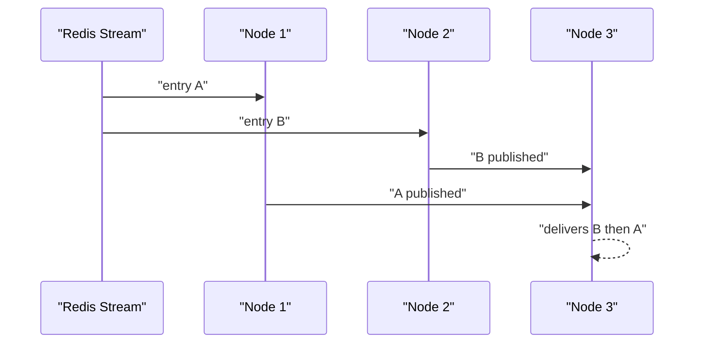
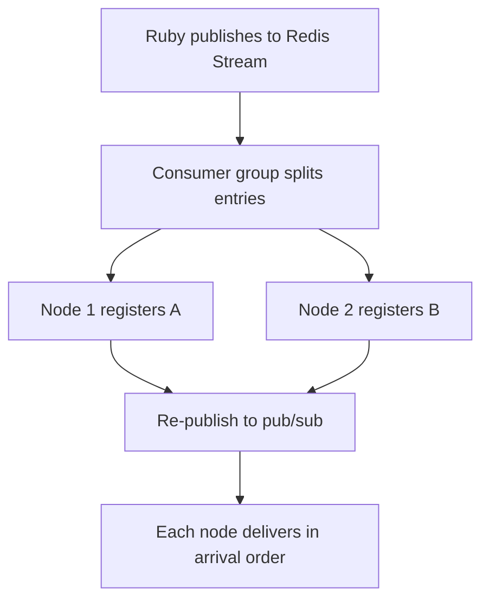

# 03 -- Cross-node broadcasts: NATS and Redis pub/sub bound ordering

A single node preserves per-stream order because one goroutine drives the whole
fan-out. Across nodes there is no such chain. The broadcast and pub/sub layers
introduce concurrent producers, and that is where the ordering guarantee
dissolves. This document traces both delivery regimes and says precisely what
the pub/sub engines do and do not promise.

## The two entry points into a node

The node exposes two handlers. `HandleBroadcast` is for single-node broadcasters
and passes the message through the broker so it gets an offset. `HandlePubSub`
is for fan-out broadcasters and skips the broker entirely:

```go
// Source: node/node.go, lines 212-240
func (n *Node) HandleBroadcast(raw []byte) error {
	msg, err := common.PubSubMessageFromJSON(raw)

	if err != nil {
		n.metrics.CounterIncrement(metricsUnknownBroadcast)
		n.log.Warn("failed to parse pubsub message", "data", logger.CompactValue(raw), "error", err)
		return nil
	}

	n.metrics.CounterIncrement(metricsPublications)

	switch v := msg.(type) {
	case common.StreamMessage:
		n.log.Debug("handle broadcast message", "payload", &v)
		return n.broker.HandleBroadcast(&v)
	case []*common.StreamMessage:
		n.log.Debug("handle batch-broadcast message", "payload", &v)
		for _, el := range v {
			if batchErr := n.broker.HandleBroadcast(el); batchErr != nil {
				return errorx.Decorate(batchErr, "failed to broadcast batch")
			}
		}
	case common.RemoteCommandMessage:
		n.log.Debug("handle remote command", "command", &v)
		return n.broker.HandleCommand(&v)
	}

	return nil
}
```

```go
// Source: node/node.go, lines 243-262
func (n *Node) HandlePubSub(raw []byte) {
	msg, err := common.PubSubMessageFromJSON(raw)

	if err != nil {
		n.metrics.CounterIncrement(metricsUnknownBroadcast)
		n.log.Warn("failed to parse pubsub message", "data", logger.CompactValue(raw), "error", err)
		return
	}

	switch v := msg.(type) {
	case common.StreamMessage:
		n.Broadcast(&v)
	case []*common.StreamMessage:
		for _, el := range v {
			n.Broadcast(el)
		}
	case common.RemoteCommandMessage:
		n.ExecuteRemoteCommand(&v)
	}
}
```

Both end in `n.Broadcast`, which is the hub entry:

```go
// Source: node/node.go, lines 863-867
func (n *Node) Broadcast(msg *common.StreamMessage) {
	n.metrics.CounterIncrement(metricsBroadcastMsg)
	n.log.Debug("incoming broadcast message", "payload", msg)
	n.hub.BroadcastMessage(msg)
}
```

The difference: `HandleBroadcast` goes through the broker, which stamps the
offset and then re-publishes; `HandlePubSub` goes straight to the hub.

## Legacy fan-out: no broker, no offset, at-most-once

The legacy Redis (an in-memory data store) broadcaster subscribes to a single Redis channel and calls
`HandlePubSub` on every message. Because every node is subscribed to the same
channel, every node receives every message independently:

```go
// Source: broadcast/legacy_redis.go, lines 152-155
		OnMessage: func(m rueidis.PubSubMessage) {
			s.log.Debug("received pubsub message")
			s.node.HandlePubSub([]byte(m.Message))
		},
```

The legacy NATS (an open-source messaging system) broadcaster does the same over NATS core publish/subscribe. A
message published while a node is disconnected is lost; Redis Pub/Sub and NATS
core are fire-and-forget. The docs say this explicitly:

```text
# Source: docs/broadcasting.md, line 78
Note that since all AnyCable server receive each publication, we cannot use [broker](./broker.md) to provide stream history support when using Redis Pub/Sub.
```

## The broker architecture: register once, re-publish

With the `http` or `redisx` broadcaster, only one node receives the publication.
That node registers it in the broker, which assigns an offset and re-publishes
over the pub/sub layer so the other nodes can deliver it. The Redis pub/sub
subscriber receives on the stream-named channel and calls `n.Broadcast`:

```go
// Source: pubsub/redis.go, lines 255-271
		OnMessage: func(m rueidis.PubSubMessage) {
			msg, err := common.PubSubMessageFromJSON([]byte(m.Message))

			if err != nil {
				s.log.Warn("failed to parse pubsub message", "data", logger.CompactValue(m.Message), "error", err)
				return
			}

			switch v := msg.(type) {
			case common.StreamMessage:
				s.log.With("channel", m.Channel).Debug("received broadcast message")
				s.node.Broadcast(&v)
			case common.RemoteCommandMessage:
				s.log.With("channel", m.Channel).Debug("received remote command")
				s.node.ExecuteRemoteCommand(&v)
			}
		},
```

The NATS subscriber is the same shape:

```go
// Source: pubsub/nats.go, lines 155-173
func (s *NATSSubscriber) handleMessage(m *nats.Msg) {
	msg, err := common.PubSubMessageFromJSON(m.Data)

	if err != nil {
		s.log.Warn("failed to parse pubsub message", "data", logger.CompactValue(m.Data), "error", err)
		return
	}

	switch v := msg.(type) {
	case common.StreamMessage:
		s.log.With("channel", m.Subject).Debug("received broadcast message")
		s.node.Broadcast(&v)
	case common.RemoteCommandMessage:
		s.log.With("channel", m.Subject).Debug("received remote command")
		s.node.ExecuteRemoteCommand(&v)
	default:
		s.log.With("channel", m.Subject).Warn("received unknown message", "data", logger.CompactValue(m.Data))
	}
}
```

## Redis Streams ingestion: the one real at-least-once hop

The `redisx` broadcaster consumes publications from a Redis Stream through a
consumer group. Each node joins the group with its own random consumer name, so
each stream entry is delivered to exactly one node. The read uses `XREADGROUP`
with the `>` identifier, which reads only entries never delivered to the group:

```go
// Source: redis/streamer.go, lines 245-266
func (s *Streamer) readFromStream(blockTime int64) ([]rueidis.XRangeEntry, error) {
	streamRes := s.client.Do(context.Background(),
		s.client.B().Xreadgroup().Group(s.group, s.consumerName).Block(blockTime).Streams().Key(s.stream).Id(">").Build(),
	)

	res, _ := streamRes.AsXRead()
	err := streamRes.Error()

	if err != nil && !rueidis.IsRedisNil(err) {
		return nil, err
	}

	if res == nil {
		return nil, nil
	}

	if messages, ok := res[s.stream]; ok {
		return messages, nil
	}

	return nil, nil
}
```

After the handler succeeds, the message is acknowledged and deleted. If the
handler fails, the message is left pending and later reclaimed:

```go
// Source: redis/streamer.go, lines 296-315
func (s *Streamer) handleRange(messages []rueidis.XRangeEntry) {
	for _, message := range messages {
		s.log.Debug("received message")

		if err := s.handler(message.FieldValues); err == nil {
			ackRes := s.client.DoMulti(context.Background(),
				s.client.B().Xack().Key(s.stream).Group(s.group).Id(message.ID).Build(),
				s.client.B().Xdel().Key(s.stream).Id(message.ID).Build(),
			)

			ackErr := ackRes[0].Error()

			if ackErr != nil {
				s.log.Error("failed to ack message", "error", ackErr)
			}
		} else {
			s.log.Error("Redis stream handler failed", "error", err)
		}
	}
}
```

Reclaim uses `XAUTOCLAIM` on entries that have been pending longer than the
block time. This is the mechanism that makes a crash recoverable:

```go
// Source: redis/streamer.go, lines 268-294
func (s *Streamer) autoclaimMessages(blockTime int64) ([]rueidis.XRangeEntry, error) {
	claimRes := s.client.Do(context.Background(),
		s.client.B().Xautoclaim().Key(s.stream).Group(s.group).Consumer(s.consumerName).MinIdleTime(fmt.Sprintf("%d", blockTime)).Start("0-0").Build(),
	)

	arr, err := claimRes.ToArray()

	if err != nil && !rueidis.IsRedisNil(err) {
		return nil, err
	}

	if arr == nil {
		return nil, nil
	}

	if len(arr) < 2 {
		return nil, fmt.Errorf("autoclaim failed: got %d elements, wanted 2", len(arr))
	}

	ranges, err := arr[1].AsXRange()

	if err != nil {
		return nil, err
	}

	return ranges, nil
}
```

This gives at-least-once from the Ruby application to a node: a message is
acknowledged only after the node handled it, and an unacknowledged message is
reclaimed by another consumer. The cost is duplicates: if a node handled a
message but crashed before the acknowledgement, another node will handle it
again.

## Why cross-node ordering breaks

The broker re-publish path has concurrent publishers. Two stream entries A then
B are assigned by the consumer group to two different nodes. Node 1 publishes A
to pub/sub; node 2 publishes B to pub/sub. There is no coordination between
them, so node 2 can publish B before node 1 publishes A. A third node then sees
B before A.



Redis Pub/Sub preserves the order in which `PUBLISH` commands reach Redis, but
the concurrent publishers destroy the original stream order before it reaches
Redis. NATS core publish/subscribe makes no total-order promise across
publishers at all. The offsets the broker assigned are monotonic and correct,
but no node ever sorts messages by offset before delivering them.



One more boundary worth stating precisely: the consumer group is created with
`Id("$")`, so a brand-new group starts at the current end of the stream:

```go
// Source: redis/streamer.go, lines 183-198
	// First, create a consumer group for the stream
	err = s.client.Do(context.Background(),
		s.client.B().XgroupCreate().Key(s.stream).Group(s.group).Id("$").Mkstream().Build(),
	).Error()

	if err != nil {
		if redisErr, ok := rueidis.IsRedisErr(err); ok {
			if strings.HasPrefix(redisErr.Error(), "BUSYGROUP") {
				s.log.Debug("Redis consumer group already exists")
			} else {
				s.log.Error("failed to create consumer group", "error", err)
				s.maybeReconnect()
				return
			}
		}
	}
```

That means the "deliver once a server is available" promise in the docs holds
only once the group already exists. On the very first boot against a stream that
already contains a backlog, a fresh group skips the pre-existing entries.

## The Aha Moment

**Aha:** The at-least-once hop and the ordering hop are different hops with
different guarantees. Redis Streams gives at-least-once from Ruby to a node via
consumer-group acknowledgements, but the re-publish over Redis or NATS pub/sub
is a fire-and-forget fan-out with concurrent producers, so the total order of a
stream is already lost before a third node ever sees the messages. Offsets are
assigned correctly at registration time and then ignored by delivery.

## Cross-References

- [00-the-delivery-question.md](./00-the-delivery-question.md) — the two regimes and their guarantees.
- [04-broker-history-replay.md](./04-broker-history-replay.md) — the offsets assigned in the register step.
- [06-where-the-guarantee-holds.md](./06-where-the-guarantee-holds.md) — the duplicates this reclaim produces.

Continue to [04-broker-history-replay.md](./04-broker-history-replay.md).
