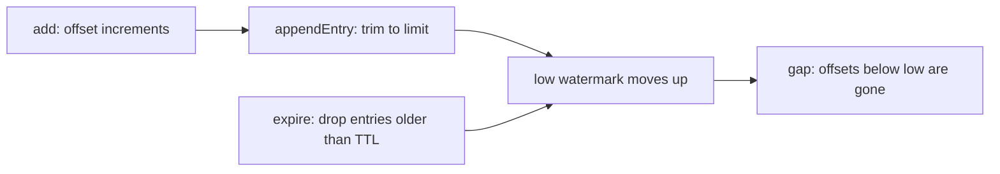
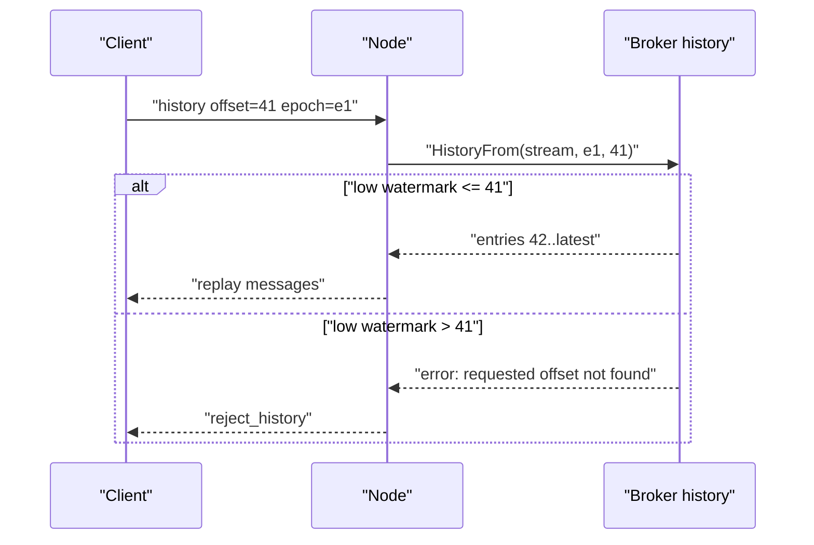

# 04 -- Broker history and replay: the offset is a cursor, not a sort

The broker keeps a bounded per-stream history and assigns each message a
monotonic offset. That offset is what makes at-least-once possible, but it is
important to be precise about how: the offset never reorders delivery. It is a
cursor a client uses to ask "what came after N". This document reads the history
code and shows exactly where a replay can succeed and where it fails with a gap.

## What the broker keeps

The memory broker stores one `memstream` per stream. The hot cache is not a
file and not a ring buffer: it is a growable Go slice of pointers to entries,
kept in heap memory. The stream holds a monotonic offset counter, a low
watermark, the stored entries, and the retention settings:

```go
// Source: broker/memory.go, lines 16-32
type entry struct {
	timestamp int64
	offset    uint64
	data      string
}

type memstream struct {
	offset   uint64
	deadline int64
	// The lowest available offset in the stream
	low   uint64
	data  []*entry
	ttl   int64
	limit int

	mu sync.RWMutex
}
```

The retention settings come from the broker config. The defaults are 100
messages or 300 seconds per stream:

```go
// Source: broker/config.go, lines 21-32
func NewConfig() Config {
	return Config{
		// 5 minutes by default
		HistoryTTL: 5 * 60,
		// 100 msgs by default
		HistoryLimit: 100,
		// 5 minutes by default
		SessionsTTL: 5 * 60,
		// 15 seconds by default
		PresenceTTL: 15,
	}
}
```

Every registered message bumps the offset by one. The offset is strictly
increasing for a stream. The counter field starts at zero and is incremented
before use, so the first assigned offset is 1; offset 0 is the "stream is
empty" sentinel:

```go
// Source: broker/memory.go, lines 34-51
func (ms *memstream) add(data string) uint64 {
	ms.mu.Lock()
	defer ms.mu.Unlock()

	ts := time.Now().Unix()

	ms.offset++

	entry := &entry{
		offset:    ms.offset,
		timestamp: ts,
		data:      data,
	}

	ms.appendEntry(entry)

	return ms.offset
}
```

## How the broker runs: a struct plus one goroutine, no file

The broker is not a file and not a goroutine: it is a plain Go struct held by
the server process, and the hot cache lives in heap memory. The `Memory` broker
holds the per-stream map, the session cache, and the presence state, each behind
its own lock:

```go
// Source: broker/memory.go, lines 236-251
type Memory struct {
	broadcaster    Broadcaster
	presenter      Presenter
	config         *Config
	tracker        *StreamsTracker
	epoch          string
	streams        map[string]*memstream
	sessions       map[string]*sessionEntry
	expireSessions *utils.PriorityQueue[string, int64]

	presence *presenceState

	streamsMu  sync.RWMutex
	sessionsMu sync.RWMutex
	epochMu    sync.RWMutex
}
```

`Start` does one thing: it launches a single background goroutine, the expire
loop. `Shutdown` is a no-op for the memory broker because all of its state is
in process:

```go
// Source: broker/memory.go, lines 296-304
func (b *Memory) Start(done chan (error)) error {
	go b.expireLoop()

	return nil
}

func (b *Memory) Shutdown(ctx context.Context) error {
	return nil
}
```

The expire loop wakes once per second and calls `expire`. That sweeps every
stream, drops entries past the retention window, deletes any stream whose
deadline has passed, and then expires the session cache and the presence state.
The stream deadline is refreshed on every append to ten times the retention
window, so an idle stream lives ten times longer than its history does; that
keeps the offset counter valid across gaps in traffic without renumbering:

```go
// Source: broker/memory.go, lines 680-713
func (b *Memory) expireLoop() {
	for {
		time.Sleep(time.Second)
		b.expire()
	}
}

func (b *Memory) expire() {
	b.streamsMu.Lock()

	toDelete := []string{}

	now := time.Now().Unix()

	for name, stream := range b.streams {
		stream.expire()

		if stream.deadline < now {
			toDelete = append(toDelete, name)
		}
	}

	for _, name := range toDelete {
		delete(b.streams, name)
	}

	b.streamsMu.Unlock()

	// sessions expiration
	b.expireSessionsCache()

	// presence expiration
	b.expirePresence()
}
```

So the answer to "is it a goroutine or a file" is: neither. The broker is an
object in the server process; its only background goroutine is this
once-a-second expiry sweeper. Nothing is written to disk.

## The two limits: count and age

Appending is where the count limit is applied. When the stored entries exceed
the limit, the oldest entry is dropped and the low watermark moves up to the new
oldest entry:

```go
// Source: broker/memory.go, lines 92-107
func (ms *memstream) appendEntry(entry *entry) {
	ms.data = append(ms.data, entry)

	if len(ms.data) > ms.limit {
		ms.data = ms.data[1:]
		ms.low = ms.data[0].offset
	}

	if ms.low == 0 {
		ms.low = ms.data[0].offset
	}

	// Update memstream expiration deadline on every added item
	// We keep memstream alive for 10 times longer than ttl (so we can re-use it and its offset)
	ms.deadline = time.Now().Add(time.Duration(ms.ttl*10) * time.Second).Unix()
}
```

The age limit is applied lazily by `expire`, which drops every entry older than
the time-to-live (TTL) and moves the low watermark to the first surviving
entry:

```go
// Source: broker/memory.go, lines 109-138
func (ms *memstream) expire() {
	ms.mu.Lock()
	defer ms.mu.Unlock()

	cutIndex := 0

	now := time.Now().Unix()
	deadline := now - ms.ttl

	for _, entry := range ms.data {
		if entry.timestamp < deadline {
			cutIndex++
			continue
		}

		break
	}

	if cutIndex < 0 {
		return
	}

	ms.data = ms.data[cutIndex:]

	if len(ms.data) > 0 {
		ms.low = ms.data[0].offset
	} else {
		ms.low = 0
	}
}
```

Both limits move the low watermark. That is the single most important detail for
at-least-once: the broker forgets from the front, so a client that asks for an
offset below the low watermark cannot be replayed.



## Assigning offsets at broadcast time

The broker's broadcast handler is where a message becomes history. If the
message is transient, it is re-published without being stored and carries no
offset:

```go
// Source: broker/memory.go, lines 306-320
func (b *Memory) HandleBroadcast(msg *common.StreamMessage) (err error) {
	if msg.Meta != nil && msg.Meta.Transient {
		b.broadcaster.Broadcast(msg)
		return
	}

	offset := b.add(msg.Stream, msg.Data)

	msg.Epoch = b.GetEpoch()
	msg.Offset = offset

	b.broadcaster.Broadcast(msg)

	return
}
```

So whisper (a private message routed to a single connection) and presence (a
join or leave event for a stream) bypass history. They are delivered to
currently connected sessions only, and a reconnecting client cannot recover
them.

## The replay query

`HistoryFrom` is the replay operation. It checks the epoch, finds the stream,
and filters everything after the requested offset:

```go
// Source: broker/memory.go, lines 349-378
func (b *Memory) HistoryFrom(name string, epoch string, offset uint64) ([]common.StreamMessage, error) {
	bepoch := b.GetEpoch()

	if bepoch != epoch {
		return nil, fmt.Errorf("unknown epoch: %s, current: %s", epoch, bepoch)
	}

	stream := b.get(name)

	if stream == nil {
		return nil, errors.New("stream not found")
	}

	history := []common.StreamMessage{}

	err := stream.filterByOffset(offset, func(entry *entry) {
		history = append(history, common.StreamMessage{
			Stream: name,
			Data:   entry.data,
			Offset: entry.offset,
			Epoch:  bepoch,
		})
	})

	if err != nil {
		return nil, err
	}

	return history, nil
}
```

The filter itself is the gap check. If the requested offset is below the low
watermark, the request is refused with an error. That is the exact point where
at-least-once stops being possible:

```go
// Source: broker/memory.go, lines 140-163
func (ms *memstream) filterByOffset(offset uint64, callback func(e *entry)) error {
	ms.mu.RLock()
	defer ms.mu.RUnlock()

	if ms.low > offset {
		return fmt.Errorf("requested offset couldn't be found: %d, lowest: %d", offset, ms.low)
	}

	if ms.low == 0 {
		return fmt.Errorf("stream is empty")
	}

	start := (offset - ms.low) + 1

	if start > uint64(len(ms.data)) {
		return fmt.Errorf("requested offset couldn't be found: %d, latest: %d", offset, ms.data[len(ms.data)-1].offset)
	}

	for _, v := range ms.data[start:] {
		callback(v)
	}

	return nil
}
```



## The three broker backends: legacy, memory, and NATS

The `Broker` interface has three implementations, chosen by the
`broker.adapter` setting. The runner builds the broker with a plain switch:

```go
// Source: cli/runner_options.go, lines 162-183
func WithDefaultBroker() Option {
	return WithBroker(func(br broker.Broadcaster, pr broker.Presenter, c *config.Config, l *slog.Logger) (broker.Broker, error) {
		if c.Broker.Adapter == "" || c.Broker.Adapter == "none" {
			return broker.NewLegacyBroker(br), nil
		}

		switch c.Broker.Adapter {
		case "memory":
			b := broker.NewMemoryBroker(br, pr, &c.Broker)
			return b, nil
		case "nats":
			// TODO: Figure out a better place for this hack.
			// We don't want to enable JetStream by default (if NATS is used only for pub/sub),
			// currently, we only need it when NATS is used as a broker.
			c.EmbeddedNats.JetStream = true
			b := broker.NewNATSBroker(br, &c.Broker, &c.NATS, l)
			return b, nil
		default:
			return nil, errorx.IllegalArgument.New("Unsupported broker adapter: %s", c.Broker.Adapter)
		}
	})
}
```

So there are three backends, and only three:

- `none` (or an empty string) is `LegacyBroker`, the no-operation broker. It
  forwards through the broadcaster but keeps no history, no session cache, and
  no presence: `HistoryFrom` and `Peak` return a "not supported" error, the
  presence methods return "not supported", and the session methods are silent
  no-ops that return nil. This is the version-1 behaviour, where messages carry
  no offset.
- `memory` is the `Memory` broker described above: an in-process, in-heap hot
  cache, one per node.
- `nats` is the `NATS` broker, described next. NATS is an open-source messaging
  system, and JetStream is its built-in persistence layer; this backend stores
  history in JetStream and keeps a local `Memory` mirror.

There is deliberately no Redis (an in-memory data store) broker backend. Redis
appears in AnyCable-Go as the publish/subscribe (pub/sub) layer and as the
`redisx` stream broadcaster, never as the broker's hot cache. The factory
rejects any other adapter with an "unsupported broker adapter" error.

## The NATS broker: JetStream as the store, a local mirror for replay

The NATS broker keeps no local per-stream history of its own for `Peak`; it
returns nothing:

```go
// Source: broker/nats.go, lines 487-489
func (n *NATS) Peak(stream string) (*common.StreamMessage, error) {
	return nil, nil
}
```

Publishing goes to a JetStream stream, and JetStream's sequence number becomes
the offset:

```go
// Source: broker/nats.go, lines 511-530
func (n *NATS) add(stream string, data string) (uint64, error) {
	err := n.ensureStreamExists(stream)

	if err != nil {
		return 0, errorx.Decorate(err, "failed to create JetStream Stream")
	}

	ctx := context.Background()
	key := streamPrefix + stream

	// Touch on publish to make sure that the subsequent history fetch will return the latest messages
	n.streamSync.touch(stream)
	ack, err := n.js.Publish(ctx, key, []byte(data))

	if err != nil {
		return 0, errorx.Decorate(err, "failed to publish message to JetStream")
	}

	return ack.Sequence, nil
}
```

Replay in the NATS broker is indirect: the node keeps a local `Memory` broker,
and a JetStream consumer copies messages into it. `HistoryFrom` first forces the
local mirror to sync, then delegates to the memory broker:

```go
// Source: broker/nats.go, lines 367-375
func (n *NATS) HistoryFrom(stream string, epoch string, offset uint64) ([]common.StreamMessage, error) {
	err := n.Ready(jetstreamReadyTimeout)
	if err != nil {
		return nil, err
	}

	n.streamSync.sync(stream)
	return n.local.HistoryFrom(stream, epoch, offset)
}
```

The consumer copies each JetStream message into the local memory broker,
preserving the JetStream sequence as the offset:

```go
// Source: broker/nats.go, lines 599-616
func (n *NATS) consumeMessage(stream string, msg jetstream.Msg) {
	n.streamSync.touch(stream)

	meta, err := msg.Metadata()
	if err != nil {
		n.log.Error("failed to get JetStream message metadata", "error", err)
		return
	}

	seq := meta.Sequence.Stream
	ts := meta.Timestamp

	_, err = n.local.Store(stream, msg.Data(), seq, ts)
	if err != nil {
		n.log.Error("failed to store message in local broker", "error", err)
		return
	}
}
```

So the NATS broker reuses the same `memstream` replay machinery; the JetStream
stream is the durable store, and the local mirror is a synced cache.

## The Aha Moment

**Aha:** At-least-once in AnyCable-Go is a bounded replay promise, not an
unbounded one. The offset is strictly increasing and the replay query is exact,
but the history is capped by both count and age, so the broker continuously
forgets from the front. A client that falls behind by more than the retention
window gets a refusal, not a silent gap: `filterByOffset` returns "requested
offset couldn't be found". The offset labels the gap; it does not close it.

## Cross-References

- [03-cross-node-broadcasts.md](./03-cross-node-broadcasts.md) — how the offset is assigned at registration time.
- [05-session-resume-offsets.md](./05-session-resume-offsets.md) — the client protocol that calls `HistoryFrom`.
- [06-where-the-guarantee-holds.md](./06-where-the-guarantee-holds.md) — the history-expiry gap as a documented break.

Continue to [05-session-resume-offsets.md](./05-session-resume-offsets.md).
