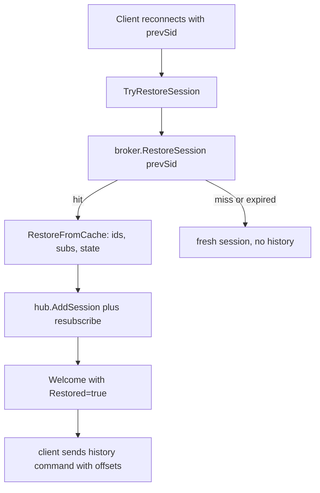
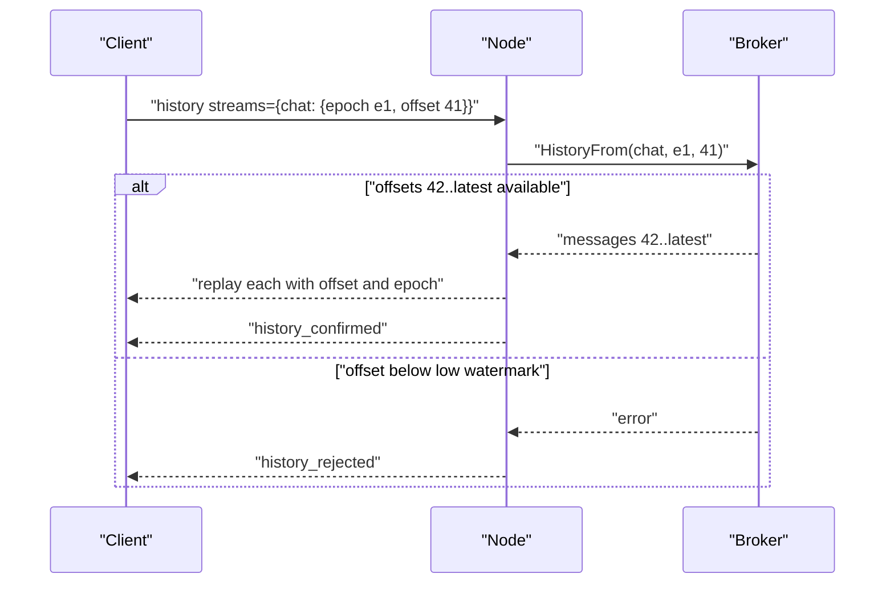

# 05 -- Session resume and offsets: the client drives its own catch-up

Session resume restores the connection's subscriptions. It does not restore a
delivery position. The server stores no per-client offset. Instead, the client
tells the server its previous session identifier, gets its subscriptions back,
and then sends a `history` command that names the offsets it last saw. This
document reads the resume and history code to make that division exact.

## How a reconnecting client names its old session

The previous session identifier arrives either as a header or as a query
parameter:

```go
// Source: cli/session_options.go, lines 17-18
	prevSessionHeader = "X-ANYCABLE-RESTORE-SID"
	prevSessionParam  = "sid"
```

```go
// Source: cli/session_options.go, lines 62-66
	if hval := info.AnyCableHeader(prevSessionHeader); hval != "" {
		opts = append(opts, node.WithPrevSID(hval))
	} else if pval := info.Param(prevSessionParam); pval != "" {
		opts = append(opts, node.WithPrevSID(pval))
	}
```

The header takes precedence over the query parameter. This is the only signal
the server receives about a prior session at connection time.

## Restore restores membership, not position

`TryRestoreSession` fetches the cached session state, applies it, re-adds the
session to the hub, and resubscribes every stored stream:

```go
// Source: node/node.go, lines 417-477
func (n *Node) TryRestoreSession(s *Session) (restored bool) {
	sid := s.GetID()
	prev_sid := s.PrevSid()

	if prev_sid == "" {
		return false
	}

	cached_session, err := n.broker.RestoreSession(prev_sid)

	if err != nil {
		s.Log.Error("failed to fetch session cache", "old_sid", prev_sid, "error", err)
		return false
	}

	if cached_session == nil {
		s.Log.Debug("session not found in cache", "old_sid", prev_sid)
		return false
	}

	if s.IsClosed() {
		s.Log.Debug("skip restore result: closed")
		return false
	}

	err = s.RestoreFromCache(cached_session)

	if err != nil {
		s.Log.Error("failed to restore session from cache", "old_sid", prev_sid, "error", err)
		return false
	}

	s.Log.Debug("session restored", "old_sid", prev_sid)

	s.Connected = true
	n.hub.AddSession(s)

	// Resubscribe to streams
	for identifier, channel_streams := range s.subscriptions.ToMap() {
		for _, stream := range channel_streams {
			streamId := n.broker.Subscribe(stream)
			n.hub.SubscribeSession(s, streamId, identifier)
		}
	}

	// Send welcome message
	s.Send(&common.Reply{
		Type:        common.WelcomeType,
		Sid:         sid,
		Restored:    true,
		RestoredIDs: utils.Keys(s.subscriptions.channels),
	})

	if s.IsResumeable() {
		if berr := n.broker.CommitSession(s.GetID(), s); berr != nil {
			s.Log.Error("failed to persist session in cache", "error", berr)
		}
	}

	return true
}
```

The cache entry itself carries the identifiers, the subscriptions, the
connection state, and the per-channel state:

```go
// Source: node/session.go, lines 621-651
func (s *Session) RestoreFromCache(cached []byte) error {
	var entry cacheEntry

	err := json.Unmarshal(cached, &entry)

	if err != nil {
		return err
	}

	s.smu.Lock()
	defer s.smu.Unlock()

	s.MarkDisconnectable(entry.Disconnectable)
	s.SetIdentifiers(entry.Identifiers)
	s.env.MergeConnectionState(&entry.ConnectionState)

	for k := range entry.ChannelsState {
		v := entry.ChannelsState[k]
		s.env.MergeChannelState(k, &v)
	}

	for k, v := range entry.Subscriptions {
		s.subscriptions.AddChannel(k)

		for _, stream := range v {
			s.subscriptions.AddChannelStream(k, stream)
		}
	}

	return nil
}
```

No offset appears anywhere in the cache entry. The resume path re-establishes
which streams the session listens to, and that is all.



## The history command is the position report

The client reports its last-known positions in a `history` field. Each position
is an epoch plus an offset, or a timestamp for time-based catch-up:

```go
// Source: common/common.go, lines 299-319
type HistoryPosition struct {
	Epoch  string `json:"epoch"`
	Offset uint64 `json:"offset"`
}

func (hp *HistoryPosition) LogValue() slog.Value {
	if hp == nil {
		return slog.StringValue("nil")
	}

	return slog.GroupValue(slog.String("epoch", hp.Epoch), slog.Uint64("offset", hp.Offset))
}

// HistoryRequest represents a client's streams state (offsets) or a timestamp since
// which we should return the messages for the current streams
type HistoryRequest struct {
	// Since is UTC timestamp in ms
	Since int64 `json:"since,omitempty"`
	// Streams contains the information of last offsets/epoch received for a particular stream
	Streams map[string]HistoryPosition `json:"streams,omitempty"`
}
```

The node handler validates the subscription, retrieves the backlog, and either
replays it or rejects the request:

```go
// Source: node/node.go, lines 659-701
// History fetches the stream history for the specified identifier
func (n *Node) History(s *Session, msg *common.Message) error {
	s.smu.Lock()
	if ok := s.subscriptions.HasChannel(msg.Identifier); !ok {
		s.smu.Unlock()
		return fmt.Errorf("unknown subscription %s", common.FilteredIdentifier(msg.Identifier))
	}
	subscriptionStreams := s.subscriptions.StreamsFor(msg.Identifier)
	s.smu.Unlock()

	history := msg.History

	if history.Since == 0 && history.Streams == nil {
		return fmt.Errorf("history request is missing, got %v", msg)
	}

	backlog, err := n.retreiveHistory(&history, subscriptionStreams)

	if s.IsClosed() {
		s.Log.Debug("skip history result: closed")
		return nil
	}

	if err != nil {
		s.Send(&common.Reply{
			Type:       common.HistoryRejectedType,
			Identifier: msg.Identifier,
		})

		return err
	}

	for _, el := range backlog {
		s.Send(el.ToReplyFor(msg.Identifier))
	}

	s.Send(&common.Reply{
		Type:       common.HistoryConfirmedType,
		Identifier: msg.Identifier,
	})

	return nil
}
```

The retrieval loop prefers per-stream positions and falls back to the timestamp
for streams without a position:

```go
// Source: node/node.go, lines 703-735
func (n *Node) retreiveHistory(history *common.HistoryRequest, streams []string) (backlog []common.StreamMessage, err error) {
	backlog = []common.StreamMessage{}

	for _, stream := range streams {
		if history.Streams != nil {
			pos, ok := history.Streams[stream]

			if ok {
				streamBacklog, err := n.broker.HistoryFrom(stream, pos.Epoch, pos.Offset)

				if err != nil {
					return nil, err
				}

				backlog = append(backlog, streamBacklog...)

				continue
			}
		}

		if history.Since > 0 {
			streamBacklog, err := n.broker.HistorySince(stream, history.Since)

			if err != nil {
				return nil, err
			}

			backlog = append(backlog, streamBacklog...)
		}
	}

	return backlog, nil
}
```

Each replayed message goes back to the client with its offset and epoch echoed,
so the client can advance its position:

```go
// Source: common/common.go, lines 398-429
func (sm *StreamMessage) ToReplyFor(identifier string) *Reply {
	data := sm.Data

	var msg interface{}

	// We ignore JSON deserialization failures and consider the message to be a string
	if json.Valid([]byte(data)) {
		dec := json.NewDecoder(strings.NewReader(data))
		// Preserve large integers (> 2^53) precision
		dec.UseNumber()
		dec.Decode(&msg) // nolint:errcheck
	}

	if msg == nil {
		msg = sm.Data
	}

	stream := ""

	// Only include stream if offset/epoch is present
	if sm.Epoch != "" {
		stream = sm.Stream
	}

	return &Reply{
		Identifier: identifier,
		Message:    msg,
		StreamID:   stream,
		Offset:     sm.Offset,
		Epoch:      sm.Epoch,
	}
}
```



## The Aha Moment

**Aha:** The server's resume machinery restores only the topology: which
identifiers and which streams a session had. The delivery position lives on the
client. The client names its own last offset in the next `history` command, and
the broker answers "everything after that". That is why at-least-once here is a
request/reply catch-up, not a server-side guarantee: the server neither
remembers your position nor checks it against its own record until you ask.

## Cross-References

- [04-broker-history-replay.md](./04-broker-history-replay.md) — what `HistoryFrom` does with the epoch and offset.
- [02-hub-fanout-send-queue.md](./02-hub-fanout-send-queue.md) — why resubscription re-enters the same per-stream ordering chain.
- [06-where-the-guarantee-holds.md](./06-where-the-guarantee-holds.md) — the gaps and duplicates the client must tolerate.

Continue to [06-where-the-guarantee-holds.md](./06-where-the-guarantee-holds.md).
