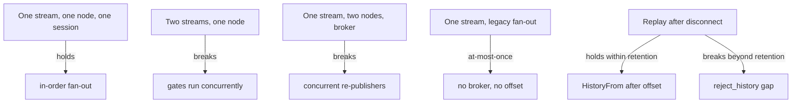
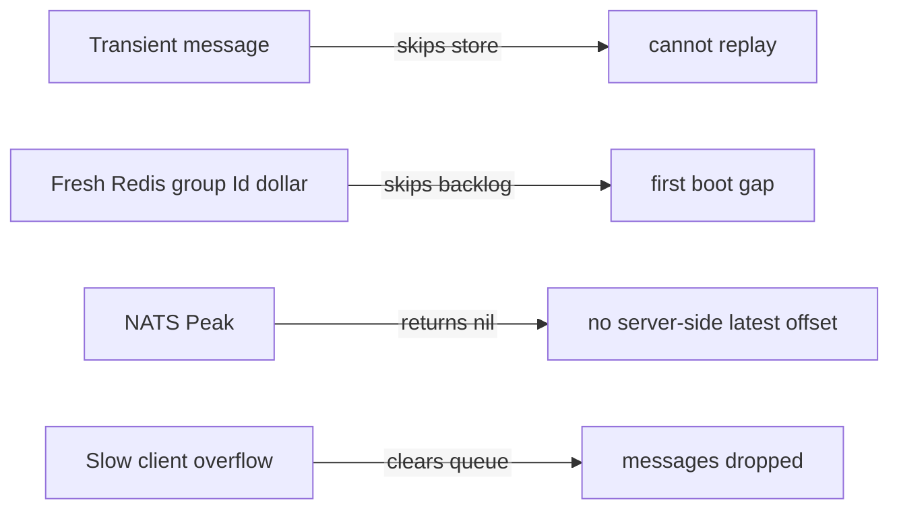

# 06 -- Where the guarantee holds and where it does not: the break cases

The previous documents built the pieces. This one assembles them into the full
map: which configurations give which guarantees, and where the code itself
refuses or silently narrows the promise. There is no single "the guarantee".
There is a matrix of cases.

## The guarantee matrix



Three properties are involved, and none of them implies the others:

- In-order fan-out holds per stream on one node.
- At-least-once from the Ruby application to a node holds only for the Redis
  (an in-memory data store) Streams broadcaster, and only once its consumer
  group exists.
- Replay holds only within the history retention window.

## Case 1: holds, per stream on one node

Document 02 showed the chain: `Hub.Run` (one goroutine), the stream's gate
`broadcastLoop` (one goroutine), and the session `SendMessages` (one writer over
a first in, first out (FIFO) queue). For one stream on one node, a session receives messages in the
order the hub received them. No code sorts or compares; the single-goroutine
topology is the entire guarantee.

## Case 2: breaks across streams

Two streams hash to two different gates (16 gates by default). The two gates
are independent goroutines, so a session subscribed to both can observe their
messages interleaved in any order. The session write queue is FIFO but its
producers are concurrent. There is no total order across streams.

## Case 3: breaks across nodes

With the broker architecture, one node registers a message and re-publishes it;
other nodes deliver whatever order the re-published messages arrive in. Two
nodes publishing two stream entries concurrently can invert them, because Redis
Pub/Sub and NATS (an open-source messaging system) core make no cross-publisher total order, and no node sorts by
the assigned offset before delivery. The offset remains correct and unused for
ordering.

## Case 4: legacy fan-out is at-most-once

The legacy Redis and NATS broadcasters call `HandlePubSub`, which goes straight
to the hub and skips the broker:

```go
// Source: node/node.go, lines 243-262
func (n *Node) HandlePubSub(raw []byte) {
	msg, err := common.PubSubMessageFromJSON(raw)

	if err != nil {
		n.metrics.CounterIncrement(metricsUnknownBroadcast)
		n.log.Warn("failed to parse pubsub message", "data", logger.CompactValue(raw), "error", err)
		return
	}

	switch v := msg.(type) {
	case common.StreamMessage:
		n.Broadcast(&v)
	case []*common.StreamMessage:
		for _, el := range v {
			n.Broadcast(el)
		}
	case common.RemoteCommandMessage:
		n.ExecuteRemoteCommand(&v)
	}
}
```

No broker means no offset, no epoch, no stored history. A disconnected session
misses every message published during the gap, permanently.

## Case 5: replay fails past retention

The replay cursor is the offset, but the history is bounded by count and age.
When the client asks for an offset below the low watermark, the broker refuses
rather than returning a partial range:

```go
// Source: broker/memory.go, lines 140-163
func (ms *memstream) filterByOffset(offset uint64, callback func(e *entry)) error {
	ms.mu.RLock()
	defer ms.mu.RUnlock()

	if ms.low > offset {
		return fmt.Errorf("requested offset couldn't be found: %d, lowest: %d", offset, ms.low)
	}

	if ms.low == 0 {
		return fmt.Errorf("stream is empty")
	}

	start := (offset - ms.low) + 1

	if start > uint64(len(ms.data)) {
		return fmt.Errorf("requested offset couldn't be found: %d, latest: %d", offset, ms.data[len(ms.data)-1].offset)
	}

	for _, v := range ms.data[start:] {
		callback(v)
	}

	return nil
}
```

That error becomes a `reject_history` reply to the client. At-least-once is a
bounded promise: within the retention window, replay is exact; outside it, the
server says "I cannot", which is the honest behavior and also the gap.

## Case 6: duplicates from the Redis Streams reclaim

The `redisx` broadcaster acknowledges a stream entry only after its handler
returns successfully:

```go
// Source: redis/streamer.go, lines 296-315
func (s *Streamer) handleRange(messages []rueidis.XRangeEntry) {
	for _, message := range messages {
		s.log.Debug("received message")

		if err := s.handler(message.FieldValues); err == nil {
			ackRes := s.client.DoMulti(context.Background(),
				s.client.B().Xack().Key(s.stream).Group(s.group).Id(message.ID).Build(),
				s.client.B().Xdel().Key(s.stream).Id(message.ID).Build(),
			)

			ackErr := ackRes[0].Error()

			if ackErr != nil {
				s.log.Error("failed to ack message", "error", ackErr)
			}
		} else {
			s.log.Error("Redis stream handler failed", "error", err)
		}
	}
}
```

If the handler succeeds but the process crashes before the acknowledgement, the
entry stays pending and `XAUTOCLAIM` hands it to another consumer. That node
handles the message a second time. This is the classic at-least-once
duplicate window: the acknowledgement is not atomic with the side effect, so
exactly-once is impossible here.

## The remaining holes

The code contains several narrower boundaries that each remove part of the
promise:

- Transient messages — whisper (a private message routed to a single connection)
  and presence (join and leave events for a stream) — skip the broker history
  entirely, so they cannot be replayed after a disconnect.
- A fresh Redis Streams consumer group is created with `Id("$")`, so a brand-new
  group skips a pre-existing backlog on first boot.
- The NATS broker's `Peak` returns nothing, so a client cannot learn the latest
  offset from the NATS broker; it must drive replay from its own last-seen
  offset.
- A slow client whose write queue exceeds the pending-size bound is
  disconnected and its queue cleared. That is a deliberate drop, not an
  ordering mechanism.



## The Aha Moment

**Aha:** The delivery guarantee is not one property but three, and they are
decoupled. In-order fan-out is a property of the in-process queue topology.
At-least-once from Ruby to a node is a property of the Redis Streams consumer
group with reclaim, and it costs duplicates. Replay after a disconnect is a
property of the broker's bounded history, and it costs gaps past retention. Each
mechanism protects against a different failure, and no mechanism protects
against all of them, so any claim of a single "ordered, at-least-once" guarantee
must be read as a shorthand for this matrix.

## Cross-References

- [00-the-delivery-question.md](./00-the-delivery-question.md) — the honest boundary stated up front.
- [02-hub-fanout-send-queue.md](./02-hub-fanout-send-queue.md) — the one case that holds, and the slow-client drop.
- [03-cross-node-broadcasts.md](./03-cross-node-broadcasts.md) — the duplicate window and the legacy at-most-once path.
- [04-broker-history-replay.md](./04-broker-history-replay.md) — the retention-bound gap.
- [05-session-resume-offsets.md](./05-session-resume-offsets.md) — why the client, not the server, owns the position.

Continue to [README.md](README.md).
